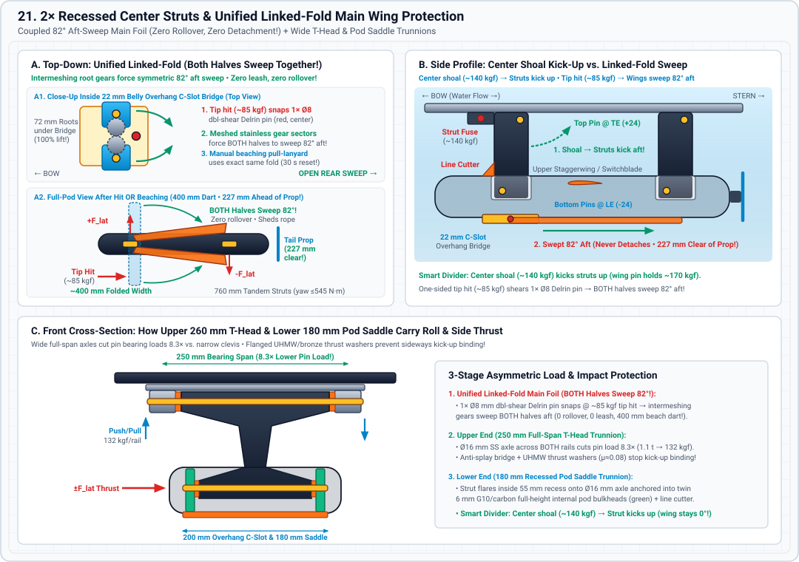
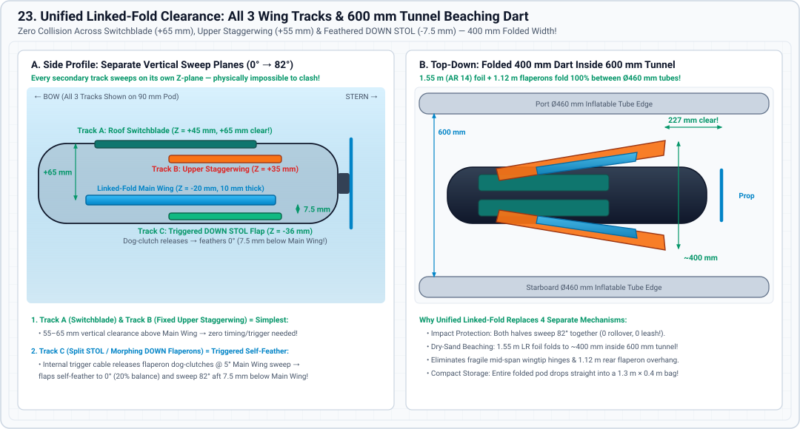

# FoilSkiff — Symmetric Central Breakaway Wing Socket, Alternative Mechanisms & Deployed-Flaperon Clearance

When flying a long-span carbon hydrofoil (`1.12–1.55 m`, `AR 11–14`) at `12–22 kn`, clipping a submerged crab-pot warp, log, or rock on **one side** (`y = +0.65 m`) generates massive yaw torque (`M_z ≈ 1,625 N·m` on a rigid wing).

This document details **how to make the Main Wing safely break away symmetrically (both halves releasing together)**, compares **all 5 central-socket design options**, specifies exact **Delrin double-shear pin rules**, and explicitly solves **clearance when the split STOL flaperons are deployed DOWN during takeoff**.

---

## 1. Why Both Halves MUST Release Together (Never a Single-Tip Breakaway!)

* **Why breaking only ONE wingtip fails in flight:** If only the starboard tip folds `90°` aft at `15.5 kn`, starboard lift drops `~50%` while port keeps lifting `~1,000+ N`, generating a sudden **`~500 N·m` asymmetric roll snap** that broaches the dinghy violently onto one tube — while also placing a heavy mechanical hinge right inside the highest-bending zone of a thin `10%`-thick carbon wing.
* **Why symmetric dual-half central release wins:** When both halves come out of the central pod socket **at the exact same instant**, port and starboard lift drop to zero symmetrically. The `True Kit Navigator 300` simply **settles flat and level straight down onto its twin `Ø460 mm` catamaran tubes** in `~0.3 s` — and your main wing spar stays structurally continuous (`1-piece` continuous carbon OR `2 × 75 cm` halves bolted rigidly into one shared `220 mm` central Carrier Block for `1.0 m` trunk packing).

---

## 2. Detailed Anatomy of Option 1: The `120°` Open-Aft V-Cradle Breakaway Socket

A tight rectangular drawer pocket will **rack sideways and jam** if struck at only one corner (`y = +0.65 m`). The **`120°` Open-Aft V-Cradle** eliminates parallel side walls entirely and stacks into a slim **`~22 mm`** recessed belly housing made of four components:

### The 4 Physical Components (`~22 mm` Total Belly Stack)

1. **Pod Belly Top Plate (`210 × 120 × 6 mm`, `6061-T6` Alu or Carbon):**
   * Bolted straight into the pod's **twin `6 mm` `G10`/carbon full-height internal structural bulkheads**.
   * Carries the **`14 mm`-tall `120°` V-shaped forward stop wall**, two flush **`316` stainless shear bushing sleeves** at `y = ±95 mm`, and a recessed **`$2` waterproof magnetic Hall / reed sensor**.
2. **Wing V-Foot Carrier Block (`200 × 95 × 14 mm`):**
   * Either laminated directly onto a **1-piece continuous carbon wing** OR machined with left/right internal sockets where **two `75 cm` wing halves** bolt rigidly together (`M8` through-bolts / carbon joiner spar).
   * Its front nose is cut to the matching **`120°` V-wedge** with a gentle **`2°` vertical wedge taper** so pushing it forward seats it dead-solid with **zero cruise rattle**.
   * Its two rear outer corners (`y = ±95 mm`) house matching flush `316` stainless shear sleeves aligned to `<0.3 mm` clearance against the top and bottom plates.
3. **Bottom Clamping Lip / Belly Skid Plate (`210 × 120 × 5 mm`, Faired `6061-T6` Alu):**
   * Bolts solidly to the front `120°` V-stop wall underneath the wing foot, forming a rigid **open-rear U-channel**.
   * Both inner horizontal faces are lined with **`1.5 mm` low-friction UHMW / PTFE wear strips (`μ ≈ 0.06–0.08`)** — so upward flight lift (`200–400 kgf`), roll (`550 N·m`), and pitch (`40–60 N·m`) react **`100%` in compression across the wide `200 mm` clamping flanges** without loading the shear pins!
   * Its rear exit lip slopes downward (`12°` for cruise-only / fixed-upper-staggerwing builds, or **`25°` steep drop-exit** when paired with deployed low STOL flaperons).
4. **`2×` Vertical `Ø6 mm` Delrin Double-Shear Pins + `0.35 m` Forward Belly Leash:**
   * **Smart Load Divider (`190 mm` Pin Spacing at `y = ±95 mm`):**
     * **Center Shoal / Sandbar Hit (`y ≈ 0`):** Both pins resist together (`~560 kgf` combined) — stronger than the **`~140 kgf` upper strut kick-up fuse** → **the 4-bar struts kick up smoothly (`0° → 86.5°`) with the Main Wing still locked in place!**
     * **One-Sided Crab-Pot / Rock Strike (`y = +0.65 m`):** Pivoting around the opposite Port V-shoulder (`y = -95 mm`) gives a **`3.9×` mechanical lever advantage** (`745 / 190 mm`), cleanly shearing the Starboard `Ø6 mm` double-shear pin at **`~70 kgf` (`~700 N`)** → immediately cam-popping the Port pin `<0.005 s` later → **both halves slide aft together** out of the open-rear V-cradle (capping pod yaw torque **`≤455 N·m`**).
   * **Never Lose the Wing & Never Hit the Prop:** A `2 mm` aft shift trips the `$2` Hall sensor → `ESP32` commands `VESC` **`0-RPM` active brake (`<0.05 s`)**, while a **`0.35 m` braided Dyneema leash** anchored to the pod belly *ahead* of the V-cradle catches the wing **`~0.50 m` clear ahead of the tail propeller**.
   * **On-Water Reset (`<60 s`):** Pull the wing back forward by its leash, slide the `120°` V-nose snugly into the stop, poke out the sheared Delrin stubs with two fresh `~$0.35` spare pins, clip their retention O-rings, and resume foiling.

---

## 3. Why Black UV-Stabilized Delrin & Pure Double-Shear Bushing Rules

Never substitute **Nylon**, **HDPE/UHMW**, **oversized `316` stainless**, or **loose unbushed holes** for shear pins:

* **Goldilocks Shear Strength (`τ ≈ 55–65 MPa`):** `316` stainless (`~350–450 MPa`) would require a fragile `Ø2–3 mm` wire to shear at `140–280 kgf`; Delrin lets you handle chunky **`Ø5–6 mm` double-shear pins** (`Ø8 mm` single-shear) with cold, wet hands (`~$8/m` rod yields `~20–25` spares).
* **Crisp Fracture & Zero Water Swelling:** Nylon absorbs `3%–8%` seawater (swelling/seizing tight in bushings and losing `~40%` strength wet) and HDPE stretches like taffy to wedge the joint. Delrin absorbs **`<0.25%` water**, snaps cleanly across the shear plane, causes **zero galvanic corrosion**, is self-lubricating (`μ ≈ 0.15–0.20`), and is softer than `6061-T6`/carbon so it **never gouges or ovalizes your V-cradle**.
* **Pure Transverse Double Shear (`<0.3 mm` Flush Stainless Bushing Sleeves):** Mount hardened `316` stainless shear sleeves flush (`<0.3 mm` gap) on both sides of the shear plane so they slice the Delrin like scissors (`±10%` repeatability). Never leave a wide bending gap!
* **Cold-Water Metal Alternative (`<5 °C`):** In near-freezing water, substitute **soft `C360` brass** (`τ ≈ 200 MPa`) at half the diameter (**`Ø3–3.5 mm` double-shear**); rinse after saltwater runs.

| Shear Fuse Location | Pin Spec & Axis | Shear Force Direction (`90°` to Pin) | Load Seen in Normal Flight (`0–22 kn`) |
| :--- | :--- | :--- | :--- |
| **Central `120°` V-Cradle Wing Pins (`2×` @ `y = ±95 mm`)** | **Vertical (`Z`-axis)** — *top plate → wing V-foot → bottom lip* (**`Ø6 mm` Delrin double shear**; `Ø8 mm` single shear) | **Horizontal Aft (`+X`)** — tip strike cams V-foot straight aft out of open rear | **Only tiny cruise drag (`~3–6 kgf`)** — `100%` of lift (`200–400 kgf`), roll & pitch sit on `200 mm` UHMW flanges (pin floats unloaded in `Z`) |
| **Upper Strut Kick-Up Fuse Pin (Front Strut LE)** | **Horizontal Lateral (`Y`-axis)** — *rail fork → strut LE tang → rail fork* (**`Ø5 mm` Delrin double shear**) | **Vertical Upward (`+Z`)** — center shoal rotates strut aft around TE pivot (`+24 mm`), driving LE tang straight UP across pin | **`0 kgf` (completely unloaded!)** — forward cruise thrust pushes strut LE *down* onto solid `70 mm` Alu stop; side loads stay on `Ø16 mm` axle + UHMW washers |

---

## 4. All 5 Central Wing Mounting / Breakaway Options Compared

| Option | How It Works | Both Halves Coupled? | Reset After Hit | Belly Stack / Drag | Fabrication Effort | Key Pros & Real-World Catches |
| :--- | :--- | :---: | :--- | :---: | :---: | :--- |
| **1. `120°` Open-Aft V-Cradle + `2×` `Ø6 mm` Delrin Pins *(Recommended CNC)*** | Open-rear UHMW-clamped U-slot with `120°` V-stop + flush `316` SS double-shear sleeves + `0.35 m` leash + Hall cutoff | **Yes** (ejects on leash) | `<60 s` (`2× $0.35` pins) | **Slim (`~22 mm`)**, low drag | Moderate (3-axis CNC) | **Best all-around:** exact `±10%` shear release, impossible to drawer-jam, zero rattle. Needs CNC milling & sand rinse after beaching. |
| **2. Spring-Loaded "Ski-Binding" V-Cradle *(Zero Spare Pins)*** | Same `120°` V-cradle, replacing Delrin pins with `2×` Belleville/coil spring stainless ball-detent cam jaws | **Yes** (ejects on leash) | **`10 s`** (slam back until click!) | Thicker (`~38 mm`, `+0.5 kg`) | High (custom cams/springs, `~$200`) | Zero spare pins to carry. **Catch:** heavier/bulky, and fine beach sand inside spring bores can drift release tension unless thoroughly flushed. |
| **3. Front C-Hook + `2×` Rear Shear Bolts *(Easiest Garage DIY!)*** | Wing LE hooks into a simple open-aft front C-lip; TE clamps flat to pod belly via `2×` rear bushed breakaway pins (`y = ±90 mm`) | **Yes** (unhooks steeply down-aft) | `<60 s` (`2×` pins/bolts) | **Very slim (`~16 mm`)** | **Lowest (basic shop tools!)** | **Zero CNC pocket & impossible for sand to jam** (open bottom!). Natural **`25°` steep drop-exit** clears deployed STOL flaperons. Must include rear SS shear sleeves so bolts fail in shear (`±10%`), not tension (`±30%`). |
| **4. Central `Ø20 mm` Vertical Kingpin "Weathervane" Swing *(Never Detaches!)*** | 1-piece wing pivots on a stout central `Ø20 mm` SS kingpin + `Ø180 mm` UHMW thrust turntable, held at `0°` by `1×` rear `Ø5 mm` Delrin pin (`80 mm` aft) | **Yes** (**stays attached!**) | `30 s` (`1×` pin, swing back to `0°`) | Medium (`Ø180 mm` boss, `+0.5 kg`) | Moderate (turned turntable) | **Zero leash & zero prop risk** (aft-swinging `750 mm` tip stops `150 mm` ahead of prop!). **Catches:** forward-swinging opposite tip can snag in tight rock/kelp fields, AND **conflicts with deployed DOWN STOL flaperons** (pair ONLY with Fixed Upper Staggerwing or Roof Switchblade!). |
| **5. Fixed Solid `4 × M8` Titanium/SS Bolts *(Commercial E-Foil Standard)*** | No wing fuse; rely strictly on `~140 kgf` strut kick-up + overbuilt carbon spar | N/A | N/A (repair carbon tip) | **Slimmest / Lowest** | **Lowest** | Zero complexity, zero false release. **Catch:** solid rock hit at `15.5 kn` on a thin `1.55 m` (`AR 14`) wingtip will likely crack the `$400` carbon wingtip itself. |

---

## 5. Critical Edge Case: What Happens When Split STOL Flaperons Are Deployed DOWN?

This is the single most important interaction check between the **Breakaway Main Wing** and **Active Split Flaperons**:

### A. Mode 2 — UP Protected Staggerwing Cruise (`98%` of Flight Time, `10–22 kn`)
* In cruise, the flaperons sit at **`Z = +35 mm`** (`57 mm` above the `Z = -22 mm` Main Wing — or `80 mm` above a belly-mounted V-cradle).
* Even a shallow `12°` down-aft exit leaves **`>85 mm` of wide-open water** between the ejecting Main Wing and the UP flaperons. **Zero collision risk** with any of Options 1–4.
* The same `100%` collision-free clearance applies **all the time** if you build **Fixed Upper Staggerwing (`Z = +35 mm`)** or **Secondary Flush-Nested Top-Deck Switchblade**.

### B. Mode 1 — DOWN STOL Takeoff (`~5 Seconds` per Flight, `<8.5 kn`)
* **The Real Hazard:** During the `~4–6 s` takeoff window (`0–8.5 kn`), the split flaperons drop to **`Z = -35 mm` at `+15°`**, putting their trailing edge at **`Z = -47 mm`** only `60–70 mm` behind the Main Wing trailing edge. While `7–8 kn` impact kinetic energy is **`~5×` lower** than `15.5 kn` cruise, striking a solid shallow rock during takeoff *could* still trip the socket — and a shallow `12°` horizontal exit **would smack straight into the lowered flaperons**.
* **The 3-Layer Anti-Collision Safeguard (Guaranteed Clean Clearance Even With Dead Batteries!):**
  1. **Layer 1 — Steep `25°` Down-Aft Drop Exit (Option 1 Inclined Lip or Option 3 Open-Bottom C-Hook):** Angling the exit path `25°` downward lets oncoming water immediately push the freed Main Wing down below the flaperon corridor within `~60 mm` of aft travel.
  2. **Layer 2 — Hall-Triggered `<0.02 s` Flaperon Up-Reflex (`+15° → -35°` TE-Up) + `0-RPM` Prop Brake:** The instant the socket Hall sensor sees `>2 mm` of aft movement, the `ESP32` simultaneously fires **`VESC` `0-RPM` active braking** (`<0.05 s`) AND commands both fast `75 kg·cm` pitch servos to **full `-35°` Trailing-Edge-UP**, lifting the flaperon trailing edges **`+32 mm` upward** (`Z = -47 → -15 mm`) in `~0.08 s`.
  3. **Layer 3 — Passive Slip-Clutch / Spring Servo-Saver Horn (Zero-Power Backup):** Fit a standard heavy-duty RC/marine **spring servo-saver horn** (or a `Ø3.5 mm` Delrin relief pin on each flaperon pitch horn) rated just above peak cruise pitch torque (`~4.5 N·m`). Even if the battery is `0 V` dead and the passing Main Wing grazes a lowered flaperon, the light `250 cm²` blade simply **flips upward freely out of the way** with zero stripped servo gears and zero cracked carbon!

### Wing-System × Breakaway-Socket Compatibility Matrix

| Wing Architecture | Option 1 (`120°` V-Cradle) | Option 2 (Ski-Binding Cam) | Option 3 (DIY Front C-Hook) | Option 4 (Kingpin Weathervane) | Option 5 (Fixed Solid) |
| :--- | :---: | :---: | :---: | :---: | :---: |
| **Fixed Upper Staggerwing (`Z = +35 mm`)** | **Ideal (`12°` exit)** | Good | **Ideal (DIY)** | **Ideal (Zero leash!)** | Good |
| **Flush-Nested Top-Deck Switchblade** | **Ideal (`12°` exit)** | Good | **Ideal (DIY)** | **Ideal (Zero leash!)** | Good |
| **Morphing Internal Elevator Sled (`DOWN` `~5 s` takeoff, `UP` `98%` cruise)** | **Ideal** (use `25°` lip + 3-layer reflex) | Good (w/ 3-layer reflex) | **Best DIY** (natural `25°` drop + reflex) | **Avoid** *(aft-swinging tip hits DOWN flaps)* | Good |
| **Fixed Low STOL Flaperons (Always `Z = -35 mm`)** | Good (requires `25°` exit + 3-layer reflex) | Fair | **Best Breakaway** (`25°` open-bottom drop + reflex) | **Incompatible** *(sweeps right into low flaps)* | Good (simplest) |
