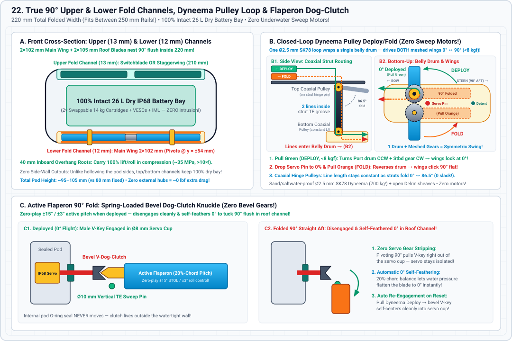

# FoilSkiff — Unified Linked-Fold Wing Architecture (Impact Protection, Beaching & Storage)

Instead of bolting together four separate fragile mechanisms (detaching belly leashes, mid-span wingtip beaching hinges, rear flaperon beaching overhangs, and Hall-effect prop cutoffs), **`FoilSkiff` standardizes on ONE unified mechanism: Coupled Aft-Sweeping ("Linked-Fold") Wings**.

When **both halves of the Main Wing** — plus the **Switchblade, Upper Staggerwing, or Split STOL Flaperons** — are linked to sweep **`82°` aft in lockstep**, a single mechanical architecture simultaneously solves:
1. **One-sided crab-pot / rock impacts** (zero violent half-wing rollover, zero wing detachment, zero leash, tips stop `227 mm` ahead of the tail prop),
2. **Flat dry-sand beaching inside the `600 mm` `True Kit Navigator 300` tunnel** (a `1.55 m` `AR 14` foil folds into a `~400 mm` narrow dart — zero mid-span wingtip hinges!), and
3. **Compact car-trunk / yacht-tender storage** (`1.3 m × 0.4 m` folded footprint).

---

## 1. Main Wing Mechanics: `22 mm` Overhang C-Slot Bridge + Intermeshing Root Gears

### How It Carries `400 kgf` Flight Lift Without Weakening the Pivot
1. **`22 mm` UHMW-Lined Overhang C-Slot Bridge (Below the `26 L` Battery Bay):**
   * Bolted directly into the pod's **twin `6 mm` `G10`/carbon full-height internal bulkheads** (zero intrusion into the dry `IP68` battery cartridges).
   * Left and right Main Wing roots pivot on stout **`Ø16 mm` vertical stainless pins at `y = ±92 mm`**, while the inner **`72 mm` of each carbon wing root** extends inboard (`y = ±92 → ±20 mm`) inside a tight top-and-bottom **UHMW-lined (`1.5 mm`, `μ ≈ 0.07`) compression slot**.
   * **Result:** `100%` of upward flight lift (`200–400 kgf`) and uneven roll bending (`550 N·m`) reacts in **pure top/bottom compression across the Overhang Bridge** — the vertical `Ø16 mm` pivot pins carry **zero** flight bending load!
2. **Intermeshing `90°` `316` Stainless Root Gear Sectors (`y = 0`):**
   * At their inboard ends (`y = ±20 mm`), the two wing roots carry matching **`90°` stainless gear sectors (`6–8` teeth, `10 mm` thick)** that mesh right on the pod centerline (`y = 0`).
   * **Result:** It is physically impossible for only one wing half to fold back. Struck from either side, **both port and starboard halves sweep `82°` aft symmetrically in lockstep** — dropping lift symmetrically so the dinghy settles flat onto its twin `Ø460 mm` catamaran tubes!
3. **`1×` Central `Ø8 mm` Double-Shear Black UV-Delrin Pin + Manual Beaching Lanyard:**
   * A central locking slider lug behind the gear mesh is pinned by **one vertical `Ø8 mm` double-shear Delrin pin** inside flush `<0.3 mm` `316` stainless shear sleeves — creating a built-in **Smart Load Divider**:
     * **Center Shoal / Sandbar Hit (`y ≈ 0`):** Symmetric drag splits across both halves (`~170 kgf` combined capacity) — stronger than the **`~140 kgf` upper strut kick-up fuse** → **the 4-bar struts kick up cleanly (`0° → 86.5°`) with all wings staying deployed!**
     * **One-Sided Crab-Pot / Rock Hit (`y = +0.65 m`):** Outer lever arm shears the single `Ø8 mm` Delrin pin at **`~85 kgf`** (`>14×` normal cruise tip drag, capping pod yaw torque **`≤545 N·m`**) → **both halves sweep `82°` aft together**, shedding crab-pot warps cleanly and stopping **`227 mm` ahead of the tail propeller**.
     * **Dry-Sand Beaching & Reset (`<30 s`):** Pull one manual release lanyard to fold the entire `1.55 m` foil to **`~400 mm` width** for beaching; to reset on the water, swing the wing back forward to `0°`, drop `1×` `~$0.35` spare Delrin pin in, and fly! Mold **`3 mm` aft sand-drain ports** at the back of the belly slot for a quick freshwater hose flush.

---

## 2. Active Flaperon Linked-Fold: Spring-Loaded Bevel Dog-Clutch Knuckle

To let the active split flaperons (`2 × 250 cm²`) **both** pitch with zero play (`±15°` STOL / `±3°` active roll & elevation) **and** sweep `82°` aft for beaching or impact relief without bevel gears or moving waterproof seals (see **Diagram 22, Panel C**):

* **Outside the Watertight Wall:** Each internal pod `IP68` servo drives its `Ø8 mm` stainless shaft through a stationary CNC double-O-ring cheek gland into a **female V-notch drive cup** just outside the pod wall (`Y = ±115 mm`).
* **Zero Servo Gear Stripping & Auto `0°` Self-Feathering:** Each flaperon carries a matching **male V-key** on its `20%`-chord pitch barrel, pivoting for sweep on a **vertical `Ø10 mm` trailing-edge pin** offset aft. The instant the flaperon sweeps aft, the male V-key pulls cleanly **out of the servo cup** (isolating the servo!) and water flow **automatically self-feathers the `20%`-chord balanced blade to `0°`**.
* **Auto Re-Engagement (`0 V` Safe):** Swinging the flaperon forward to `0°` slides the bevel V-key straight back into the servo cup with zero play.

---

## 3. Zero-Collision Vertical Separation Across All 3 Secondary Wing Tracks

| Secondary Wing Track | Vertical Plane vs. Main Wing (`Z = -20 mm`) | Linked-Fold Behavior (`0° → 82°` Aft) | Folded Width & Prop Clearance |
| :--- | :---: | :--- | :---: |
| **Track A: + Flush-Nested Top-Deck Switchblade (`Z = +45 mm`)** | **`+65 mm` higher** *(separate plane)* | Roof blades **already** sweep `85°` aft flush into the `220 mm` roof pocket (`>9 kn` cruise); belly Main Wing linked-folds `82°` aft on impact or beaching | **`~400 mm` wide**, `227 mm` ahead of prop — **simplest long-range pairing!** |
| **Track B: + Fixed Upper Staggerwing Flaperons (`Z = +35 mm`)** | **`+55 mm` higher** *(separate plane)* | Active flaperons sit permanently out of the Main Wing wake & `55 mm` above its sweep plane (**zero vertical elevator sled, zero cheek slots**); dog-clutch lets them fold `82°` aft (`346 mm` wide) for beaching | **`~400 mm` wide** (flaps `346 mm`), `227–328 mm` ahead of prop! |
| **Track C: + Split STOL / Morphing Flaperons (`Z = -36 mm` DOWN ↔ `+35 mm` UP)** | **`7.5 mm` lower** in DOWN mode (`+55 mm` higher in UP mode) | A light internal trigger cable links Main Wing sweep (`>5°`) to the flaperon dog-clutches: both flaperons immediately disengage, **self-feather to `0°`**, and sweep `82°` aft **`7.5 mm` cleanly below** the `10 mm`-thick Main Wing (`Z = -25 mm` bottom vs. `-32.5 mm` flap top) | **`~400 mm` wide**, zero clash even during `~5 s` DOWN STOL takeoff! |

---

## 4. Why Black UV-Delrin & Pure Double-Shear Bushing Rules

* **Material (`τ ≈ 55–65 MPa`):** `316` stainless (`~350–450 MPa`) would have to be a fragile `Ø2–3 mm` wire; **black UV-stabilized Delrin (Acetal / POM)** gives chunky, wet-hand-friendly **`Ø5–8 mm` pins** (`~$8/m` rod → `~20–25` spares at `~$0.35` ea.), absorbs **`<0.25%` water** (unlike Nylon which swells & seizes), snaps crisply (unlike HDPE which smears), causes **zero galvanic corrosion**, and never gouges carbon/aluminum sockets. *(Cold-water `<5 °C` alternative: soft `C360` brass at half diameter, rinsed after saltwater use.)*
* **Pure Transverse Double Shear (`<0.3 mm` Flush `316` SS Sleeves):** Never leave a wide bending gap between mating plates — sharp flush stainless shear sleeves slice Delrin cleanly like scissors (`±10%` repeatability).

| Shear Fuse Location | Pin Spec & Axis | Shear Load Direction (`90°` to Pin) | Normal Flight Load (`0–22 kn`) |
| :--- | :--- | :--- | :--- |
| **Main Wing Linked-Fold Lock (`1×` @ `y = 0`)** | **Vertical (`Z`-axis)** — *top bridge → central slider lug → bottom lip* (**`Ø8 mm` Delrin double shear**) | **Horizontal Aft (`+X`)** — tip strike drives gear slider lug aft across pin (`~85 kgf` tip / `~170 kgf` center) | **Tiny cruise drag (`~6–10 kgf`)** — `100%` of lift (`200–400 kgf`) & roll sit on the `72 mm` UHMW Overhang Bridge |
| **Upper Strut Kick-Up Fuse (`1×` Front Strut LE)** | **Horizontal Lateral (`Y`-axis)** — *rail fork → strut LE tang → rail fork* (**`Ø5 mm` Delrin double shear**) | **Vertical Upward (`+Z`)** — center shoal rotates strut aft around TE pivot (`+24 mm`), driving LE tang straight UP (`~140 kgf`) | **`0 kgf` (unloaded!)** — forward cruise thrust pushes strut LE *down* onto solid `70 mm` Alu stop; side loads sit on `Ø16 mm` axle + UHMW washers |

---

## 5. Simple Fallback & Why We Dropped More Complicated Variations

* **Only Zero-Fold Alternative Kept — Fixed Solid `4 × M8` Bolted Wing:** If riding strictly in deep, rock-free water and willing to stop beach retraction at `~68°` (or unbolt wings for car transport), solid `4 × M8` titanium/stainless bolts save `~0.6 kg` and `~$220` — accepting that a solid rock strike on a thin `1.55 m` tip will crack the carbon tip itself.
* **Complicated Variations Explicitly Dropped:**

| Dropped Variation | Why We Eliminated It in Favor of Unified Linked-Fold |
| :--- | :--- |
| **Detaching `120°` V-Cradle / Front C-Hook + Belly Leash + Hall Cutoff** | Required detaching a loose wing underwater, a `0.35 m` belly tether, a Hall-sensor prop brake, AND still needed separate beaching/packing hardware to fit the `600 mm` tunnel. |
| **Spring-Loaded "Ski-Binding" Cam Jaws** | Added `+0.5 kg`, `~38 mm` belly thickness, `~$200` custom spring hardware, and sand-drift sensitivity in spring bores — still detached on a leash. |
| **Central `Ø20 mm` Kingpin "Weathervane" Turntable** | Bulky `Ø180 mm` slew turntable, forward-swinging opposite tip could snag in rock/kelp fields, and swept straight through lowered STOL flaperons. |
| **Mid-Span Single-Wingtip Breakaway Hinges (`Y = ±275 mm`)** | Folding only one tip at `15.5 kn` caused a violent **`~500 N·m` asymmetric half-wing rollover** and put a heavy hinge in the wing's peak bending zone. |
