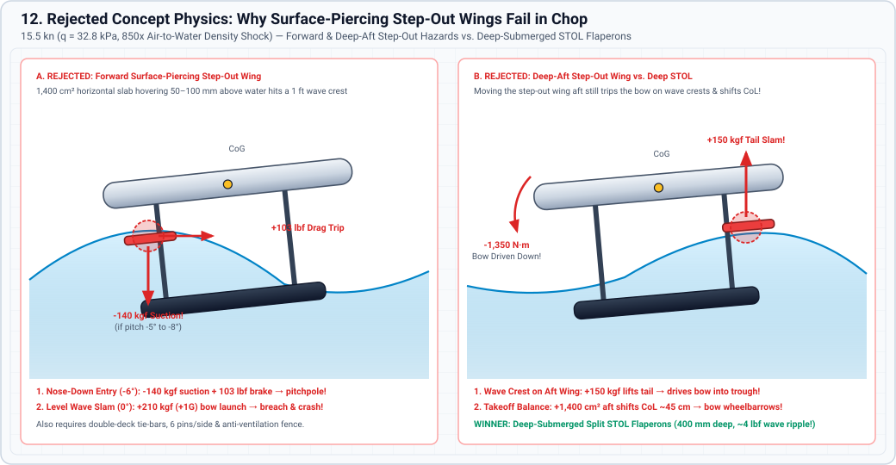
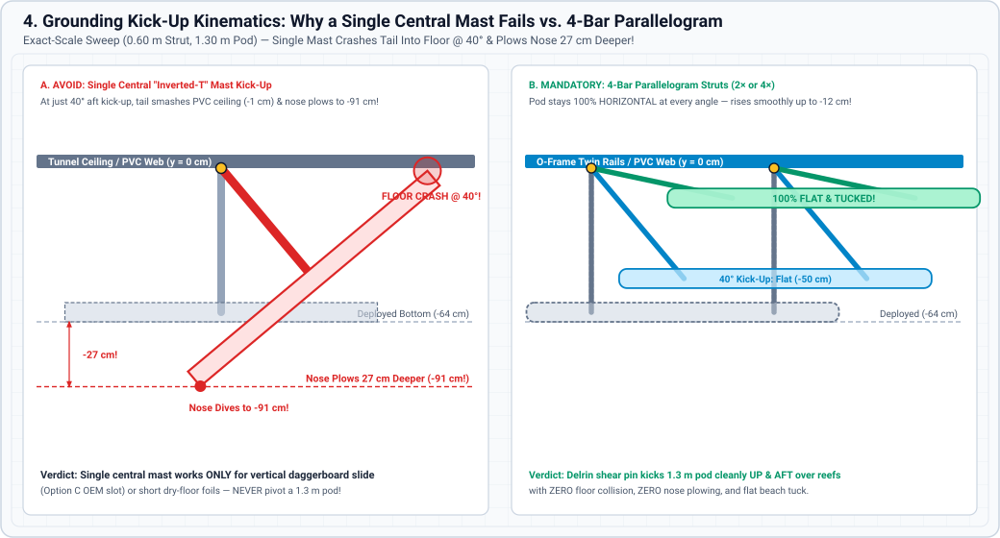
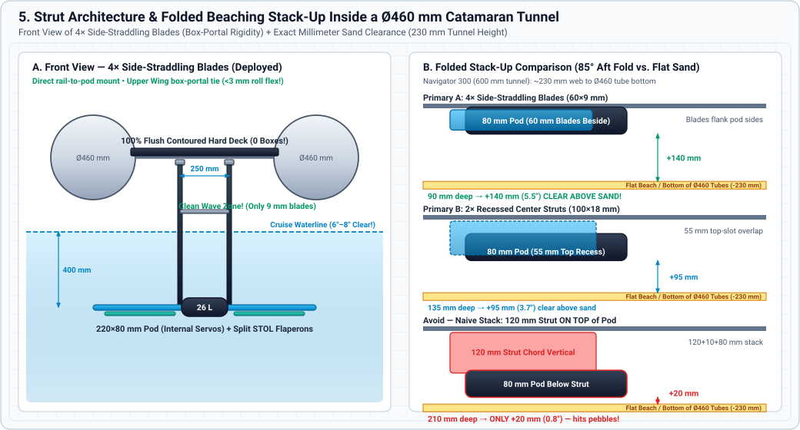
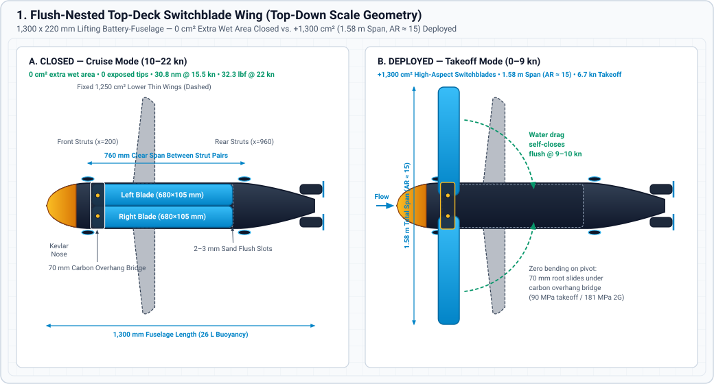

# FoilSkiff — Why We Rejected Other Possible Options (Design Trade-Offs & Eliminated Concepts)

Every architecture choice in **`FoilSkiff`** for the **`True Kit Navigator 300`** (primary hull) and **`True Kit Discovery 330`** (secondary open-bow hull) was chosen by first eliminating concepts that fail real-world marine physics, ocean chop, grounding kinematics, or tender usability.

This document records **exact physics, failure modes, and numbers** for every major option we explicitly rejected so future revisions do not re-introduce solved hazards.

---

## Summary Matrix: Rejected Concepts vs. Adopted `FoilSkiff` Standard

| Rejected Concept | Root Failure Mode | Quantified Penalty / Hazard | Adopted `FoilSkiff` Replacement |
| :--- | :--- | :--- | :--- |
| **1. Upper Surface-Piercing "Step-Out" Wing (Forward or Deep Aft)** | `850×` air-to-water density shock in `1–2 ft` chop; pitch-over / nose-dive / CoL shift | Forward: **`-140 kgf` suction + `103 lbf` brake** (nose-down) or **`+210 kgf` (`+1G`) bow launch**; Aft: **`+150 kgf` tail slam → `-1,350 N·m` bow-down** + `45 cm` CoL jump | **PRIMARY:** Deep-Submerged **Split STOL Flaperons** (`1,000 + 2×250 cm²`, `400 mm` deep) **SECONDARY:** **Flush-Nested Top-Deck Switchblade** (`400 mm` deep) |
| **2. Single Central "Inverted-T" Pivoting Mast** | Rigid 90° lever arm swings tail up into floor while nose rotates downward | Tailcone **smashes PVC ceiling (`-1 cm`) @ `40°`** while nose **plows `27 cm` deeper (`-91 cm`)** | **4-Bar Parallelogram Struts** (`4×` `60×9 mm` blades; pod stays `100%` horizontal `0°→86.5°`) |
| **3. Naive Vertical Strut-Chord Stack-Up** | Strut chord stands vertically when folded `85°` aft on top of pod | `10 + 120 + 80 = 210 mm` depth → **only `20 mm` (`0.8"`) above sand** | **`4×` Side-Straddling Blades** folding *beside* pod (`~90 mm` depth → **`+135–140 mm` / `5.5"` sand clearance**) |
| **4. Above-Deck Servo Boxes & Long Strut Pushrods** | Protruding boxes ruin cockpit; `650 mm` pushrods bind across `86.5°` parallelogram fold | Trip hazard, water intrusion through deck, pushrod drag/kelp snags & fold geometry shift | **`2×` `IP67` Servos Sealed INSIDE Flying-Keel Pod** + `Ø8 mm` double-O-ring direct-drive torque tubes (**`0` deck boxes!**) |
| **5. Flat Rectangular Hard Deck & Under-Hull Plate** | Ignores curved closed bow & bow rocker upsweep on `Navigator 300` | Sharp rectangular corners chafe/puncture curved bow PVC & blunt front edge catches waves | **Bow-Contoured Hard Deck & Bow-Bent Under-Hull Ski-Plate** matching curved planform & upward bow rocker |
| **6. External Un-Nested Swing-Wing / Split Battery-Fuselage Swing-Wing** | Extra wetted area ($S_{\text{wet}}$) stays in water + blunt tip points into `20 kn` flow | **`+33%–53%` cruise drag** (`32–37 lbf` @ `15.5 kn`); `100 A` cable fatigue through rotary pivots | **Flush-Nested Top-Deck Switchblade** (`0 cm²` extra wet area closed, `0` exposed tips, `0` moving battery cables) |
| **7. Fixed Thick Full-Span Battery Wing (`3,400 cm²`, `t/c = 14%`)** | Massive full-span profile drag ($C_{D0} \cdot S \cdot V^2$) above `12 kn` | **`2.2×–2.7×` drag** (`38.8 lbf` @ `15.5 kn`, `74.1 lbf` @ `22 kn`; only `21.9 nm` range) | Longitudinal `220×80 mm` Lifting Battery-Fuselage + sleek `10%`-thick high-aspect wings |
| **8. Thick `4×` Quad Struts (`110 × 15 mm`)** | Unnecessary wetted area & spray drag | **`18.7 lbf`** strut drag (`2.6×` penalty) | Ultra-slim **`4×` `60 × 9 mm` UD carbon blades** (`11.4 lbf`, `0.5 lbf` spray drag, `9.8×` buckling safety) |
| **9. Bare Round Outboard Tube / High-Kv Motors / `16S` on `12S` ESC / Pump-Jet + Foil** | Cylinder drag (`C_D ≈ 1.15`), over-voltage ESC blow-up, jet air-suction on lift-off | `Ø36 mm` bare tube wastes **`2,407 W` @ `10 kn`** (`63 lbf` drag); `16S` (`58.4 V`) blows `50.4 V` ESCs | `NACA 0024` fairing (`2,135 W` saved); `100 Kv` on `16S` w/ `75 V` `VESC`; keep `BP100` jet strictly non-foiling |
| **10. External Protruding `58 mm` Morphing Cheek Swing-Arms** | Pitch hinge sits `58 mm` out at arm tip → needs hidden belts/gears/4-bar links; external arms snag kelp & add interference drag | `-0.4 lbf` extra drag + `~18 mm` overly wide STOL slot + exposed moving linkage | **`100%` Internal-Pod Wet-Slot Vertical Elevator Sled** (`90 mm` pod, `Tr10×2` leadscrew + `IP68` servos directly ON sled, `0` external arms) — OR **Fixed Upper Staggerwing** (`0` sled, `+0.5 kn` takeoff) |

---

## 1. Why We Rejected Surface-Piercing "Step-Out" Wings (Forward OR Deep Aft)

At first glance, mounting a fixed `+1,400 cm²` horizontal "Step-Out" booster wing `200–250 mm` up the struts looks appealing on glass-flat water (`6.4 kn` takeoff, then exits into dry air `>9 kn`). However, in real harbor chop or `1–2 ft` ocean swells at **`15.5 kn` (`8.0 m/s`)**, seawater dynamic pressure is:

$$q = \frac{1}{2}\rho V^2 = \frac{1}{2}(1,025)(8.0)^2 = \mathbf{32,800\text{ Pa}}$$

Because seawater is **`~850×` denser than air**, any flat horizontal `1,400 cm²` (`0.14 m²`) wing hovering `50–100 mm` above the waterline acts like a **hair-trigger step-function tripwire**:

### A. Forward-Mounted Step-Out Wing (Two Violent Failure Modes)
1. **Slight Nose-Down Pitch / Back-of-Wave Entry (`-5°` to `-8°` hull pitch):**
   * The upper wing enters the wave crest past its zero-lift angle (negative AoA, $C_L \approx -0.30$):
     $$F_{\text{down}} = 32,800 \times 0.14 \times (-0.30) \approx \mathbf{-1,380\text{ N}\ (-141\text{ kgf} / -310\text{ lbf})}$$
   * Simultaneously, splash-entry drag ($C_D \approx 0.10$) adds **`~460 N` (`103 lbf`) of sudden braking** `~0.65 m` below passenger CoG (`~300 N·m` forward pitch-over impulse).
   * **Outcome:** Instead of cushioning the boat, the upper wing **violently pulls the bow underwater** into a submarine/pitchpole crash.
2. **Level or Nose-Up Wave-Crest Slam (`0°` to `+2°`):**
   * An `850×` air-to-water jump at positive takeoff camber ($C_L \approx +0.45$) fires an instantaneous **`+2,066 N` (`+211 kgf` / `+465 lbf`, ~`+1.0 G`) upward bow slam** in `<0.05 s`.
   * **Outcome:** Bucks the bow skyward → lower main wing breaches the surface and ventilates/stalls → `0.5 s` later the boat drops nose-first straight into Mode 1 above.
3. **Mechanical Penalty:** Keeping an upper wing parallel to the waterline during `86.5°` retraction (instead of flipping vertical/perpendicular to the folded struts) also requires a **double-deck 4-bar parallelogram** (twin outer longitudinal tie-bars, `6` hinge pins per side, forward-offset clevis arms, and an anti-ventilation fence collar).

### B. Deep-Aft-Mounted Step-Out Wing (Still Fails Two Ways)
Moving the step-out wing far aft (`~0.9 m` behind CoG) prevents bow-down entry suction (pulling the tail down pitches the nose *up*), **but introduces two equally fatal flaws**:
1. **Level Wave-Crest Slam Lifts the Tail → Pitches Bow Down:** A `+150 kgf` (`1,470 N`) wave-crest hit under an aft wing on a `0.9 m` lever arm creates **`-1,325 N·m` of nose-down pitch torque**, driving the bow straight into the next trough.
2. **Severe Takeoff-to-Cruise Center-of-Lift Jump (`~45 cm`):** With `+1,400 cm²` of lift `0.9 m` aft during `6–8 kn` takeoff, the stern lifts out first and **wheelbarrows the bow down into the water**; the instant the aft wing exits into air, Center of Lift jumps **`~45 cm` forward**—too large a sudden trim shift for a `3.0 m` `Navigator 300`.

### Why Deep-Submerged Split STOL Flaperons (Primary) & Switchblade (Secondary) Win
Keeping `100%` of lift **`~400 mm` deep underwater right under CoG** means when a `1–2 ft` wave crest passes through the `Navigator 300` tunnel, **only the `9 mm`-thin vertical blades slice the crest** (`~4 lbf` drag ripple, **zero** vertical slam, **zero** CoL jump, **zero** double-deck tie-bars!). On our **Primary Split STOL Flaperons**, the `ESP32` + 6-DOF `BNO085` IMU actively arrests any bow dip in `~0.03 s`.

---

## 2. Why We Rejected a Single Central Pivoting Mast ("Inverted-T")

A single central strut pivoted at the hull works fine for a tiny `25 cm` surfboard foil, **but fails geometrically on a `1.3 m` (`±65 cm`) Flying-Keel Pod**:

| Kick-Up Angle (`0.60 m` Strut, `1.3 m` Pod) | **Single Mast:** Tailcone Top | **Single Mast:** Nose Bottom | **4-Bar Parallelogram:** Pod Top / Bottom |
| :---: | :---: | :---: | :---: |
| **`0°`** *(Foiling)* | `-56 cm` | `-64 cm` | `-56 cm` / `-64 cm` *(flat)* |
| **`25°`** | `-23 cm` | **`-86 cm`** *(22 cm deeper!)* | `-50 cm` / `-58 cm` *(flat, rising)* |
| **`40°`** | **`-1 cm` (SMASHES FLOOR!)** | **`-91 cm`** *(27 cm deeper!)* | `-42 cm` / `-50 cm` *(flat, rising)* |
| **`85°`** | *Impossible* | *Impossible* | **`-6 cm` / `-14 cm`** *(flat & tucked)* |

Because the `1.3 m` pod is rigidly fixed `90°` to a single mast, kicking aft rotates the tail straight UP into the `1.2 mm` PVC tunnel ceiling at `40°` while simultaneously driving the Kevlar nose **`27 cm` deeper into the reef/sand (`-91 cm`)**. **Verdict:** A single mast (`180 × 22 mm`) is valid *only* for vertical daggerboard lift (OEM Option C slot) or short dry-floor foils—**never** for pivoting a `1.3 m` pod.

---

## 3. Why We Rejected Naive Vertical Strut-Chord Stack-Up & Thick `4×` Quad Struts

* **Naive Strut Stack-Up (`210 mm` Depth):** When a `120 mm`-chord strut folds `85°` aft, its **chord stands vertically**. Placing it strictly on top of an `80 mm` pod yields `10 mm bracket + 120 mm strut + 80 mm pod = 210 mm` depth—leaving **only `20 mm` (`0.8"`) above flat beach sand** inside the `Navigator 300`'s `230 mm` tunnel!
* **Adopted Solution (`4×` Side-Straddling `60 × 9 mm` Blades):** Mounting `4×` ultra-slim blades outside the `220 mm` pod lets them fold **beside** the pod (`~90 mm` total depth → **`+135–140 mm` / `5.5"` clear above flat sand!**), bolts directly to the `250 mm`-spaced rails with zero crossbars or pod recesses, and keeps drag at `11.4 lbf` (`0.5 lbf` spray drag)—whereas thick `4×` `110 × 15 mm` quad struts waste **`18.7 lbf`** (`2.6×` drag).

---

## 4. Why We Rejected Above-Deck Servo Boxes & Long External Strut Pushrods

An early STOL flaperon layout placed two `IP67` servos in protective housings on top of the cockpit Spine Floor with `650 mm`-long `4 mm` stainless pushrods running down the rear struts. **We eliminated this completely for four reasons:**
1. **Ruins the `100%` Flush Cockpit Floor:** Boxes bolted above the hard deck are an instant toe/gear trip hazard on a compact `3.0 m` (`60 cm` inside beam) `Navigator 300` tender and risk puncturing cargo/bags.
2. **Parallelogram Folding Kinematics Conflict:** Long `650 mm` pushrods spanning from the fixed deck down to a pivoting pod change effective length or bind whenever the `4×` struts kick up `86.5°` over a reef or for beaching unless complex bellcrank concentric pivots are added at every hinge.
3. **Drag, Kelp Snags & Deck Holes:** External pushrod grooves along the rear blades collect weeds/sand and require routing hardware past the `1.2 mm` PVC web.
4. **Why Internal Pod Servos Are Strictly Better:** Two standard `40 × 20 × 40 mm` brushless `IP67` `70–80 kg·cm` servos take just **`0.19 L`** inside the `26 L` Flying-Keel Pod bay right in line with the flaperons' `20%`-chord pivot axis—driving **`Ø8 mm` 316L stainless torque tubes through CNC double-O-ring side seals** (peak torque is only `2.5–3.6 N·m`, giving `>40×` shaft safety margin). Zero cockpit protrusions, zero external pushrods, zero folding interference!

---

## 5. Why We Rejected Flat Rectangular Hard Decks & Under-Hull Plates

The **`True Kit Navigator 300`** is not a flat-bottom box: forward of `X = -720 mm`, the closed curved bow tube **tapers smoothly inward** (`680 mm → 180 mm`) while the PVC tunnel ceiling **curves upward (`~85–95 mm` bow rocker)**.
* A **flat rectangular** Hard Deck stops short of the bow (leaving an unsupported soft bow floor) OR jams sharp `90°` corners directly into the inflated bow PVC tube.
* A **flat rectangular** under-hull plate ends in a blunt square lip that chafes the rising bow PVC web and catches chop inside the tunnel inlet.
* **Adopted Solution:** Both the **2-Piece Hard Deck** (top) and the **Under-Hull Hybrid C-Frame Plate** (bottom) are **contoured in planform AND bent smoothly upward in the bow** (`~12°` bow rocker ski-nose) to hug the hull curve continuously up to the `6 mm` Dyneema Bow-D-Ring sling.

---

## 6. Why We Rejected External Swing-Wings, Split Battery-Wings & Thick Full-Span Battery Wings

Above `12 kn`, `70%–85%` of foil drag is **skin friction ($D_f = \frac{1}{2}\rho V^2 C_f S_{\text{wet}}$)**:
1. **External Un-Nested Swing-Wing (`+33%–53%` Drag Penalty):** Swinging an extra `1,400 cm²` wing `90°` lengthwise *outside* the fuselage keeps `100%` of its wetted area in seawater and points its blunt tip into `20 kn` flow (`32.2–37.0 lbf` @ `15.5 kn`; `22.5–24.5 nm`). By contrast, our **Secondary Flush-Nested Top-Deck Switchblade** recesses two thin `680 × 105 × 13 mm` blades `100%` flush into the pod roof (`0 cm²` extra wet area closed, `0` exposed tips, `30.8 nm`, `32.3 lbf` @ `22 kn`).
2. **Split Battery-Fuselage Swing-Wings:** Only marginal drag savings over a fixed pod (`28.8 nm`), while introducing catastrophic failure risk from flexing `100 A` battery cables through cantilevered `IP68` underwater rotary hinges.
3. **Fixed Thick Full-Span Battery Wing (`3,400 cm²`, `38 mm` cells, `t/c = 14%`):** Doubles/triples profile drag at speed (`38.8 lbf` @ `15.5 kn`, `74.1 lbf` @ `22 kn`; range collapses to `21.9 nm`).

---

## 7. Electrical, Fairing & Propulsion Traps We Explicitly Avoid

* **Bare Round Outboard Shaft Tube (`Ø36 mm`):** $C_D \approx 1.15$ creates **`63.1 lbf` drag (`2,407 W` wasted!) at `10 kn`** and ventilates the prop. Always wrap any test-mule round shaft (e.g., `M2200`) in a `150 mm`-chord `NACA 0024` fairing (`2,135 W` saved @ `10 kn`).
* **`16S LiFePO4` on Stock `12S` ESCs (`50.4 V` Max):** `16S LiFePO4` charges to `55.2–58.4 V` and instantly destroys `50.4 V`-rated `12S` ESCs (`APISQUEEN U30`, some `W-30` units). Either drop to **`14S LiFePO4` (`<50 V`)** or run **`75 V`-rated `Flipsky 75100`/`75200` `VESC`s**.
* **High-Kv RC Boat Motors (`195–500 Kv`):** Spin way too fast for direct-drive marine propellers (`195 Kv` is for jet impellers only; use **`100 Kv` on `16S`** or **`120 Kv` on `14S`** for `Flipsky 65161`).
* **Pump-Jet (`BP100`) Paired with Hydrofoils:** Flush hull intake sucks air and loses `100%` thrust the moment the hull lifts out of the water; use `BP100` strictly as a non-foiling `3"`-draft shallow-water jetboard.
