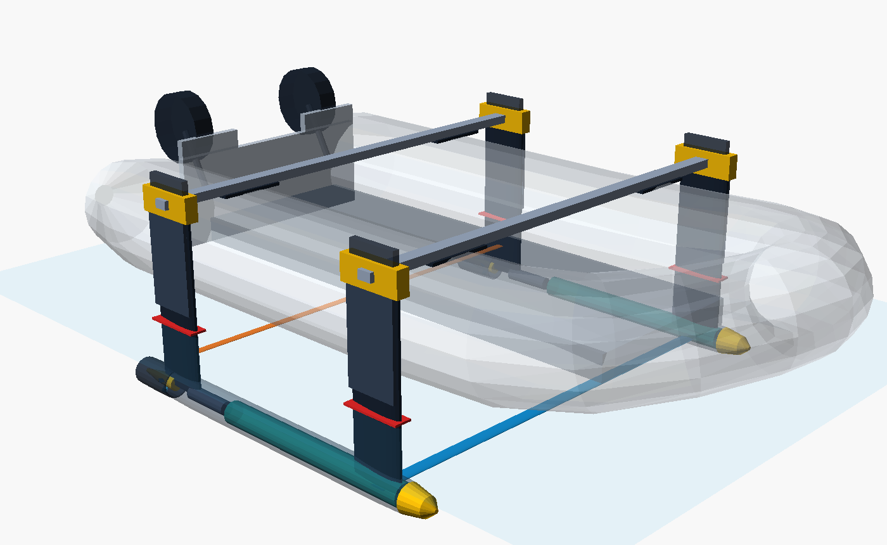
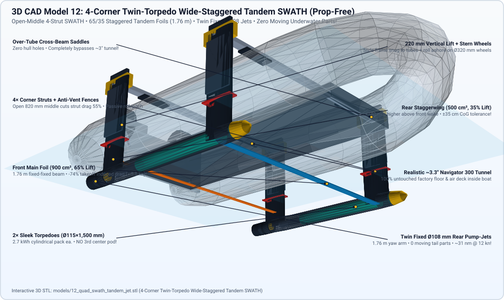

# FoilSkiff — 4-Corner Twin-Torpedo Wide-Staggered Tandem SWATH (`Model 12`)

A zero-moving-parts, prop-free, passively self-stabilizing **4-Strut Foiling SWATH** architecture for the **`True Kit Navigator 300`** (`300 × 155 cm`, `Ø460 mm` tubes, realistic `~75–100 mm` / `3"–4"` under-floor tunnel).

Instead of routing struts through the cramped `~3"` tunnel or relying on active IMU/servo flight control and complex underwater gimbals, this architecture clamps **two over-tube cross-beam saddles** across the `Ø460 mm` inflatable tubes (`ZERO` hull holes, `ZERO` tunnel interference) to support a **closed structural box-frame** built around:
1. **Two Sleek Outer Submerged Torpedoes (`Y = ±880 mm`, `Ø115 × 1,500 mm`, NO 3rd center pod):** Each houses a swappable `2.7 kWh` cylindrical `21700` `IP68` battery pack (`5.4 kWh` total) and a **fixed rear `Ø108 mm` wide-bore axial pump-jet** (`132.5 cm²` combined exit area, **`1.76 m` differential yaw lever arm**, zero moving tail parts, dual-drive offshore redundancy).
2. **Four Corner Surface-Piercing Buoyant Wing-Struts (`2` Front @ `X = -520 mm`, `2` Rear @ `X = +520 mm` — `~820 mm` Open Middle Gap):** `NACA 0013` (`220 × 28 mm`) buoyant carbon struts with horizontal **anti-ventilation fences** and outer rubber dock rub-strakes give passive 4-corner roll + pitch damping while cutting strut drag `~55%` vs. full-length side walls.
3. **Wide-Staggered Tandem Foils (`1.76 m` span, `65/35` lift split, `1,400 cm²` total):**
   * **Front Main Foil (`~900 cm²`, `c = 58 mm`, `Z = -480 mm`):** Low between the front torpedo roots.
   * **Rear Staggerwing (`~500 cm²`, `c = 38 mm`, `Z = -340 mm`):** Mounted **`140 mm` higher** on the rear struts—completely clear of the front foil's downwash wake yet `100%` submerged in cruise (`~5.8 kn` passive takeoff, **`±35 cm` passenger CoG tolerance**, `4×` stiffer fixed-fixed beam!).

---

## 1. Visual 3D CAD Model & Render

<strong>View Annotated 3D Isometric Engineering Callouts (SVG)</strong>

* **Interactive `1:1` mm 3D STL:** [`models/12_quad_swath_tandem_jet.stl`](models/12_quad_swath_tandem_jet.stl)

---

## 2. Core Geometry & Drag Budget (`Navigator 300`, `235 kg` All-Up)

* **Realistic Hull Reference:** `Ø460 mm` tubes (`Y = ±545 mm`, tube bottoms `Z = -230 mm`, tube tops `Z = +230 mm`), factory welded PVC tunnel web at `~85 mm` (`3.3"`) above flat ground (`Z = -145 mm`)—confirm exact millimeter height on your actual hull before cutting struts.
* **Why 2 Torpedoes Only (No 3rd Center Pod):** At `15.5 kn`, `~75%` of total drag is wetted skin friction. Adding a center battery pod on top of two outer torpedoes adds `+94 N` (`21 lbf`) of drag (`5.0+ kW` @ `15.5 kn`). Putting `2.7 kWh` inside each outer `Ø115 × 1,500 mm` torpedo eliminates the 3rd pod and keeps all high-current DC wiring local to each nacelle.

| Drag Component (`235 kg`, `24 kgf` torpedo buoyancy) | `12.0 kn` Eco (`6.2 m/s`) | `15.5 kn` Cruise (`8.0 m/s`) | Notes |
| :--- | :---: | :---: | :--- |
| **2× Sleek Outer Torpedoes** (`Ø115 × 1,500 mm`) | `75 N` | `125 N` | Houses `2 × 2.7 kWh` packs + `75100 VESCs` + `Ø54 mm` motors |
| **4× Corner Wing-Struts** (`220 × 28 mm`, open middle) | `41 N` | `68 N` | `NACA 0013` + `4×` horizontal anti-ventilation fences |
| **Wide-Staggered Tandem Foils** (`900 + 500 cm²`, `1.76 m`) | `48 N` | `62 N` | `10.2 N` induced drag @ `15.5 kn`; `140 mm` vertical stagger |
| **Hull & Crew Aero Drag** | `24 N` | `40 N` | Tubes `~230 mm` clear of water surface |
| **TOTAL DRAG** | **`188 N` (`42 lbf`)** | **`295 N` (`66 lbf`)** | **`-74%` takeoff induced drag vs. `1.05 m` monoplane!** |
| **Battery Power (`60%` Twin Fixed Wide-Bore Jets)** | **`1.92 kW DC`** | **`3.93 kW DC`** | `2 × Ø108 mm` OD / `Ø94 mm` bore (`132.5 cm²` total, `0` moving parts) |
| **Usable Range (`5.38 kWh` Pack, `92%` Usable)** | **`~31.0 nm`** | **`~19.5 nm`** | **Sweet spot: `10–13 kn` all-weather ocean cruiser** |

---

## 3. Retraction & Beaching Geometry (Accounting for the Real `~3"` Tunnel)

Because the two horizontal tandem foils span underneath both `Ø460 mm` tubes (`Z_tube_bottom = -230 mm`), a rigid one-piece box-frame cannot pass vertically upward *through* the tubes or hide inside a `~3"` tunnel. Two clean mechanical solutions handle shallow water and beaching without compromising the hull:

| Beaching Mode | Mechanism | Shallow Draft / Beach Clearance | Trade-Off |
| :--- | :--- | :---: | :--- |
| **Option A *(Primary — Zero Underwater Wing Hinges)***: **`220 mm` Vertical Slide-Up + Stern Launching Wheels** | All `4` corner struts slide **`220 mm` straight UP** through UHMW-lined vertical guide sleeves on the two cross-beam saddles (`4:1` Dyneema hoist + locking pins), tucking the front foil snug beneath the `Ø460 mm` tubes (`Z = -260 mm`). For rolling ashore, flip down **`Ø320 mm` QuickLok stern launching wheels** on the `Tru-Alu` transom (`320 mm` below tubes) and lift the lightweight bow by hand. | **`10.6"`** shallow motoring draft; **`+2.5"–4"`** clear above sand/rocks on wheels | **Zero underwater wing hinges**; maximum box-frame stiffness; rolls easily up rocky beaches |
| **Option B *(Optional — Flat Tube-Bottom Beaching)***: **Center-Split `90°` Folding Tandem Foils + `350 mm` Vertical Lift** | Add a pinned stainless shear-lap joint at `Y = 0` on both foils + `90°` aft-folding root hinges at the torpedo inner faces (`Y = ±820 mm`). Pulling the center pin lets both foil halves sweep `90°` aft flat along the torpedoes; then both Port & Starboard SWATH pods slide **`350 mm` straight UP alongside the outside of the tubes** (`Z_torp = -110 mm`). | **`+60 mm` (`+2.4"`) ABOVE tube bottoms!** (Boat rests flat on its PVC tubes) | Adds `4` underwater wing-fold hinges & center shear pins |

---

## 4. Mandatory Hydrodynamic & Practical Details

1. **Anti-Ventilation Fences (`4×` Red Horizontal Strakes):** Bond a thin `15 mm`-wide horizontal carbon fence around each corner strut at `Z ≈ -210 mm` (just below cruise waterline) and keep the upper strut symmetric (`NACA 0013`, zero camber) so surface air cannot travel down the strut onto the main foil.
2. **Outer Rubber Dock Rub-Strakes:** Because overall beam across the outer torpedoes/struts is **`~1.88 m`** (`~16 cm` outside each `Ø460 mm` tube), bond `15 mm` closed-cell EPDM rub-strake strips along the outer vertical strut edges so the rigid frame acts as a non-marking fender against yacht hulls and pilings.
3. **3-Piece Modular Transport Breakdown:** Bolt the two cross-beams and two tandem foils into the Port & Starboard torpedo/strut subassemblies with `M8` `316L` stainless flange bolts so the entire frame breaks down into `4` flat pieces for car-trunk or mothership deck storage in `<5 minutes`.
4. **Propulsion Selection (`2 × Ø54 mm` Slim Inrunners):** Pair two slim `Ø50–56 mm` sealed inrunners (`~160–200 Kv`, `3–4 kW` peak each) with `2 × Flipsky 75100` `VESC`s inside the outer torpedoes driving fixed `Ø100 mm` impeller / `Ø94 mm` exit axial shrouds (`132.5 cm²` total exit area, `360°` CAN-bus differential steering at `1.76 m` lever arm, instant reverse, and dual-engine redundancy).
