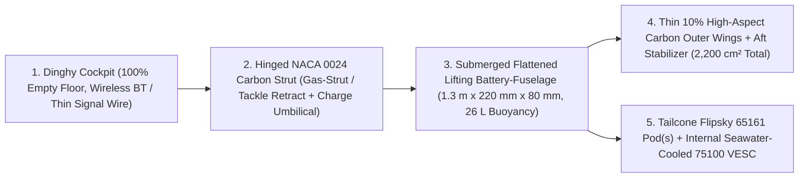
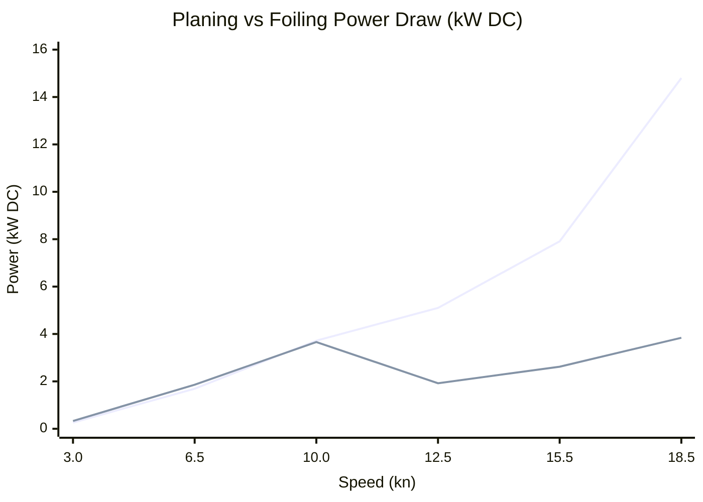

# FoilSkiff

**Submerged Lifting-Body Battery-Fuselage ("Flying-Keel Pod") & Lightweight `48 V` Hydrofoiling Catamaran Tender (`10 ft` Class)**

`foil-skiff` (**FoilSkiff** — combining *Foil* [retractable hydrofoils and `NACA 0024` streamlined struts] and *Skiff* [lightweight inflatable tunnel-catamaran tender]) is an engineering, hydrodynamics, and fabrication project for converting an ultralight **`10 ft` (`3.0–3.3 m`) inflatable tunnel-catamaran dinghy** (e.g., `True Kit Navigator 300` / `Discovery 330`, `31–36 kg` bare hull) into a compact, power-steered electric hydrofoiling tender.

---

## Primary Architecture: Submerged Lifting-Body Battery-Fuselage ("Flying-Keel Pod")

Instead of bolting heavy industrial outboards onto a `31 kg` inflatable transom or cluttering the cockpit with bulky battery cases, **`FoilSkiff`'s primary architecture integrates the battery, BMS, `Flipsky 75100` `VESC` controller(s), and tailcone `Flipsky 65161` motor(s) inside a single streamlined, flattened lifting-body fuselage** that drops down *with* the hydrofoils:

### Why the Submerged Flying-Keel Pod Wins
1. **Free Archimedes Lift (`~26.6 kg` Buoyancy):** A `~1.3 m × 220 mm × 80 mm` (`~26 L`) streamlined carbon fuselage cancels `~90%` of a `30 kg` (`5.38 kWh`) battery's weight underwater—cutting hydrodynamic lift demand by `~66 lbf` with zero induced drag, lowering foiling takeoff speed to **`7.4 knots`**, and **beating a dry-battery thin foil in drag across `7.4–12.5 knots`**.
2. **Zero High-Amp Strut Cables & Passive Seawater Cooling:** Keeping the battery, BMS, `VESC`, and tailcone `Flipsky 65161` pod(s) inside the same submerged shell eliminates thick `100–150 A` DC cables snaking down a thin foil strut, while directly water-cooling the `75100` MOSFETs through the hull skin.
3. **Pendulum Keel Roll Stability & Zero-Hardware Power Steering:** Putting `30 kg` of battery mass `350–450 mm` below the waterline stabilizes roll like a racing keel bulb, while twin tailcone **`2 × Flipsky 65161` (`100 Kv` on `16S` / `120 Kv` on `14S`)** pods deliver **`360°` CAN-bus differential power steering** with zero moving steering linkages.
4. **Up to `3×` High-Speed Range:** Lifting the catamaran tubes `6"`–`8"` clear of chop slashes `15.5-knot` battery power draw from `7.91 kW` (planing) down to **`~2.95 kW`** (**`~28.3 nm` range on `5.38 kWh`**; `31.8 nm` on the dry-floor thin-foil variant).

---

## Planing vs. Foiling Power Draw (`True Kit 10 ft` Class)

*(Upper Line = Standard Planing Catamaran `kW DC`; Lower Line = Hydrofoiling Catamaran `kW DC`)*

---

## Configuration Matrix

| Configuration | Drive & Battery Architecture | Key Performance & Thrust | Range (`5.38 kWh` Pack) | Complete DIY Cost (incl. Pack) |
| :--- | :--- | :--- | :---: | :---: |
| **Primary: Submerged Flying-Keel Pod** *(Recommended)* | `2 × Flipsky 65161` (`100/120 Kv`, `6 kg`, CAN diff. steer) + `2 × 75100 VESC` inside `26 L` lifting battery fuselage + thin `10%` carbon wings | **`7.4 kn` takeoff**, **`15.5 kn` @ `2.95 kW`**, `0` high-amp strut cables, passive seawater cooling, `100%` clear cockpit | **`28.3 nm` @ `15.5 kn`** `33.6 nm` @ `12 kn` | **`~$3,300`** |
| **Alt A: Dry `60 mm` Rigid Battery-Floor + Foil-Strut Pods** *(Rocky-Beach Pick)* | `2 × Flipsky 65161` + `2 × 75100 VESC` + dry 2-piece `EVE LF105` RIB floor + `2-sec` flip-up thin foils | `9.5 kn` takeoff, **`15.5 kn` @ `2.62 kW`**, `22.5 kn` max cont., zero submerged lithium risk | **`31.8 nm` @ `15.5 kn`** | **`~$3,350`** |
| **Alt B: Turnkey CNC Azimuth Pods (`2 × W-30` `730 mm`)** *(Zero-Fab Pick)* | `13.2 kg` CNC struts + **built-in `±85°` servo power steering + wireless remote** | `6.4 kW` peak (`110 lbf`), foiling capable on `730 mm` tall shafts | **`30+ nm`** *(foiling)* | `2 × W-30` + `$1,620–$2,150` |
| **Alt C: `2 × APISQUEEN U30` Ducted / `BP100` Jet** *(Tug / Shallow Beach)* | `U30`: `5.3 kg`, `132 lbf` (`33 lbf/kW`, diff. steer) / `BP100`: `10 kW` (`158 lbf`) jetboard | `U30`: `4–11 kn` tugboat & harbor / `BP100`: prop-free `3"`-draft rocky beaching (`14–15.5 kn`) | `36 nm` @ `4.5 kn` (`U30`) `~7.4 nm` (`BP100` jet) | **`~$2,820 – $2,965`** |
| **Experimental: `M2200` Solo Foiling Mule** *(Low-Cost Testbed)* | Stripped `2.2 kW` `M2200` + `Flipsky 75100` + `NACA 0024` fairing (`saves 2.1 kW @ 10 kn`) + `12 V` actuators *(or `2 × T63100` `~$500`)* | Solo (`150 kg`) `6.8–7.5 kn` takeoff (`2,900 cm²` wings) $\rightarrow$ **`11.5 kn` @ `1.28 kW`** | `~18 nm` (`2 kWh` test pack) | **`~$650 – $1,100`** |

---

## Repository Contents

* **[`electric-foiling-dinghy-guide.md`](electric-foiling-dinghy-guide.md)** — Complete engineering guide covering the **Primary Submerged Lifting-Body Battery-Fuselage ("Flying-Keel Pod")** hydrodynamics and `IP68`/impact safety rules, off-the-shelf drive showdown (`Flipsky 65161` `100 Kv` vs `120 Kv`, `2 × T63100`, `W-30`, `APISQUEEN U30`, `Maytech 65162 / 70182`, `TP100`, `BP100` jet, `QS138` / `Sotion`, and `ME1304` baseline), `14S` vs `16S LiFePO4` ESC voltage rules, dry `60 mm` rigid battery-floor comparison, and the `M2200` + `NACA 0024` solo foiling test mule.

---

## Development Roadmap

- [x] **Phase 0: Flying-Keel Pod Hydrodynamics, Drive Benchmarking & Safety Specification**
  - Compare longitudinal flattened lifting battery-fuselage (`26 L` buoyancy, `7.4 kn` takeoff) against thick blended battery-wings (`2.2×` drag penalty >`12 kn`) and dry `60 mm` composite battery-floors.
  - Benchmark `Flipsky 65161` (`100 Kv` on `16S` vs `120 Kv` on `14S`), `2 × T63100`, `2 × W-30`, `2 × APISQUEEN U30`, and `M2200` + `NACA 0024` fairing drag savings (`2,135 W` at `10 kn`).
- [ ] **Phase 1: `M2200` + `Flipsky 75100` `VESC` + `NACA 0024` Fairing & Drive-by-Wire Mule**
  - `3D`-print interlocking `150 mm` chord `NACA 0024` shaft fairing + glass/carbon skin; install `Flipsky 75100` `VESC` and `12 V` linear-actuator steering & aft-foil pitch trim; run solo lift-off trials.
- [ ] **Phase 2: Submerged Flying-Keel Battery-Fuselage Prototype (`26 L` Monocoque + Thin Carbon Wings)**
  - Mold the `1.3 m × 220 mm × 80 mm` carbon lifting fuselage with `20 mm` sacrificial Kevlar nose bumper, CNC double-O-ring rear flange, leak sensor, internal seawater-cooled `2 × Flipsky 75100` `VESCs`, `2 × Flipsky 65161` tailcone pods, and hinged `NACA 0024` retraction strut.
- [ ] **Phase 3: Full-Scale `15–21 kn` Foiling Sea Trials & Mothership `48 V` Umbilical Charging**
  - Validate `7.4 kn` takeoff, `28+ nm` range at `15.5 knots`, assisted shallow-water retraction, and dry deck-level charging from the mothership's bus (see [`flux-shaft`](https://github.com/boats-boats-boats/flux-shaft)).
