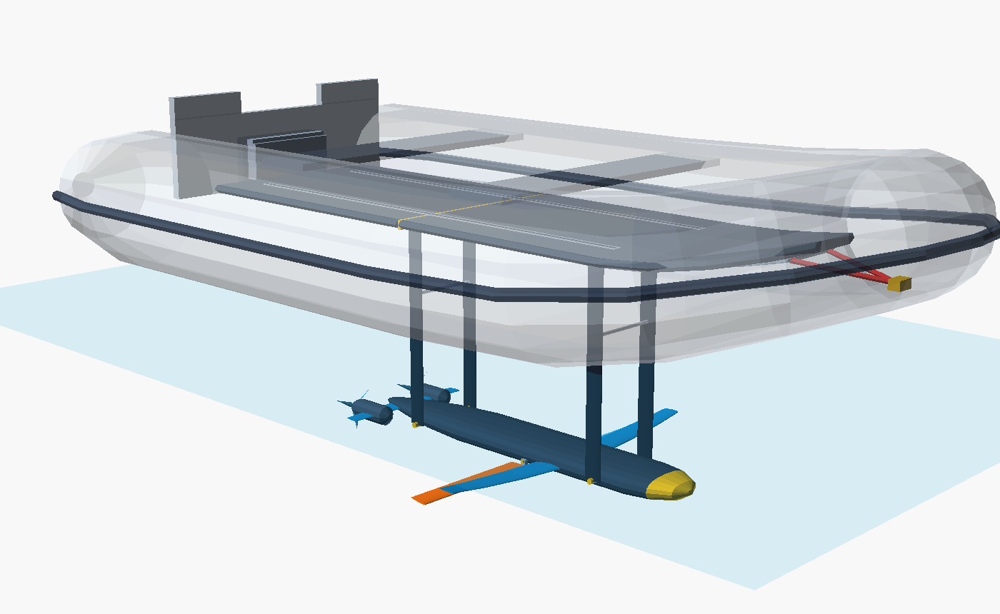
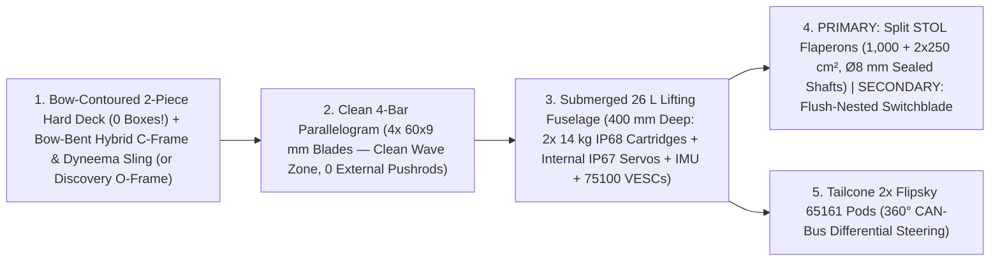
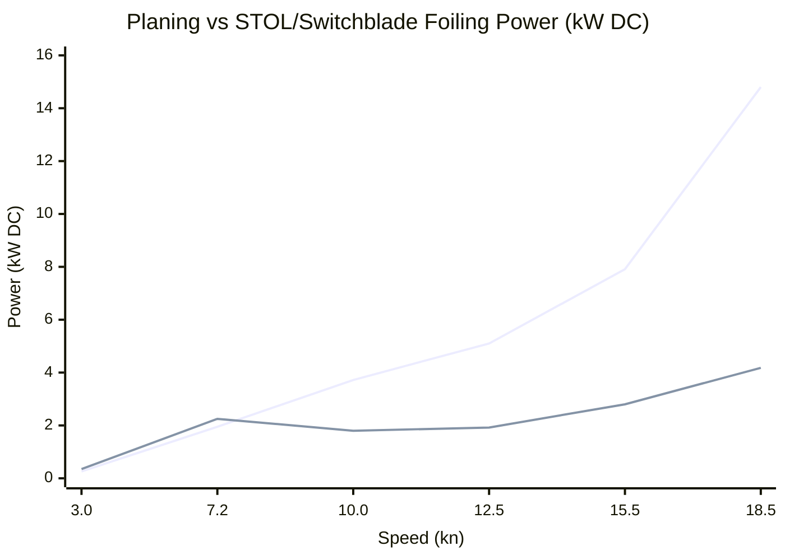

# FoilSkiff

**Bow-Contoured Rigid Hard Deck & Deep-Submerged Split STOL Flaperon Flying-Keel Pod with Swappable `IP68` Battery Cartridges (`True Kit Navigator 300` Primary | `Discovery 330` Secondary)**

`foil-skiff` (**FoilSkiff** — combining *Foil* [deep-submerged Split STOL Flaperons & Flush-Nested Switchblade hydrofoils] and *Skiff* [ultralight inflatable tunnel-catamaran tender]) is an engineering, hydrodynamics, and fabrication project centered on converting the **`True Kit Navigator 300`** (**primary focus:** `300 × 155 cm`, `60 cm` inside beam, `Ø460 mm` closed curved bow tubes, factory `Tru-Alu` aluminum transom, `31 kg` bare weight, `500 kg` capacity)—while preserving full open-bow fitment for **`True Kit Discovery 330`** (`3.3 m`, `36 kg`), **`Takacat LX`**, `Saturn`, and `Kaboat`—into an ocean-safe, bolt-on, power-steered electric hydrofoiling tender with **zero permanent hull modifications and zero boxes above the cockpit floor**.

---

## Primary Architecture: `True Kit Navigator 300` + Bow-Contoured Hard Deck & Split STOL Flaperon Flying-Keel Pod

*Explore all **9 interactive 3D `.stl` CAD models** (including **3 `60–75+ nm` Long-Range Hydro Package models** & **Modular 1-or-2 Low-Sit Chair Hard Deck**!), **9 OpenSCAD renders**, and **19 scaled engineering SVGs** in **[`VISUAL_ATLAS.md`](VISUAL_ATLAS.md)**, and read why we eliminated surface-piercing step-out wings, single masts, above-deck servo boxes, and flat rectangular plates in **[`DESIGN_TRADE_OFFS.md`](DESIGN_TRADE_OFFS.md)**.*

Instead of bolting heavy industrial outboards onto a `31 kg` inflatable transom, cluttering the cockpit with battery/servo boxes, or risking surface-piercing wave slams in chop, **`FoilSkiff`'s primary architecture pairs a bow-contoured 2-piece rigid Hard Deck + bow-bent `Tru-Alu` Hybrid C-Frame & `6 mm` Dyneema Bow-D-Ring Sling with a deep-submerged (`400 mm` deep) `26 L` Flying-Keel Pod** housing **two swappable `14 kg` `IP68` battery cartridges**, **`2×` internal `IP67` brushless flaperon servos + `ESP32`/`BNO085` IMU**, seawater-cooled `75100` `VESC`s, and **`1,000 + 2×250 cm²` Split STOL Flaperons** (with **Flush-Nested Top-Deck Switchblade Wings** as the secondary max-range/speed wing track):

### Why This Architecture Wins on the `True Kit Navigator 300`
1. **Bow-Contoured Flush Hard Deck (`0` Above-Deck Boxes!) + Zero-Hole Coupling (`Navigator 300` Hybrid C-Frame, Switchable Magnets, or `Discovery 330` O-Frame):** Both the `28 mm` 2-piece Hard Deck (`~5.5–7.5 kg` carbon) and the under-hull carriage plate **taper in planform and bend smoothly upward along the `Navigator 300`'s bow rocker** (never flat rectangles!), resting directly on the continuous `1.2 mm` PVC tunnel web with zero glue and zero hull holes:
   * **`Navigator 300` Primary — Bow-Contoured `Tru-Alu` Transom-Clamped Hybrid C-Frame + `6 mm` Dyneema Bow-D-Ring Sling (`~3.0–3.8 kg`, `250 mm` rail spacing):** Clamps directly onto the factory `10 HP`-rated `Tru-Alu` transom and ties the upturned bow ski-nose forward to the factory Bow Towing D-Ring (`3×–4×` lower bending, `~165 mm` clear per side inside the `600 mm` tunnel, `~90 mm` flat beach tuck → `~5.5"` sand clearance!).
   * **`Navigator 300` Universal Alt — Flush-Recessed Switchable Magnets (`4 × Magswitch`, `~800 kgf` across `2.5 mm` gap) + `Tru-Alu` transom bridle:** `5-sec` drop-on with built-in resettable breakaway fuse.
   * **Secondary Open-Bow Reference (`True Kit Discovery 330` / `Takacat LX`) — Bow-Contoured Rigid "O-Frame" (`~2.5–3.5 kg`):** Wraps rigidly around both open square bow and open transom.
2. **100% Ocean-Safe Deep Foil (`400 mm` Deep) — Zero Surface-Piercing Wave Slam:** Keeping all wings `400 mm` underwater eliminates the `850×` air-to-water wave-crest slam / nose-dive hazard of surface-piercing step-out wings—only the `9 mm`-thin vertical blades pierce `1–2 ft` chop (`~4 lbf` ripple).
   * **PRIMARY Wing — Submerged Split STOL Flaperons (`1,000 + 2×250 cm²`, `7.2 kn` takeoff, `29.8 nm` @ `15.5 kn`):** `4-in-1` active takeoff flaps, Direct-Lift wave/elevation leveling, active roll leveling & inward-banked turns (`20%`-chord self-centering `0°` mechanical failsafe).
   * **SECONDARY Wing — Flush-Nested Top-Deck Switchblade (`+1,300 cm²` roof-nested + `1,250 cm²` lower wing, `6.7 kn` takeoff, `30.8 nm` @ `15.5 kn`, `32.3 lbf` best `22 kn` drag):** Zero extra wetted area closed (`0` exposed tips!).
3. **Internal Pod Servos (`ZERO` Deck Boxes, `ZERO` External Pushrods!):** Mounting both `IP67` `70–80 kg·cm` brushless flaperon servos and the `ESP32`/`BNO085` IMU **inside the sealed Flying-Keel Pod** driving `Ø8 mm` double-O-ring stainless torque tubes keeps the cockpit `100%` clear and eliminates strut pushrod drag and `86.5°` folding interference.
4. **Swappable `IP68` Battery Cartridges + Free Archimedes Lift (`~26.6 kg` Buoyancy):** Two removable `IP68` `2.7 kWh` (`14 kg` ea.) slide-in cartridges cancel `~90%` of battery weight underwater, carry ashore easily, or swap one out for a foam dummy plug (`~15 nm`) on solo hops.
5. **Nearly `3×` High-Speed Range & Zero-Hardware Steering:** Twin tailcone **`2 × Flipsky 65161` (`100 Kv` on `16S` / `120 Kv` on `14S`)** + seawater-cooled `75100` `VESC`s deliver `360°` CAN-bus differential steering and slash `15.5-knot` power from `7.91 kW` (planing) down to **`2.80 kW` (`29.8 nm` STOL)** / **`2.71 kW` (`30.8 nm` Switchblade)**.

---

## Planing vs. Deep-Submerged Foiling Power Draw (`True Kit Navigator 300` / `10 ft` Class)

*(Upper Line = Standard Planing Catamaran `kW DC`; Lower Line = Primary Split STOL Flaperon Flying-Keel Pod `kW DC`)*

---

## Configuration Matrix

| Configuration | Drive & Battery Architecture | Key Performance & Thrust | Range (`5.38 kWh` Pack) | Complete DIY Cost (incl. Pack) |
| :--- | :--- | :--- | :---: | :---: |
| **PRIMARY: Bow-Contoured Hard Deck + Split STOL Flaperon Pod (`Navigator 300`)** | Bow-contoured `28 mm` Hard Deck (`0` deck boxes!) + bow-bent `Tru-Alu` Hybrid C-Frame & Dyneema Sling + `4×` `60×9 mm` blades + `2 × Flipsky 65161` + `2 × 75100 VESC` + `26 L` bay w/ **`2 × 14 kg` `IP68` cartridges** + **Split STOL Flaperons (`1,000 + 2×250 cm²`) & internal pod servos** *(or **Secondary Flush-Nested Switchblade**)* | **`7.2 kn` TO** (`6.7 kn` Switchblade), **`15.5 kn` @ `2.80 kW`** (`2.71 kW` Switchblade), `0` wave slam, `~90 mm` flat beach tuck (`~5.5"` sand clear) | **`29.8 nm` @ `15.5 kn`** *(`30.8 nm` Switchblade)* | **`~$4,280`** *(`$4,200` Switchblade)* |
| **Long-Range Expedition (`60–75+ nm` `Navigator 300`)** *(Models 6–8)* | Single centerline `65161` + `10"×11"` 2-blade CNC prop + internal-servo tail rudder + `AR 13.5–14` (`1.50–1.55 m`) wing + Bow Dodger + **`10.76 kWh` Dual `LiFePO4`** (`5.4` pod + `5.4` `60 mm` deck/plug-in) *(or `8.2 kWh` Single-Pod `NMC`)* | **`118–125 Wh/nm` @ `12 kn`** / **`142–152 Wh/nm` @ `15.5 kn`**; keeps `4×` blades + Split STOL (80/20) OR `2×` center struts + Switchblade (Max) | **`65–70 nm` @ `15.5 kn`** **`79–84 nm` @ `12 kn`** | **`~$4,450 – $4,750`** *(1× motor/VESC offsets 2nd pack!)* |
| **Alt A: Dry `60 mm` Rigid Battery-Floor + Foil-Strut Pods** *(Rocky-Beach Pick)* | `2 × Flipsky 65161` + `2 × 75100 VESC` + dry 2-piece `EVE LF105` RIB floor + `2-sec` flip-up thin foils | `9.5 kn` takeoff, **`15.5 kn` @ `2.62 kW`**, `22.5 kn` max cont., zero submerged lithium risk | **`31.8 nm` @ `15.5 kn`** | **`~$3,350`** |
| **Alt B: Turnkey CNC Azimuth Pods (`2 × W-30` `730 mm`)** *(Zero-Fab Pick)* | `13.2 kg` CNC struts + **built-in `±85°` servo power steering + wireless remote** | `6.4 kW` peak (`110 lbf`), foiling capable on `730 mm` tall shafts | **`30+ nm`** *(foiling)* | `2 × W-30` + `$1,620–$2,150` |
| **Alt C: `2 × APISQUEEN U30` Ducted / `BP100` Jet** *(Tug / Shallow Beach)* | `U30`: `5.3 kg`, `132 lbf` (`33 lbf/kW`, diff. steer) / `BP100`: `10 kW` (`158 lbf`) jetboard | `U30`: `4–11 kn` tugboat & harbor / `BP100`: prop-free `3"`-draft rocky beaching (`14–15.5 kn`) | `36 nm` @ `4.5 kn` (`U30`) `~7.4 nm` (`BP100` jet) | **`~$2,820 – $2,965`** |
| **Experimental: `M2200` Solo Foiling Mule** *(Low-Cost Testbed)* | Stripped `2.2 kW` `M2200` + `Flipsky 75100` + `NACA 0024` fairing (`saves 2.1 kW @ 10 kn`) + `12 V` actuators *(or `2 × T63100` `~$500`)* | Solo (`150 kg`) `6.8–7.5 kn` takeoff (`2,900 cm²` wings) $\rightarrow$ **`11.5 kn` @ `1.28 kW`** | `~18 nm` (`2 kWh` test pack) | **`~$650 – $1,100`** |

---

## Repository Contents

* **[`electric-foiling-dinghy-guide.md`](electric-foiling-dinghy-guide.md)** — Complete engineering guide centered on **`True Kit Navigator 300`** (with preserved **`True Kit Discovery 330`** / **`Takacat LX`** secondary references) covering the **Primary Bow-Contoured Hard Deck + Deep-Submerged Split STOL Flaperon Flying-Keel Pod (internal pod servos, `0` deck boxes)**, **Secondary Flush-Nested Top-Deck Switchblade Wings**, `Tru-Alu` Hybrid C-Frame + Dyneema Bow Sling / switchable magnets / open-bow O-Frame coupling, `4×` slim side-straddling parallelogram blades, `IP68`/impact safety rules, off-the-shelf drive showdown (`Flipsky 65161` `100 Kv` vs `120 Kv`, `2 × T63100`, `W-30`, `APISQUEEN U30`, `Maytech`, `TP100`, `BP100` jet, `QS138`), `14S` vs `16S LiFePO4` ESC voltage rules, dry `60 mm` battery-floor, and `M2200` + `NACA 0024` solo foiling mule.
* **[`DESIGN_TRADE_OFFS.md`](DESIGN_TRADE_OFFS.md)** — Detailed physics & engineering breakdown of **why we rejected other possible options** (surface-piercing forward & deep-aft Step-Out wings, single central pivoting masts, naive vertical strut-chord stack-up, above-deck servo boxes & strut pushrods, flat rectangular decks/under-plates, external/split swing-wings, thick full-span battery wings, thick quad struts, bare round shaft tubes, high-Kv RC motors, and pump-jet + foil pairings).
* **[`VISUAL_ATLAS.md`](VISUAL_ATLAS.md)** — Visual Design Atlas & 3D CAD Gallery showcasing all **9 interactive 3D `.stl` CAD models** (Primary `Navigator 300` deployed/retracted, Split STOL & Switchblade pods, `Discovery 330` secondary, **3 Long-Range `60–75+ nm` Hydro Package models** in Solo & Tandem chair modes, plus the **Modular Flush L-Track 1-or-2 Low-Sit Chair Hard Deck**), **9 OpenSCAD multi-material 3D PNG renders**, and **19 mathematically-scaled engineering SVG diagrams**.
* **[`models/`](models/)** — Parametric Python 3D CAD generator ([`generate_cad.py`](models/generate_cad.py), zero external Python deps) and 9 binary `.stl` assemblies (orbitable natively on GitHub or 3D-printable at `1:15` scale): `01_navigator300_stol_flaperons.stl` through `09_modular_hard_deck_seating.stl`.
* **[`renders/`](renders/)** — High-resolution `1400 × 860` multi-material OpenSCAD 3D PNG renderings of all 9 CAD configurations.
* **[`diagrams/`](diagrams/)** — Pure-Python 2D technical SVG generator ([`generate_diagrams.py`](diagrams/generate_diagrams.py)) and 19 vector SVG engineering drawings (`00`–`18`).

---

## Development Roadmap

- [x] **Phase 0: `True Kit Navigator 300` Fitment, Deep-Submerged Split STOL & Switchblade Hydrodynamics, Safety & Eliminated-Concepts Audit**
  - Verify exact `True Kit Navigator 300` geometry (`300 × 155 cm`, `600 mm` tunnel, `Ø460 mm` closed curved bow tubes, factory `Tru-Alu` transom, `31 kg`) and specify the **bow-contoured Hard Deck & bow-bent under-hull `Tru-Alu` Hybrid C-Frame + `6 mm` Dyneema Bow Sling** (retaining `Discovery 330` / `Takacat LX` O-Frame as secondary).
  - Promote **Deep-Submerged Split STOL Flaperons (`1,000 + 2×250 cm²`, internal pod servos, `0` deck boxes)** to Primary and **Flush-Nested Top-Deck Switchblade (`30.8 nm`, `32.3 lbf` @ `22 kn`)** to Secondary; document full wave-slam & kinematic rejection proofs in [`DESIGN_TRADE_OFFS.md`](DESIGN_TRADE_OFFS.md).
  - Benchmark `Flipsky 65161` (`100 Kv` on `16S` vs `120 Kv` on `14S`), `2 × T63100`, `2 × W-30`, `2 × APISQUEEN U30`, and `M2200` + `NACA 0024` fairing drag savings (`2,135 W` at `10 kn`).
- [ ] **Phase 1: `M2200` + `Flipsky 75100` `VESC` + `NACA 0024` Fairing & Drive-by-Wire Mule**
  - `3D`-print interlocking `150 mm` chord `NACA 0024` shaft fairing + glass/carbon skin; install `Flipsky 75100` `VESC` and run solo lift-off trials on `Navigator 300`.
- [ ] **Phase 2: `Navigator 300` Bow-Contoured Hard Deck + Split STOL Flying-Keel Prototype (`26 L` Bay + Internal Servos)**
  - Measure exact `Tru-Alu` transom lower-lip dip (`10–30 mm` check) and bow rocker profile; fabricate the **bow-contoured `28 mm` 2-piece Hard Deck (`0` boxes above deck)** + **bow-bent `Tru-Alu` Hybrid C-Frame (`250 mm` rails)** & `6 mm` Dyneema Bow Sling, `1.3 m × 220 mm × 80 mm` carbon fuselage bay with `20 mm` Kevlar crush-nose, CNC double-O-ring rear door for `2 × 14 kg` potted `IP68` cartridges, **`2×` internal `IP67` `70–80 kg·cm` brushless servos + `Ø8 mm` double-O-ring shafts + `ESP32`/`BNO085` 6-DOF IMU**, seawater-cooled `2 × Flipsky 75100` `VESCs`, `2 × Flipsky 65161` tailcone pods, `1,000 + 2×250 cm²` Split STOL Flaperons (`20%`-chord failsafe pivot), and **`4×` `60 × 9 mm` parallelogram blades pivoted at `x = -540 / +220 mm`**.
- [ ] **Phase 3: Full-Scale `15–22 kn` Foiling Sea Trials & Mothership `48 V` Umbilical Charging**
  - Validate `7.2 kn` STOL takeoff, `29.8–30.8 nm` range at `15.5 knots`, active chop leveling & banked turns, carry-ashore cartridge swapping, assisted shallow-water retraction beneath the `Tru-Alu` transom, and dry deck-level charging from the mothership's bus (see [`flux-shaft`](https://github.com/boats-boats-boats/flux-shaft)).
