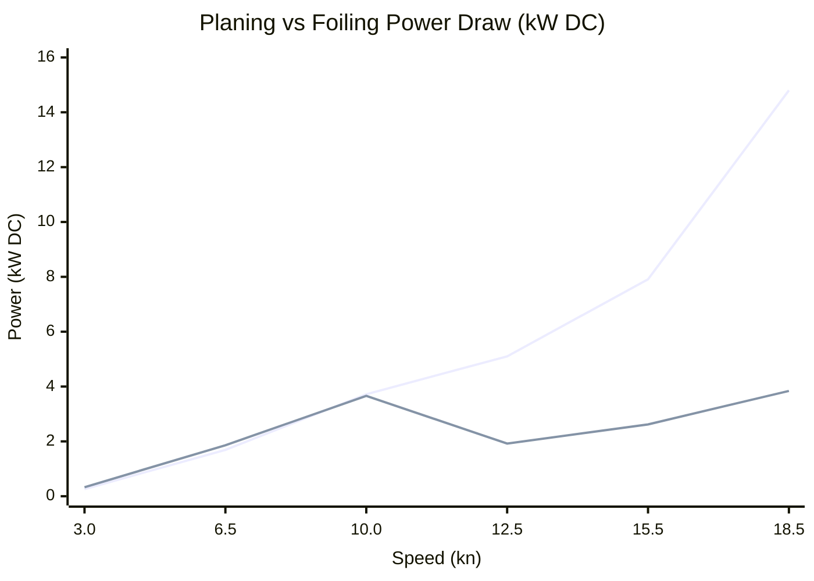

# FoilSkiff

**`48 V` Electric, Hydrofoiling & Integrated Battery-Floor Inflatable Catamaran Tender (`10 ft` Tunnel-Catamaran Class)**

`foil-skiff` (**FoilSkiff** — combining *Foil* [retractable hydrofoils and `NACA 0024` streamlined strut fairings] and *Skiff* [lightweight utility tender/dinghy]) is an engineering, hydrodynamics, and fabrication project for converting an ultralight **`10 ft` (`3.0–3.3 m`) inflatable tunnel-catamaran dinghy** (e.g., `True Kit Navigator 300` / `Discovery 330`) into a high-efficiency electric planing, tugboat, or hydrofoiling tender.

---

## Why FoilSkiff?

Commercial `6–10 HP` electric outboards (`Torqeedo Cruise 6.0`, `ePropulsion Navy 6.0`) cost **`$6,500–$9,000`** with batteries, push standard inflatable hulls at high wetted-surface drag (`~500+ Wh/nm` at `15 kn`), and clutter the tiny dinghy cockpit with heavy external battery cases.

**FoilSkiff** combines four modular engineering upgrades:
1. **Axial-Flux `Motenergy ME1304 @ 48 V` Electric Outboard (`~24.5 kg` Complete):** Lighter than a `6 HP` 4-stroke gas outboard while delivering **`6.8 kW` (`9.2 HP`) continuous** and **`13.5 kW` (`18.1 HP`) peak**, plus an optional **`Kort 19A` nozzle** (`212 lbf` cont. / `345 lbf` peak) for emergency yacht hip-towing at `3.0–3.5 knots`.
2. **Tall-Shaft (`20"`–`25"`) Outboard + Flip-Up External Hydrofoils:** Lifts the inflatable catamaran tubes `6"`–`9"` clear of harbor chop at **`10.0 knots`**, slashing drag at `15.5 knots` by **`75%`** (`185 lbf` $\rightarrow$ **`46 lbf`**), dropping battery draw from `7.91 kW` down to **`2.62 kW` (`169 Wh/nm`)**, and **tripling high-speed range (`30.3 nm` on `5.12 kWh`)**.
3. **Rigid `60 mm` Composite "Battery-Floor" Skateboard Chassis:** Replaces the `100 mm` drop-stitch air floor with a dry, above-waterline 2-piece carbon/E-glass floor packing flat `36.7 mm` `EVE LF105` `LiFePO4` cells (`5.38–8.06 kWh`)—preserving the catamaran air tunnel, leaving `100%` of the cockpit clear, and providing a rigid RIB mounting spine for flip-up hydrofoils, tall outboards, `APISQUEEN U30` / `W-30` / `Flipsky 65161` pods, or a central `BP100` `10 kW` pump-jet.
4. **Low-Cost Experimental Foiling Test-Mule (`M2200` + `Flipsky 75100` `VESC` + `NACA 0024` Tube Fairing):** Proves how wrapping a bare `Ø36 mm` round outboard shaft tube in a `150 mm` chord `NACA 0024` fairing saves **`2,135 W` at `10 knots`**, enabling solo (`150 kg`) foiling lift-off (`6.8–7.5 kn` takeoff, **`1.28 kW` steady flight at `11.5 kn`**) on a stripped `2.2 kW` brushless outboard with drive-by-wire linear-actuator steering and active pitch trim.

---

## Planing vs. Foiling Power Draw (`True Kit 10 ft` + `ME1304 @ 48 V`)

*(Upper Line = Standard Planing Catamaran `kW DC`; Lower Line = Tall-Shaft Outboard + External Hydrofoils `kW DC`)*

---

## Configuration Matrix

| Configuration | Drive & Voltage | Performance & Pushing Force | Range (`5.12–5.38 kWh`) | Est. DIY Cost (Excl. Hull) |
| :--- | :--- | :--- | :---: | :---: |
| **1. Standard Planing + Tugboat** | `1 × ME1304 @ 48 V` on `15"` leg (opt. `Kort 19A`) | `15.5 kn` cont. (`7.9 kW`, `185–212 lbf`) / `19 kn` peak (`345 lbf`) | `10.0 nm` @ `15.5 kn` `34.2 nm` @ `4.5 kn` | **`~$2,650`** |
| **2. Tall-Shaft Foiling Tender** | `1 × ME1304 @ 48 V` on `20"`–`25"` leg + Flip-Up Foils | **`15.5 kn` @ `2.62 kW` (`46 lbf` drag)** / **`22.5 kn` max cont.** | **`30.3 nm` @ `15.5 kn`** | **`~$3,600 – $4,100`** |
| **3. Rigid Battery-Floor + Pods/Foil** | `60 mm` 2-piece `EVE LF105` floor + `ME1304`, `2× U30` (`132 lbf`), `2× W-30` (`±85°` steer), or `2× Flipsky 65161` (`240 lbf`) | `100%` clear cockpit; dry above-waterline `5.4–8.1 kWh` pack; rigid foil mount | **`30+ nm`** *(foiling)* | **`~$3,450 – $4,365`** |
| **4. Central Jet Motor-Board** | `APISQUEEN BP100` (`10 kW`, `72–86 V`, `158 lbf`) | Prop-free `3"`-draft rocky beaching / detachable jet-surfboard (`14–15.5 kn`) | `~7.4 nm` @ `14.5 kn` | **`~$2,965`** |
| **5. Experimental `M2200` Foiling Mule** | Stripped `2.2 kW` `M2200` + `Flipsky 75100` `VESC` + `NACA 0024` tube fairing + `12 V` linear-actuator steer/trim | Solo (`150 kg`) `6.8–7.5 kn` takeoff (`2,900 cm²` wings) $\rightarrow$ **`11.5 kn` @ `1.28 kW`** | `~18 nm` (`2 kWh` test pack) | **`~$650 – $1,100`** *(reusing donor motor)* |

---

## Repository Contents

* **[`electric-foiling-dinghy-guide.md`](electric-foiling-dinghy-guide.md)** — Complete engineering, hydrodynamics, battery-packaging, propulsion comparison (`ME1304`, `W-30`, `APISQUEEN U30`, `Flipsky 65161`, `APISQUEEN BP100`), `M2200` + `NACA 0024` solo foiling test-mule blueprint, and BOM guide.

---

## Development Roadmap

- [x] **Phase 0: Hydrodynamics, Motor/Thruster Benchmarking & Battery-Floor Architecture**
  - Compare planing, `Kort 19A` tugboat mode, tall-shaft hydrofoiling, twin torpedo SWATH pods, central `BP100` jetboard, and rigid `60 mm` `EVE LF105` battery-floor chassis.
  - Quantify bare round-tube vs. `NACA 0024` strut fairing drag (`2,135 W` saved at `10 kn`) and `14S` vs. `16S LiFePO4` ESC voltage limits.
- [ ] **Phase 1: `M2200` + `Flipsky 75100` `VESC` + `NACA 0024` Fairing & Drive-by-Wire Mule**
  - `3D`-print interlocking `150 mm` chord `NACA 0024` shaft fairing + glass/carbon skin; install `Flipsky 75100` `VESC` and `12 V` linear-actuator steering & aft-foil pitch trim; run solo lift-off trials.
- [ ] **Phase 2: Rigid 2-Piece Composite "Battery-Floor" & Flip-Up Hydrofoil Kit**
  - Fabricate the `60 mm` carbon/E-glass 2-piece floor (`16S EVE LF105` `5.38 kWh` dry bay) with integrated flip-up forward foil sockets and `20"`–`25"` tall-shaft sliding transom jack plate.
- [ ] **Phase 3: Full-Scale `15–22 kn` Foiling Sea Trials & Mothership `48 V` Charging Integration**
  - Validate `30 nm` range at `15.5 knots` and direct charging from the mothership's `48 V` / `96 V` propulsion bus (see [`flux-shaft`](https://github.com/boats-boats-boats/flux-shaft)).
