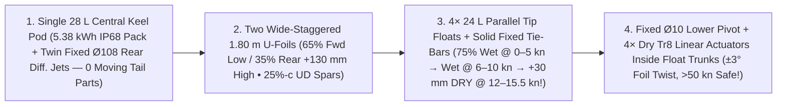
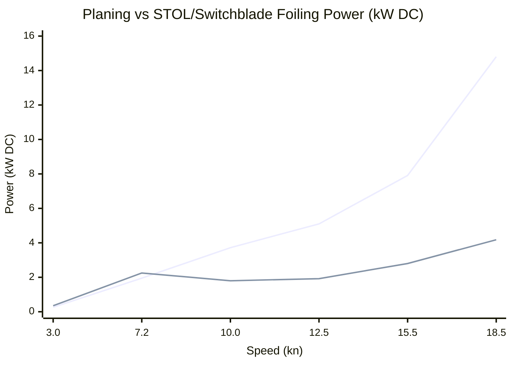

# FoilSkiff

**PRIMARY: Central-Keel 4-Float Staggered U-Foil with Dry Above-Water Wing-Warping & Twin Fixed Differential Pump-Jets (`True Kit Navigator 300` Primary | `Discovery 330` Secondary)**

`foil-skiff` (**FoilSkiff**) is an engineering, hydrodynamics, and fabrication repository for converting the **`True Kit Navigator 300`** (`300 × 155 cm`, `60–70 cm` inside beam, `Ø460 mm` continuous closed curved bow tubes, realistic `~75–100 mm` / `3"–4"` under-floor tunnel, factory `Tru-Alu` aluminum transom, `31 kg` bare weight, `500 kg` capacity)—while preserving open-bow fitment for **`True Kit Discovery 330`** / **`Takacat LX`**—into a prop-free, ocean-safe, self-stabilizing electric hydrofoiling tender with **zero permanent hull modifications and zero underwater moving parts**.

---

## Primary Architecture: Central-Keel 4-Float Staggered U-Foil + Dry 4-Channel Wing-Warping (`Models 13 & 14`)

*Read the complete primary design & hydroelastic proof in **[`WING_WARP_UFOIL_JET.md`](WING_WARP_UFOIL_JET.md)**; inspect the dry wing-warping close-up (`renders/17-wing-warp-tiebar-closeup-3d.png`) and 3-stage flight diagram (`diagrams/29-wing-warp-3stage-flight-dynamics.svg`); explore all **16 cataloged 3D `.stl` CAD assemblies & printable OpenSCAD parts** in **[`VISUAL_ATLAS.md`](VISUAL_ATLAS.md)**; and compare against our Propeller Track ([`electric-foiling-dinghy-guide.md`](electric-foiling-dinghy-guide.md)), Quad-SWATH ([`QUAD_SWATH_TANDEM_JET.md`](QUAD_SWATH_TANDEM_JET.md)), and Split-Keel Gimbal Jet ([`SPLIT_KEEL_JET_CCV_POD.md`](SPLIT_KEEL_JET_CCV_POD.md)).*

Instead of exposed spinning propellers, fragile underwater servo pushrods, or complex submerged gimbals, **`FoilSkiff`'s primary architecture pairs a single `28 L` central keel pod (`5.38 kWh` swappable `IP68` cartridges + twin fixed `Ø108 mm` rear differential pump-jets, `0` moving tail parts) with two wide-staggered `1.80 m` U-foils (`65/35` lift split, `+130 mm` vertical stagger), four `24 L` always-parallel corner tip floats (torpedo planform from above, rounded rectangle from the side) rigidly joined by solid fixed-length above-water carbon tie-bars (`0` telescoping joints!), and `4×` dry `IP67` `Tr8` internal linear actuators rocking each blade tang `±17 mm` inside a free-flooding center trunk around a fixed `Ø10 mm` lower pivot pin (`±3.0°` foil AoA twist — ZERO underwater hinges or wet shaft seals!)**:

### Why This Architecture Wins on the `True Kit Navigator 300`
1. **3-Stage Flight Progression (`0–5` / `6–10` / `12–15.5 kn`) on `600 mm` Struts:**
   * **`0–5 kn` Takeoff:** All `4 × 24 L` corner floats are `~75%` submerged (`~100 kgf` total pre-lift buoyancy with the `28 L` center pod) $\rightarrow$ inflatable tubes `50%–75%` unloaded $\rightarrow$ effortless **`~5.0–5.5 kn`** takeoff (`-74%` induced drag vs. `1.05 m` wings!).
   * **`6–10 kn` Post-Takeoff Climb:** Tubes `+100 mm` clear while all `4` always-parallel floats remain `150 mm` in water, unloading linearly (`~10.5 kgf / 10 cm`) for rock-solid passive pitch + roll stabilization.
   * **`12–15.5 kn` High-Speed Cruise:** All `4` floats lift **`+30 mm` DRY IN AIR (`0 N` float water drag!)**, leaving only thin `18 mm` vertical blades (w/ red anti-ventilation fences) and the single `28 L` center pod wet while the Front/Rear foils stay `320 / 190 mm` deep underwater $\rightarrow$ **`~33 nm` @ `12.0 kn` (`1.80 kW`) / `~20.5 nm` @ `15.5 kn` (`3.75 kW`)**!
2. **Parallel-Float Dry 4-Channel Wing-Warping (`ZERO` Telescoping Bars, `ZERO` Wet Seals!):** The four floats stay `100%` parallel on solid fixed-length `Ø34 mm` above-water carbon tie-bars. Each `18 mm` vertical blade pivots around a fixed `Ø10 mm` pin at the float bottom and extends `320 mm` up inside a free-flooding center trunk where a `$35` dry `IP67` `Tr8` linear actuator pushes the tang **`±17 mm`** (`~100 N` force, `0 W` hold) to twist each foil half **`±3.0°`** (`0.06%` strain, `>150 N·m` roll torque, `±336 N` cruise altitude lock, `>50–60 kn` divergence safety!).
3. **`100%` Prop-Free, Dual-Drive Offshore Redundancy:** Twin fixed `Ø108 mm` wide-bore rear axial pump-jets (`132.5 cm²` total exit, `~60%` wire-to-thrust efficiency) give `360°` CAN-bus differential steering, instant reverse, kelp/swimmer safety, and limp-home redundancy—with **`0` moving tail parts**.
4. **Honest `~3"` Tunnel Accounting & Rocky Beaching:** Retracting the `4×` central struts lifts the flat U-foils snug beneath the `Ø460 mm` tube bottoms while keeping all `4` outer floats `~200 mm` clear above beach sand; flip-down **`Ø320 mm` QuickLok stern launching wheels** roll the rigid frame ashore `+2.5"–4"` clear of rocks.

---

## Planing vs. Deep-Submerged Foiling Power Draw (`True Kit Navigator 300` / `10 ft` Class)

*(Upper Line = Standard Planing Catamaran `kW DC`; Lower Line = Primary Split STOL Flaperon Flying-Keel Pod `kW DC`)*

---

## Configuration Matrix

| Configuration | Drive & Battery Architecture | Key Performance & Thrust | Range (`5.38 kWh` Pack) | Complete DIY Cost (incl. Pack) |
| :--- | :--- | :--- | :---: | :---: |
| **PRIMARY: Central-Keel 4-Float Staggered U-Foil + Dry Wing-Warping (`Models 13 & 14`)** | Single `28 L` central pod (`2 × 14 kg` `IP68` `LiFePO4`) + **Twin Fixed `Ø108 mm` Rear Diff. Pump-Jets** (`0` moving tail parts) + **`2×` Wide-Staggered `1.80 m` U-Foils** + **`4× 24 L` Parallel Floats** + **Solid Fixed Tie-Bars & `4×` Dry `Tr8` Internal Blade-Tang Actuators** | **`~5.2 kn` pre-lifted TO** (`~100 kgf` buoyancy), **3-stage flight** (floats `+30 mm` DRY @ `12–15.5 kn`), `>150 N·m` dry roll warp, **`100%` prop-free** & **`0` underwater moving parts** | **`~33.0 nm` @ `12.0 kn`** **`~20.5 nm` @ `15.5 kn`** | **`~$4,150`** |
| **Propeller Track: Split STOL Flaperon Pod (`Model 1`, Open Props)** | Bow-contoured `28 mm` Hard Deck (`0` deck boxes!) + bow-bent `Tru-Alu` Hybrid C-Frame & Dyneema Sling + `4×` `60×9 mm` blades + `2 × Flipsky 65161` + `2 × 75100 VESC` + `26 L` bay w/ **`2 × 14 kg` `IP68` cartridges** + **Split STOL Flaperons (`1,000 + 2×250 cm²`) & internal pod servos** *(or **Secondary Flush-Nested Switchblade**)* | **`7.2 kn` TO** (`6.7 kn` Switchblade), **`15.5 kn` @ `2.80 kW`** (`2.71 kW` Switchblade), narrow `1.05 m` beam | **`29.8 nm` @ `15.5 kn`** *(`30.8 nm` Switchblade)* | **`~$4,280`** *(`$4,200` Switchblade)* |
| **Long-Range Expedition (`60–75+ nm` `Navigator 300`)** *(Models 6–8)* | Single centerline `65161` + `10"×11"` 2-blade CNC prop + internal-servo tail rudder + `AR 13.5–14` (`1.50–1.55 m`) wing + Bow Dodger + **`10.76 kWh` Dual `LiFePO4`** (`5.4` pod + `5.4` `60 mm` deck/plug-in) *(or `8.2 kWh` Single-Pod `NMC`)* | **`118–125 Wh/nm` @ `12 kn`** / **`142–152 Wh/nm` @ `15.5 kn`**; keeps `4×` blades + Split STOL (80/20) OR `2×` center struts + Switchblade (Max) | **`65–70 nm` @ `15.5 kn`** **`79–84 nm` @ `12 kn`** | **`~$4,450 – $4,750`** *(1× motor/VESC offsets 2nd pack!)* |
| **Alt A: Dry `60 mm` Rigid Battery-Floor + Foil-Strut Pods** *(Rocky-Beach Pick)* | `2 × Flipsky 65161` + `2 × 75100 VESC` + dry 2-piece `EVE LF105` RIB floor + `2-sec` flip-up thin foils | `9.5 kn` takeoff, **`15.5 kn` @ `2.62 kW`**, `22.5 kn` max cont., zero submerged lithium risk | **`31.8 nm` @ `15.5 kn`** | **`~$3,350`** |
| **Alt B: Turnkey CNC Azimuth Pods (`2 × W-30` `730 mm`)** *(Zero-Fab Pick)* | `13.2 kg` CNC struts + **built-in `±85°` servo power steering + wireless remote** | `6.4 kW` peak (`110 lbf`), foiling capable on `730 mm` tall shafts | **`30+ nm`** *(foiling)* | `2 × W-30` + `$1,620–$2,150` |
| **Alt C: `2 × APISQUEEN U30` Ducted / `BP100` Jet** *(Tug / Shallow Beach)* | `U30`: `5.3 kg`, `132 lbf` (`33 lbf/kW`, diff. steer) / `BP100`: `10 kW` (`158 lbf`) jetboard | `U30`: `4–11 kn` tugboat & harbor / `BP100`: prop-free `3"`-draft rocky beaching (`14–15.5 kn`) | `36 nm` @ `4.5 kn` (`U30`) `~7.4 nm` (`BP100` jet) | **`~$2,820 – $2,965`** |
| **Experimental: `M2200` Solo Foiling Mule** *(Low-Cost Testbed)* | Stripped `2.2 kW` `M2200` + `Flipsky 75100` + `NACA 0024` fairing (`saves 2.1 kW @ 10 kn`) + `12 V` actuators *(or `2 × T63100` `~$500`)* | Solo (`150 kg`) `6.8–7.5 kn` takeoff (`2,900 cm²` wings) $\rightarrow$ **`11.5 kn` @ `1.28 kW`** | `~18 nm` (`2 kWh` test pack) | **`~$650 – $1,100`** |

---

## Repository Contents

* **[`WING_WARP_UFOIL_JET.md`](WING_WARP_UFOIL_JET.md)** — **PRIMARY ARCHITECTURE:** Complete engineering & hydroelastic specification for the **Central-Keel 4-Float Staggered U-Foil with Parallel-Float Dry Wing-Warping & Twin Fixed `Ø108 mm` Differential Pump-Jets (`Models 13 & 14`)**, including 3-stage flight waterlines (`0–5` / `6–10` / `12–15.5 kn`), solid fixed `Ø34 mm` tie-bars (`0` telescoping joints!), fixed `Ø10 mm` lower pivots + internal `Tr8` linear actuators, `25%`-chord UD spar divergence proof (`>50–60 kn`), honest `~3"` tunnel beaching, and printable close-up STLs.
* **[`electric-foiling-dinghy-guide.md`](electric-foiling-dinghy-guide.md)** — Complete engineering guide centered on **`True Kit Navigator 300`** (with preserved **`True Kit Discovery 330`** / **`Takacat LX`** secondary references) covering the **Propeller Track: Bow-Contoured Hard Deck + Deep-Submerged Split STOL Flaperon Flying-Keel Pod (internal pod servos, `0` deck boxes)**, **Flush-Nested Top-Deck Switchblade Wings**, `Tru-Alu` Hybrid C-Frame + Dyneema Bow Sling / switchable magnets / open-bow O-Frame coupling, `4×` slim side-straddling parallelogram blades, `IP68`/impact safety rules, off-the-shelf drive showdown (`Flipsky 65161` `100 Kv` vs `120 Kv`, `2 × T63100`, `W-30`, `APISQUEEN U30`, `Maytech`, `TP100`, `BP100` jet, `QS138`), `14S` vs `16S LiFePO4` ESC voltage rules, dry `60 mm` battery-floor, and `M2200` + `NACA 0024` solo foiling mule.
* **[`BREAKAWAY_WING_SOCKET.md`](BREAKAWAY_WING_SOCKET.md)** — Complete engineering reference for the **True `90°` Upper (`13 mm` Roof) & Lower (`12 mm` Belly) Fold Channels** (`220 mm` dart fitting between the `250 mm` under-hull rails, `100%` intact `26 L` dry bay, `179 mm` clear ahead of tail prop), **Closed-Loop `Ø2.5 mm` `SK78` Dyneema Coaxial Hinge Pulleys**, **Dual Wet `IP68` Servo-Controlled Variable-Preload Roller Pins** for both Foils & Upper Struts (`0%` Fold/Beach ↔ `50%` Reef ↔ `100%` Over-Center Cruise @ `0 W`, `5-sec` reset, `0` broken pins), **Embedded Rotating Wet `IP68` Foil-Base Servos** (exact `0.0°` flat-lock before folding), and bolt-on/fixed alternatives.
* **[`DESIGN_TRADE_OFFS.md`](DESIGN_TRADE_OFFS.md)** — Detailed physics & engineering breakdown of **why we rejected other possible options** (surface-piercing forward & deep-aft Step-Out wings, single central pivoting masts, naive vertical strut-chord stack-up, above-deck servo boxes & strut pushrods, flat rectangular decks/under-plates, external/split swing-wings, thick full-span battery wings, thick quad struts, bare round shaft tubes, high-Kv RC motors, sideways pod-core cutouts, solenoids, disposable shear pins, and pump-jet + foil pairings).
* **[`SPLIT_KEEL_JET_CCV_POD.md`](SPLIT_KEEL_JET_CCV_POD.md)** — Prop-free foiling **`70/30` Split Keel Jet-CCV Pod (`1,450 mm` LOA, Model 11)** pairing an inline `Flipsky 65161` + `Ø140 mm` BLI pump-jet, a **2-axis gimbaled hollow rear ring-nozzle** with a **spider-mounted sliding teardrop plug** (`~60%` η, `25–26 nm` @ `15.5 kn`), and **twin `Ø80 mm` zero-seal `N52` mag-drive centrifugal CCV pumps** (`models/ccv_magdrive_pump_80mm.scad` + 4 printable STLs) feeding flush pop-up inboard roll-trim wing roots.
* **[`QUAD_SWATH_TANDEM_JET.md`](QUAD_SWATH_TANDEM_JET.md)** — Zero-moving-parts prop-free **4-Corner Twin-Torpedo Wide-Staggered Tandem SWATH (Model 12)** clamping over the `Navigator 300`'s `Ø460 mm` tubes (bypassing the real `~3"` tunnel!) with `4×` open-middle corner wing-struts, `2× Ø115×1,500 mm` battery torpedoes, `65/35` staggered `1.76 m` tandem foils (`~5.8 kn` passive takeoff, `±35 cm` CoG tolerance), twin fixed `Ø108 mm` rear differential pump-jets (`~31 nm` @ `12 kn`), and vertical slide-up + stern-wheel beaching.
* **[`VISUAL_ATLAS.md`](VISUAL_ATLAS.md)** — Visual Design Atlas & 3D CAD Gallery showcasing all **15 cataloged 3D CAD assemblies & printable OpenSCAD models** (including Models 11–13: `70/30` Split Keel Jet-CCV Pod, 4-Corner Quad-SWATH Tandem Jet, and 2-Wing/4-Float Dry Tie-Bar U-Foil + printable `Ø80 mm` Mag-Drive Pump & `Ø150 mm` Spherical Gimbal STLs), **16 OpenSCAD multi-material 3D PNG renders**, and **28 mathematically-scaled engineering SVG diagrams**.
* **[`models/`](models/)** — Parametric Python 3D CAD generator ([`generate_cad.py`](models/generate_cad.py), zero external Python deps) producing 13 binary `.stl` assemblies (`01_navigator300_stol_flaperons.stl` through `13_center_keel_tip_float_ufoil.stl`), plus printable `1:1` OpenSCAD sources & STLs ([`ccv_magdrive_pump_80mm.scad`](models/ccv_magdrive_pump_80mm.scad) and [`gimbal_nozzle_150mm.scad`](models/gimbal_nozzle_150mm.scad)).
* **[`renders/`](renders/)** — High-resolution `1400 × 860` multi-material OpenSCAD 3D PNG renderings of all 16 CAD & cutaway views.
* **[`diagrams/`](diagrams/)** — Pure-Python 2D technical SVG generator ([`generate_diagrams.py`](diagrams/generate_diagrams.py)) and 28 vector SVG engineering drawings (`00`–`27`).

---

## Development Roadmap

- [x] **Phase 0: `True Kit Navigator 300` Fitment, Deep-Submerged Split STOL & Switchblade Hydrodynamics, Safety & Eliminated-Concepts Audit**
  - Verify exact `True Kit Navigator 300` geometry (`300 × 155 cm`, `600 mm` tunnel, `Ø460 mm` closed curved bow tubes, factory `Tru-Alu` transom, `31 kg`) and specify the **bow-contoured Hard Deck & bow-bent under-hull `Tru-Alu` Hybrid C-Frame + `6 mm` Dyneema Bow Sling** (retaining `Discovery 330` / `Takacat LX` O-Frame as secondary).
  - Promote **Deep-Submerged Split STOL Flaperons (`1,000 + 2×250 cm²`, internal pod servos, `0` deck boxes)** to Primary and **Flush-Nested Top-Deck Switchblade (`30.8 nm`, `32.3 lbf` @ `22 kn`)** to Secondary; document full wave-slam & kinematic rejection proofs in [`DESIGN_TRADE_OFFS.md`](DESIGN_TRADE_OFFS.md).
  - Benchmark `Flipsky 65161` (`100 Kv` on `16S` vs `120 Kv` on `14S`), `2 × T63100`, `2 × W-30`, `2 × APISQUEEN U30`, and `M2200` + `NACA 0024` fairing drag savings (`2,135 W` at `10 kn`).
- [ ] **Phase 1: `M2200` + `Flipsky 75100` `VESC` + `NACA 0024` Fairing & Drive-by-Wire Mule**
  - `3D`-print interlocking `150 mm` chord `NACA 0024` shaft fairing + glass/carbon skin; install `Flipsky 75100` `VESC` and run solo lift-off trials on `Navigator 300`.
- [ ] **Phase 2: `Navigator 300` Bow-Contoured Hard Deck + Split STOL Flying-Keel Prototype (`26 L` Bay + Internal Servos)**
  - Measure exact `Tru-Alu` transom lower-lip dip (`10–30 mm` check) and bow rocker profile; fabricate the **bow-contoured `28 mm` 2-piece Hard Deck (`0` boxes above deck)** + **bow-bent `Tru-Alu` Hybrid C-Frame (`250 mm` rails)** & `6 mm` Dyneema Bow Sling, `1.3 m × 220 mm × 80 mm` carbon fuselage bay with `20 mm` Kevlar crush-nose, CNC double-O-ring rear door for `2 × 14 kg` potted `IP68` cartridges, **`2×` internal `IP67` `70–80 kg·cm` brushless servos + `Ø8 mm` double-O-ring shafts + `ESP32`/`BNO085` 6-DOF IMU**, seawater-cooled `2 × Flipsky 75100` `VESCs`, `2 × Flipsky 65161` tailcone pods, `1,000 + 2×250 cm²` Split STOL Flaperons (`20%`-chord failsafe pivot), and **`4×` `60 × 9 mm` parallelogram blades pivoted at `x = -540 / +220 mm`**.
- [ ] **Phase 3: Full-Scale `15–22 kn` Foiling Sea Trials & Mothership `48 V` Umbilical Charging**
  - Validate `7.2 kn` STOL takeoff, `29.8–30.8 nm` range at `15.5 knots`, active chop leveling & banked turns, carry-ashore cartridge swapping, assisted shallow-water retraction beneath the `Tru-Alu` transom, and dry deck-level charging from the mothership's bus (see [`flux-shaft`](https://github.com/boats-boats-boats/flux-shaft)).
