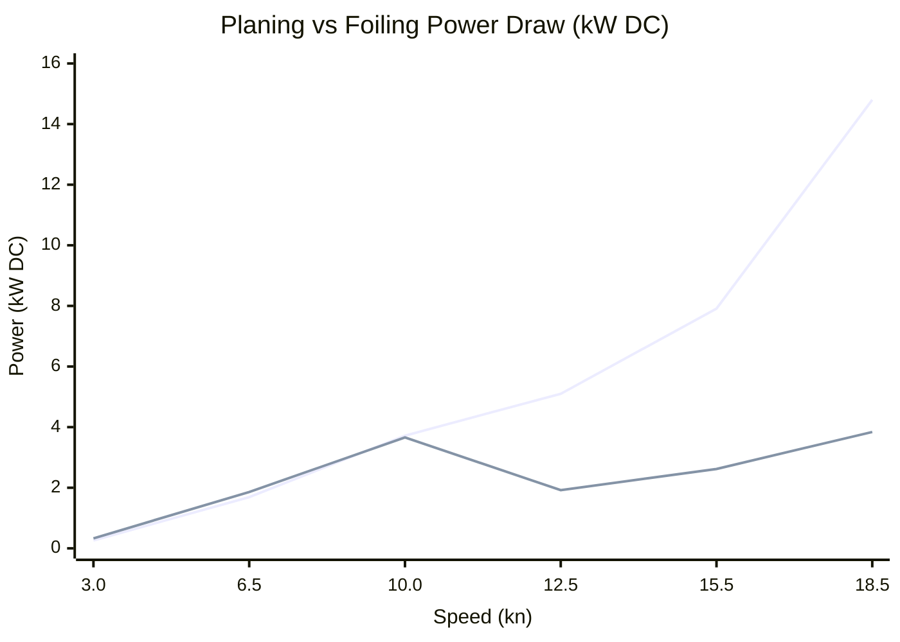

# FoilSkiff

**Lightweight `48 V` Electric, Hydrofoiling & Integrated Battery-Floor Inflatable Catamaran Tender (`10 ft` Tunnel-Catamaran Class)**

`foil-skiff` (**FoilSkiff** — combining *Foil* [retractable hydrofoils and `NACA 0024` streamlined strut fairings] and *Skiff* [lightweight utility tender/dinghy]) is an engineering, hydrodynamics, and fabrication project for converting an ultralight **`10 ft` (`3.0–3.3 m`) inflatable tunnel-catamaran dinghy** (e.g., `True Kit Navigator 300` / `Discovery 330`, `31–36 kg` bare hull) into a compact, power-steered electric planing or hydrofoiling tender.

---

## Why FoilSkiff?

Commercial `6–10 HP` electric outboards (`Torqeedo Cruise 6.0`, `ePropulsion Navy 6.0`) cost **`$6,500–$9,000`** with batteries, while heavy industrial DIY outboard swaps (like a `15.9 kg` `Motenergy ME1304` on a stripped gas leg) add **`25–26 kg` and `$2,200+`** to a `31 kg` inflatable transom.

**FoilSkiff** focuses on **compact, high-power-density off-the-shelf drives (`4–13 kg`) with built-in or differential electric power steering** paired with hydrofoils and a rigid battery floor:
1. **Top Pick — Twin `IP68` Foil-Strut Pods (`2 × Flipsky 65161` or `Maytech 65162` + `2 × Flipsky 75100` `VESC`, `4–6 kg`, `~$950–$1,150`):** Delivers **`6–10 kW` continuous / `200–240 lbf` thrust** at **`1/4` the weight and half the cost** of an industrial outboard swap—eliminating the donor gas lower leg and providing **zero-hardware `360°` differential power steering** via a `VESC` CAN-bus joystick.
2. **Zero-Fabrication Turnkey Pick — Twin Steerable CNC Aluminum Azimuth Pods (`2 × W-30` `730 mm`, `13.2 kg` total, `6.4 kW` peak, `110 lbf`):** Bolt-on streamlined CNC tall shafts with **built-in `±85°` (`170°`) servo power steering** and wireless remote.
3. **Flip-Up Hydrofoils (`67%` Less Power & `3.0×` Range):** Lifting the catamaran tubes `6"`–`9"` clear of harbor chop at `10.0 knots` cuts `15.5-knot` drag from `185 lbf` down to **`46 lbf` (`2.62 kW`, `169 Wh/nm`)**, extending range on a `5.38 kWh` pack from `10.5 nm` to **`31.8 nm`** with a **`22.5 kn` continuous top speed**.
4. **Rigid `60 mm` Composite "Battery-Floor" Skateboard Chassis:** Replaces the `100 mm` inflatable air floor with a dry, above-waterline 2-piece carbon/E-glass floor packing flat `36.7 mm` `EVE LF105` `LiFePO4` cells (`5.38–8.06 kWh`)—preserving the catamaran air tunnel, leaving `100%` of the cockpit clear, and providing a rigid RIB mounting spine for flip-up hydrofoils.

---

## Planing vs. Foiling Power Draw (`True Kit 10 ft` Class)

*(Upper Line = Standard Planing Catamaran `kW DC`; Lower Line = Hydrofoiling Catamaran `kW DC`, dropping sharply after `10.0 kn` lift-off)*

---

## Top Off-the-Shelf Drive & Hull Configurations

| Configuration | Drive Weight & Power Steering | `48 V` / `72 V` Performance & Thrust | Range (`5.38 kWh` Pack) | Complete DIY Cost (incl. Pack) |
| :--- | :--- | :--- | :---: | :---: |
| **1. Twin `Flipsky 65161` / `Maytech 65162` Foil-Strut Pods + Battery-Floor** *(Top Pick)* | **`4–6 kg`**; **zero-hardware differential power steering** (`2× 75100 VESC` CAN joystick) | `6–10 kW` cont. (`200–240 lbf`) **Foiling: `15.5 kn` @ `2.62 kW`** / `22.5 kn` max | **`31.8 nm` @ `15.5 kn`** `36 nm` @ `4.5 kn` | **`~$3,350`** |
| **2. Turnkey CNC Azimuth Pods (`2 × W-30` `730 mm`)** *(Zero-Fab Pick)* | **`13.2 kg`**; **built-in `±85°` servo power steering + remote** | `6.4 kW` peak (`110 lbf` / `50 kgf`) **Foiling capable on `730 mm` tall shafts** | **`30+ nm`** *(foiling)* | `2 × W-30` + `$1,620–$2,150` *(foils + floor/pack)* |
| **3. `2 × APISQUEEN U30` Ducted Thrusters + Battery-Floor** *(Harbor / Tugboat Pick)* | **`5.3 kg`**; **differential power steering** (`33 lbf/kW`!) | `4.0 kW` cont. (`132 lbf` / `60 kgf`) Best `4–11 kn` cruise & hip-towing | `36 nm` @ `4.5 kn` | **`~$2,820 – $3,040`** |
| **4. Central Jet Motor-Board (`APISQUEEN BP100` `10 kW`)** *(Beach Jet Pick)* | `10.3 kg`; nozzle vector steering (`72–86 V`) | `10 kW` (`158 lbf`), `3"` rocky-beach draft, detachable jet-surfboard (`14–15.5 kn`) | `~7.4 nm` @ `14.5 kn` | **`~$2,965`** |
| **5. Experimental `M2200` Solo Foiling Mule** *(Low-Cost Testbed)* | `12.5 kg` stripped donor + `NACA 0024` tube fairing (`saves 2.1 kW @ 10 kn`) + `12 V` actuators | Solo (`150 kg`) `6.8–7.5 kn` takeoff (`2,900 cm²` wings) $\rightarrow$ **`11.5 kn` @ `1.28 kW`** | `~18 nm` (`2 kWh` test pack) | **`~$650 – $1,100`** *(reusing donor motor)* |

---

## Repository Contents

* **[`electric-foiling-dinghy-guide.md`](electric-foiling-dinghy-guide.md)** — Complete engineering guide comparing compact off-the-shelf drives (`Flipsky 65161`, `Maytech 65162 / 70182`, `W-30` CNC azimuth pods, `APISQUEEN U30`, `TP Power TP100`, `APISQUEEN BP100` jet, `QS138` / `Sotion` IPM, and `ME1304` baseline), hydrofoil lift-off physics, `60 mm` rigid `EVE LF105` battery-floor vs. twin torpedo SWATH pods, `14S` vs. `16S LiFePO4` ESC voltage rules, and the `M2200` + `NACA 0024` solo foiling test-mule blueprint.

---

## Development Roadmap

- [x] **Phase 0: Lightweight Off-the-Shelf Drive Benchmarking, Hydrodynamics & Battery-Floor Architecture**
  - Benchmark compact `4–13 kg` power-steered drives (`Flipsky 65161`, `Maytech 65162/70182`, `W-30` azimuth pods, `APISQUEEN U30`, `TP100`, `BP100`) against heavier industrial outboard conversions.
  - Quantify `NACA 0024` round-tube fairing drag savings (`2,135 W` at `10 kn`), `14S` vs. `16S LiFePO4` + `75 V` `VESC` voltage safety, and flat `EVE LF105` `60 mm` battery-floor packaging.
- [ ] **Phase 1: `M2200` + `Flipsky 75100` `VESC` + `NACA 0024` Fairing & Drive-by-Wire Mule**
  - `3D`-print interlocking `150 mm` chord `NACA 0024` shaft fairing + glass/carbon skin; install `Flipsky 75100` `VESC` and `12 V` linear-actuator steering & aft-foil pitch trim; run solo lift-off trials.
- [ ] **Phase 2: Rigid 2-Piece Composite "Battery-Floor" & Twin Foil-Strut Pod Build**
  - Fabricate the `60 mm` carbon/E-glass 2-piece floor (`16S EVE LF105` `5.38 kWh` dry bay) with flip-up forward/aft hydrofoils and `2 × Flipsky 65161` / `Maytech 65162` differential-steered strut pods (or `2 × W-30` `730 mm` azimuth pods).
- [ ] **Phase 3: Full-Scale `15–22 kn` Foiling Sea Trials & Mothership `48 V` Charging Integration**
  - Validate `30+ nm` range at `15.5 knots` and direct charging from the mothership's `48 V` / `96 V` propulsion bus (see [`flux-shaft`](https://github.com/boats-boats-boats/flux-shaft)).
