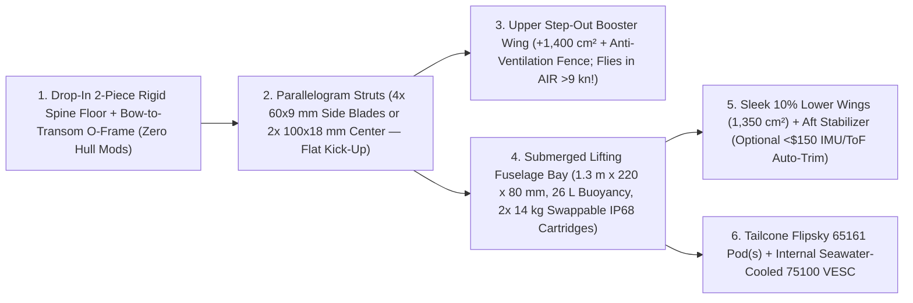
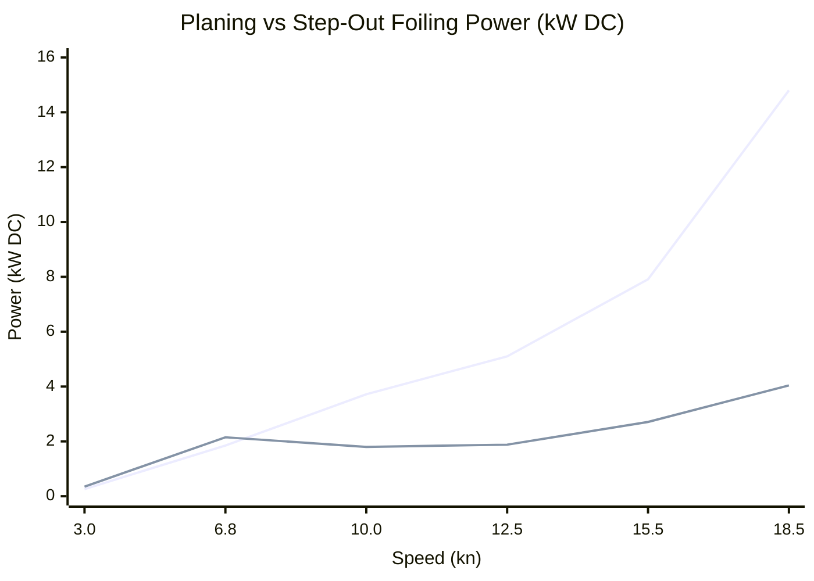

# FoilSkiff

**Drop-In Rigid Spine Floor & Step-Out Flying-Keel Pod with Swappable `IP68` Battery Cartridges (`10 ft` Class `48 V` Hydrofoiling Catamaran Tender)**

`foil-skiff` (**FoilSkiff** — combining *Foil* [biplane step-out hydrofoils and `NACA 0024` streamlined struts] and *Skiff* [lightweight inflatable tunnel-catamaran tender]) is an engineering, hydrodynamics, and fabrication project for converting any ultralight **`10 ft` (`3.0–3.3 m`) inflatable tunnel-catamaran dinghy** (e.g., `True Kit Navigator 300` / `Discovery 330`, `Takacat LX`, `Saturn`, `Kaboat` — `31–36 kg` bare hull) into a compact, bolt-on, power-steered electric hydrofoiling tender with **zero permanent hull modifications**.

---

## Primary Architecture: Drop-In Spine Floor + Step-Out Flying-Keel Pod

*Explore all **4 interactive 3D `.stl` CAD models**, OpenSCAD renders, and 11 scaled engineering SVGs in **[`VISUAL_ATLAS.md`](VISUAL_ATLAS.md)**.*

Instead of bolting heavy industrial outboards onto a `31 kg` inflatable transom, cluttering the cockpit with bulky battery cases, or twisting a soft air floor under foil loads, **`FoilSkiff`'s primary architecture combines a drop-in 2-piece rigid Spine Floor with a submerged lifting-body fuselage housing two swappable `14 kg` `IP68` battery cartridges**, sleek **`1,350 cm²` lower thin wings**, and a fixed **Upper "Step-Out" Booster Wing (`+1,400 cm²` mounted `200–250 mm` higher on the strut)**:

### Why This Architecture Wins
1. **Drop-In Rigid "Spine Floor" + Zero-Hole Coupling (`O-Frame`, `C-Frame`, or Switchable Magnets):** A thin `25–35 mm` 2-piece folding carbon/aluminum floor sits directly on the catamaran's continuous `1.2 mm` PVC tunnel ceiling web (replacing the stock drop-stitch air floor via existing tube pockets—zero glue, zero holes, universal width strips for `True Kit` / `Takacat`). Connects to the under-tunnel foil carriage without cutting the PVC web via:
   * **Bow-to-Transom Twin-Rail "O-Frame" (`~2.5–3.5 kg`, `2× 50×20 mm` rails spaced `250–300 mm` apart):** Best zero-hole pick for open-bow + open-transom catamarans (`True Kit Discovery`, `Takacat LX`); `3×–4×` lower bending moment, pod retracts *between* the rails, splits to `1.0 m` halves.
   * **Open-Transom "C-Frame" (`~3.3–5.2 kg`):** Purely mechanical zero-hole link for closed-bow catamarans (`True Kit Navigator`).
   * **Through-Fabric Switchable Magnets (`4 × Magswitch`, `~800 kgf` across `2.5 mm` gap) + rubber grip pads & aft safety bridle:** Universal `5-sec` drop-on across open or closed transoms with a built-in resettable breakaway fuse.
2. **Swappable `IP68` Battery Cartridges + Free Archimedes Lift (`~26.6 kg` Buoyancy):** A `~1.3 m × 220 mm × 80 mm` (`~26 L`) carbon fuselage bay holds **two removable, factory-potted `IP68` `2.5–2.7 kWh` (`14 kg` ea.) slide-in cartridges** (*Flitecell*-style). Buoyancy cancels `~90%` of pack weight underwater, while modular cartridges let one person carry a battery ashore to charge, isolate seal/cell service, or run **1 cartridge + foam buoyancy plug (`~15 nm`)** for ultralight solo runs.
3. **Dual-Regime Efficiency & "Push Throttle and Fly" Ergonomics (`6.4 kn` Takeoff + `30.8 nm` @ `15.5 kn`):** At takeoff (`0–8 kn`), both wings (`~2,750 cm²` combined) are submerged for an effortless **`6.4-knot` lift-off (`41%` less takeoff power)**. Above `9 kn`, the upper booster wing **exits completely into dry air (`825×` less dense → `99.9%` drag vanishes)** while acting as a **passive mechanical ride-height stabilizer**—paired with an optional `<$150` `ESP32`/`IMU`/`ToF` auto-trim aft stabilizer so non-athletic sailors can fly smoothly without `$40k` active flight computers.
4. **Zero High-Amp Strut Cables, Passive Seawater Cooling & Zero-Hardware Steering:** Keeping the battery cartridges, `75100` `VESC`s (water-cooled through the bottom skin), and twin tailcone **`2 × Flipsky 65161` (`100 Kv` on `16S` / `120 Kv` on `14S`)** inside the submerged pod eliminates thick strut cables and delivers **`360°` CAN-bus differential power steering** with zero moving steering linkages.
5. **Nearly `3×` High-Speed Range:** Lifting the catamaran tubes `6"`–`8"` clear of chop slashes `15.5-knot` battery power draw from `7.91 kW` (planing) down to **`2.71 kW`** (**`30.8 nm` range on `5.38 kWh`**—within `3%` of a dry-floor thin foil's `31.8 nm`!).

---

## Planing vs. Step-Out Foiling Power Draw (`True Kit 10 ft` Class)

*(Upper Line = Standard Planing Catamaran `kW DC`; Lower Line = Primary Step-Out Flying-Keel Pod `kW DC`)*

---

## Configuration Matrix

| Configuration | Drive & Battery Architecture | Key Performance & Thrust | Range (`5.38 kWh` Pack) | Complete DIY Cost (incl. Pack) |
| :--- | :--- | :--- | :---: | :---: |
| **Primary: Spine Floor + Step-Out Flying-Keel Pod** *(Recommended)* | Drop-in `25–35 mm` rigid Spine Floor + Bow-to-Transom `O-Frame` + `4×` `60×9 mm` parallelogram blades + `2 × Flipsky 65161` + `2 × 75100 VESC` + `26 L` bay w/ **`2 × 14 kg` swappable `IP68` cartridges** + Step-Out / Switchblade / Split STOL wings | **`6.4–7.2 kn` takeoff**, **`15.5 kn` @ `2.71 kW`**, zero hull mods, carry-ashore packs, `~90 mm` flat beach tuck | **`30.8 nm` @ `15.5 kn`** `35.5 nm` @ `12 kn` | **`~$4,120`** |
| **Alt A: Dry `60 mm` Rigid Battery-Floor + Foil-Strut Pods** *(Rocky-Beach Pick)* | `2 × Flipsky 65161` + `2 × 75100 VESC` + dry 2-piece `EVE LF105` RIB floor + `2-sec` flip-up thin foils | `9.5 kn` takeoff, **`15.5 kn` @ `2.62 kW`**, `22.5 kn` max cont., zero submerged lithium risk | **`31.8 nm` @ `15.5 kn`** | **`~$3,350`** |
| **Alt B: Turnkey CNC Azimuth Pods (`2 × W-30` `730 mm`)** *(Zero-Fab Pick)* | `13.2 kg` CNC struts + **built-in `±85°` servo power steering + wireless remote** | `6.4 kW` peak (`110 lbf`), foiling capable on `730 mm` tall shafts | **`30+ nm`** *(foiling)* | `2 × W-30` + `$1,620–$2,150` |
| **Alt C: `2 × APISQUEEN U30` Ducted / `BP100` Jet** *(Tug / Shallow Beach)* | `U30`: `5.3 kg`, `132 lbf` (`33 lbf/kW`, diff. steer) / `BP100`: `10 kW` (`158 lbf`) jetboard | `U30`: `4–11 kn` tugboat & harbor / `BP100`: prop-free `3"`-draft rocky beaching (`14–15.5 kn`) | `36 nm` @ `4.5 kn` (`U30`) `~7.4 nm` (`BP100` jet) | **`~$2,820 – $2,965`** |
| **Experimental: `M2200` Solo Foiling Mule** *(Low-Cost Testbed)* | Stripped `2.2 kW` `M2200` + `Flipsky 75100` + `NACA 0024` fairing (`saves 2.1 kW @ 10 kn`) + `12 V` actuators *(or `2 × T63100` `~$500`)* | Solo (`150 kg`) `6.8–7.5 kn` takeoff (`2,900 cm²` wings) $\rightarrow$ **`11.5 kn` @ `1.28 kW`** | `~18 nm` (`2 kWh` test pack) | **`~$650 – $1,100`** |

---

## Repository Contents

* **[`electric-foiling-dinghy-guide.md`](electric-foiling-dinghy-guide.md)** — Complete engineering guide covering the **Primary Drop-In Spine Floor + Step-Out Flying-Keel Pod** (swappable `2 × 14 kg` `IP68` battery cartridges, zero-mod rigid Spine Floor + `O-Frame`/`C-Frame`/switchable magnet coupling across `True Kit`/`Takacat` hulls, `4×` slim side-straddling parallelogram blades, and three high-lift wing tracks: zero-moving-parts **Upper Step-Out Booster Wing**, zero-extra-wet-area **Flush-Nested Top-Deck Switchblade Wings**, and **`~$160` Submerged Split STOL Flaperons (`1,000 + 2×250 cm²`)** for rough chop & 4-in-1 active elevation/roll control), `IP68`/impact/anti-ventilation safety rules, off-the-shelf drive showdown (`Flipsky 65161` `100 Kv` vs `120 Kv`, `2 × T63100`, `W-30`, `APISQUEEN U30`, `Maytech 65162 / 70182`, `TP100`, `BP100` jet, `QS138` / `Sotion`, and `ME1304` baseline), `14S` vs `16S LiFePO4` ESC voltage rules, dry `60 mm` rigid battery-floor comparison, `M2200` + `NACA 0024` solo foiling test mule, and bolt-on kit productization rationale.
* **[`VISUAL_ATLAS.md`](VISUAL_ATLAS.md)** — Visual Design Atlas & 3D CAD Gallery showcasing all **4 interactive 3D `.stl` CAD models**, **4 OpenSCAD multi-material 3D PNG renders**, and **11 mathematically-scaled engineering SVG diagrams**.
* **[`models/`](models/)** — Parametric Python 3D CAD generator ([`generate_cad.py`](models/generate_cad.py), zero external Python deps) and 4 binary `.stl` assemblies (orbitable natively on GitHub or 3D-printable at `1:15` scale): `01_step_out_flying_keel_truekit.stl`, `02_switchblade_pod.stl`, `03_stol_flaperon_pod.stl`, and `04_retracted_beaching_truekit.stl`.
* **[`renders/`](renders/)** — High-resolution `1400 × 860` multi-material OpenSCAD 3D PNG renderings of all 4 CAD configurations.
* **[`diagrams/`](diagrams/)** — Pure-Python 2D technical SVG generator ([`generate_diagrams.py`](diagrams/generate_diagrams.py)) and 11 vector SVG engineering drawings (`00`–`10`).

---

## Development Roadmap

- [x] **Phase 0: Step-Out Flying-Keel Pod Hydrodynamics, Modularity & Safety Specification**
  - Compare the Step-Out Flying-Keel Pod (`26 L` buoyancy, `6.4 kn` takeoff, `19.3 lbf` @ `15.5 kn`) against fixed single-plane pods, submerged longitudinal swing-wings (`+33%–53%` wetted-area penalty), trailing-edge flaps, thick blended battery-wings, and dry `60 mm` composite battery-floors.
  - Specify the drop-in 2-piece rigid Spine Floor (zero hull mods), swappable `2 × 14 kg` `IP68` battery cartridges, anti-ventilation strut fence collar, and `<$150` `ESP32`/`IMU`/`ToF` auto-trim aft stabilizer.
  - Benchmark `Flipsky 65161` (`100 Kv` on `16S` vs `120 Kv` on `14S`), `2 × T63100`, `2 × W-30`, `2 × APISQUEEN U30`, and `M2200` + `NACA 0024` fairing drag savings (`2,135 W` at `10 kn`).
- [ ] **Phase 1: `M2200` + `Flipsky 75100` `VESC` + `NACA 0024` Fairing & Drive-by-Wire Mule**
  - `3D`-print interlocking `150 mm` chord `NACA 0024` shaft fairing + glass/carbon skin; install `Flipsky 75100` `VESC` and `12 V` linear-actuator steering & aft-foil pitch trim; run solo lift-off trials.
- [ ] **Phase 2: Drop-In Spine Floor + Step-Out Flying-Keel Prototype (`26 L` Bay + Swappable Cartridges)**
  - Fabricate the universal `25–35 mm` 2-piece rigid Spine Floor (`True Kit` / `Takacat` trim panels) + Bow-to-Transom Twin-Rail O-Frame, `1.3 m × 220 mm × 80 mm` carbon lifting fuselage bay with `20 mm` sacrificial Kevlar nose bumper, CNC double-O-ring rear door for `2 × 14 kg` potted `IP68` cartridges, leak sensor, internal seawater-cooled `2 × Flipsky 75100` `VESCs`, `2 × Flipsky 65161` tailcone pods, `1,350 cm²` sleek lower thin wings, `+1,400 cm²` double-deck horizontal upper step-out booster wing with `20 mm` anti-ventilation fence, and **parallelogram retraction struts (`4×` `60 × 9 mm` side-straddling blades for `~90 mm` folded depth or `2×` `100 × 18 mm` recessed center tandem struts)**.
- [ ] **Phase 3: Full-Scale `15–22 kn` Foiling Sea Trials & Mothership `48 V` Umbilical Charging**
  - Validate `6.4 kn` step-out takeoff, `30+ nm` range at `15.5 knots`, passive ride-height stabilization + optional auto-trim, carry-ashore cartridge swapping, assisted shallow-water retraction, and dry deck-level charging from the mothership's bus (see [`flux-shaft`](https://github.com/boats-boats-boats/flux-shaft)).
