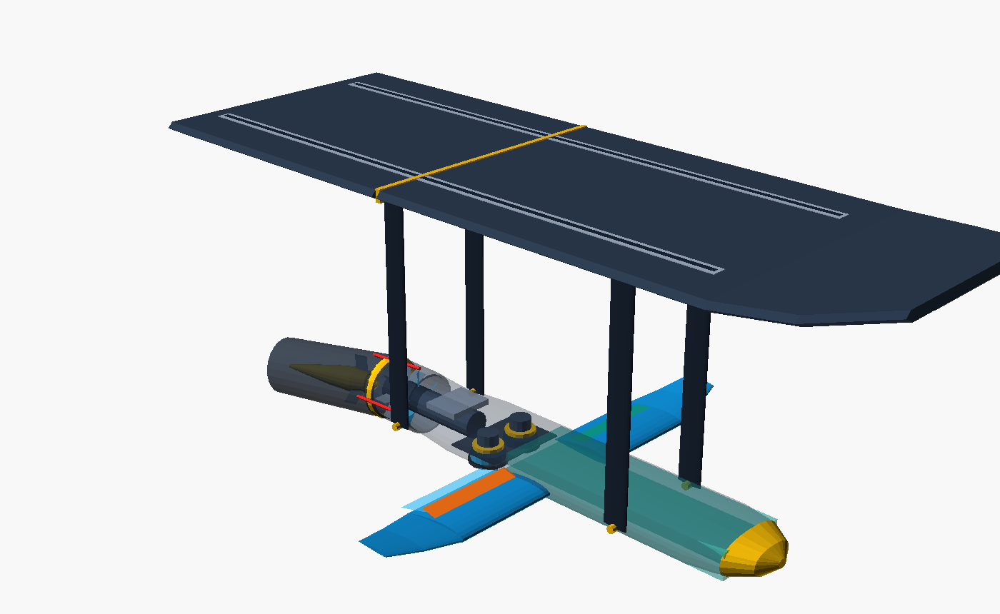
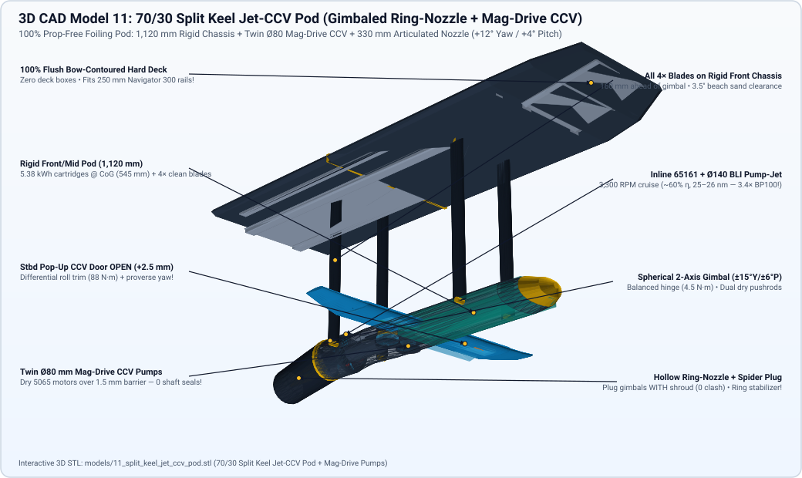
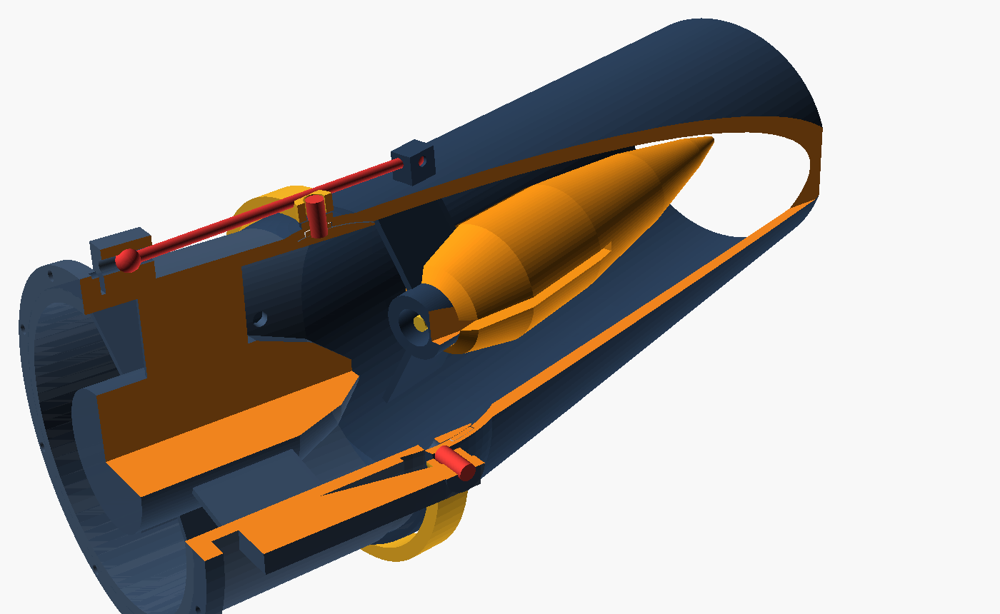
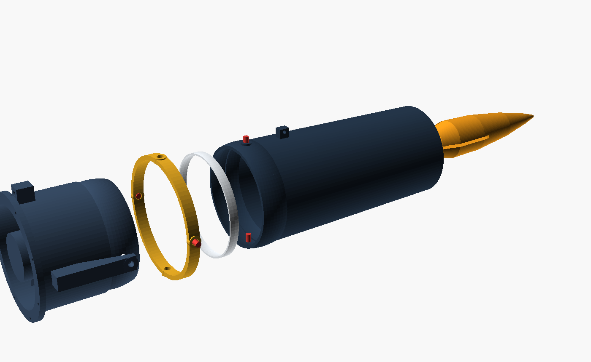
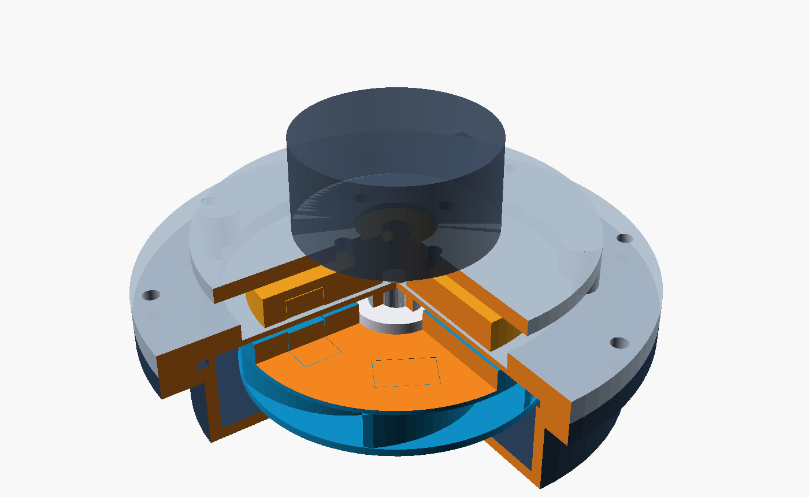

# FoilSkiff — `70/30` Split Keel Jet-CCV Pod & `Ø80 mm` Mag-Drive Centrifugal Pump

A prop-free, weed-resistant, hydrofoiling propulsion & active-lift architecture for the **`True Kit Navigator 300`** (`250 mm` under-hull C-Frame rails, `4×` `60 × 9 mm` side-straddling parallelogram blades, `5.38 kWh` `16S LiFePO4` pack).

This design replaces both exposed propellers and external mechanical flaperon linkages with two tightly integrated fluidic subsystems:
1. **A `77/23` (`~70/30` conceptual) Split Keel Pod (`1,450 mm` LOA):** Rigid front/mid battery + wing + axial/mixed-flow pump chassis (`1,120 mm`) paired with a **2-axis gimbaled hollow rear ring-nozzle (`330 mm`)** carrying an internal **spider-mounted sliding teardrop throttling plug**—solving the `APISQUEEN BP100` flush-intake air-suction and `~38%` cruise efficiency traps while remaining `100%` prop-free.
2. **Inboard Circulation-Control (CCV) Wing Roots + Twin `Ø80 mm` Mag-Drive Centrifugal Pumps:** Flush pop-up top doors on the `2 × 250 mm` inboard wing roots divert `~5.5 L/s @ 0.50 bar` per side for **`~7.0–7.2 kn` STOL takeoff**, cushioned landings, and **differential roll trim with proverse yaw**—driven through a solid `1.5 mm` waterproof carbon floor via **`N52` magnetic couplings (ZERO rotary shaft seals!)**.

---

## 1. Visual CAD Models & Printable Parts



<details>
<summary><strong>View Annotated 3D Isometric Engineering Callouts (SVG)</strong></summary>



</details>

| Artifact | Path | Purpose |
| :--- | :--- | :--- |
| **Full `70/30` Split Keel Pod 3D STL** | [`models/11_split_keel_jet_ccv_pod.stl`](models/11_split_keel_jet_ccv_pod.stl) | Interactive `1:1` mm assembly (fits `Navigator 300` `250 mm` rails) |
| **Parametric `Ø80 mm` Mag-Drive Pump (OpenSCAD)** | [`models/ccv_magdrive_pump_80mm.scad`](models/ccv_magdrive_pump_80mm.scad) | Parametric source (`impeller`, `volute_lower`, `bulkhead_lid`, `drive_hub`) |
| **Printable Bench-Test STLs (`1:1` mm)** | [`ccv_pump_80mm_impeller.stl`](models/ccv_pump_80mm_impeller.stl), [`ccv_pump_80mm_volute.stl`](models/ccv_pump_80mm_volute.stl), [`ccv_pump_80mm_bulkhead_lid.stl`](models/ccv_pump_80mm_bulkhead_lid.stl), [`ccv_pump_80mm_drive_hub.stl`](models/ccv_pump_80mm_drive_hub.stl) | Direct-to-slicer `PA12-CF` / `PETG-CF` parts for tub testing `5.5 L/s @ 0.5 bar` |
| **Parametric 2-Axis Gimbal Nozzle (OpenSCAD)** | [`models/gimbal_nozzle_150mm.scad`](models/gimbal_nozzle_150mm.scad) | Close-up `1:1` spherical gimbal (`±15°` Y / `±6°` P) + spider-mounted sliding plug (`4` printable STLs) |
| **Printable Gimbal STLs (`1:1` mm)** | [`gimbal_150mm_stator_housing.stl`](models/gimbal_150mm_stator_housing.stl), [`gimbal_150mm_cardan_ring.stl`](models/gimbal_150mm_cardan_ring.stl), [`gimbal_150mm_rear_nozzle.stl`](models/gimbal_150mm_rear_nozzle.stl), [`gimbal_150mm_sliding_plug.stl`](models/gimbal_150mm_sliding_plug.stl) | Manifold printable/CNC parts for the `Ø150 → Ø132 mm` 2-axis vectoring nozzle |

---

## 2. Why a `70/30` Internal-Nozzle Split Beats Both `BP100` & `50/50` External Splits

* **Why `BP100` (`Ø56 mm` round hull jet) fails for foiling:** Flush hull intake sucks air immediately on lift-off, and its tiny `~25 cm²` exit forces `~20–22 m/s` jet velocity ($\eta_{\text{ideal}} \approx 53\%$, wire-to-thrust `~35%–42%`, only `~7.4 nm` range).
* **Why a `50/50` split blowing over the *outside* of a `600 mm` rear pod loses:** Shooting a `12 m/s` jet across `~0.28 m²` of external rear pod skin creates `~83 N` (`~35%` of cruise thrust) in turbulent skin scrubbing drag and breaks the `foil-skiff` 4-bar parallelogram strut wheelbase.
* **Why the `1,120 mm` Rigid Pod + `330 mm` Articulated Hollow Ring-Nozzle wins:**
  1. **Large Exit Area (`A_j = 131–134 cm²`, `5.3×` larger than `BP100`):** At `15.5 kn` (`8.0 m/s`, `235 N` thrust), jet speed drops to **`9.8 m/s`** ($\eta_{\text{Froude}} \approx 90\%$) and internal pressure rise is just **`16 kPa`**, yielding **`~60%` wire-to-thrust efficiency** (including Boundary-Layer Ingestion off the aft pod flanks!).
  2. **Zero Gearbox Motor Match:** A `Ø140 mm` axial/mixed-flow impeller (`P/D ≈ 1.5`) turns at **`~3,300 RPM`** in cruise—dead-center in the `75%–80%` efficiency band of a single inline **`Flipsky 65161` (`100 Kv`)** on `16S LiFePO4` (`49.5 V` loaded, `4,160 RPM` max) + `1× Flipsky 75100` `VESC`.
  3. **3-in-1 Rear Control + Power-Off Ring Stabilizer:** The hollow `Ø150 → Ø132 mm` rear shroud gimbals `±15°` Yaw / `±6°` Pitch for zero-speed vectoring and active pitch trim, carries the sliding throttling plug internally, AND acts as a torpedo-style **annular ring-tail stabilizer** if power cuts out mid-flight.

---

## 3. Station Layout, Weight & Buoyancy Balance (`1,450 mm` LOA)

Total LOA (`1,450 mm`) matches the baseline `1,300 mm` pod + `162 mm` tailcone (`~1,460 mm`), tucks cleanly between the `250 mm` under-hull rails (`50 mm` clear per side around the `Ø150 mm` rear shroud), and preserves **`~90 mm` (`3.5"`) flat-beach sand clearance** when retracted.

| Station (`X` from Nose) | Subsystem & Geometry | Mass (`kg`) | Buoyancy (`kgf`) | `X` Center (`mm`) |
| :--- | :--- | :---: | :---: | :---: |
| **`0 – 50 mm`** | `20 mm` Kevlar/elastomer crush-nose + `5 mm` `G10` crash bulkhead | `0.6` | `0.4` | `25` |
| **`50 – 680 mm`** | **Dry Cartridge Bay (`220 × 96 mm`):** `2 × 14 kg` swappable `IP68` `LiFePO4` (`5.38 kWh`) + `75100 VESC` + `ESP32`/`BNO085` IMU | `28.8` | `16.2` | `365` |
| **`520 – 680 mm`** | **Main Wing (`1,250 cm²`, `1.05 m` span):** `2 × 250 mm` inboard `15.5%` CCV roots + thin `10%` outer tips | *(in shell)* | *(in shell)* | `560` *(CoL)* |
| **`680 – 820 mm`** | **Mid-Pod Twin CCV Bay:** `2 × 5065` dry motors above `1.5 mm` solid carbon wall $\rightarrow$ `N52` mag-couplings $\rightarrow$ `2 × Ø80 mm` wet centrifugal impellers (`~40 mm` plenum run into wing roots) | `1.5` | `2.8` | `750` |
| **`830 – 1,120 mm`** | **Main Propulsion Bay:** Inline `Flipsky 65161` (`100 Kv`) + annular BLI intake + `Ø140 mm` axial/mixed-flow impeller + stator vanes | `4.2` | `3.2` | `975` |
| **`1,120 – 1,450 mm`** | **Articulated Rear Ring-Nozzle (`330 mm`):** Hollow converging shroud (`Ø150` OD $\rightarrow$ `Ø132 mm` bore) + spider-mounted sliding teardrop plug (`Ø65 → Ø20 mm`) | `1.8` | `0.8` | `1,270` |
| **Shell, Struts & Servos** | Carbon fuselage, wings, `2 × IP68` gimbal servos + plug micro-actuator | `6.6` | `2.6` | `640` |
| **TOTAL POD** | **`1,450 × 220 × 96 mm` (`Ø150 mm` rear shroud)** | **`43.5 kg`** | **`26.0 kgf`** | **`X_CoG = 545 mm`** |

* **CoG Alignment:** Mass-weighted **`X_CoG = 545 mm`** sits directly on the Main Wing quarter-chord Center of Lift (`X = 560 mm`), and `26.0 kgf` buoyancy drops net underwater pod weight to **`17.5 kg`**.
* **Strut Anchoring:** All `4×` `60 × 9 mm` side-straddling blades bolt strictly to the rigid front/mid chassis at **`X = 320 mm`** and **`X = 960 mm`** (`640 mm` rigid wheelbase, `160 mm` ahead of the `X = 1,120 mm` gimbal split).

---

## 4. Spherical Gimbal & Spider-Mounted Plug Kinematics



<details>
<summary><strong>View Exploded Mechanical Assembly (All Gimbal Parts Separated)</strong></summary>



</details>

1. **Zero-Leak Spherical Collar & External Cardan Ring (`X = 1,120 mm`, `R_male = 75.0 mm`):**
   * Stationary male spherical ball (`R = 75.0 mm`) mates with the nozzle's female spherical collar (`R_in = 75.4 mm`, `R_out = 79.8 mm`) via a recessed **`UHMW-PE` spherical seal band** (`0.15 mm` water-lubricated fit — zero jet leakage across full articulation).
   * Because the nozzle's spherical collar (`R_out = 79.8 mm`) sits strictly inside the external **`Ø179 mm` Cardan Ring (`R_in = 82.5 mm`)**, collision is **mathematically impossible** at any simultaneous combination of `±15°` Yaw (12 & 6 o'clock `Ø8 mm` pins) and `±6°` Pitch (3 & 9 o'clock `Ø8 mm` pins on stationary fork arms).
2. **Hinge-Torque Balance & Heim-Joint Pushrods:** Placing the servo clevis ears at `X = +62 mm` aft of the gimbal pivot (`90°` apart: Top = Pitch, Starboard = Yaw) with spherical heim-joint pushrods absorbs 2-axis cross-coupling cleanly and keeps peak `15.5 kn` steering torque around **`~4.5 N·m` (`46 kg·cm`)**—easily driven by `2 × IP68` `75 kg·cm` dry-pod servos.
3. **Mandatory Collision Fix — Spider-Mounted Plug:** Supporting the `Ø65 → Ø16 mm` sliding teardrop plug on **3 thin streamlined spider vanes *inside* the gimbaled shroud** (with a central `Ø34 mm` guide sleeve + self-locking `Tr8×2` leadscrew and 3 axial vane-clearance slots across `45 mm` stroke) guarantees `100%` concentric annular exit flow at every steering angle (`A_j = 133.7 cm²` retracted $\leftrightarrow$ `103.7 cm²` extended).

---

## 5. Inboard CCV Wing Roots & Differential Roll Trim

* **Hybrid Root Profile (`c = 160 mm`, `t/c = 15.5%` / `25 mm` thick across `2 × 250 mm` inboard span):**
  * Solid UD carbon main spar (`25%–35%` chord) ahead of a **`60 × 8 mm` (`4.8 cm²`) internal water plenum** (`42%–64%` chord).
  * **Flush Pop-Up Upper Door (`55%–68%` chord):** Living carbon flexure or hinge lifting `0 → 3.0 mm` at its aft lip. Preloaded to **`22–25 kPa` cracking pressure** so `15.5 kn` upper-wing cruise suction (`-10 to -16 kPa`) cannot pull it open, while the `45–55 kPa` mag-drive pump pops it open cleanly on demand.
  * **Moderate Rounded Coanda Trailing Edge (`r ≈ 3 mm`, `~2%` chord):** `<2%` cruise drag penalty when closed, yet bends the `~9 m/s` Coanda sheet downward during takeoff/landing.
* **Differential Roll & Proverse Yaw:** Opening only the Starboard door (`+2.4 mm`) adds **`ΔL ≈ +350 N`** at `y = 0.25 m` lever arm $\rightarrow$ **`τ_roll ≈ 88 N·m` (bank LEFT)** while its tangential rearward jet adds `~75–85 N` of forward push on the right wing (exceeding `~35–45 N` extra induced drag) $\rightarrow$ **proverse yaw** turning the nose naturally into the bank!
* **Why Decoupled CCV Pumps Beat Main-Jet Bleed:** An efficient wide-bore cruise pump-jet runs at only `15–22 kPa`, whereas thin `2.5 mm` CCV slots need `45–50 kPa`. Dedicated twin `Ø80 mm` mag-drive pumps let you run full STOL landing cushion and active roll trim even at **zero main throttle** without choking the main nozzle.

---

## 6. `Ø80 mm` Mag-Drive Centrifugal CCV Pump — Bench-Test & Print Guide



### Hydraulic & Magnetic Design Specs
* **Duty Point (per unit):** `Q = 5.5 L/s` (`330 L/min`) @ `ΔP = 50 kPa` (`5.1 m` head) at **`2,350 RPM`** (`N_q ≈ 52`, `75%–82%` hydraulic efficiency).
* **Impeller (`ccv_pump_80mm_impeller.stl`):** `Ø80 mm` OD, `Ø44 mm` suction eye, `6×` backward-curved logarithmic vanes (`10 mm` tall, `74°` sweep), press-fit **`608` full-ceramic (`Si3N4`)** wet bearing riding on a stationary `Ø8 × 24 mm` `316L` stainless stub shaft.
* **Zero-Seal `N52` Magnetic Coupling:** `6×` `15 × 10 × 5 mm` `N52` magnets (alternating `N–S–N–S–N–S` on `Ø52 mm` PCD) in both the wet impeller backplate and the dry `5065` drive hub across a **`1.5 mm` solid waterproof barrier** (`3.5 mm` magnet face-to-face gap) $\rightarrow$ `>4.5 N·m` breakaway torque (`>3×` margin over `1.42 N·m` running torque!).
* **Total Stack Height:** `~56 mm` (including compact pancake `5065` motor) — fits easily inside the `96 mm` keel pod with `0` shaft seals!

### 3D Printing & Tub Bench-Test Protocol
1. **Print Settings (`PA12-CF` or `PETG-CF`):** `0.16 mm` layers, `4` perimeters, `100%` infill on `bulkhead_lid` barrier web (coat barrier face with 1 thin coat of penetrating marine epoxy to guarantee zero porosity).
2. **Magnet Bonding:** Bond `6×` `15 × 10 × 5 mm` `N52` magnets into both `impeller` and `drive_hub` pockets in strict alternating `N–S` polarity; encapsulate the wet impeller magnet pockets flush with marine epoxy.
3. **Assembly:** Press the `608` full-ceramic bearing into the impeller and the `Ø8 mm` `316L` dowel pin into the `bulkhead_lid` blind socket. Drop a `Ø106 × 2.5 mm` Viton O-ring into the `volute_lower` groove, bolt the flange with `8× M4` `316L` screws, and mount a dry `5065` (`140–200 Kv`) motor + `60 V / 40 A` ESC on the dry side.
4. **Tub Verification (`~20 L` bucket timed fill + pressure gauge):** Submerge the volute belly intake, attach a `60 × 8 mm` straight test chute with a `0–15 psi` static tap `50 mm` downstream, and ramp to `2,350 RPM` (`~350–400 W` electrical):
   * **Pass Target:** `≥ 0.45 bar` (`6.5 psi`) static pressure at `≥ 4.5–5.5 L/s` (`20 L` fill in `3.6–4.4 s`), zero mag-coupling slip up to `2,800 RPM`, and zero dry-side moisture after 10 minutes submerged.

---

## 7. Performance & BOM Comparison (`5.38 kWh` `16S LiFePO4` Pack, `92%` Usable)

| Architecture | Prop-Free? | Takeoff Speed | `15.5 kn` Cruise Power | Usable Range @ `15.5 kn` | Added Drive/CCV Cost |
| :--- | :---: | :---: | :---: | :---: | :---: |
| **`BP100` Hull Jet** *(non-foiling Alt C)* | Yes | N/A *(planing)* | `~10.0 kW` | `~7.4 nm` | `~$1,215` *(jet + ESC)* |
| **`70/30` Split Keel Jet-CCV Pod** *(Model 11)* | **Yes** | **`~7.0–7.2 kn`** *(CCV)* | **`~2.95–3.05 kW`** | **`~25–26 nm`** *(`3.4×` BP100!)* | `~$1,150` *(`1× 65161` + `1× 75100` + `2×` mag-drive CCV + `2×` gimbal servos)* |
| **Baseline `foil-skiff` Split STOL** *(Model 1)* | No | `7.2 kn` | `2.80 kW` | `29.8 nm` | `~$1,210` *(`2× 65161` + `2× 75100` + `2×` flaperon servos)* |

### Regenerating Models & STLs
```bash
# Export all 4 printable Ø80 mm Mag-Drive CCV Pump STLs + cutaway PNG
openscad -D 'part_select="impeller"'         -o models/ccv_pump_80mm_impeller.stl     models/ccv_magdrive_pump_80mm.scad
openscad -D 'part_select="volute_lower"'     -o models/ccv_pump_80mm_volute.stl       models/ccv_magdrive_pump_80mm.scad
openscad -D 'part_select="bulkhead_lid"'     -o models/ccv_pump_80mm_bulkhead_lid.stl models/ccv_magdrive_pump_80mm.scad
openscad -D 'part_select="drive_hub"'        -o models/ccv_pump_80mm_drive_hub.stl    models/ccv_magdrive_pump_80mm.scad
openscad -D 'part_select="assembly_cutaway"' --imgsize=1400,860 --colorscheme=Tomorrow \
         --camera=8,8,28,58,0,325,315 -o renders/12-ccv-magdrive-pump-80mm-3d.png models/ccv_magdrive_pump_80mm.scad

# Regenerate Model 11 (and all FoilSkiff 3D CAD STLs, SVGs & PNG renders)
python3 models/generate_cad.py
```
