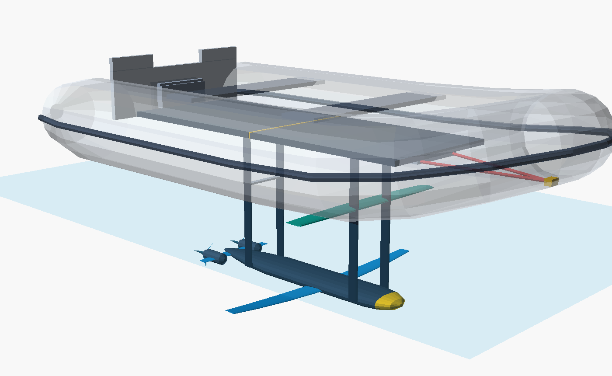
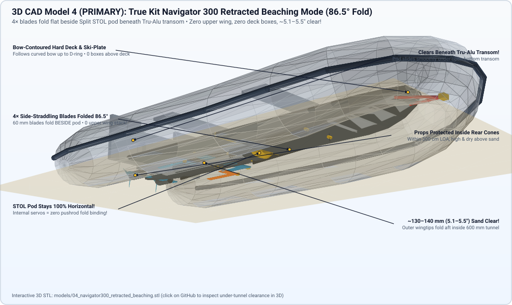
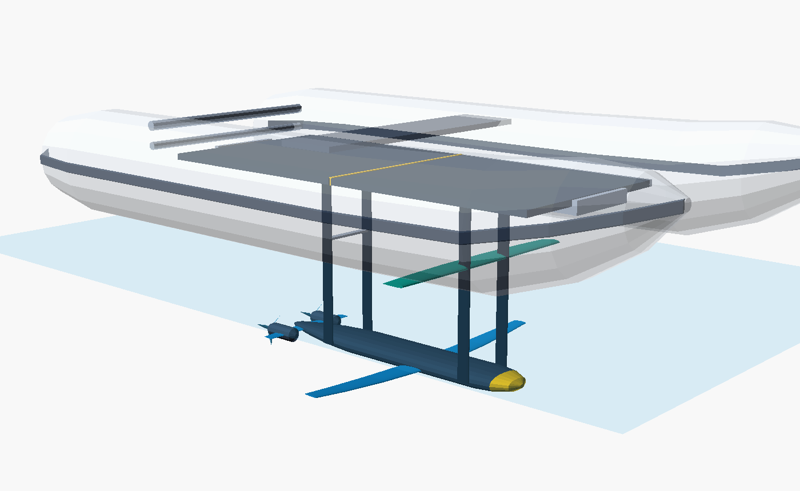
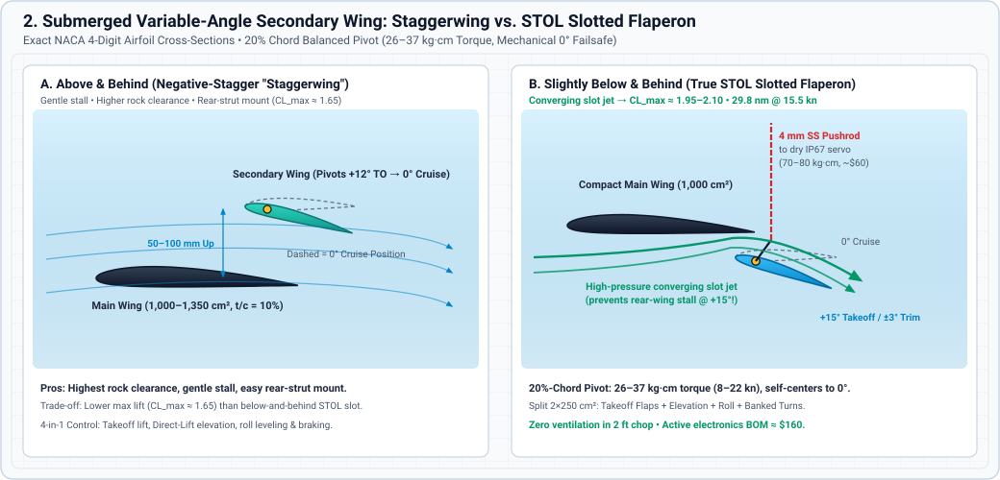
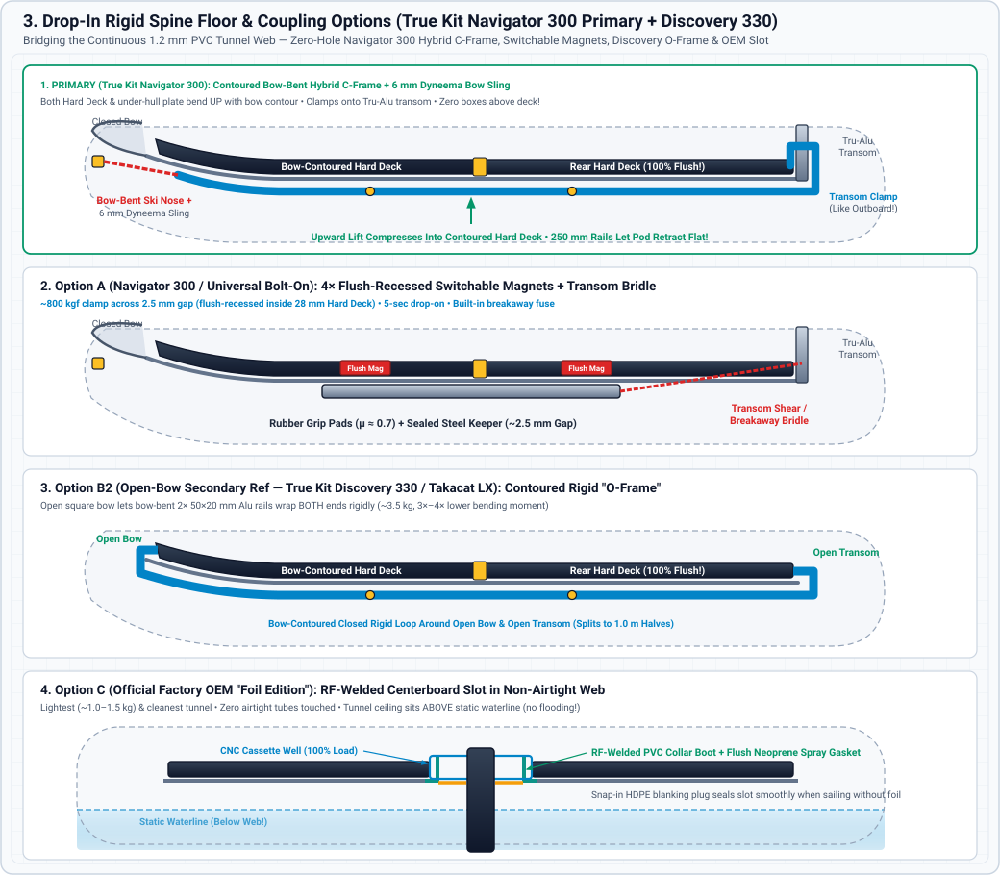

# FoilSkiff — Visual Design Atlas & 3D CAD Model Gallery

A complete visual companion to [`electric-foiling-dinghy-guide.md`](electric-foiling-dinghy-guide.md), pairing **interactive millimeter-scale 3D `.stl` CAD models** (orbitable directly in GitHub's native 3D viewer), **multi-material OpenSCAD 3D renderings (`renders/`)**, and **mathematically-scaled 2D engineering SVG drawings (`diagrams/`)**.

* **Primary Reference Hull:** **`True Kit Navigator 300`** (`300 × 155 cm`, `60 cm` inside beam, `Ø460 mm` continuous closed-bow tubes, factory `Tru-Alu` rigid aluminum transom, `31 kg` bare weight, `500 kg` capacity).
* **Secondary Open-Bow Reference:** **`True Kit Discovery 330`** / **`Takacat LX`** (open square bow enabling a full rigid Bow-to-Transom O-Frame).

---

## Part I — Interactive 3D CAD Models & Renderings

| # | 3D CAD Model (Click on GitHub to Orbit in 3D) | Hull / Focus | Key Highlight Shown |
| :---: | :--- | :---: | :--- |
| **1** | [`models/01_navigator300_step_out_flying_keel.stl`](models/01_navigator300_step_out_flying_keel.stl) | **`Navigator 300`** *(Primary)* | Primary **Step-Out Flying-Keel Pod** + **Tru-Alu Transom-Clamped Hybrid C-Frame** + **`6 mm` Dyneema Bow-D-Ring Sling** |
| **2** | [`models/02_switchblade_pod.stl`](models/02_switchblade_pod.stl) | *Universal Pod* | **Flush-Nested Top-Deck Switchblade Wing** (`+1,300 cm²` deployed + `70 mm` carbon overhang bridge) |
| **3** | [`models/03_stol_flaperon_pod.stl`](models/03_stol_flaperon_pod.stl) | *Universal Pod* | **Submerged Split STOL Flaperons** (`1,000 + 2×250 cm²`) in differential bank + dry-deck servos & `4 mm` pushrods |
| **4** | [`models/04_navigator300_retracted_beaching.stl`](models/04_navigator300_retracted_beaching.stl) | **`Navigator 300`** *(Primary)* | **Retracted `85°` Parallelogram Beaching Mode** tucked cleanly beneath the `Tru-Alu` transom (`~140 mm` / `5.5"` sand clearance) |
| **5** | [`models/05_discovery330_oframe_step_out.stl`](models/05_discovery330_oframe_step_out.stl) | `Discovery 330` *(Secondary)* | Secondary open-bow reference showing the **Full Rigid Bow-to-Transom O-Frame** (also applies to `Takacat LX`) |

---

### 1. PRIMARY: `True Kit Navigator 300` + Step-Out Flying-Keel Pod
*Exact `True Kit Navigator 300` geometry (`300 × 155 cm`, `60 cm` inside beam, `Ø460 mm` continuous closed curved bow tube, factory notched `Tru-Alu` aluminum transom) fitted with a `680 × 1,850 mm` Drop-In 2-Piece Rigid Spine Floor, **Tru-Alu Transom-Clamped Hybrid C-Frame** (`2 × 50 × 20 mm` Alu rails spaced `250 mm` apart), **`6 mm` Dyneema Bow-D-Ring Tieback Sling** (eliminating front cantilever with zero holes!), `4×` `60 × 9 mm` side-straddling blades, Upper Step-Out Booster Wing (flying in dry air >`9 kn`), and Submerged `26 L` Flying-Keel Pod (`20 mm` Kevlar crush-nose, `1,350 cm²` lower thin wings, twin `Flipsky 65161` tailcone pods).*



<details>
<summary><strong>View Annotated 3D Isometric Engineering Callouts (SVG)</strong></summary>


</details>

---

### 2. Co-Primary Rough-Chop Wing: Flush-Nested Top-Deck Switchblade Pod *(Fits `Navigator 300` & `Discovery 330`)*
*Two `680 × 105 × 13 mm` solid UD carbon blades (`1.58 m` span, `AR ≈ 15`) sweep cleanly between the `x = 170 mm` and `x = 960 mm` side-straddling blades, locking beneath a `70 mm` carbon overhang bridge at takeoff (`6.7 kn`) and folding `100%` flush into the fuselage roof above `9 kn` (`0 cm²` extra wet area, `30.8 nm` @ `15.5 kn`, `32.3 lbf` best pod drag @ `22 kn`).*


<details>
<summary><strong>View Annotated 3D Isometric Engineering Callouts (SVG)</strong></summary>


</details>

---

### 3. Active-Chop Flight-Control Upgrade: Submerged Split STOL Flaperons *(Fits `Navigator 300` & `Discovery 330`)*
*Compact `1,000 cm²` high-speed main wing paired with independent port/starboard `250 cm²` Junkers external slotted flaperons shown in differential bank (`+18°` port / `-8°` starboard). Two dry-mounted `IP67` `70–80 kg·cm` brushless servos on the Spine Floor drive `4 mm` stainless pushrods tucked inside the rear blade trailing-edge grooves (`~$160` active BOM; `20%`-chord self-centering failsafe).*


<details>
<summary><strong>View Annotated 3D Isometric Engineering Callouts (SVG)</strong></summary>


</details>

---

### 4. PRIMARY Retracted Beaching Mode: `85°` Parallelogram Fold on `True Kit Navigator 300`
*Tunnel-level view of the **`True Kit Navigator 300`** resting on flat beach sand (`Z = -232 mm`). All `4×` `60 × 9 mm` side-straddling blades fold `85°` aft **beside** the `80 mm`-thick pod (zero vertical chord stack-up!), sliding smoothly beneath the factory `Tru-Alu` transom and keeping the `1.3 m` pod, lower wings, and twin `65161` props `100%` horizontal and **`~135–140 mm` (`5.5"`) clear above flat sand** within the `300 cm` hull length.*


<details>
<summary><strong>View Annotated 3D Isometric Engineering Callouts (SVG)</strong></summary>



</details>

---

### 5. Secondary Open-Bow Reference: `True Kit Discovery 330` + Full Rigid Bow-to-Transom O-Frame
*For open-bow catamarans (`True Kit Discovery 280/330/400`, `Takacat LX`), the identical swappable Flying-Keel Pod mounts to a closed rigid Bow-to-Transom Twin-Rail **O-Frame** wrapping around both open ends.*



<details>
<summary><strong>View Annotated 3D Isometric Engineering Callouts (SVG)</strong></summary>


</details>

---

## Part II — Scaled 2D Engineering Drawings (`diagrams/`)

### 6. Flying-Keel Pod Internal Cutaway (`26 L` Swappable Cartridges, Seawater Cooling & Safety)


### 7. Flush-Nested Top-Deck Switchblade Wing (Top-Down Closed vs. Deployed)


### 8. Submerged Variable-Angle Secondary Wing: Staggerwing vs. STOL Slotted Flaperon


### 9. Drop-In Rigid Spine Floor & Coupling Options (`Navigator 300` Primary + Magnets + `Discovery 330` O-Frame + OEM Slot)


### 10. Grounding Kick-Up Kinematics: Single Central Mast Collision vs. 4-Bar Parallelogram


### 11. Strut Architecture & Folded Stack-Up Clearance Inside the `Navigator 300` Tunnel (`600 mm` Wide × `230 mm` High)


### 12. Integrated Battery-Hull Architecture Comparison on `True Kit Navigator 300`


---

## Part III — Regenerating or Modifying the Parametric CAD & Drawings

All `.stl` models, `.svg` technical drawings, and OpenSCAD `.png` renderings are generated deterministically with **zero Python third-party dependencies** (plus optional `openscad` CLI for shaded PNG renders):

```bash
# Regenerate all 7 scaled 2D engineering SVGs (pure Python 3)
python3 diagrams/generate_diagrams.py

# Regenerate all 5 binary 3D .stl CAD models, 5 annotated 3D SVGs, and 5 OpenSCAD PNGs
python3 models/generate_cad.py
```

* **OpenSCAD (macOS / Linux / Docker):** Install natively (`brew install --cask openscad`) or run headless via Docker (`docker run --rm -v "$PWD":/work openscad/openscad ...`).
* **3D Printing Tabletop Models:** Import any file in `models/*.stl` into PrusaSlicer / Bambu Studio / Cura and scale to **`1:15` (`6.7%`)** or **`1:10` (`10%`)** (all coordinates are native `1:1` millimeters).
