# FoilSkiff — Visual Design Atlas & 3D CAD Model Gallery

A complete visual companion to [`electric-foiling-dinghy-guide.md`](electric-foiling-dinghy-guide.md), [`BREAKAWAY_WING_SOCKET.md`](BREAKAWAY_WING_SOCKET.md), and [`DESIGN_TRADE_OFFS.md`](DESIGN_TRADE_OFFS.md), pairing **interactive millimeter-scale 3D `.stl` CAD models** (orbitable directly in GitHub's native 3D viewer), **multi-material OpenSCAD 3D renderings (`renders/`)**, and **25 mathematically-scaled engineering SVG drawings (`diagrams/`)**.

* **Primary Hull:** **`True Kit Navigator 300`** (`300 × 155 cm`, `60 cm` inside beam, `Ø460 mm` continuous closed-bow tubes, factory `Tru-Alu` rigid aluminum transom, `31 kg` bare weight, `500 kg` capacity).
* **Primary Wing & Actuation:** **Deep-Submerged Split STOL Flaperons (`1,000 + 2×250 cm²`, `400 mm` deep)** with **`2×` `IP67` brushless servos sealed INSIDE the Flying-Keel Pod** (`ZERO` boxes above the top Hard Deck, `ZERO` external strut pushrods, `ZERO` surface-piercing wave-slam wings!).
* **Secondary Wing:** **Flush-Nested Top-Deck Switchblade (`+1,300 cm²` roof-nested blades + `1,250 cm²` lower thin wing)** for maximum `22 kn` speed & `30.8 nm` range.
* **Secondary Open-Bow Hull Reference:** **`True Kit Discovery 330`** / **`Takacat LX`** (open square bow enabling a full rigid Bow-to-Transom O-Frame).

---

## Part I — Interactive 3D CAD Models & Renderings

| # | 3D CAD Model (Click on GitHub to Orbit in 3D) | Role | Key Highlight Shown |
| :---: | :--- | :---: | :--- |
| **1** | [`models/01_navigator300_stol_flaperons.stl`](models/01_navigator300_stol_flaperons.stl) | **`Navigator 300`** *(PRIMARY)* | **Bow-Contoured Hard Deck & Under-Hull Hybrid C-Frame** + **`6 mm` Dyneema Bow Sling** + **Deep-Submerged Split STOL Flaperons** (internal pod servos, `0` deck boxes, clean wave zone!) |
| **2** | [`models/02_switchblade_pod.stl`](models/02_switchblade_pod.stl) | *Secondary Wing Pod* | **Flush-Nested Top-Deck Switchblade Wing** (`+1,300 cm²` deployed + `70 mm` carbon overhang bridge + contoured bow-bent under-plate) |
| **3** | [`models/03_stol_flaperon_pod.stl`](models/03_stol_flaperon_pod.stl) | *Primary Pod Cutaway* | **Split STOL Flaperons (`+18°` / `-8°` differential bank)** with **translucent pod showing `2×` internal `IP67` servos, `Ø8 mm` sealed shafts & `ESP32`/IMU** (`ZERO` boxes above flush Hard Deck!) |
| **4** | [`models/04_navigator300_retracted_beaching.stl`](models/04_navigator300_retracted_beaching.stl) | **`Navigator 300`** *(PRIMARY)* | **Retracted `86.5°` Parallelogram Beaching Mode** tucked cleanly beneath the `Tru-Alu` transom (`~130–140 mm` / `5.1–5.5"` sand clearance; **True `90°` Upper/Lower Fold Channels** tuck wings inside **`220 mm` dart** right between the `250 mm` rails!) |
| **5** | [`models/05_discovery330_oframe_stol.stl`](models/05_discovery330_oframe_stol.stl) | `Discovery 330` *(Secondary Hull)* | Secondary open-bow reference showing **Bow-Contoured Hard Deck + Full Rigid O-Frame** + identical swappable **Split STOL Flaperon Pod** (also applies to `Takacat LX`) |
| **6** | [`models/06_navigator300_lr_8020_sweetspot.stl`](models/06_navigator300_lr_8020_sweetspot.stl) | **`Navigator 300`** *(LR 80/20 Tandem)* | **Long-Range 80/20 Tandem (`65–79 nm`):** **2 inline low-sit ergonomic chairs** on flush L-Tracks + `4×` easy blades + Split STOL + **Single `65161` (`10"` CNC prop)** + `AR 13.5` wing + `60 mm` Deck Pack & Bow Dodger |
| **7** | [`models/07_navigator300_lr_max_range.stl`](models/07_navigator300_lr_max_range.stl) | **`Navigator 300`** *(Full LR Solo)* | **Full 4-Swap Long-Range Solo (`70–84 nm`):** **1 low-sit pilot chair slid over CoG** (open aft gear/extender bay!) + `2×` Recessed Center Struts + `AR 14` Flush Switchblade + Single `65161` (`10"` prop) & Bow Dodger |
| **8** | [`models/08_lr_pod_closeup.stl`](models/08_lr_pod_closeup.stl) | *Long-Range Pod Cutaway* | **Internal Cutaway of Long-Range Single-Prop Pod:** translucent shell showing `2×` recessed center struts, swappable cartridges (`5.4 kWh` `LiFePO4` / `8.2 kWh` `NMC`), `1×` `75100` VESC, internal rudder servo & `10"` 2-blade CNC prop |
| **9** | [`models/09_modular_hard_deck_seating.stl`](models/09_modular_hard_deck_seating.stl) | **`Navigator 300`** *(Modular Deck)* | **Modular Hard Deck Seating System:** Bow-contoured 2-piece Hard Deck + **flush recessed twin L-Track rails (`390 mm` spacing)** + **2 quick-release low-sit ergonomic chairs** + right-hand armrest wireless helm pod (`0` trip edges when empty!) |
| **10** | [`models/10_morphing_stol_staggerwing_pod.stl`](models/10_morphing_stol_staggerwing_pod.stl) | *Dual-Mode Wing Upgrade* | **100% Internal-Pod Morphing STOL-to-Staggerwing Sled:** `90 mm` pod encloses a **Wet-Slot / Dry-Bay Vertical Elevator Sled (`70 mm` stroke, `0` external arms!)** switching between **DOWN STOL (`6–8 mm` slot)** & **UP Protected Staggerwing (`57 mm` / `4–5×` above wake!)** via `Tr10×2` leadscrew + `2×` direct-drive `IP68` servos ON sled |

---

### 1. PRIMARY: `True Kit Navigator 300` + Split STOL Flaperons (Internal Pod Servos)
*Exact `True Kit Navigator 300` geometry (`300 × 155 cm`, `60 cm` inside beam, `Ø460 mm` continuous closed curved bow tube, factory notched `Tru-Alu` aluminum transom) fitted with a **bow-contoured, upward-curved 2-piece Hard Deck** (`ZERO` boxes above deck!), **bow-contoured `Tru-Alu` Transom-Clamped Hybrid C-Frame Ski-Plate**, **`6 mm` Dyneema Bow-D-Ring Tieback Sling**, `4×` `60 × 9 mm` side-straddling blades (clean wave zone — zero surface-piercing wing!), and **Submerged `26 L` Flying-Keel Pod with `1,000 + 2×250 cm²` Split STOL Flaperons & internal `IP67` pod servos**.*


<details>
<summary><strong>View Annotated 3D Isometric Engineering Callouts (SVG)</strong></summary>

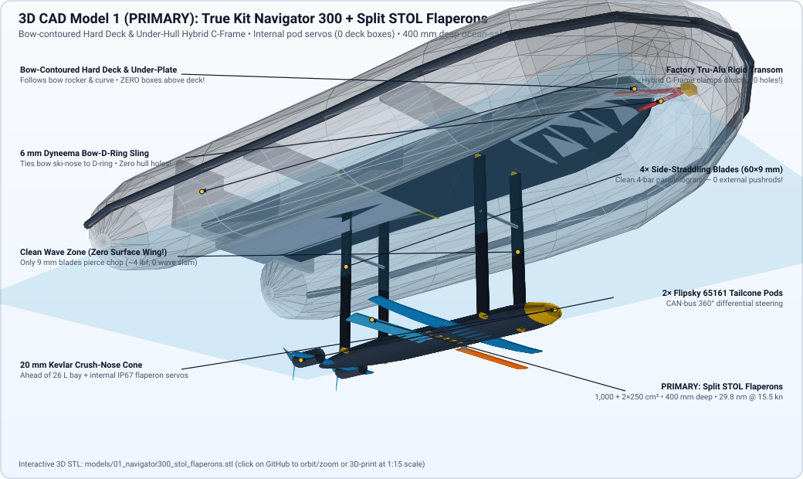

</details>

---

### 2. Secondary Wing Track (Max Range/Speed): Flush-Nested Top-Deck Switchblade Pod
*Two `680 × 105 × 13 mm` solid UD carbon blades (`1.58 m` span, `AR ≈ 15`) sweep cleanly between the `x = 170 mm` and `x = 960 mm` side-straddling blades, locking beneath a `70 mm` carbon overhang bridge at takeoff (`6.7 kn`) and folding `100%` flush into the fuselage roof above `9 kn` (`0 cm²` extra wet area, `0` wave-crest wing slam, `30.8 nm` @ `15.5 kn`, `32.3 lbf` best pod drag @ `22 kn`).*


<details>
<summary><strong>View Annotated 3D Isometric Engineering Callouts (SVG)</strong></summary>

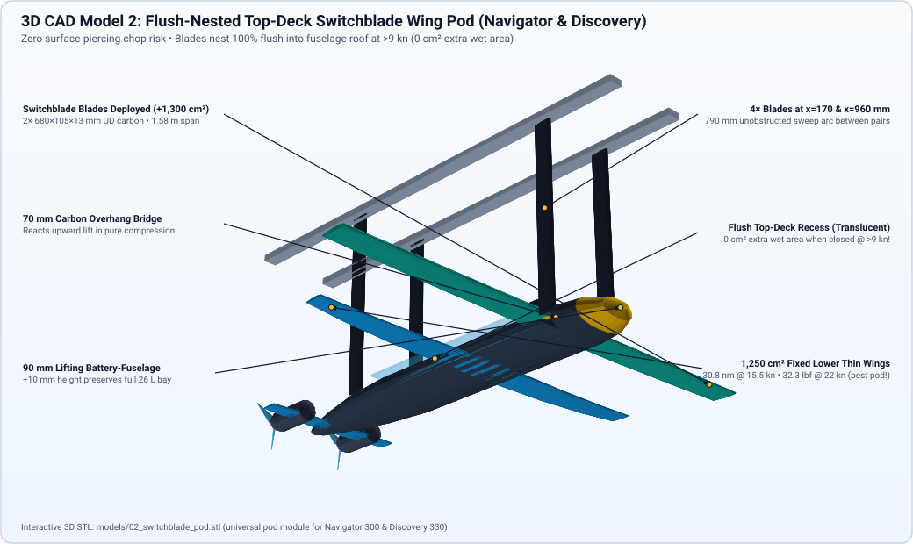

</details>

---

### 3. PRIMARY Pod Close-Up: Split STOL Flaperons + Internal Pod Servos (`ZERO` Deck Boxes!)
*Compact `1,000 cm²` main wing paired with independent port (`+18°`) and starboard (`-8°`) `250 cm²` Junkers external slotted flaperons. Translucent pod shell reveals the **`2×` `IP67` `70–80 kg·cm` brushless servos, `Ø8 mm` double-O-ring direct-drive stainless shafts, `ESP32`/`BNO085` 6-DOF IMU, and seawater-cooled `75100` `VESC`s sealed inside the pod**—leaving the **bow-contoured Hard Deck `100%` flush** with zero protruding boxes and zero external strut pushrods!*


<details>
<summary><strong>View Annotated 3D Isometric Engineering Callouts (SVG)</strong></summary>


</details>

---

### 4. PRIMARY Retracted Beaching Mode: `86.5°` Parallelogram Fold on `True Kit Navigator 300`
*Tunnel-level view of the **`True Kit Navigator 300`** resting on flat beach sand (`Z = -232 mm`). One press of **`BEACH MODE`** rotates both Foil & Strut `IP68` servo pins to `0%`, the closed-loop Dyneema pulley folds all wings **true `90°` flush inside the `13 mm` upper & `12 mm` lower pod channels (`220 mm` total width — zero overhang!)**, and all `4×` `60 × 9 mm` side-straddling blades fold `86.5°` aft beside the `95 mm` pod right **between the `250 mm` under-hull rails** beneath the factory `Tru-Alu` transom (**`~130–140 mm` / `5.1–5.5"` clear above flat sand** within the `300 cm` LOA).*

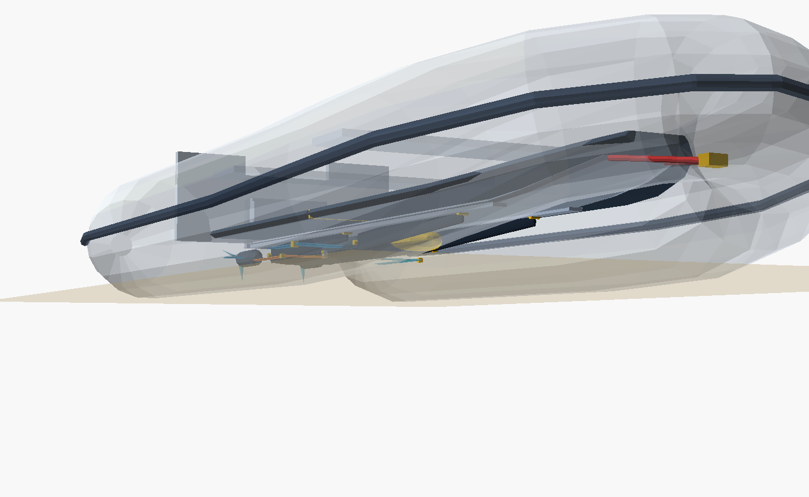

<details>
<summary><strong>View Annotated 3D Isometric Engineering Callouts (SVG)</strong></summary>


</details>

---

### 5. Secondary Open-Bow Hull Reference: `True Kit Discovery 330` + Contoured O-Frame
*For open-bow catamarans (`True Kit Discovery 280/330/400`, `Takacat LX`), the identical swappable Split STOL Flaperon Flying-Keel Pod mounts to a bow-contoured rigid **O-Frame** wrapping around both open ends.*


<details>
<summary><strong>View Annotated 3D Isometric Engineering Callouts (SVG)</strong></summary>

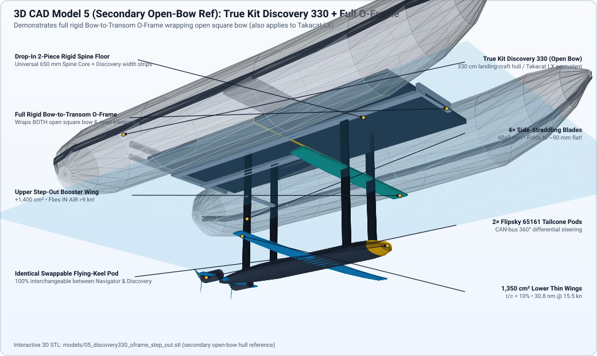

</details>

---

### 6. Long-Range 80/20 Sweet Spot (`65–79 nm`): `Navigator 300` + Single `65161` (`10"` Prop) + `AR 13.5` Split STOL + `60 mm` Dual-Pack Deck
*Hitting **`65 nm` @ `15.5 kn` / `79 nm` @ `12 kn`** on `100%` fire-safe **`10.76 kWh` `LiFePO4`** (`5.38 kWh` pod + `5.38 kWh` dry inside the `60 mm` bow-contoured Battery-Floor Hard Deck) while **keeping `4×` easy side-straddling blades (`5.5"` sand clearance) and Primary Split STOL Flaperon chop control**. Adds the **Single Centerline `65161` + `10"×11"` 2-blade CNC prop + internal-servo tail rudder** (nearly half the total range gain!), wider `AR 13.5` (`1.50 m`) main wing, and a low-profile curved bow spray dodger.*

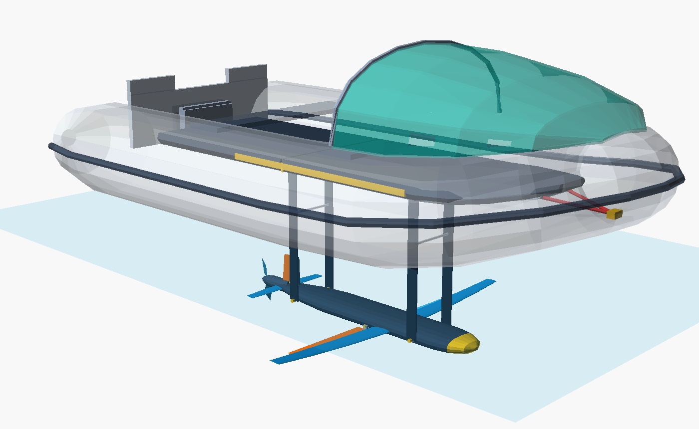

<details>
<summary><strong>View Annotated 3D Isometric Engineering Callouts (SVG)</strong></summary>

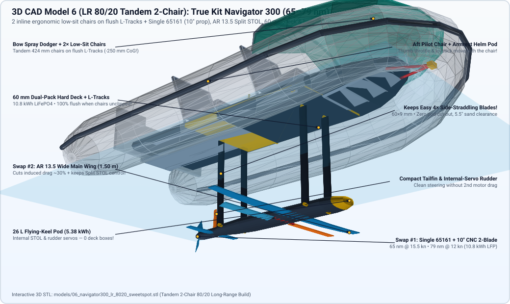

</details>

---

### 7. Full 4-Swap Long-Range Max Efficiency (`70–84 nm` `LiFePO4` / `67 nm` Single-Pod `NMC`): `2×` Recessed Center Struts + `AR 14` Flush Switchblade
*All four Long-Range Hydro Package swaps combined on **`True Kit Navigator 300`**: **`2×` hollow `100 × 18 mm` recessed center struts** (`9.1 lbf`, rear drafts in front wake), **`AR 14` (`1.55 m`) wing + Flush-Nested Switchblade** (`0 cm²` extra wet area closed), **Single Centerline `65161` + `10"` 2-blade CNC prop + tail rudder**, and curved bow spray dodger — cutting energy burn to **`118 Wh/nm` @ `12 kn` (`84 nm`)** and **`142 Wh/nm` @ `15.5 kn` (`70 nm`)** on `10.8 kWh` `LiFePO4` (or **`67 nm` @ `12 kn`** from a single `8.2 kWh` `21700 NMC` pod keeping the slim `28 mm` Hard Deck!).*

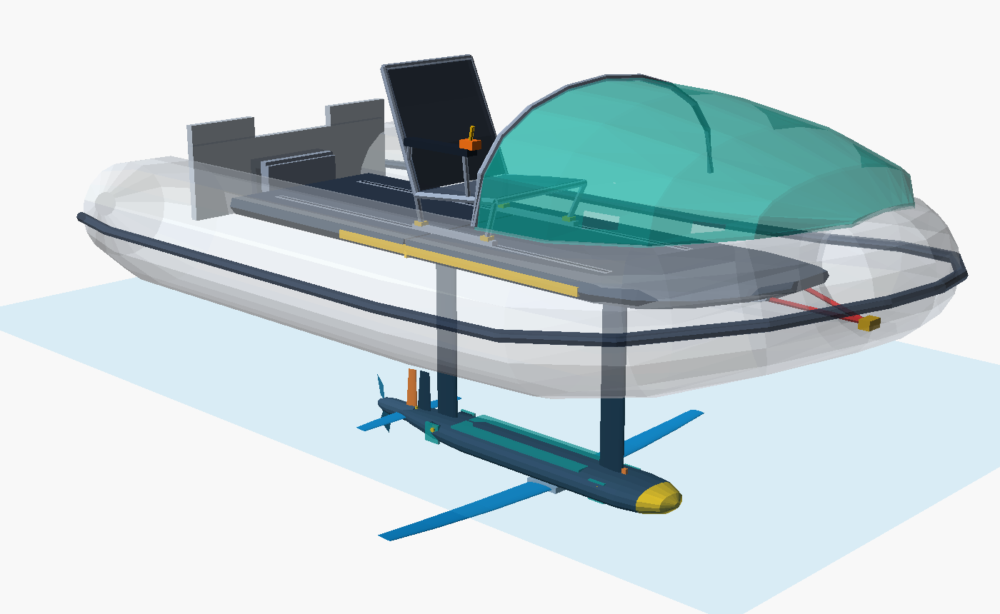

<details>
<summary><strong>View Annotated 3D Isometric Engineering Callouts (SVG)</strong></summary>

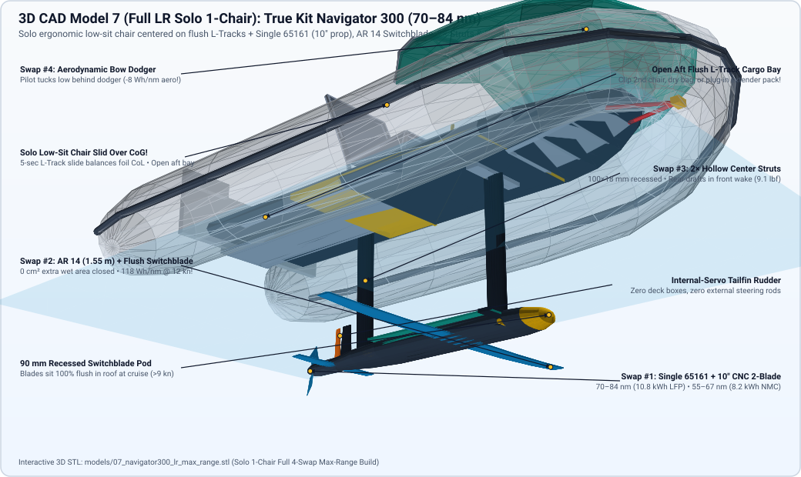

</details>

---

### 8. Long-Range Single-Prop Pod Close-Up Cutaway (`2×` Recessed Struts, Internal Rudder Servo & `10"` 2-Blade CNC Prop)
*Close-up translucent cutaway showing the **`60 mm` bow-contoured Battery-Floor Hard Deck** (`100%` flush top, zero boxes!), **`2×` `100 × 18 mm` recessed center tandem struts** with `300 mm` T-heads and offset gold pivot pins, swappable `IP68` cartridges, **`1×` seawater-cooled `Flipsky 75100` `VESC`**, `ESP32`/`BNO085` IMU, **internal aft `IP67` rudder servo** driving the orange tailfin rudder flap, and the **Single `65161` + `10"×11"` 2-blade CNC prop**.*

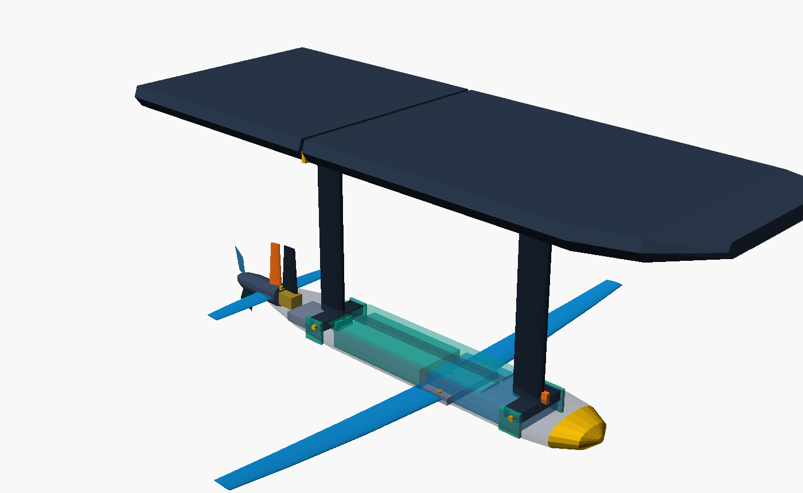

<details>
<summary><strong>View Annotated 3D Isometric Engineering Callouts (SVG)</strong></summary>

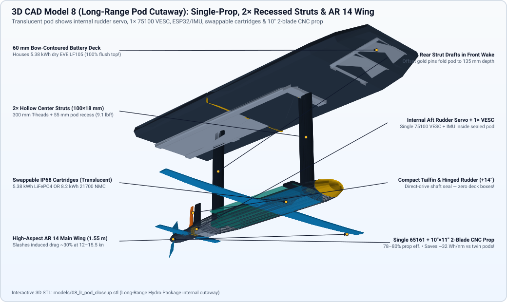

</details>

---

### 9. Modular Hard Deck Seating System: Flush Recessed L-Tracks + 1 or 2 Ergonomic Low-Sit Chairs
*Close-up of the **Bow-Contoured 2-Piece Hard Deck** outfitted with **twin flush-recessed marine L-Track rails (`390 mm` spacing, `1,570 mm` long)** that sit `100%` flush with the top carbon skin (zero trip edges when chairs are unclipped!). Tool-free `900 kgf` spring-loaded double-stud quick-release fittings let you switch in `5 seconds` between **Solo Long-Range (`1 chair` slid right over midship CoG)**, **Tandem 2-Up (`2× 424 mm` inline chairs cleanly inside the `600 mm` tunnel)**, and **Open Cargo/Beaching Deck (`0 chairs`)**—with the wireless thumb-throttle & mini-joystick integrated right onto the pilot's right-hand armrest.*

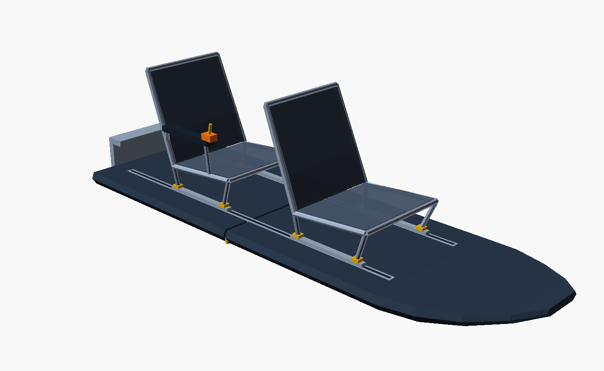

<details>
<summary><strong>View Annotated 3D Isometric Engineering Callouts (SVG)</strong></summary>

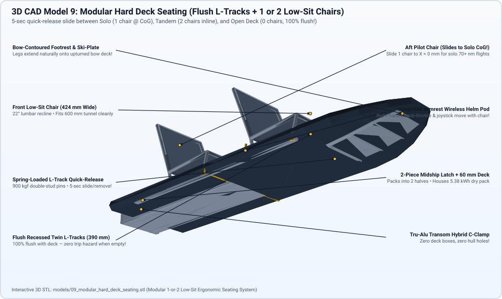

</details>

---

### 10. Dual-Mode Upgrade: 100% Internal-Pod Morphing STOL-to-Staggerwing Elevator Sled
*Keeps `100%` of the morphing mechanism inside a **`90 mm` Flying-Keel Pod (`ZERO` external swing-arms, `ZERO` belts/gears, `ZERO` sliding dry-hull seals!)**. A dedicated `96 mm`-long **free-flooding internal wing-box** (bounded by twin curved green watertight bulkheads) houses twin `Ø10 mm` guide rods and a self-locking **`Tr10×2` stainless leadscrew (`0 W` hold)** moving the aluminum elevator sled `70 mm` straight vertically between **Mode 1 DOWN** (far port side: `Z = -35 mm`, optimal `6–8 mm` Venturi STOL slot, `CL_max ≈ 2.0`, still `10 mm` above pod belly) and **Mode 2 UP** (foreground starboard side: `Z = +35 mm`, `57 mm` / `4–5×` above the Main Wing's `~12 mm` turbulent wake, shielded behind the fixed lower Main Wing, still `10 mm` below pod roof!). Both individually waterproof **`IP68` billet pitch servos** ride **directly ON the sled** (direct-driving the `Ø8 mm` flaperon shafts through flush silicone cheek wiper skirts), while only a stationary cable passes through a **static bulkhead gland** into the dry battery/VESC/IMU bay (`ZERO` boxes above the Hard Deck!).*

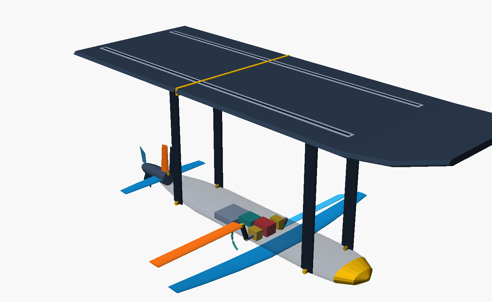

<details>
<summary><strong>View Annotated 3D Isometric Engineering Callouts (SVG)</strong></summary>

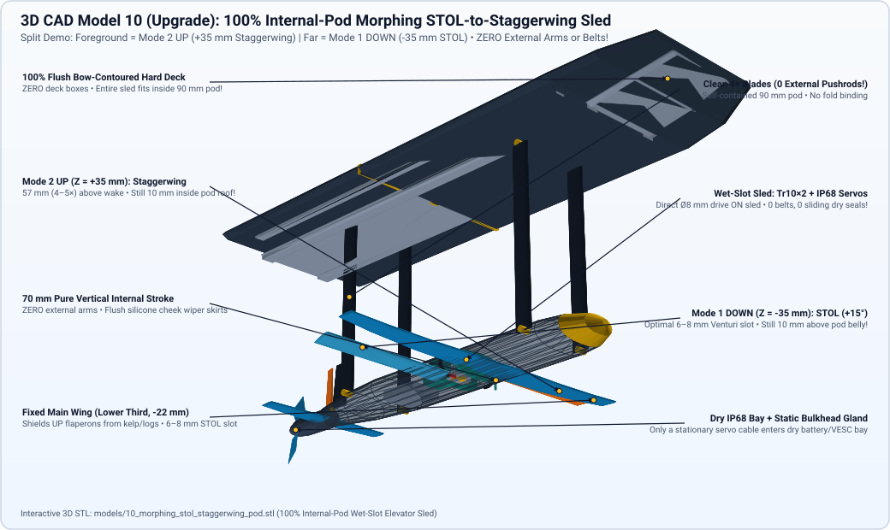

</details>

---

## Part II — Scaled 2D Engineering Drawings (`diagrams/`)

### 11. 100% Internal-Pod Morphing STOL-to-Staggerwing Sled (Wet-Slot / Dry-Bay Mechanics & Wake Clearance)
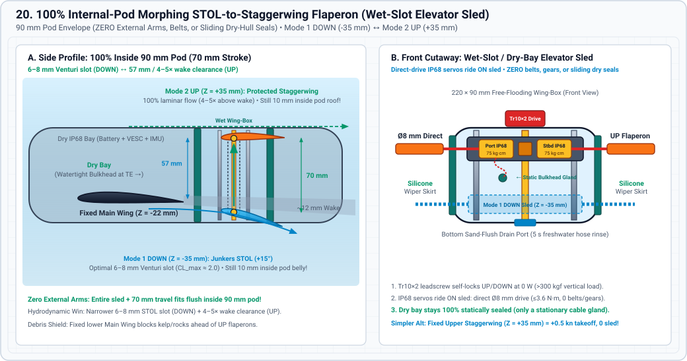

### 12. `2×` Recessed Center Struts & True `90°` Upper/Lower Fold-Channel Protection (Dual Servo-Pin Smart Divider)


### 13. True `90°` Upper (`13 mm`) & Lower (`12 mm`) Fold Channels, Closed-Loop Dyneema Pulleys & Rotating Foil-Base Servo


### 14. True `90°` Upper & Lower Fold Channels: All 3 Wing Tracks & `220 mm` Beaching Dart (Fits Between `250 mm` Rails!)
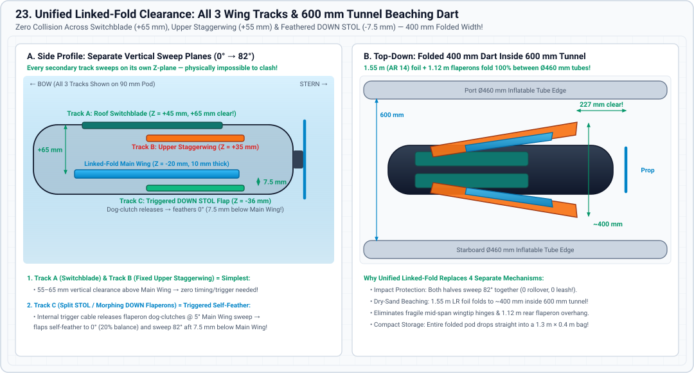

### 15. Wet `IP68` Servo-Controlled Variable-Preload Roller Pins for Foils & Upper Struts (`0%` Fold / `50%` Reef / `100%` `0 W` Cruise)
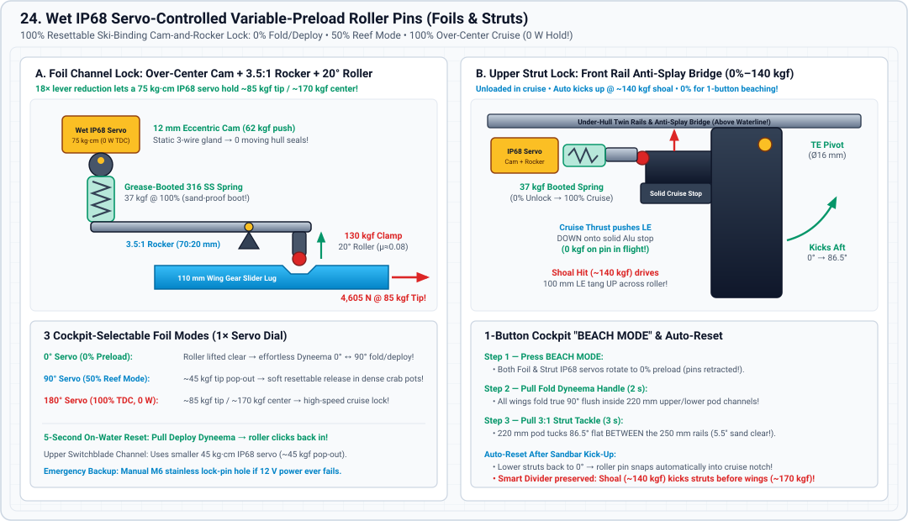

### 16. Modular Hard Deck Seating Ergonomics & CoG Trim (Solo 1-Chair, Tandem 2-Chair & Flush L-Track Detail)


### 17. Long-Range (`60–75+ nm`) Hydro Package Swaps & Battery Recipes Comparison
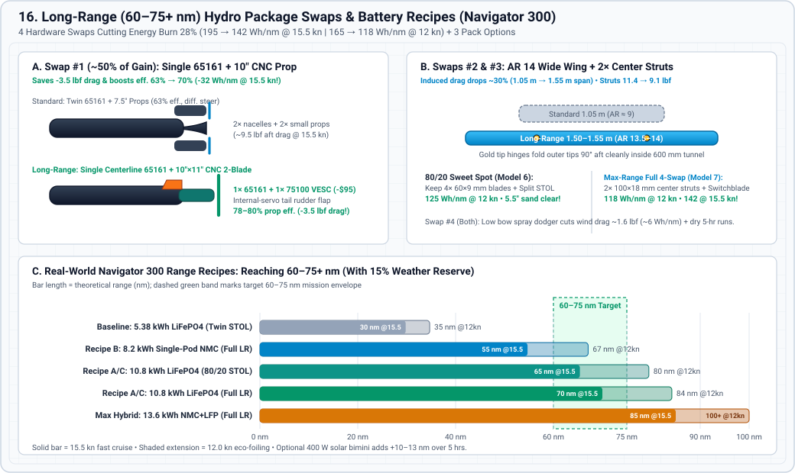

### 18. PRIMARY Wing Cross-Section: Submerged Split STOL Flaperons & Internal Pod Servos


### 19. Flying-Keel Pod Internal Cutaway (`26 L` Swappable Cartridges, Internal Servos, Seawater Cooling & Safety)
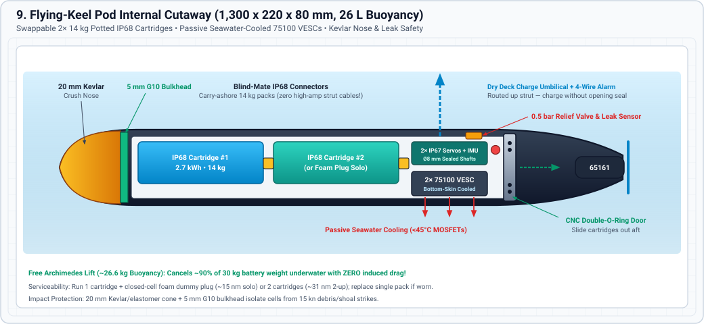

### 20. Secondary Wing: Flush-Nested Top-Deck Switchblade Wing (Top-Down Closed vs. Deployed)


### 21. Contoured Bow-Bent Hard Deck & Under-Hull Coupling Options (`Navigator 300` Primary + Magnets + `Discovery 330` O-Frame + OEM Slot)


### 22. Grounding Kick-Up Kinematics: Why a Single Central Mast Fails vs. 4-Bar Parallelogram


### 23. Strut Architecture & Folded Stack-Up Clearance Inside the `Navigator 300` Tunnel (`600 mm` Wide × `230 mm` High)


### 24. Integrated Battery-Hull Architecture Comparison on `True Kit Navigator 300`


### 25. Rejected Concept Physics: Why Surface-Piercing Step-Out Wings Fail in Chop (Forward & Deep-Aft)


---

## Part III — Regenerating or Modifying the Parametric CAD & Drawings

All `.stl` models, `.svg` technical drawings, and OpenSCAD `.png` renderings are generated deterministically with **zero Python third-party dependencies** (plus optional `openscad` CLI for shaded PNG renders):

```bash
# Regenerate all 15 scaled 2D engineering SVGs (pure Python 3)
python3 diagrams/generate_diagrams.py

# Regenerate all 10 binary 3D .stl CAD models, 10 annotated 3D SVGs, and 10 OpenSCAD PNGs
python3 models/generate_cad.py
```

* **OpenSCAD (macOS / Linux / Docker):** Install natively (`brew install --cask openscad`) or run headless via Docker (`docker run --rm -v "$PWD":/work openscad/openscad ...`).
* **3D Printing Tabletop Models:** Import any file in `models/*.stl` into PrusaSlicer / Bambu Studio / Cura and scale to **`1:15` (`6.7%`)** or **`1:10` (`10%`)** (all coordinates are native `1:1` millimeters).
