# FoilSkiff — Visual Design Atlas & 3D CAD Model Gallery

A complete visual companion to [`electric-foiling-dinghy-guide.md`](electric-foiling-dinghy-guide.md), pairing **interactive millimeter-scale 3D `.stl` CAD models** (orbitable directly in GitHub's native 3D viewer), **multi-material OpenSCAD 3D renderings (`renders/`)**, and **mathematically-scaled 2D engineering SVG drawings (`diagrams/`)** using a semi-realistic **`True Kit Discovery 330`** (`Ø460 mm` upswept open-bow inflatable catamaran) reference hull.

---

## Part I — Interactive 3D CAD Models & Renderings

| # | 3D CAD Model (Click on GitHub to Orbit in 3D) | Key Highlight Shown |
| :---: | :--- | :--- |
| **1** | [`models/01_step_out_flying_keel_truekit.stl`](models/01_step_out_flying_keel_truekit.stl) | Primary **Step-Out Flying-Keel Pod** flying `6"`–`8"` clear on a `True Kit Discovery 330` |
| **2** | [`models/02_switchblade_pod.stl`](models/02_switchblade_pod.stl) | **Flush-Nested Top-Deck Switchblade Wing** (`+1,300 cm²` deployed + `70 mm` carbon overhang bridge) |
| **3** | [`models/03_stol_flaperon_pod.stl`](models/03_stol_flaperon_pod.stl) | **Submerged Split STOL Flaperons** (`1,000 + 2×250 cm²`) in differential bank + dry-deck servos & `4 mm` pushrods |
| **4** | [`models/04_retracted_beaching_truekit.stl`](models/04_retracted_beaching_truekit.stl) | **Retracted `85°` Parallelogram Beaching Mode** (`~140 mm` / `5.5"` sand clearance under `Ø460 mm` tubes) |

---

### 1. Primary Architecture: Step-Out Flying-Keel Pod on `True Kit Discovery 330`
*Drop-In 2-Piece Rigid Spine Floor + Bow-to-Transom Twin-Rail O-Frame + `4×` `60 × 9 mm` Side-Straddling Blades + Upper Step-Out Booster Wing (flying in dry air >`9 kn`!) + Submerged `26 L` Flying-Keel Pod (`20 mm` Kevlar crush-nose) + `1,350 cm²` Lower Thin Wings + Twin `Flipsky 65161` Tailcone Pods.*

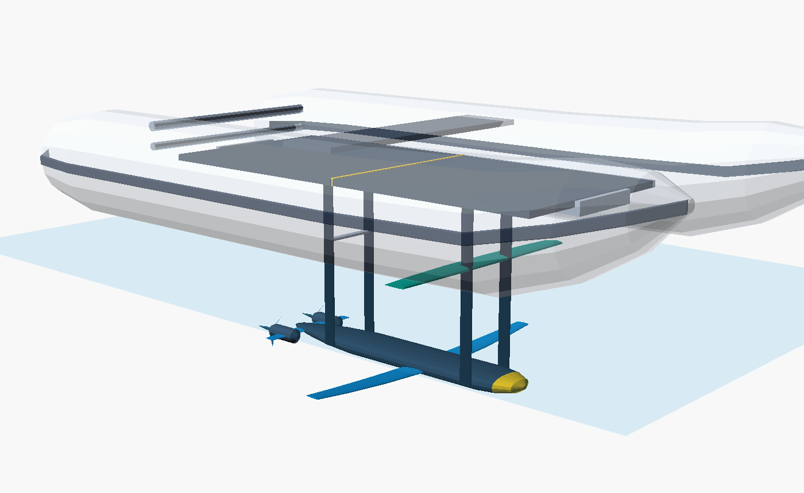

<details>
<summary><strong>View Annotated 3D Isometric Engineering Callouts (SVG)</strong></summary>

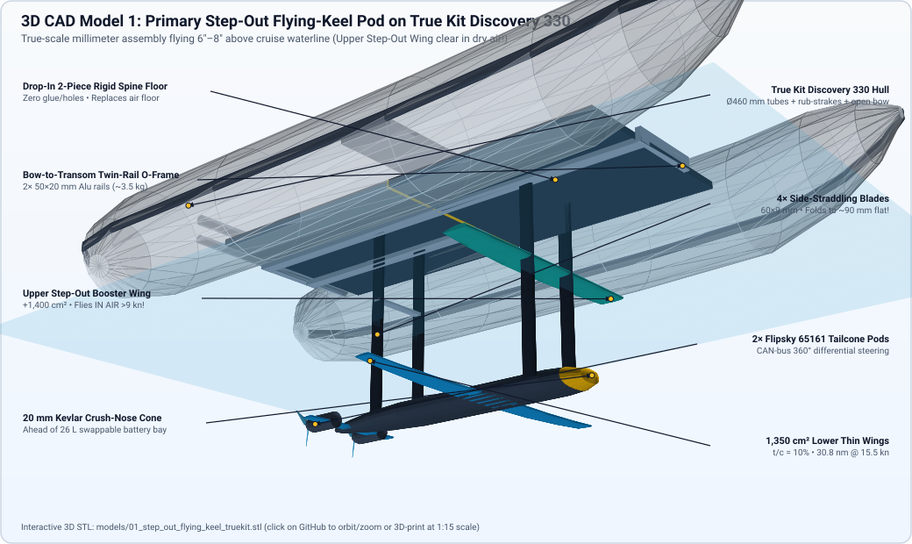

</details>

---

### 2. Co-Primary Rough-Chop Wing: Flush-Nested Top-Deck Switchblade Pod
*Two `680 × 105 × 13 mm` solid UD carbon blades (`1.58 m` span, `AR ≈ 15`) sweep cleanly between the `x = 170 mm` and `x = 960 mm` side-straddling blades, locking beneath a `70 mm` carbon overhang bridge at takeoff (`6.7 kn`) and folding `100%` flush into the fuselage roof above `9 kn` (`0 cm²` extra wet area, `30.8 nm` @ `15.5 kn`, `32.3 lbf` best pod drag @ `22 kn`).*

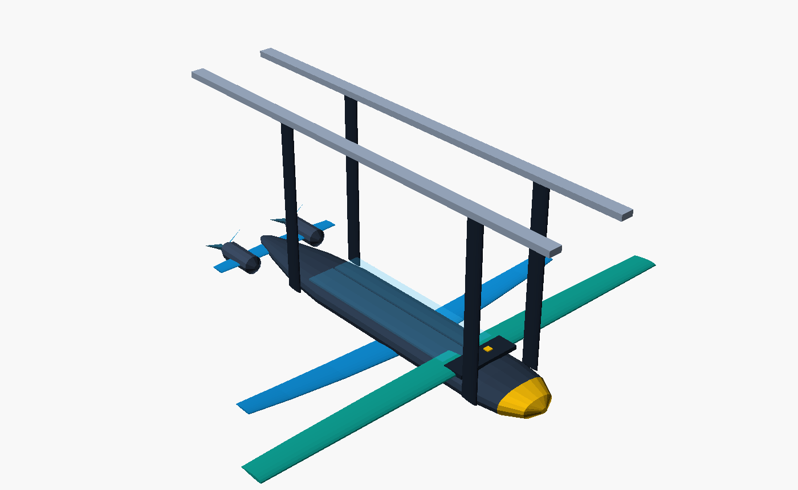

<details>
<summary><strong>View Annotated 3D Isometric Engineering Callouts (SVG)</strong></summary>


</details>

---

### 3. Active-Chop Flight-Control Upgrade: Submerged Split STOL Flaperons (`1,000 + 2×250 cm²`)
*Compact `1,000 cm²` high-speed main wing paired with independent port/starboard `250 cm²` Junkers external slotted flaperons shown in differential bank (`+18°` port / `-8°` starboard). Two dry-mounted `IP67` `70–80 kg·cm` brushless servos on the Spine Floor drive `4 mm` stainless pushrods tucked inside the rear blade trailing-edge grooves (`~$160` active BOM; `20%`-chord self-centering failsafe).*

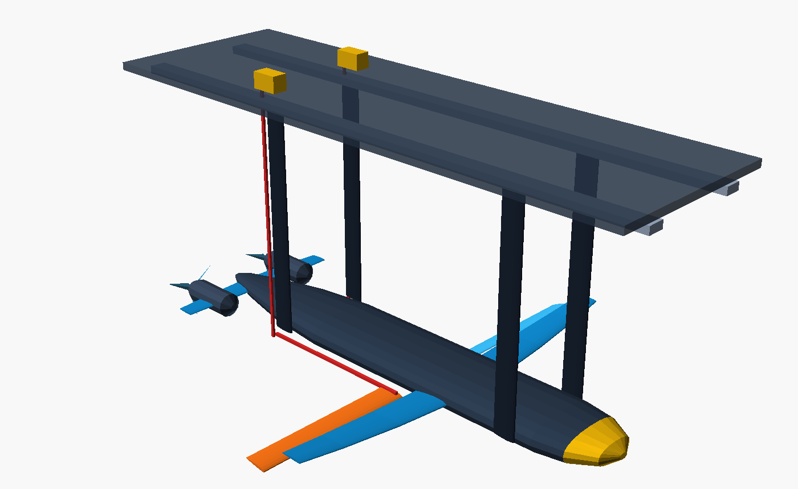

<details>
<summary><strong>View Annotated 3D Isometric Engineering Callouts (SVG)</strong></summary>

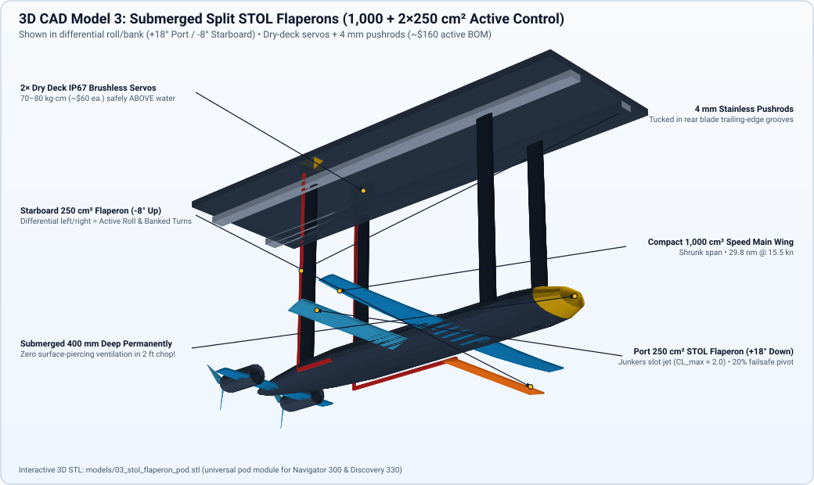

</details>

---

### 4. Shallow Beaching & Grounding Retraction: `85°` Parallelogram Fold on `True Kit Discovery 330`
*Tunnel-level view looking down the open bow of a `True Kit Discovery 330` resting on flat beach sand (`Z = -232 mm`). All `4×` `60 × 9 mm` side-straddling blades fold `85°` aft **beside** the `80 mm`-thick pod (zero vertical chord stack-up!), keeping the entire `1.3 m` pod, lower wings, and twin `65161` props `100%` horizontal and **`~135–140 mm` (`5.5"`) clear above flat sand**.*

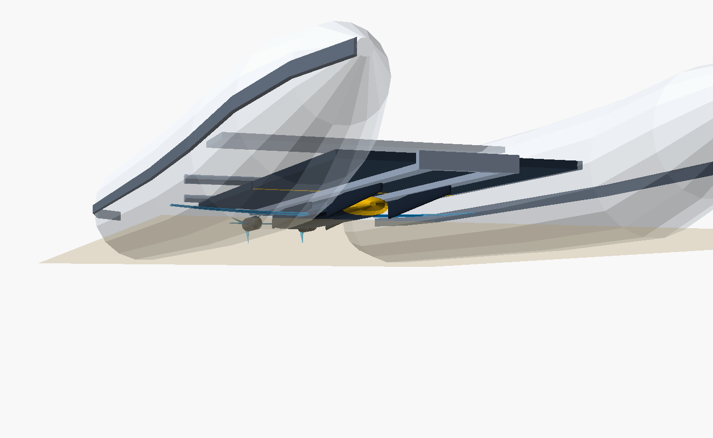

<details>
<summary><strong>View Annotated 3D Isometric Engineering Callouts (SVG)</strong></summary>

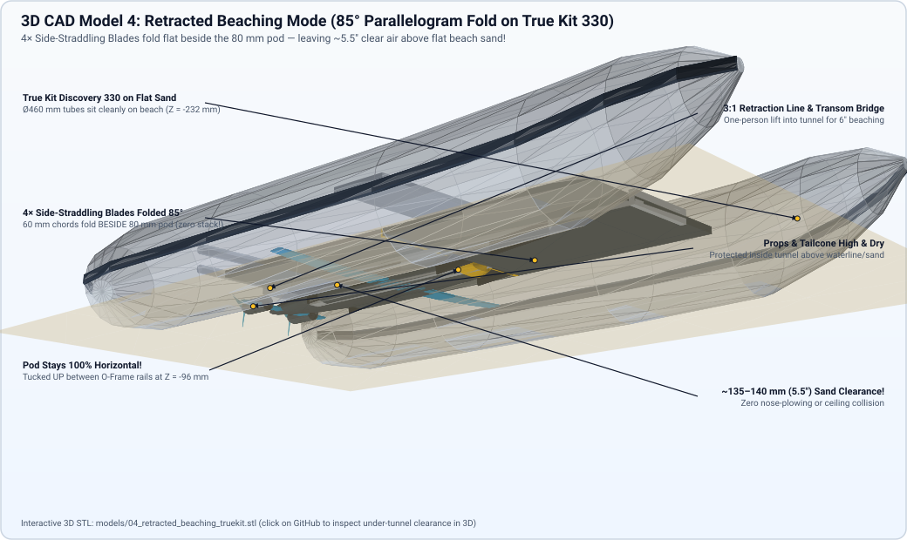

</details>

---

## Part II — Scaled 2D Engineering Drawings (`diagrams/`)

### 5. Flying-Keel Pod Internal Cutaway (`26 L` Swappable Cartridges, Seawater Cooling & Safety)


### 6. Flush-Nested Top-Deck Switchblade Wing (Top-Down Closed vs. Deployed)
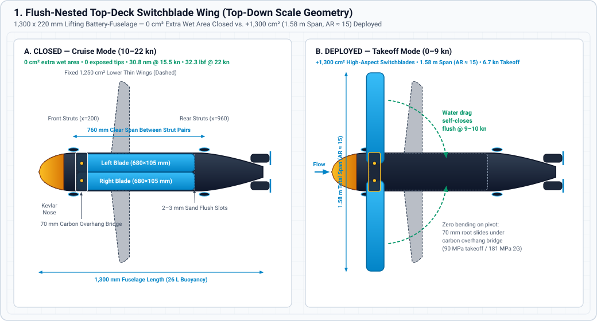

### 7. Submerged Variable-Angle Secondary Wing: Staggerwing vs. STOL Slotted Flaperon


### 8. Drop-In Rigid Spine Floor & Top-to-Bottom Coupling Options (`O-Frame` vs. `C-Frame` vs. `OEM Slot`)


### 9. Grounding Kick-Up Kinematics: Single Central Mast Collision vs. 4-Bar Parallelogram
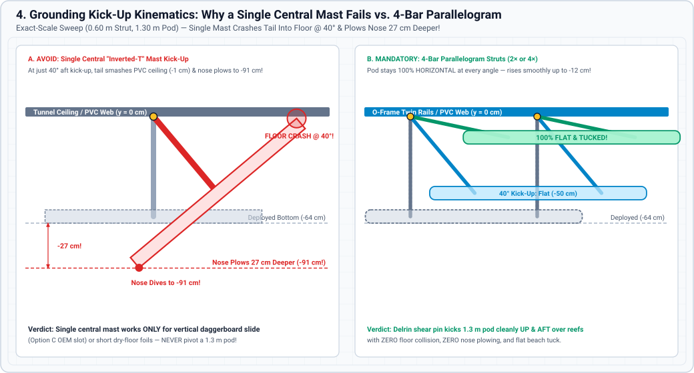

### 10. Strut Architecture & Folded Stack-Up Clearance Inside a `Ø460 mm` Catamaran Tunnel
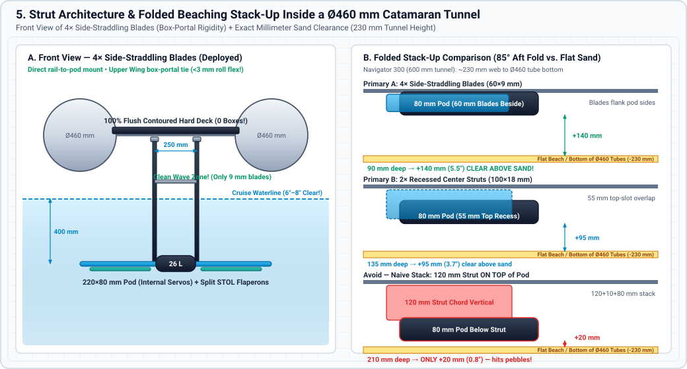

### 11. Integrated Battery-Hull Architecture Comparison (Primary vs. Dry Floor vs. SWATH vs. Jet)
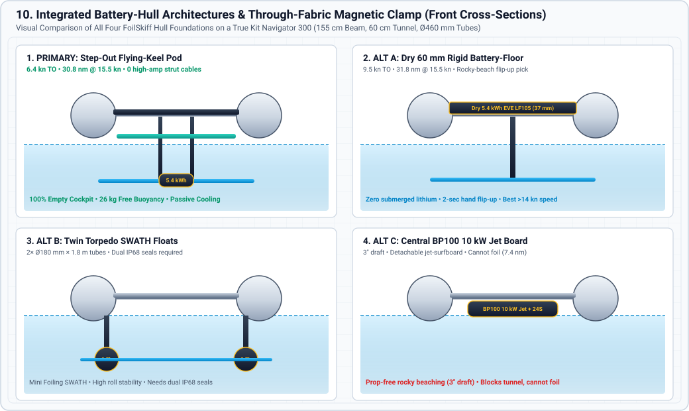

---

## Part III — Regenerating or Modifying the Parametric CAD & Drawings

All `.stl` models, `.svg` technical drawings, and OpenSCAD `.png` renderings are generated deterministically with **zero Python third-party dependencies** (plus optional `openscad` CLI for shaded PNG renders):

```bash
# Regenerate all 7 scaled 2D engineering SVGs (pure Python 3)
python3 diagrams/generate_diagrams.py

# Regenerate all 4 binary 3D .stl CAD models, 4 annotated 3D SVGs, and 4 OpenSCAD PNGs
python3 models/generate_cad.py
```

* **OpenSCAD (macOS / Linux / Docker):** Install natively (`brew install --cask openscad`) or run headless via Docker (`docker run --rm -v "$PWD":/work openscad/openscad ...`).
* **3D Printing Tabletop Models:** Import any file in `models/*.stl` into PrusaSlicer / Bambu Studio / Cura and scale to **`1:15` (`6.7%`)** or **`1:10` (`10%`)** (all coordinates are native `1:1` millimeters).
