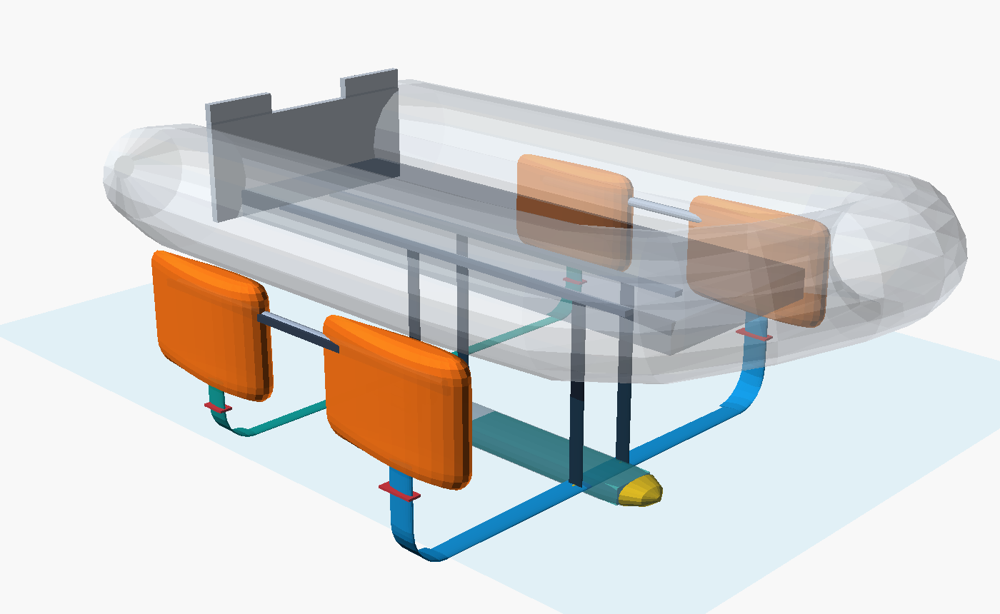

# FoilSkiff PRIMARY Architecture — Central-Keel 4-Float Staggered U-Foil with Dry Wing-Warping & Twin Fixed Differential Pump-Jets (`Models 13 & 14`)

This document specifies the **PRIMARY `FoilSkiff` architecture** for the **`True Kit Navigator 300`** (`300 × 155 cm`, `Ø460 mm` tubes, realistic `~75–100 mm` / `3"–4"` under-floor tunnel, `31 kg` bare weight, `500 kg` capacity).

It combines **four breakthroughs** into one cohesive, `100%` prop-free, zero-underwater-moving-parts electric hydrofoil tender:
1. **Single `28 L` Central Keel Pod (`NO` Outer Submerged Torpedoes):** Cuts submerged body drag by **`~50%`** vs. twin-torpedo SWATH and centralizes `5.38 kWh` swappable `IP68` batteries, `2 × Flipsky 75100` `VESC`s, and **twin fixed `Ø108 mm` wide-bore rear differential pump-jets** (`132.5 cm²` combined exit area, `360°` CAN-bus steering, instant reverse, dual-drive redundancy, **`0` moving tail parts**).
2. **Two Wide-Staggered `1.80 m` U-Foils (`65/35` Lift Split, `+130 mm` Vertical Stagger):**
   * **Front Main U-Foil (`~900 cm²`, `Z = -830 mm` / `320 mm` deep in cruise)** + **Rear Staggered U-Foil (`~500 cm²`, `Z = -700 mm` / `190 mm` deep in cruise, `+130 mm` clean above front wake)**.
   * Cuts takeoff induced drag **`-74%`** vs. a `1.05 m` center-pod wing, eliminates any separate aft stabilizer, and tolerates **`±35 cm` fore/aft passenger movement**.
3. **Four Stepped Corner Tip Floats (`4 × 24 L = 96 L`) + Above-Water Longitudinal Tie-Bars:**
   * **Top view:** Classical `NACA 0014` streamlined torpedo (`620 × 135 mm`). **Side view:** Vertical rounded-corner rectangle (`620 × 400 mm`, `R = 65 mm` corners) for strictly linear buoyancy unloading.
   * **3-Stage Flight Progression on `600 mm` Struts:**
     * **`0–5 kn` Takeoff:** All `4` floats `~75%` submerged (`~100 kgf` total pre-lift buoyancy with center pod) $\rightarrow$ effortless **`~5.0–5.5 kn`** takeoff!
     * **`6–10 kn` Post-Takeoff Climb:** Tubes `+100 mm` clear while all `4` floats remain `150 mm` in water $\rightarrow$ rock-solid 4-corner passive pitch & roll stability!
     * **`12–15.5 kn` High-Speed Cruise:** All `4` floats lift **`+30 mm` DRY IN AIR (`0 N` float water drag!)**, leaving only the thin `18 mm` lower vertical blades (w/ red anti-ventilation fences) wet $\rightarrow$ **`~33 nm` @ `12.0 kn` / `~20.5 nm` @ `15.5 kn`**!
4. **Dry Above-Water 4-Channel Wing-Warping (`±2° to ±3°` Foil AoA Control — ZERO Underwater Actuators!):**
   * Four dry, non-backdrivable rotary/worm actuators tucked inside the tops of the four above-water floats rotate each float independently against **two passive telescoping carbon slip-tube tie-bars** (`Ø28 mm` inside `Ø32 mm` w/ `200 mm` UHMW bushing overlap, `+330 mm` dry in air!).
   * Elastically twists each submerged `0.90 m` foil half by **`±2° to ±3°`** around its `25%`-chord UD carbon spar (`0.055%` shear strain = `10×` below composite fatigue limit!) for **active roll (`>150 N·m`), direct heave (`±336 N`), and locked `12–20+ kn` cruise ride height—with ZERO underwater hinges, ZERO wet shaft seals, and ZERO flap drag!**

---

## 1. Visual CAD Assemblies & Close-Up Mechanisms

<strong>View Annotated 3D Isometric Engineering Callouts (SVG)</strong>

### Close-Up: Dry Above-Water Wing-Warping & Passive Telescoping Tie-Bar (`Model 14`)

### 3-Stage Flight Progression & Hydroelastic Mechanics (2D Engineering Diagram)

| Artifact | Path | Purpose |
| :--- | :--- | :--- |
| **Full Primary 3D Assembly STL (`Model 13`)** | [`models/13_center_keel_tip_float_ufoil.stl`](models/13_center_keel_tip_float_ufoil.stl) | `1:1` mm full `Navigator 300` assembly at `12–15.5 kn` cruise |
| **Parametric Wing-Warp Close-Up (OpenSCAD)** | [`models/wing_warp_tiebar_closeup.scad`](models/wing_warp_tiebar_closeup.scad) | Parametric `1:1` close-up of floats, dry worm-drive bays, `Ø28/Ø32` UHMW slip-tube & `25%`-c UD spars |
| **Printable Slip-Joint & Actuator Clevis STLs** | [`wing_warp_slip_collar.stl`](models/wing_warp_slip_collar.stl), [`wing_warp_actuator_clevis.stl`](models/wing_warp_actuator_clevis.stl) | Manifold `1:1` parts ready to print in `PA12-CF` / `PETG-CF` |
| **2D 3-Stage Flight & Kinematics SVG** | [`diagrams/29-wing-warp-3stage-flight-dynamics.svg`](diagrams/29-wing-warp-3stage-flight-dynamics.svg) | Scaled waterlines (`0–5` / `6–10` / `12–15.5 kn`) + wing-warping statics & divergence proof |

---

## 2. Exact 3-Stage Vertical Stack (`600 mm` Central Struts)

*All Z coordinates referenced to `Navigator 300` `Ø460 mm` tube bottom (`Z_tb = 0`; note factory welded PVC tunnel web sits at `~75–100 mm` / `3"–4"` above `Z_tb`—verify exact value on your hull).*

| Flight Stage | Speed | Waterline (rel. `Z_tb`) | `4×` Corner Tip Floats (`Z = -250 → +150 mm`) | Front / Rear Foil Depth | Active Wing-Warp Trim |
| :--- | :---: | :---: | :--- | :---: | :--- |
| **1. Lowered Pre-Lift Takeoff** | **`0–5 kn`** | `+50 mm` *(tubes `50 mm` wet)* | **`75%` submerged** (`~72 kgf` + `28 kgf` center pod = **`~100 kgf` pre-lift!**) | `650 / 520 mm` | All `4` tips **`+2.5°`** (max STOL lift) |
| **2. Post-Takeoff Climb** | **`6–10 kn`** | `-100 mm` *(tubes `+100 mm` clear!)* | **Still `150 mm` (`38%`) IN water** (linear 4-corner passive pitch + roll stability!) | `500 / 370 mm` | Neutral / gentle bank trim |
| **3. High-Speed Cruise** | **`12–15.5 kn`** | `-280 mm` *(tubes `+280 mm` clear!)* | **`+30 mm` DRY IN AIR (`0 N` water drag!)**; Tie-Bars `+330 mm` dry | **`320 / 190 mm` deep** *(zero chop breach!)* | Front **`-1.5°`** / Rear **`+1.5°`** locks cruise height; diff. **`±2.5°`** banks turns! |

---

## 3. Dry 4-Channel Wing-Warping & Hydroelastic Safety Rules

### Why the Passive Telescoping Tie-Bar Works (Statics Proof)
* Twisting the Front (`h = 655 mm` below tie-bar) and Rear (`h = 525 mm` below tie-bar) foils differently by `±3°` changes the axial spacing between float tops by up to **`ΔL_bar ≈ ±34 mm`**.
* Using a **passive telescoping carbon slip-tube** (`Ø28 mm` inner tube sliding smoothly inside a `Ø32 mm` outer tube across a **`200 mm` UHMW-PE bushing overlap**) absorbs `±35 mm` axial travel with near-zero friction while transmitting `100%` of the bending reaction between front and rear floats via vertical blade shear:
  $$F_z = \frac{M_{\text{fwd}} + M_{\text{aft}}}{L_{\text{bar}}} \approx \frac{25 + 25\text{ N}\cdot\text{m}}{0.90\text{ m}} \approx \mathbf{55.6\text{ N}\ (5.7\text{ kgf})}$$
* **Result:** Only **`4×` dry rotary/worm actuators** (`25–35 N·m`, `0 W` self-locking hold) inside the tops of the 4 floats give **4 completely independent AoA channels** ($\alpha_{\text{FL}}, \alpha_{\text{FR}}, \alpha_{\text{RL}}, \alpha_{\text{RR}}$)—no 5th/6th length actuator required! *(An ultra-simple 2-actuator fallback replaces the passive slip-tubes with `2×` `55 N` dry linear actuators for coupled pitch + differential roll.)*

### Mandatory Composite Layup & Divergence Rules (Do NOT Violate!)
1. **Place the `0°` UD Carbon Main Spar Dead-On `25%–28%` Chord:** Aligns the foil's elastic twist axis with its hydrodynamic center of pressure ($e \le 3\text{ mm}$), preventing static torsional divergence.
2. **Tailored Torsion Skin (`1` ply `±45°` carbon/glass, $GJ \approx 220\text{–}300\text{ N}\cdot\text{m}^2/\text{rad}$):**
   * Keeps `±2.5°` twist torque manageable (**`~15–22 N·m` elastic + `~10 N·m` hydro = `~25–32 N·m`** at the dry float actuator) and peak surface shear strain at **`0.055%`** (`~10×` below epoxy fatigue endurance limit!).
3. **Strictly Non-Backdrivable Dry Actuators (Worm-Gear or `Tr8` Leadscrew):** Holding the tip rigidly locked turns the foil from fixed-free to **fixed-fixed** in torsion (`4×` divergence eigenvalue), pushing static divergence safely past **`50–60+ kn`**.
4. **Horizontal Anti-Ventilation Fences (`4×`):** Bond one `15 mm` horizontal fence on each `18 mm` lower vertical blade at `Z = -570 mm` (just below cruise waterline) so surface air cannot ventilate down onto the submerged U-foils.

---

## 4. Drag, Power, Range & Beaching Summary (`5.38 kWh` `16S LiFePO4` Pack)

| Operating Point (`235 kg` All-Up, `60%` Twin Fixed `Ø108 mm` Jets) | Total Drag | Battery Draw (`DC kW`) | Energy (`Wh/nm`) | Usable Range (`92%` Pack) |
| :--- | :---: | :---: | :---: | :---: |
| **`5.2 kn` Pre-Lifted Takeoff** (`~100 kgf` buoyancy, `+2.5°` twist) | `~260 N` (`58 lbf`) | `~1.8 kW` *(brief)* | — | `2–3 sec` lift-off |
| **`12.0 kn` Eco Dry-Float Cruise** *(Sweet Spot)* | **`~175 N`** (`39 lbf`) | **`1.80 kW`** (`35 A`) | **`150 Wh/nm`** | **`~33.0 nm`** (`2.75 hrs`) |
| **`15.5 kn` Fast Dry-Float Cruise** | **`~281 N`** (`63 lbf`) | **`3.75 kW`** (`73 A`) | **`242 Wh/nm`** | **`~20.5 nm`** (`1.32 hrs`) |

* **Beaching & Shallow Water (Honest `~3"` Tunnel Accounting):** Retracting the `4×` central struts lifts the flat U-foils snug beneath the `Ø460 mm` tube bottoms (`~10.5"` shallow motoring draft) while lifting all `4` outer tip floats **`~200 mm` clear above beach sand**; flip down **`Ø320 mm` QuickLok stern launching wheels** on the `Tru-Alu` transom to roll smoothly up rocky beaches (`+2.5"–4"` clear under the center pod).
* **Estimated DIY Conversion BOM (`~$4,150` incl. `5.38 kWh` `LiFePO4`):** `2 × Ø54 mm` sealed inrunners + `2 × Flipsky 75100` `VESC`s + fixed `Ø108 mm` shrouds (`$950`), `2 × 14 kg` swappable `IP68` `LiFePO4` cartridges (`$700`), central pod + `2×` wide U-foils + `4×` `24 L` floats + `2×` telescoping tie-bars (`$1,850`), `4×` dry worm/micro-linear wing-warp actuators + `ESP32`/`BNO085` IMU (`$350`), contoured hard deck / rail carriage & stern wheels (`$300`).
