# `48 V` Electric & Foiling Catamaran Dinghy Guide (`True Kit Navigator 300` Primary | `Discovery 330` Secondary)

A standalone engineering guide centered on converting a **`True Kit Navigator 300`** (**primary focus:** `300 × 155 cm`, `60 cm` inside beam, `Ø460 mm` closed-bow tubes, factory `Tru-Alu` aluminum transom, `31 kg` bare weight, `500 kg` capacity)—while preserving full open-bow fitment notes for **`True Kit Discovery 330`** (`3.3 m`, `36 kg`) and **`Takacat LX`**—into a high-efficiency electric hydrofoiling tender.

**`FoilSkiff`'s Primary Architecture** turns the `True Kit Navigator 300` (and other `10 ft` inflatable tunnel-catamarans) into a bolt-on, ocean-safe electric hydrofoil—with **zero glue, zero holes, zero cockpit servo boxes, and zero hull warranty voiding**—by combining four core elements:

1. **Bow-Contoured 2-Piece Rigid Hard Deck ("Spine Floor") + Bow-Bent `Tru-Alu` Transom-Clamped Hybrid C-Frame & `6 mm` Dyneema Bow-D-Ring Sling:** Both the top `28 mm` rigid Hard Deck and the under-hull Hybrid C-Frame plate **follow the real hull contour—tapering to the curved bow tube and bending smoothly upward with the bow rocker** (never flat rectangles!), leaving **`100%` of the cockpit flush with zero boxes above the deck**. Rear risers clamp directly onto the factory `10 HP`-rated `Tru-Alu` aluminum transom (zero holes), while a `6 mm` Dyneema sling ties the upturned bow ski-nose forward to the factory Bow Towing D-Ring (adapting to open-bow `Discovery 330` / `Takacat LX` via a contoured full O-Frame).
2. **Submerged Lifting-Body Battery-Fuselage ("Flying-Keel Pod") with Swappable `IP68` Cartridges & Internal Flaperon Servos:** A **`~1.3 m × 220 mm × 80 mm` (`~26 L`) longitudinal flattened lifting fuselage** permanently submerged **`400 mm` deep** housing **two removable, factory-potted `IP68` `2.5–2.7 kWh` (`~14 kg` ea.) slide-in battery cartridges** (*Flitecell*-style), **`2×` internal `IP67` brushless flaperon servos + `ESP32`/`BNO085` 6-DOF IMU**, seawater-cooled `Flipsky 75100` `VESC`s, and tailcone **`Flipsky 65161`** pod(s). Displacing `~26 L` of seawater provides **`~26.6 kg` free Archimedes buoyancy** (`~90%` of pack weight), eliminates high-amp strut cables and external pushrods, and lets one person carry a `14 kg` cartridge ashore to charge.
3. **PRIMARY Wing — Deep-Submerged Split STOL Flaperons (`1,000 + 2×250 cm²`) | SECONDARY — Flush-Nested Top-Deck Switchblade (`+1,300 cm²`):** Staying **`100%` deep submerged (`400 mm` below surface)** eliminates surface-piercing wave-slam and nose-dive hazards—only the ultra-slim `9 mm` vertical blades pierce chop (`~4 lbf` ripple). Our **Primary Split STOL Flaperons** deliver `7.2 kn` takeoff, `29.8 nm` @ `15.5 kn`, and **4-in-1 active takeoff flaps, Direct-Lift wave/elevation leveling, roll leveling, and banked turns** driven directly from inside the pod via `Ø8 mm` double-O-ring shafts (`20%`-chord self-centering `0°` failsafe). Our **Secondary Flush-Nested Switchblade** folds `100%` flush inside the pod roof above `9 kn` (`6.7 kn` takeoff, `30.8 nm` @ `15.5 kn`, `32.3 lbf` best `22 kn` drag). *(See **[`DESIGN_TRADE_OFFS.md`](DESIGN_TRADE_OFFS.md)** for full physics on why we rejected surface-piercing Step-Out wings, single pivoting masts, deck servo boxes, and flat rectangular plates.)*
4. **Alternative Foundations, Off-the-Shelf Drive Showdown & `M2200` Prototyping Mule:** Complete comparison of Dry **`60 mm` Battery-Floor**, **Twin Torpedo SWATH**, **`BP100` Jet**, **`Flipsky 65161`** (`100 Kv` vs `120 Kv`), **`2 × T63100`**, **`2 × W-30`** (`±85°` steer), **`2 × APISQUEEN U30`**, **`Maytech 65162 / 70182`**, **`TP100`**, and the stripped **`M2200` + `NACA 0024` tube fairing** (`2,135 W` saved @ `10 kn`).

---

## 1. Primary Architecture: Bow-Contoured Hard Deck + Split STOL Flaperon Flying-Keel Pod (`True Kit Navigator 300`)

### A. System Architecture, `Navigator 300` Fitment & 3D CAD Assembly

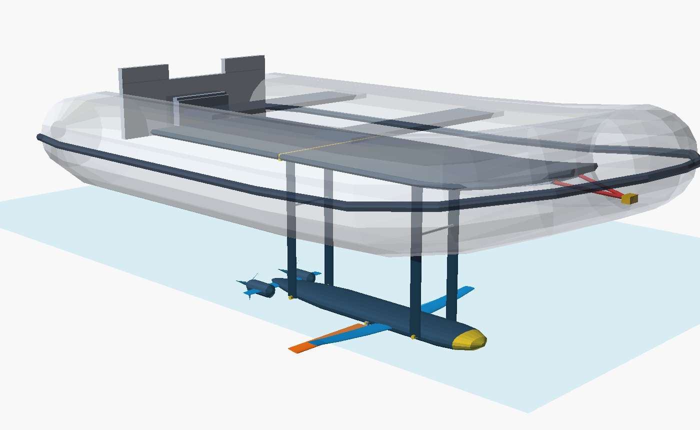

> **Full 3D Model Gallery & Rejected-Options Rationale:** See **[`VISUAL_ATLAS.md`](VISUAL_ATLAS.md)** for all **5 interactive 3D `.stl` CAD models** (Primary `Navigator 300` [`01_navigator300_stol_flaperons.stl`](models/01_navigator300_stol_flaperons.stl) & [`04_navigator300_retracted_beaching.stl`](models/04_navigator300_retracted_beaching.stl), Secondary Switchblade [`02_switchblade_pod.stl`](models/02_switchblade_pod.stl), Primary STOL Pod Cutaway [`03_stol_flaperon_pod.stl`](models/03_stol_flaperon_pod.stl), and secondary open-bow `Discovery 330` [`05_discovery330_oframe_stol.stl`](models/05_discovery330_oframe_stol.stl)), OpenSCAD renders, and 13 scaled SVGs. See **[`DESIGN_TRADE_OFFS.md`](DESIGN_TRADE_OFFS.md)** for detailed physics explaining why we rejected Step-Out wings, single masts, above-deck servo boxes, and flat rectangular plates.

#### Primary Target Hull: `True Kit Navigator 300` Specifications & Foil Fitment Envelope

| Hull Parameter | **`True Kit Navigator 300`** *(Primary Focus)* | `True Kit Discovery 330` *(Secondary Reference)* | Key FoilSkiff Fitment Impact |
| :--- | :---: | :---: | :--- |
| **LOA × External Beam** | **`300 × 155 cm`** (`9'10" × 61"`) | `330 × 165 cm` (`10'10" × 65"`) | Compact `300 cm` length uses forward-shifted pivots (`x = -540 / +220 mm`) so `86.5°` retracted `1.3 m` pod stays cleanly inside the rear pontoon cones. |
| **Inside Beam / Tube Dia.** | **`60 cm` (`600 mm`) / `Ø460 mm` (`18"`)** | `~70 cm` / `Ø460 mm` | `250 mm`-spaced lower rails + `220 mm`-wide pod leave **`~165 mm` clear per side** to the `Ø460 mm` tubes; tunnel depth below PVC web is **`~210–230 mm`**. |
| **Bow Geometry & Rocker** | **Closed continuous curved inflatable bow tube** bending UPWARD in bow | Open square bow with gentle bow rocker | Both top Hard Deck & under-hull plate **taper and bend smoothly upward in the bow** (`~12°` ski-nose); **`6 mm` Dyneema Bow-D-Ring Sling** kills cantilever with zero holes! |
| **Transom** | **Factory rigid notched `Tru-Alu` aluminum transom** (`10 HP` rated, open tunnel below) | Open tube/slotted transom (`15 HP` rated) | Factory `Tru-Alu` transom is a built-in `10 HP` structural hardpoint for **zero-hole outboard-style twin-rail clamps**; verify `10–30 mm` transom lower-lip dip on hull. |
| **Bare Weight / Capacity / Bag** | **`31 kg` (`68 lb`) / `500 kg` / `105 × 60 × 30 cm`** | `36 kg` (`79 lb`) / `500 kg` | Contoured 2-piece Hard Deck (`~5.5–7.5 kg` carbon; `100%` flush top — **zero servo boxes!**) packs cleanly alongside the `105 × 60 cm` boat bag. |

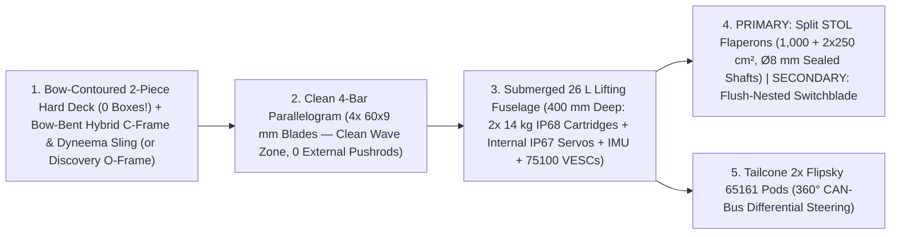

### B. Wing & Fuselage Geometry Showdown: Why Deep-Submerged Split STOL Flaperons (Primary) & Switchblade (Secondary) Win
Hydrodynamic comparison for a `~235 kg` (`518 lb`) 1–2 person `True Kit Navigator 300` dinghy (main foil + fuselage drag only):

| Architecture (`~235 kg` All-Up Boat + Crew, `5.38 kWh` Pack) | Takeoff | `10.0 kn` Drag | `12.5 kn` Drag | `15.5 kn` Drag | `22.0 kn` Drag | **`15.5 kn` Power & Range** | Engineering Verdict |
| :--- | :---: | :---: | :---: | :---: | :---: | :---: | :--- |
| **PRIMARY (Ocean-Safe Active Control): Submerged Split STOL Flaperons (`1,000 cm²` Main + `2 × 250 cm²` Active Slotted Flaperons, Internal Pod Servos)** | **`7.2 kn`** | **`16.1 lbf`** (`72 N`) | `16.9 lbf` (`75 N`) | **`20.9 lbf`** (`93 N`) | `36.4 lbf` (`162 N`) | **`2.80 kW` (`29.8 nm`)** | **PRIMARY PICK:** `100%` deep submerged (`400 mm` deep, `0` wave-crest wing slam!), `0` deck boxes (servos sealed inside pod), full **4-in-1 active takeoff, Direct-Lift wave leveling, roll leveling & banked turns** (`~$160` electronics)! |
| **SECONDARY (Max Range & Top Speed): Flush-Nested Top-Deck Switchblade (`2 × 680×105 mm` flush in pod roof) + `1,250 cm²` Lower Thin Wings** | **`6.7 kn`** | `16.8 lbf` (`75 N`) | **`16.5 lbf`** (`73 N`) | **`19.4 lbf`** (`86 N`) | **`32.3 lbf`** (`144 N`) *(Best pod!)* | **`2.71 kW` (`30.8 nm`)** | **SECONDARY PICK:** `100%` deep submerged (`0` wave slam!), `0 cm²` extra wet area & `0` exposed tips when closed, best `22 kn` efficiency, `~90 mm` flat beach fold! |
| **Alt 1 (Simplest Fixed Submerged): Single-Plane Fixed Flying-Keel (`26 L` buoy. + `2,200 cm²` fixed thin wings)** | `7.4 kn` | **`15.0 lbf`** (`67 N`) | `17.9 lbf` (`80 N`) | `24.2 lbf` (`108 N`) | `45.1 lbf` (`200 N`) | `2.98 kW` (`27.9 nm`) | Simplest ocean-safe fixed wing (`0` moving foil parts); lowest drag at `8–11 kn`, higher cruise drag >`13 kn`. |
| **Alt 2: Dry-Floor Thin Foil (`1,600 cm²`, `t/c = 10%`) + Dry `36 kg` Battery in Rigid Floor** | `9.5 kn` | `18.2 lbf` (`81 N`) | **`16.4 lbf`** (`73 N`) | **`17.8 lbf`** (`79 N`) | **`27.5 lbf`** (`122 N`) | **`2.62 kW` (`31.8 nm`)** | Lowest drag >`14 kn` (`L/D ≈ 20`) & easiest `2-sec` hand flip-up for rocky beaches, but `9.5 kn` takeoff. |
| **Rejected in Chop: Upper Surface-Piercing "Step-Out" Wing (`+1,400 cm²` high on strut, forward OR deep aft)** | `6.4 kn` | `16.1 lbf` | `16.3 lbf` | `19.3 lbf` | `33.2 lbf` | `2.71 kW` (`30.8 nm`) | **REJECTED for real chop** *(see [`DESIGN_TRADE_OFFS.md`](DESIGN_TRADE_OFFS.md))*: `850×` air-to-water shock in `1–2 ft` waves causes `-140 kgf` nose-dive suction / `+210 kgf` bow launch (forward) or `-1,350 N·m` tail-slam bow-down + `45 cm` CoL jump (aft)! |
| **Rejected: External Un-Nested Swing-Wing / Split Battery-Fuselage Swing-Wing** | `5.6–6.7 kn` | `17.9–21.8 lbf` | `18.5–26.3 lbf` | `22.7–37.0 lbf` *(+33–53%!)* | `39.3–70.8 lbf` | `2.90–3.71 kW` (`22.5–28.8 nm`) | **REJECTED:** keeps `100%` extra wetted area ($S_{\text{wet}}$) in water, blunt tips point into flow, and/or flexes `100 A` cables through rotary underwater pivots. |
| **Rejected: Fixed Thick Full-Span Battery Wing (`3,400 cm²`, `38 mm` `21700` wing, `t/c = 14%`)** | `6.1 kn` | `21.5 lbf` (`96 N`) | `27.6 lbf` (`123 N`) | `38.8 lbf` (`173 N`) *(2.2× drag!)* | `74.1 lbf` (`330 N`) *(2.7× drag!)* | `3.81 kW` (`21.9 nm`) | **REJECTED >`12 kn`:** huge chord across the full span doubles/triples profile drag ($C_{D0} \cdot S \cdot V^2$). |

> **Fluid-Mechanics & Wave-Safety Takeaway:** Above `12 kn`, `70%–85%` of foil drag is skin friction ($D_f = \frac{1}{2} \rho V^2 C_f S_{\text{wet}}$)—**AND** in `1–2 ft` harbor/ocean chop, any horizontal wing hovering near the surface suffers violent `850×` air-to-water wave slams. Keeping `100%` of lift **`400 mm` deep underwater** solves BOTH: **(1) PRIMARY — Submerged Split STOL Flaperons** (`1,000 + 2×250 cm²`, `29.8 nm`, active wave/roll/elevation stabilization via **internal pod servos**), and **(2) SECONDARY — Flush-Nested Top-Deck Switchblade** (`0 cm²` extra wet area closed, `30.8 nm`, best `22 kn` pod drag).

* **PRIMARY: Submerged Split STOL Flaperon Mechanics with Internal Pod Servos (`ZERO` Boxes Above Top Deck!):**

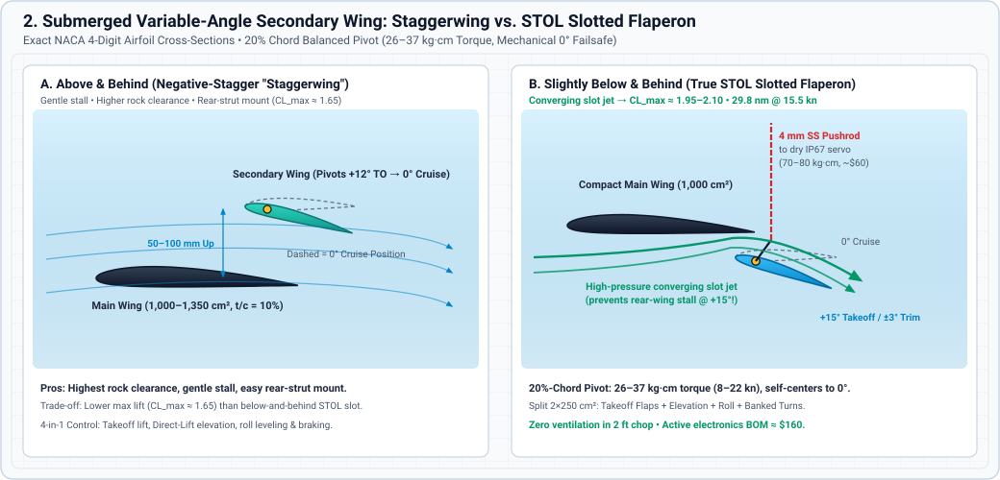

  * **Stagger Position:** Mounting the split `2 × 250 cm²` (`450 × 55 mm` ea.) flaperons **slightly below & behind** the `1,000 cm²` main wing (`~20–35 mm` down, `~0.8` chords aft — *Junkers / Zenith CH701* STOL external slotted flap) channels a high-pressure converging slot jet over the rear wing's upper surface (`CL_max ≈ 1.95–2.10`). Mounting **above & behind** (*Beechcraft Staggerwing* negative-stagger biplane, `~50–100 mm` up, `~0.7` chords aft) yields gentler stall and slightly higher rock clearance (`CL_max ≈ 1.65`).
  * **4-in-1 Active Flight Control:** (1) **STOL Takeoff Flaps** (both `+15°` down), (2) **Direct-Lift Elevation / Wave Leveling** (both `±3°` together—arrests bow dips and raises/lowers the boat dead-flat over swells without rollercoaster nose pitching), (3) **Active Roll Leveling & Banked Turning** (differential left/right `±3°` when passengers move or turning), and (4) **Hydrodynamic Braking / Soft Touchdown** (both `-8°`).
  * **Internal Pod-Mounted Servos (`ZERO` Above-Deck Boxes, `ZERO` External Strut Pushrods!):** Pivoting each `250 cm²` half at its **quarter-chord aerodynamic center (`20%–25%` chord)** keeps peak actuator torque tiny (`≤3.6 N·m` / `37 kg·cm` across `8–22 kn`). Rather than bolting protruding servo boxes onto the cockpit Hard Deck and running `650 mm` pushrods down the struts (which ruin deck usability and bind during `86.5°` folding!), **mount both `40 × 20 × 40 mm` brushless `IP67` `70–80 kg·cm` servos (`0.19 L` combined, `~$60` ea.) + the `ESP32` & 6-DOF `BNO085` IMU directly INSIDE the sealed Flying-Keel Pod bay**. Each servo directly drives a **`Ø8 mm` 316L stainless torque tube** (`>40×` torsional safety margin) exiting through a **CNC double-O-ring / Viton lip-seal gland** on the pod side into the flaperon root. Placing the hinge slightly forward at **`~20%` chord** ensures both flaperons **hydrodynamically self-center to `0°`** on power/servo loss:

| Flaperon Regime (`250 cm²` / `450 × 55 mm` Half) | Lift per Half | Balanced Hinge Torque (`2×` Margin) | `Ø8 mm` Stainless Direct-Drive Shaft Margin |
| :--- | :---: | :---: | :---: |
| **Takeoff (`+15°` @ `8 kn`)** | `304 N` | **`2.67 N·m`** (`27 kg·cm`) | **`>55×`** yield safety (`0` external pushrods) |
| **Cruise Trim (`±3°` @ `15.5 kn`)** | `285 N` | **`2.51 N·m`** (`26 kg·cm`) | **`>58×`** yield safety (`0` external pushrods) |
| **Max Speed Trim (`±2°` @ `22 kn`)** | `410 N` | **`3.61 N·m`** (`37 kg·cm`) | **`>40×`** yield safety (`0` external pushrods) |

* **Dual-Mode Upgrade — `100%` Internal-Pod Morphing STOL-to-Staggerwing Flaperon (`+$180–$240`, `+0.8 kg` — Best Morphing Option for 5-Hour Flights):**

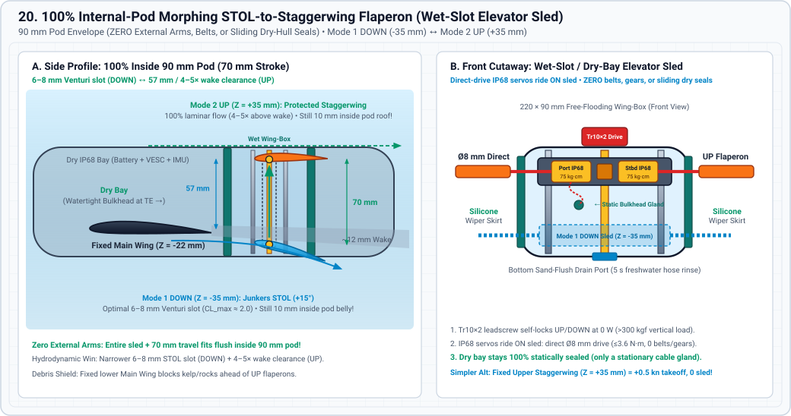

  * **Why We Stay `100%` Inside a `90 mm` Pod (`ZERO` External Swing-Arms!):** An external `58 mm` cheek swing-arm sticks outside the pod, snags kelp, and cannot transmit pitch torque from pod-mounted servos to the arm tip without hidden belts/chains/bevel gears or 4-bar linkages. Instead, mount the fixed `1,000 cm²` Main Wing in the **lower third (`Z = -22 mm`)** of a **`90 mm` tall pod (`±45 mm`)**, and move the flaperons purely vertically (`70 mm` stroke, `Z = -35 mm ↔ +35 mm`) **100% inside the pod hull**:
    * **Mode 1 — DOWN (`Z = -35 mm`, `+15°` STOL Takeoff — still `10 mm` inside pod belly!):** Sits `13 mm` below the Main Wing center, forming the true optimal **`6–8 mm` (`6–8%` chord) converging Venturi slot gap** behind the Main Wing TE (`CL_max ≈ 1.95–2.05`, **`7.0–7.2 kn` lift-off**).
    * **Mode 2 — UP (`Z = +35 mm`, `0°` / `±3°` Protected Staggerwing Cruise — still `10 mm` inside pod roof!):** At `15.5 kn` (`Re ≈ 8 × 10⁵`), the Main Wing's turbulent viscous wake is only **`~10–14 mm` thick** (`~1°` downwash). Rising to `Z = +35 mm` puts the flaperons **`57 mm` (`0.57` chords) above the Main Wing (`4–5×` higher than the entire wake!)** in `100%` clean laminar freestream (`-0.8 to -1.1 lbf` drag saved → `+1.5–2.2 nm` range bonus), shielded behind the fixed lower Main Wing, with full `±3°` active roll/elevation control and extra beaching clearance.
  * **"Wet-Slot / Dry-Bay" Vertical Elevator Sled (`ZERO` Belts/Gears, `ZERO` Sliding Dry-Hull Seals!):** Because flat sliding waterproof seals always leak under sand/pressure, place the `70 mm` elevator inside a dedicated **`96 mm`-long free-flooding internal wing-box** separated from the dry `IP68` battery/VESC/IMU bay by twin curved watertight bulkheads:
    * **Self-Locking Vertical Drive:** Twin `Ø10 mm` stainless guide rods + `1×` central **`Tr10×2` self-locking stainless leadscrew** (`0 W` holding power, `>300 kgf` vertical capacity, `~2–3 s` shift while flaperons feather to `0°`).
    * **Direct-Drive Servos ON the Sled:** Both individually waterproof **`IP68` CNC aluminum `75 kg·cm` pitch servos** ride **directly on the elevator sled** and couple straight to the `Ø8 mm` `20%`-chord flaperon shafts (`≤3.6 N·m`, `ZERO` belts, chains, or bevel gears!). Only a stationary flexible 3-wire silicone servo pigtail crosses into the dry bay through a **static `IP68` bulkhead wire gland**.
    * **Hydrodynamic Fairing & Sand Rinse:** Flush **split silicone cheek wiper skirts** (racing-dinghy centerboard gasket style) smooth the `12 × 75 mm` vertical cheek slots, and a bottom drain port allows a `5-second` freshwater hose rinse after beaching (see 3D cutaway [`10_morphing_stol_staggerwing_pod.stl`](models/10_morphing_stol_staggerwing_pod.stl)).
  * **Simpler Zero-Sled Alternative — Fixed Upper Staggerwing (`Z = +35 mm` Fixed):** If you prefer **zero moving vertical mechanism and zero cheek slots**, bolting the flaperons permanently at the UP Staggerwing position (`Z = +35 mm`, `2×` direct-drive O-ring shafts inside an `80 mm` pod) keeps **`100%` of the laminar out-of-wake cruise efficiency and debris protection** at the cost of only **`+0.5 kn` takeoff speed** (`7.6–7.9 kn` vs. `7.2 kn`):

| Flaperon Architecture | Takeoff Speed (`CL_max`) | `15.5 kn` Wake / Drag | Debris Shield | Inside Pod Only? | Mechanism & Maintenance |
| :--- | :---: | :---: | :---: | :---: | :--- |
| **Internal-Pod Wet-Slot Elevator Sled *(Best Morphing)*** | **`7.0–7.2 kn`** (`~2.0`) | **Clean UP** (`+1.5–2.2 nm`) | **High** (UP cruise) | **YES (`90 mm` pod)** | Free-flooding sled + `Tr10×2` + wipers (`5 s` sand rinse) |
| **Fixed Upper Staggerwing *(Simplest Protected Cruise)*** | `7.6–7.9 kn` (`~1.65`) | **Cleanest** (`+1.5–2.5 nm`) | **Highest** (always UP) | **YES (`80 mm` pod)** | **Simplest:** `2×` rotary O-ring shafts (`0` sled, `0` slots) |
| **Fixed Low STOL Flaperons *(Primary Simplest Takeoff)*** | **`7.2 kn`** (`~2.0`) | Baseline (`~0.8 lbf` near wake) | Lower (sits low) | **YES (`80 mm` pod)** | **Simplest:** `2×` rotary O-ring shafts (`0` sled, `0` slots) |
| **Rejected: External `58 mm` Cheek Swing-Arm** | `7.2 kn` | `-0.4 lbf` arm drag penalty | Arms snag kelp/lines | **NO (protrudes)** | **Rejected:** requires hidden belt/gear/4-bar link inside arms |

* **SECONDARY: Flush-Nested Top-Deck Switchblade Wing Mechanics (`+1,300 cm²` Takeoff, `0 cm²` Extra Wet Area at Cruise):**

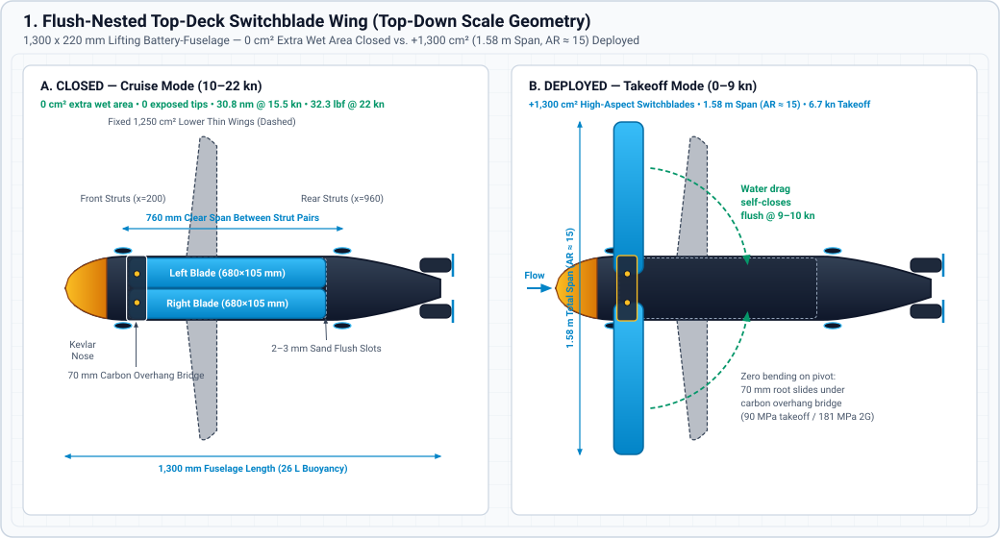

  * **Zero-Drag Roof Nesting & Strut Clearance:** Two `680 × 105 × 13 mm` solid UD carbon blades (`2 × 105 = 210 mm` inside the `220 mm` pod width; `1.58 m` total span / `AR ≈ 15` open!) sit flush inside a `13 mm`-deep recessed top-deck pocket (`+10 mm` pod height `80 → 90 mm` preserves the full `26 L` battery bay). Mounting the **`4×` side-straddling tandem struts** at `x = 170 mm` (ahead of the `x = 220 mm` pivots) and `x = 960 mm` (behind the `x = 900 mm` tucked tips) leaves the entire `680 mm` sweep arc `100%` clear—folding to **`~90 mm` (`~5.5"` clear above flat sand)**.
  * **Carbon Overhang Bridge & Strength:** Solid UD carbon (`105 × 13 mm`) sees only **`90 MPa`** at normal takeoff (`52.5 kgf/blade`, `9×` safety) and **`181 MPa`** in a `2G` gust (`4.4×` safety). A **`70 mm`-deep rigid carbon Overhang Bridge** across the front of the pocket lets each blade's inner `70 mm` root slide *underneath* when deployed—reacting `~214 kgf` of upward lift in pure compression while the vertical pivot pin handles only sweep rotation.
  * **Hydrodynamic Self-Closing & Sand-Proofing:** Sweeping *aft* means water drag naturally closes the blades flush at `9–10 kn` as soon as a hold-open latch releases (and folds them safely back on kelp/branch contact). Mold **`2–3 mm` aft flush-out drain slots** + **UHMW / Delrin wear pads** under the bridge to prevent sand jamming, and pair with an internal pod-actuated `<$150` aft auto-trim stabilizer.

#### Choosing Between Primary (Split STOL Flaperons) & Secondary (Flush-Nested Switchblade)

| Decision Criterion | **PRIMARY: Submerged Split STOL Flaperons (`1,000 + 2×250` wet)** | **SECONDARY: Flush-Nested Top-Deck Switchblade (`+1,300` roof + `1,250` low)** | **Fixed Alt: Single-Plane Deep Wing (`2,200 cm²` fixed)** |
| :--- | :---: | :---: | :---: |
| **Takeoff / `15.5 kn` Range / `22 kn` Drag** | `7.2 kn` / `29.8 nm` / `36.4 lbf` | **`6.7 kn` / `30.8 nm` / `32.3 lbf`** | `7.4 kn` / `27.9 nm` / `45.1 lbf` |
| **Rough `2 ft` Ocean Chop & Wave Slam** | **Best! `0` wave-crest slam** (`400 mm` deep) + active wave leveling | **`0` wave-crest slam** (`400 mm` deep permanently) | **`0` wave-crest slam** (`400 mm` deep permanently) |
| **Ride-Height & Roll Stabilization** | **Full 4-in-1 active Direct-Lift elevation, roll leveling & banked turns** (servos inside pod!) | Needs internal pod `<$150` aft auto-trim stabilizer | Manual throttle/body weight (or aft auto-trim) |
| **Cockpit Deck & Folded Beaching Depth** | **`100%` flush deck (`0` boxes!) • `~90 mm` (`~5.5"` sand clear)** | **`100%` flush deck (`0` boxes!) • `~90 mm` (`~5.5"` sand clear)** | **`100%` flush deck • `~90 mm` (`~5.5"` sand clear)** |
| **Maintenance & Mechanical Complexity** | **Zero sliding roof pockets;** `2×` internal `IP67` servos + `Ø8 mm` double-O-ring shafts (`20%`-chord `0°` failsafe) | Recessed top pocket needs `2–3 mm` sand flush slots + release latch | **Simplest:** zero moving foil parts (`~10%` less cruise range) |

### C. Core Advantages of the Bow-Contoured Hard Deck + Deep-Submerged Split STOL Flying-Keel Pod
1. **Free Archimedes Lift (`~26.6 kg` Buoyancy) + Modular Swappable Portability:** Displacing `26 L` of seawater cancels `~90%` of the battery's weight underwater (`~66 lbf` lift with zero induced drag). Housing the cells as **two removable, factory-potted `IP68` `2.5–2.7 kWh` (`~14 kg` ea.) slide-in cartridges** inside the fuselage bay lets one person carry a battery ashore to charge, isolates seal/cell serviceability, and lets you run **1 cartridge + a closed-cell foam dummy plug** (`~15 nm`) for ultralight solo trips or **2 cartridges (`~30–31 nm`)** for 2-up range.
2. **100% Ocean-Safe Deep Immersion (`400 mm` Deep — Zero Surface-Piercing Wave Slam):** With **zero** horizontal wing hovering near the waterline, `1–2 ft` chop passes harmlessly through the `Navigator 300`'s open tunnel while only the `9 mm` blades slice the crest (`~4 lbf` ripple).
3. **"Push Throttle and Fly" Ergonomics with ZERO Above-Deck Boxes:** Mounting both `IP67` `70–80 kg·cm` brushless flaperon servos and the `ESP32` + 6-DOF `BNO085` IMU **inside the sealed Flying-Keel Pod** leaves `100%` of the bow-contoured Hard Deck flush for passengers and gear while delivering smooth active elevation, roll leveling, and inward-banked turns (`~$160` BOM, `20%`-chord mechanical `0°` failsafe).
4. **Bow-Contoured Rigid Hard Deck & Under-Hull Ski-Plate (Zero Hull Flex, Zero Permanent Boat Mods):** Both the `28 mm` 2-piece Hard Deck and the under-hull Hybrid C-Frame plate taper in planform and bend smoothly upward along the `Navigator 300`'s bow rocker—eliminating hull twist and bow chafe with zero glue or drilled holes.
5. **Zero High-Current Strut Cables, Zero External Pushrods & Passive Seawater Cooling:** Keeping the battery cartridges, `IP67` flaperon servos, `ESP32`/IMU, `Flipsky 75100` `VESC`s (heat-sunk to the bottom skin `<45°C`), and tailcone `Flipsky 65161` pods inside one self-contained underwater fuselage eliminates thick `100–150 A` DC cables and long strut pushrods—only a thin `4-wire` control/alarm/charge umbilical runs up a `3 mm` trailing-edge blade channel.
6. **Pendulum Keel Roll Stability & Cavitation Margin (`>4×` at `22 kn`):** Placing `28–30 kg` of battery mass `350–450 mm` below the waterline resists roll like a racing keel bulb, while the low-lift longitudinal fuselage maintains a `4.2×` cavitation margin at `22 kn`.

### D. Mandatory Marine Safety & Mechanical Design Rules

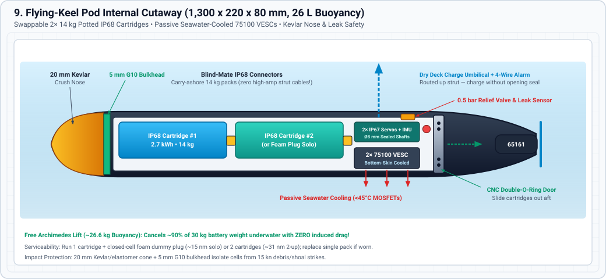

1. **Bow-Contoured Rigid Hard Deck Structural Backbone (Mandatory on Soft Inflatables):** Never mount a hydrofoil directly to an unsupported drop-stitch air floor, glued PVC transom patches, or blunt flat rectangular plates. Always bolt/clamp the under-hull carriage to a **bow-contoured 2-piece folding Hard Deck** wedged into the tube pockets with **zero protruding boxes above the top deck**.
2. **Sealed Internal Pod Actuation (`Ø8 mm` Double-O-Ring Rotary Shafts + `20%`-Chord Mechanical Failsafe):** Keep both flaperon servos and the `ESP32`/`BNO085` IMU **inside the waterproof Flying-Keel Pod bay** (never bolted on top of the cockpit deck!). Seal each `Ø8 mm` 316L stainless torque tube with a **CNC double-O-ring / Viton lip-seal gland**, and place each flaperon pivot at **`~20%` chord** so both surfaces self-center hydrodynamically to `0°` on power loss.
3. **Swappable `IP68` Battery Cartridges + Sacrificial Nose Impact Bumper:** Build a **`20 mm` closed-cell elastomer + Kevlar crush-nose cone** ahead of a rigid `5 mm` `G10` bulkhead for rock/debris impacts. Use **two removable, factory-potted `IP68` (`14 kg` ea.) slide-in cartridges** with blind-mate waterproof high-current connectors (`Amphenol SurLok` / `QS8` inside a CNC double-O-ring rear bay door), an **internal optical/conductivity leak sensor** wired to a cockpit alarm, a **`0.5 bar` pressure-relief burst valve**, and a **deck-level dry charging umbilical** up the blade trailing channel.
4. **Parallelogram Assisted Retraction for Shallow Beaching & Grounding Kick-Up:** Mount the `1.3 m` pod (`~37–43 kg` loaded / `~11–15 kg` empty) on **`4×` side-straddling (`60 × 9 mm`) parallel struts (4-bar parallelogram)** hinged to the `250 mm`-spaced Hybrid C-Frame (or `Discovery 330` O-Frame) twin rails with a **`3:1` Dyneema tackle or marine gas-strut assist** + breakaway Delrin shear pin. With servos sealed inside the pod (zero external pushrods!) and no upper wing, the pod lifts **100% flat and horizontal** straight up *between* the rails (`~90 mm` depth → `~135–140 mm` / `5.5"` sand clearance!).
5. **Deep Pod Immersion (`350–450 mm`) & Clean Wave Zone:** Set `680 mm` strut length so the entire Flying-Keel Pod and Split STOL Flaperons fly **`350–450 mm` deep**—leaving only the `9 mm` vertical blades in the wave-crest zone (`0` surface-piercing wings!).
6. **Steering Options on the Flying-Keel Pod:**
   * **Option 1 (Twin Tailcone `65161` Pods — Zero Moving Parts):** Mount `2 × Flipsky 65161` (`100 Kv` on `16S` or `120 Kv` on `14S`) symmetrically off the aft fuselage/stabilizer tips for **`360°` CAN-bus differential power steering** with zero rudder drag.
   * **Option 2 (Single Centerline `65161` Tailcone Pod + Compact Servo Rudder):** Lowest drag and lightest weight (`3 kg` motor), using an internal aft pod servo actuating a compact rudder flap.

### E. Drop-In 2-Piece Rigid "Spine Floor" & Zero-Hole Coupling (`Navigator 300` Primary & `Discovery 330` Secondary)
Both `True Kit Navigator 300` (closed curved bow + rigid `Tru-Alu` aluminum transom) and `True Kit Discovery 330` / `Takacat LX` (open square bow) feature a **continuous, permanently heat-welded `~1.0–1.2 mm` PVC fabric "tunnel ceiling" web** stretched between the two side pontoons, with the stock drop-stitch air floor resting *on top* of it. Because you cannot pass a strut through the center of the floor without cutting that PVC membrane, the Spine Floor uses **zero-hole clamping** across or around the web:

* **Bow-Contoured 2-Piece Rigid Hard Deck & Under-Hull Plate (`Navigator 300` Primary — `0` Glue, `0` Holes, `0` Above-Deck Boxes, `60-Second` Install):**
  * **Follows the Real Bow Contour (Never Flat Rectangles!):** For the **`True Kit Navigator 300`** (`600 mm` inside beam), two interlocking `28 mm` sandwich panels (`~5.5–7.5 kg` carbon/Divinycell or `~9–10 kg` Alu honeycomb; rear half flat `680 mm` wide, front half **tapering smoothly to the curved bow tube and bending upward `~85–95 mm` along the bow rocker!**) latch flush midship with zero protruding servo boxes or hardware above the top deck.
  * **Contoured Under-Hull Ski-Plate:** Underneath the `1.2 mm` PVC web, the `Tru-Alu` Hybrid C-Frame plate + twin `250 mm`-spaced rails **also tapers and bends upward in the bow (`~12°` ski-nose)** up to the `6 mm` Dyneema Bow-D-Ring tieback—eliminating bow chafe and blunt-lip wave catch.
  * **Multi-Hull Adaptability (`Discovery 330` / `Takacat LX`):** The standardized `650 mm` central Spine Core adapts cleanly to wider open-bow hulls via bolt-on beveled HDPE/EVA outer width strips (`15–150 mm`) and a bow-contoured full rigid O-Frame.
  * **Install Sequence:** Partially inflate pontoons (`~1.5 PSI`) → drop the contoured Hard Deck directly onto the `1.2 mm` PVC web and latch midship → inflate tubes to full `3.5 PSI` to friction-lock the beveled edges firmly inside the tube pockets.

| Connection Method (Top Spine Floor $\leftrightarrow$ Bottom Foil Carriage) | Added Weight | Added Cost | Grounding / Reef-Strike Behavior | Hull Compatibility | Engineering Verdict |
| :--- | :---: | :---: | :--- | :---: | :--- |
| **Option B1 (`Navigator 300` PRIMARY): `Tru-Alu` Transom-Clamped Hybrid C-Frame + `6 mm` Dyneema Bow-D-Ring Sling** *(twin `50×20 mm` rails clamped to `Tru-Alu` transom + front tieback to Bow D-Ring)* | **`~3.0–3.8 kg`** *(2× `50×20 mm` Alu rails)* | **`+$160 – $260`** *(`~$75` Alu + Dyneema)* | Mechanical strut kick-up + Delrin shear pin | **Closed-bow + `Tru-Alu` transom (`True Kit Navigator 300` / `250`)** | **Primary `Navigator 300` zero-hole mount:** leverages factory `10 HP` `Tru-Alu` transom + Bow D-Ring sling to eliminate front cantilever (`3×–4×` lower bending), `220 mm` pod retracts *between* rails (`165 mm` side clearance in `600 mm` tunnel)! |
| **Option A (`Navigator 300` Universal Alt): Through-Fabric Switchable Magnets (`4 × Magswitch` Rotary `N52` / EPM) + `Tru-Alu` Transom Shear/Safety Bridle** | `~6–9 kg` | `+$450 – $750` | **Built-in resettable breakaway fuse** (front pair releases cleanly @ `~400 kgf` shock; transom bridle retains pod!) | **Universal** *(closed-bow `Navigator 300`, open or closed transoms!)* | **Best `5-sec` drop-on UX for `Navigator 300`:** zero forward sling or bow wrap; works ONLY with Spine Floor directly on `1.2 mm` PVC (`~2.5 mm` gap), NOT through `100 mm` air deck! |
| **Option B2 (Secondary Open-Bow Ref): Full Bow-to-Transom Twin-Rail "O-Frame" Clamshell** *(wraps both open square bow & open transom around PVC web)* | **`~2.5–3.5 kg`** *(2× `50×20 mm` rails)* | **`+$150 – $250`** *(`~$70` Alu tubing)* | Mechanical strut kick-up + Delrin shear pin | Open-bow + open-transom cats (`True Kit Discovery 330`, `Takacat LX`) | **Best zero-hole mount for open-bow hulls:** rigid closed loop at both ends, `20 mm` slim rail height, splits into `1.0 m` halves. |
| **Option C: Factory OEM Welded Centerboard Slot** *(one RF-welded `60×320 mm` slot + PVC boot + split-neoprene gasket in non-airtight web)* | **`~1.0–1.5 kg`** | `+$150` *(factory)* | Top-accessible strut kick-up clutch | Factory OEM "Foil Edition" (`True Kit` / `Takacat`) | **Lightest & cleanest OEM finish** (zero underwater rails; pluggable w/ flush blanking plate); modifies stock PVC web so not a no-mod DIY bolt-on. |

#### Side-Profile Diagrams & Structural Rationale (`Navigator 300` Hybrid C-Frame vs. Magnets vs. `Discovery 330` O-Frame vs. OEM Slot)

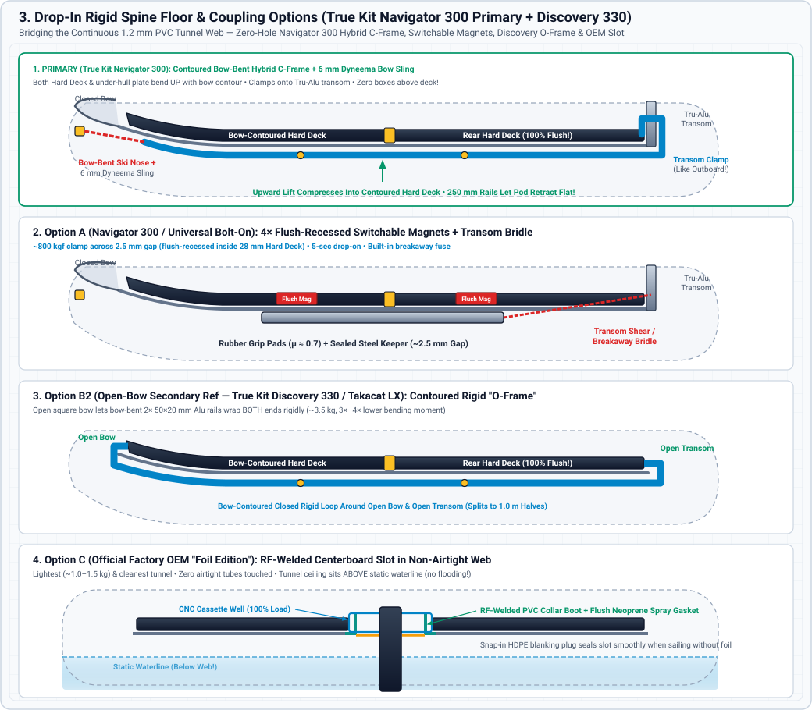

* **Why Eliminating the Front Cantilever Matters (Hybrid C-Frame Bow Sling & Open-Bow O-Frame):** A pure 1-ended **cantilever** (like a diving board) concentrates the full `40 kg` hanging pod weight on a `1.1 m` lever arm at the transom corner (`~917 N·m` in `2G` bounce). Supporting **both** ends—via the **`6 mm` Dyneema Bow-D-Ring Tieback Sling** on the closed-bow `Navigator 300`, or the rigid front bow wrap (**O-Frame**) on the open-bow `Discovery 330`—splits the hanging load 50/50, cutting peak bending moment by **`3×–4×` (`~210–300 N·m`)** and deflection by **`10×–16×`**! *(Note: While **foiling**, upward lift `+210 kgf` pushes the lower rails flat UP against the underside of the Top Spine Floor in direct compression—so neither frame cantilevers while flying; front tie-up shines during hanging loads, trailering/wave bounce, and roll stiffness.)*
* **Option B1 (PRIMARY for `True Kit Navigator 300` — `Tru-Alu` Transom-Clamped Hybrid C-Frame + `6 mm` Dyneema Bow Sling):**
  * Uses **two slim `50 × 20 × 2.5 mm` `6061-T6` aluminum rails (`~3.4 kg` total)** spaced **`250 mm` apart** inside the `Navigator 300`'s `600 mm` inside beam (leaving **`~165 mm` clear per side** to the `Ø460 mm` tubes) and providing a **built-in center retraction bay** so the `220 mm`-wide Flying-Keel Pod tucks UP *between* the two rails.
  * Rear vertical risers **clamp directly onto the factory `10 HP`-rated `Tru-Alu` aluminum transom** with anodized outboard-style screw clamps (zero holes!) and lock into the rear Spine Floor.
  * A **`6 mm` high-modulus Dyneema tieback sling** (`>2,500 kg` breaking load, tensioned via a small `2:1` low-friction ring or turnbuckle) runs from the front crossbar forward *under* the raised curved bow tube up to the factory **Bow Towing D-Ring**, eliminating front cantilever sag with zero hull modifications. Midship splice sleeves split the rails into `~0.95 m` packable halves, and a `3 mm` EPDM chafe pad cushions the `1.2 mm` PVC web.
  * **`Navigator 300` Field-Check Note (`Tru-Alu` Transom Lip & Forward Pivots):** On the `300 cm` `Navigator 300`, mount the `4×` parallelogram strut pivots slightly forward (`x_front = -540 mm`, `x_rear = +220 mm` relative to midship) so on an `86.5°` aft fold the `1.3 m` pod (`~90–95 mm` folded depth, with outer wingtips folded `90°` aft cleanly inside the `600 mm` tunnel) slides smoothly underneath the open-bottom `Tru-Alu` transom while staying inside the `300 cm` rear pontoon cones with **`~130–140 mm` (`5.1–5.5"`) sand clearance**. *(Before cutting the rear C-Frame riser height, measure the exact vertical dip of your `Tru-Alu` transom's lower aluminum edge below the PVC tunnel web—typically `10–30 mm`.)*
* **Option A (`Navigator 300` Universal Alternative — Four Mandatory Rules for Through-Fabric Switchable Magnetic Clamping):**
  1. **`~2.2–2.5 mm` Gap Physics (`4 ×` `10 × 10 cm` Pucks on `400 × 800 mm` Base):** Sitting the `Navigator 300` Spine Floor directly on the `1.2 mm` PVC web yields `B ≈ 0.70 T` (`~2.0 kgf/cm²`) → **`~800 kgf` (`1,760 lbf`) total clamping force** (`~2.2×` roll safety margin in `1.5 G` turns; upward foiling lift compresses the clamp tighter). Never attempt through a `100 mm` stock air deck (flux drops to near zero).
  2. **Rubber Grip Pads + `Tru-Alu` Transom Shear/Safety Bridle (Mandatory):** Wet PVC is slippery (`μ ≈ 0.22` → `~175 kgf` slip threshold). Bond **micro-ribbed vulcanized rubber/silicone grip pads** (`μ ≈ 0.65–0.80` → `520+ kgf` shear) to both faces **and** clip a short Dyneema/stainless bridle onto the `Tru-Alu` transom to carry fore-aft shock shear and prevent losing the `$2,500` pod if a reef strike trips the magnetic breakaway fuse.
  3. **Mechanical Rotary (`Magswitch`) or Electro-Permanent Magnets (EPMs) ONLY — Never Plain Electromagnets:** Plain electromagnets fail-unsafe on battery loss. Mechanical rotary `N52` pucks require **zero power**, stay failsafe `ON`, and only need a sealed **`8–10 mm` mild-steel / `430` ferritic stainless keeper plate** on the bottom carriage (saving `~4 kg` and `~$400` vs. dual-sided magnets).
  4. **Hermetic Saltwater Sealing & 6-DOF IMU Mode:** Encapsulate all `NdFeB` rotors (`316L`/epoxy) and vacuum-bag bottom steel keeper plates in carbon/epoxy against saltwater corrosion; keep magnetic compasses `>500 mm` away and run any `BNO085` auto-trim IMU in **6-DOF (gyro + accel only)** mode.
* **Option B2 (Secondary Open-Bow Reference — Full Bow-to-Transom Twin-Rail "O-Frame" for `True Kit Discovery 330` & `Takacat LX`):**
  * For open-bow catamarans (`Discovery 330`, `Takacat LX`), the same `50 × 20 × 2.5 mm` `6061-T6` twin rails (`~2.5–3.5 kg`) loop rigidly around both the open square bow and open transom (`1.0 m` packable halves), where the front bow bridge doubles as a beaching bumper and the rear bridge anchors the `3:1` retraction tackle & launch wheels.
* **Option C (Factory OEM Welded Centerboard Slot — Non-Airtight Web & Zero Flood Risk):**
  * Cuts **one reinforced `~60 × 320 mm` longitudinal slot** solely in the non-pressurized `1.2 mm` PVC tunnel sling—**zero airtight side-tube chambers are touched**. Because the catamaran's tunnel ceiling already sits **above the static waterline** (self-draining open transom), water does not flood upward at rest; a `100–120 mm` RF-welded vertical PVC collar ("boot") rises into the Spine Floor's CNC well, a flush **split-neoprene centerboard gasket** blocks underway spray (same proven tech as `Tiwal`, `MiniCat`, and `Laser`/`Moth` dinghies), and a snap-in HDPE blanking plug restores a smooth tunnel whenever boating without the foil. Best reserved for an OEM "Foil Edition" hull since cutting a stock hull voids factory warranty.

#### Mandatory Parallelogram Strut Geometry (`4×` Slim Side-Straddling Blades vs. `2×` Center Tandem Struts)
Keeping a pivoting `1.3 m` Flying-Keel Pod **parallel during grounding kick-up and shallow-water retraction** geometrically requires a **4-bar parallelogram linkage** (front + rear inline struts). *(See [`VISUAL_ATLAS.md`](VISUAL_ATLAS.md#4-primary-retracted-beaching-mode-865-parallelogram-fold-on-true-kit-navigator-300) for the `Navigator 300` 3D tunnel-level retracted beaching render & STL, and [`DESIGN_TRADE_OFFS.md`](DESIGN_TRADE_OFFS.md) for the single-mast collision proof.)*

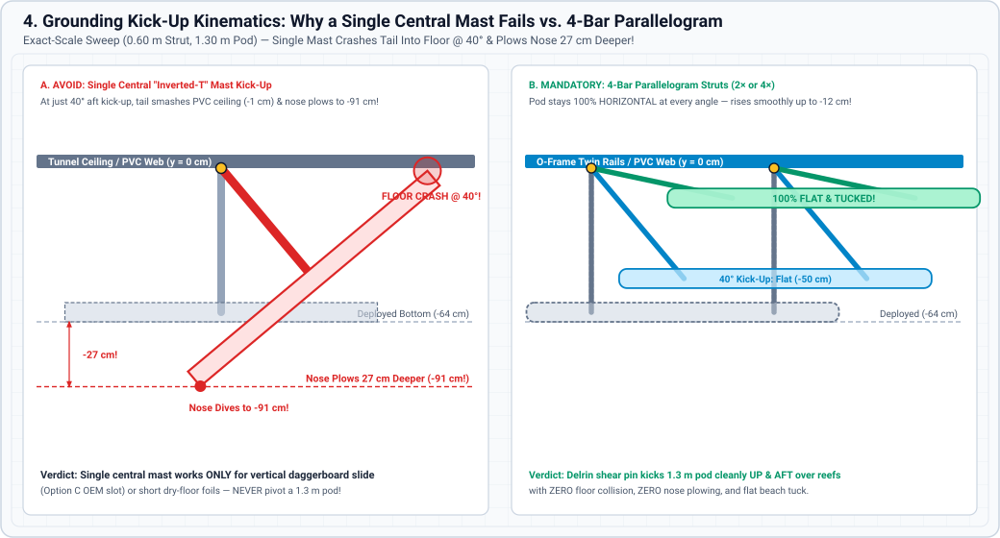

| Kick-Up Angle (`0.60 m` Strut, `1.3 m` Pod) | **Single Central Mast:** Tailcone Top | **Single Central Mast:** Nose Bottom | **4-Bar Parallelogram:** Pod Top / Bottom |
| :---: | :---: | :---: | :---: |
| **`0°`** *(Foiling)* | `-56 cm` | `-64 cm` | `-56 cm` / `-64 cm` *(flat)* |
| **`25°`** | `-23 cm` | **`-86 cm`** *(22 cm deeper!)* | `-50 cm` / `-58 cm` *(flat, rising)* |
| **`40°`** | **`-1 cm` (HITS FLOOR!)** | **`-91 cm`** *(27 cm deeper!)* | `-42 cm` / `-50 cm` *(flat, rising)* |
| **`75°`** | `+48 cm` *(impossible)* | `-79 cm` | **`-11.5 cm` / `-19.5 cm`** *(cleanly tucked)* |

> **Critical Folded Stack-Up Rule (Strut Chord Stands Vertically at `86.5°` Fold!):** When a strut swings `85°–86.5°` aft, its **chord stands vertically**! Stacking an `80 mm` pod strictly *underneath* a `120 mm`-chord strut yields **`~210 mm` (`8.3"`)** total depth below the PVC web (leaving only `~20 mm` clearance inside a `~230 mm` `Navigator 300` tunnel). You solve this cleanly via **Primary A (`4×` side-straddling `60 × 9 mm` blades flanking the pod sides → `~90 mm` depth, `+135–140 mm` / `5.5"` clear above flat sand!)** OR **Primary B (`2×` `100 mm`-chord center struts recessed `55 mm` into a pod top slot → `~135 mm` depth)**. Because there is **zero surface-piercing upper wing** and **zero external strut pushrods** (servos sit inside the pod!), folding is a clean, jam-free 4-pin/side parallelogram.

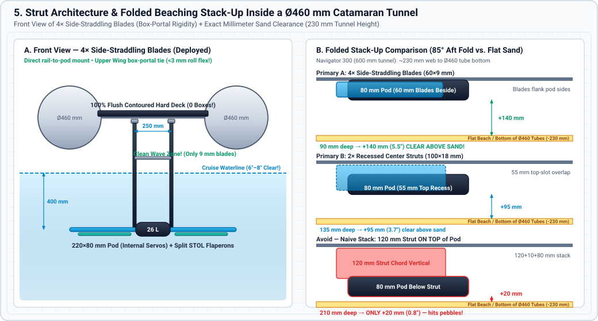

| Folded Stack-Up Variant (`80°–85°` Aft Fold) | Vertical Stack-Up Components Below `1.2 mm` PVC Web | Pod Bottom Below Web | Clearance Above Flat Beach (`230 mm` Tunnel) |
| :--- | :--- | :---: | :---: |
| **Naive Stack (Avoid):** `120 mm` center struts strictly *on top* of `80 mm` pod | `10 mm` bracket + `120 mm` vertical strut chord + `80 mm` pod | **`~210 mm`** (`8.3"`) | Only `~20 mm` (`0.8"`) — **too close to sand/pebbles!** |
| **Primary B Optimized:** `2×` `100 mm` center struts **recessed `55 mm` into pod top slot** (offset pins) | `10 mm` bracket + `100 mm` strut overlapping `55 mm` into `80 mm` pod | **`~135 mm`** (`5.3"`) | **`~95 mm` (`3.7"`)** clear above bottom of `Ø460 mm` tubes |
| **Primary A Optimized:** `4×` `60 × 9 mm` side-straddling blades **flanking pod sides** | `10 mm` clearance + `80 mm` pod (`60 mm` blades fold *beside* pod!) | **`~90–95 mm`** (`3.6"`) | **`~135–140 mm` (`5.5"`)** clear above flat beach sand! |

| Strut Layout (`0.40 m` Submerged @ `15.5 kn`) | Re / Spray Drag | Total Drag @ `15.5 kn` | Folded Depth Below Web | Beach Clearance (`230 mm` Tunnel) | Roll Flex (`1.5 G` Turn) & Buckling | Engineering Verdict |
| :--- | :---: | :---: | :---: | :---: | :--- | :--- |
| **Primary A (Best Twin-Rail Fit): `4×` Ultra-Slim Side-Straddling Tandem Blades** (`60 × 9 mm` solid UD carbon or `75 × 10 mm` `6061-T6` Alu; 2 left + 2 right) | `4.0 × 10⁵` / **`0.5 lbf`** *(Half!)* | **`11.4 lbf`** *(carbon)* `13.1 lbf` *(Alu)* | **`~90–95 mm`** *(flank pod sides; `0` cut-out!)* | **`~135–140 mm` (`5.5"`)!** | `<3 mm` w/ Upper Wing tie; `9.8×–10.5×` buckling (`733–789 kgf/blade`) | **Cleanest build for `250 mm`-spaced Twin Rails (`Navigator 300` Hybrid C-Frame & `Discovery 330` O-Frame):** bolts straight from both rails to pod sides (`0` crossbars, `100%` intact `IP68` battery bay, works in solid carbon or cheap `6061-T6` Alu!). Route thin charge/signal wires in a `3 mm` trailing-edge channel; only `+2.3 lbf` (`~1.3 nm` range) vs `2×` center struts. |
| **Primary B (Lowest Pivoting Drag): `2×` Center Tandem Parallel Struts** (`100 × 18 mm` hollow carbon, offset pins + `55 mm` pod top recess) | `6.7 × 10⁵` / `1.0 lbf` | **`9.1 lbf`** *(aft in front wake)* | **`~135 mm`** *(`~210 mm` non-recessed)* | **`~95 mm` (`3.7"`)** | `<1.2°` flex w/ `300 mm` wide T-heads | **Lowest drag (`+1.3 nm` range) & internal hollow cable routing**, plus cleanest weed shedding—requires hollow carbon tooling + recessed top slot in pod fairing. |
| **Fixed / Vertical-Lift Only: `1×` Single Central Carbon Mast** (`180 × 22 mm`, `3.5 mm` UD walls) | `12.1 × 10⁵` / `0.9 lbf` | **`7.1 lbf`** *(Lowest!)* | *N/A (vertical slide only)* | *N/A* | `<1°` flex (`99 MPa`, `8×` safety) | **FAILS pivoting kick-up** (tail hits ceiling @ `40°`, nose plows `27 cm` deeper to `-91 cm`!). Use **ONLY** for vertical daggerboard lift (OEM Option C slot) or short dry-floor foils. |
| **Avoid: `4×` Thick Quad Struts** (`110 × 15 mm` ea.) | `7.4 × 10⁵` / `1.4 lbf` | **`18.7 lbf`** *(2.6× drag!)* | `~150 mm` | `~80 mm` | Over-built | **Avoid:** unnecessary chord/thickness destroys high-speed efficiency. |

* **Box-Portal Cross-Brace Rigidity on Primary A (`4×` Side-Straddling Blades):** Tying left and right `60 × 9 mm` blades together with two slim `Ø12 mm` above-water horizontal cross-braces (`Z = -260 mm`, clear above the `Z = -370 mm` cruise waterline — zero surface-piercing wing!) locks the four blades into a rigid **3D box-portal frame** (`<3 mm` roll flex even in `6061-T6` Alu, `9.8×–10.5×` buckling safety) while keeping the `86.5°` folded depth at just **`~90–95 mm` (`~135–140 mm` / `5.5"` clear above flat sand)**.

#### Engineering the Upper & Lower Ends of `2×` Recessed Center Struts & Unified Linked-Fold Wing Protection

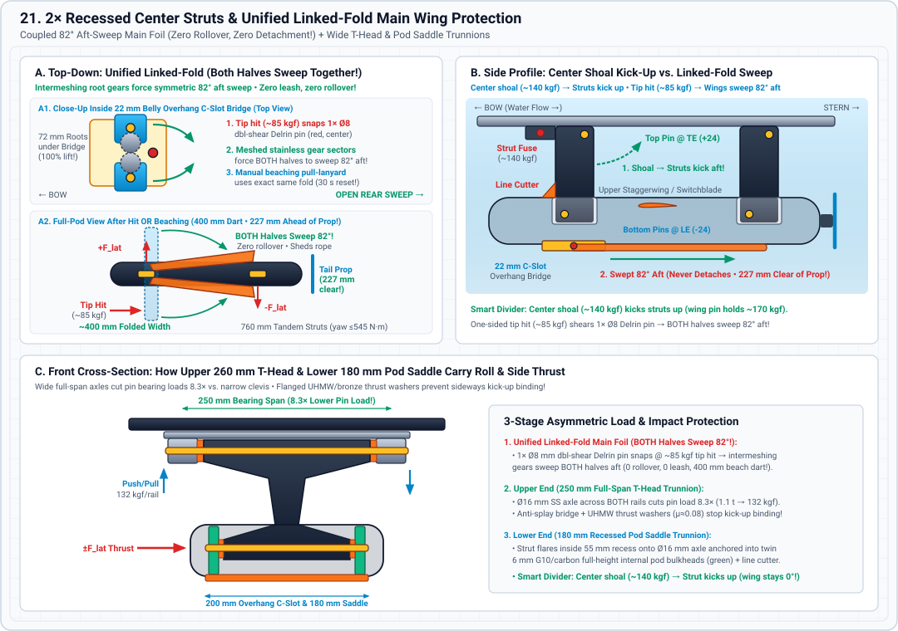

Because **`2×` Recessed Center Struts (`100 × 18 mm` on `Y = 0`)** lack the wide `250 mm` stance of `4×` side blades, both their **upper and lower pivot joints**—plus the **Main Wing root**—must be engineered specifically for **uneven crew/turn roll loads (`M_x ≈ 550–650 N·m`)** and **one-sided wingtip impacts** (e.g., clipping a crab-pot line or rock at `y = +0.65 m` on a `1.55 m` long-range foil at `15.5 kn`):

| Structural Zone | Load / Failure Mode Without Proper Design | Engineered `FoilSkiff` Solution | Quantitative Result |
| :--- | :--- | :--- | :--- |
| **Stage 1: Unified Linked-Fold Main Foil (`BOTH` Halves Sweep `82°` Aft Together!)** | Rigid wing hitting a rock/pot at `y = 0.65 m` creates **`1,625 N·m` yaw torque**; breaking *only one* tip causes a violent **`~500 N·m` rollover**; detaching a wing needs a leash + prop brake + separate beaching hinges! | Pivot left/right Main Wing roots on `Ø16 mm` vertical pins (`y = ±92 mm`) inside a **`22 mm` UHMW Overhang C-Slot Bridge** (`72 mm` inboard roots carry `100%` lift/roll in compression!) linked by **intermeshing `90°` `316` SS gear sectors at `y = 0`** + **`1×` central vertical `Ø8 mm` double-shear black UV-Delrin pin** + manual beaching lanyard. Active flaperons add **bevel dog-clutch knuckles** (`82°` aft fold + auto `0°` self-feather!). | **Smart Divider & 3-in-1 Mechanism:** Center shoal (`y ≈ 0`) sees `~170 kgf` pin capacity → **struts kick up first (`~140 kgf`)** with wings at `0°`! One-sided tip hit (`y = +0.65 m`) snaps the single `Ø8 mm` pin at **`~85 kgf`** → **BOTH halves sweep `82°` aft together** (`0` rollover, `0` detachment, `0` leash, caps yaw **`≤545 N·m`**, stops **`227 mm` ahead of prop**, folds `1.55 m` foil into a **`~400 mm` dart** inside the `600 mm` beach tunnel!). |
| **Stage 2: Upper End (`260 mm` Wide T-Head Trunnion & Anti-Splay Bridge)** | Narrow `40 mm` clevis pin sees **`10.8 kN` (`1.1 ton`)** prying force under `325 N·m` roll & binds sideways during one-sided kick-up! | **Full-width `Ø16 mm` stainless axle** spanning **BOTH `250 mm`-spaced rails** inside flanged **UHMW/bronze thrust washers (`μ ≈ 0.08`)** + rigid **anti-splay bridge plate** + **offset TE pin (`+24 mm`)** + front-edge **horizontal `Ø5 mm` double-shear Delrin kick-up fuse (`~140 kgf`)**. | Bearing span grows `8.3×` (`30 → 250 mm`), slashing pin load to **`132 kgf/rail`** (`<1.2°` roll flex); low-friction thrust washers carry `±220 kgf` side thrust so struts **never rack/bind** while kicking up! |
| **Stage 3: Lower End (`180 mm` Recessed Pod Saddle Trunnion + Twin Bulkheads)** | Narrow center tab twists the pod roof skin; single strut twists in torsion during off-center hits. | Flare strut root inside the `55 mm` recess into a **`180 mm` T-foot** on a **`Ø16 mm` axle** anchored into **twin `6 mm` `G10`/carbon full-height internal pod bulkheads** + **LE offset pin (`-24 mm`)** + **`70 mm` solid forward compression stop** + **`±45°` carbon torsion wrap** & stainless **crab-pot line cutter** at front strut LE. | `760 mm` tandem spacing converts `~90%` of residual yaw torque into a clean lateral couple (instead of strut torsion); internal bulkheads carry roll/side loads across the full `220 mm` pod width (`<140 MPa`, `>5.5×` safety) with zero cruise backlash! |

> **Why Black UV-Stabilized Delrin (Acetal / POM) & Pure Double-Shear Bushing Rules (Never Nylon, HDPE, Bending Gaps, or Oversized Stainless!):**
> * **Goldilocks Shear Strength (`τ ≈ 55–65 MPa`):** `316` stainless (`~350–450 MPa`) would have to be a fragile `Ø2–3 mm` wire to shear at `140–280 kgf`; Delrin allows **chunky, wet-hand-friendly `Ø5–8 mm` double-shear pins** (`~$8/m` rod → `~20–25` spares at `~$0.35` ea.).
> * **Crisp Snap Release & Zero Water Swelling:** Unlike **Nylon** (absorbs `3%–8%` water, swells/seizes in bushings, and loses `~40%` strength wet) or **HDPE/UHMW** (stretches like taffy and jams), Delrin absorbs **`<0.25%` water**, snaps cleanly across the shear plane, causes **zero galvanic corrosion**, is self-lubricating (`μ ≈ 0.15–0.20`), and **never gouges or ovalizes** carbon/aluminum hardware.
> * **Pure Double Shear (`<0.3 mm` Flush Stainless Bushing Sleeves — Zero Bending or Tension!):** Every pin must see **pure transverse shear (`90°` to its axis)** across **two flush `316` stainless shear sleeves (`<0.3 mm` clearance)** like scissors. Never leave a wide gap! For near-freezing water (`<5 °C`), substitute **soft `C360` brass** (`τ ≈ 200 MPa`) at half the diameter (rinse after saltwater runs).

| Shear Fuse Location | Pin Spec & Orientation | Shear Load Direction (`90°` to Pin) | Load Seen in Normal Flight (`0–22 kn`) |
| :--- | :--- | :--- | :--- |
| **Main Wing Linked-Fold Lock (`1×` @ `y = 0`)** | **Vertical (`Z`-axis)** — *top bridge → central slider lug → bottom lip* (**`Ø8 mm` Delrin double shear**) | **Horizontal Aft (`+X`)** — tip strike drives gear slider lug aft across pin (`~85 kgf` tip / `~170 kgf` center) | **Only tiny cruise drag (`~6–10 kgf`)** — `100%` of lift (`200–400 kgf`) & roll sit on the `72 mm` UHMW Overhang Bridge |
| **Upper Strut Kick-Up Fuse Pin (Front Strut LE)** | **Horizontal Lateral (`Y`-axis)** — *rail fork → strut LE tang → rail fork* (**`Ø5 mm` Delrin double shear**, parallel to `Ø16 mm` axle) | **Vertical Upward (`+Z`)** — shoal hit rotates strut aft around TE pivot (`+24 mm`), driving LE tang straight UP across pin | **`0 kgf` (completely unloaded!)** — forward cruise thrust pushes strut LE *down* onto the solid `70 mm` Alu compression stop; side loads stay on `Ø16 mm` axle + UHMW washers |

> **Full Linked-Fold Reference & 3-Track Clearance:** See **[`BREAKAWAY_WING_SOCKET.md`](BREAKAWAY_WING_SOCKET.md)** for the complete `22 mm` Overhang C-Slot Bridge + Intermeshing Root Gear mechanics, active **Flaperon Bevel Dog-Clutch Knuckle** (zero bevel gears, automatic `0°` self-feathering), zero-collision vertical planes across **Switchblade (`+65 mm`)**, **Fixed Upper Staggerwing (`+55 mm`)**, and **Triggered DOWN STOL (`-7.5 mm`)**, plus why more complicated detaching/cam/kingpin variations were dropped (Diagrams 22 & 23).

---

## 2. Off-the-Shelf Propulsion Showdown (`Weight`, `Compactness`, `Cost` & `Power Steering`)

All drives below use **`60–150 Kv` high-torque marine/e-foil windings** matched to `48 V` (`51.2 V` nominal) or `72 V` packs (avoiding `350–500 Kv` high-RPM RC boat motors):

| Option | Weight & Footprint | `48 V` (`51.2 V`) Output & Static Thrust | **Thrust Eff. (`lbf/kW`)** | Power Steering Method | **Drive Cost (Motor + ESC + Steer)** | Foiling Ready (`15–22 kn`)? |
| :--- | :--- | :--- | :---: | :--- | :---: | :---: |
| **1. `2 × Flipsky 65161` (`100/120 Kv`) or `Maytech 65162` + `2 × Flipsky 75100` `VESC`** *(Top Pick)* | **`4.0 – 6.0 kg` total** (`Ø65 × 162 mm` sealed IP68 pods) | **`6–10 kW` cont. / `12–18 kW` peak** **`200–240 lbf`** (`91–109 kgf`, `7.5"` props) | **`24–26 lbf/kW`** | **Differential power steering** *(CAN-bus joystick; zero moving parts!)* | **`~$950 – $1,150`** | **Yes (`15–23 kn`)** *(ideal tailcone/strut drive for the Flying-Keel Pod!)* |
| **1B. `2 × T63100` (`63100` Open-Can Outrunner, `120–140 Kv`) + `2 × Flipsky 75100` `VESC`** *(Ultra-Budget Solo Pick)* | **`~3.4 kg` total** (`Ø63 × 100 mm`, `~1.5–1.8 kg` ea.) | `1×`: `2.5 kW` (`35–55 lbf`) **`2×`: `5.0 kW` (`90–115 lbf` / `40–52 kgf`)** | `20–24 lbf/kW` | **Differential power steering** *(CAN-bus joystick)* | **`~$450 – $550`** *(Half the cost of `65161`!)* | **Solo (`150–180 kg`) Yes** *(open-can: keep out of sand & rinse after saltwater!)* |
| **2. Turnkey `W-30` CNC Azimuth Pod** *(`1×` or `2×`, `570 / 730 mm` tall shafts — Zero-Fab Pick)* | **`6.6 kg`** (`1×`) / **`13.2 kg`** (`2×`) *(CNC aluminum)* | `1× W-30`: `3.2 kW` pk / `55 lbf` `2× W-30`: **`6.4 kW` pk / `110 lbf`** | `17.2 lbf/kW` *(high-RPM `5,000 RPM` speed prop)* | **Built-in `±85°` (`170°`) CNC electric steering + wireless remote** | Check live listing (`1×` or `2× W-30`) | **Yes (`2× W-30` on `730 mm` tall shafts)** *(single `55 lbf` needs `2,600+ cm²` wings)* |
| **3. `2 × APISQUEEN U30` All-Metal Ducted Thrusters** *(Bollard Pick)* | **`5.3 kg` total** (`2 × 2.14 kg` + `2 × 0.5 kg` ESCs) | **`4.0 kW` cont.** (`2 × 2 kW`) **`132 lbf`** (`60 kgf`, `2 × 30 kgf`) | **`33.0 lbf/kW`** *(Best low-speed pull!)* | **Differential power steering** *(zero moving parts)* | **`~$1,300`** *(use `14S LiFePO4` w/ stock ESCs, or `+$190` for `2× 75100` on `16S`)* | **Low-speed only (`4–11 kn`)** *(shrouded bollard props top out `~11 kn`)* |
| **4. Ultra-Light Outboard Swap (`Maytech MTI70182` `120 Kv` or `TP Power TP100` `~135 Kv`)** | **`3.0 kg` motor** (`~11–13 kg` complete on donor leg) | `MTI70182`: `5–6 kW` cont. / `12 kW` pk `TP100`: **`9–11 kW` cont. / `20 kW` pk** | `24–27 lbf/kW` | `+$100` `12 V` linear actuator on donor leg | **`~$950 – $1,250`** *(motor + `75200` VESC + leg + actuator)* | **Yes (`15–22 kn`)** *(on `20"`–`25"` tall donor leg)* |
| **5. `APISQUEEN BP100` Pump-Jet** *(Shallow Jet Pick)* | `8 kg` pump + `2.25 kg` ESC (`10.25 kg`) | **`72–86 V`**, **`10 kW`** @ `6,500 RPM` **`158 lbf`** (`72 kgf`) | **`15.8 lbf/kW`** | Jet nozzle vectoring (`±30°` cable/servo) | **`~$1,100 – $1,215`** | **No** *(flush intake sucks air when hull lifts)* |
| **6. Sealed `IP67` Dirt-Bike IPM (`QS138 70H V3` / `Sotion FW01`)** | `10.8–11.5 kg` motor (`~19 kg` complete) | `QS138`: `4–5 kW` cont. / `12 kW` pk `Sotion`: `8.5 kW` cont. / `18 kW` pk | `24–27 lbf/kW` | `+$100` `12 V` linear actuator on donor leg | **`~$1,050 – $1,450`** | **Yes** *(rugged sealed IPM, heavier than pods)* |
| *7. Heavy Industrial Baseline (`Motenergy ME1304` + `Sevcon` + Leg)* | *`15.9 kg` motor (`~25–26 kg` complete)* | *`6.8 kW` cont. / `13.5 kW` peak (`185–212 lbf` w/ `Kort 19A`)* | *`24–27 lbf/kW`* | *DIY linear actuator* | *`~$2,200+`* | *Yes (overkill weight & cost for a `10 ft` hull)* |

### Critical Electrical, Winding & Saltwater Selection Rules
1. **`Flipsky 65161` `100 Kv` vs. `120 Kv` (`14S` vs. `16S LiFePO4`):**
   * The e-foil adage "`120 Kv` > `100 Kv`" comes from **`12S` Li-ion surfboards (`42.0 V` loaded)**, where `100 Kv` stalls at `~3,530 RPM` (`13.9 kn`) while `120 Kv` hits `~4,230 RPM` (`16.7–19.5 kn`).
   * On **`16S LiFePO4` (`49.5 V` loaded — `+18%` higher voltage)**, **`100 Kv` already spins at `~4,160 RPM`** (matching `12S` `120 Kv`!) while delivering **`+20%` more torque per phase amp (`14.3` vs `11.9 N·m` @ `150 A`)** and **`~30%` less copper/ESC heat ($I^2 R$)** during heavy 2-person takeoffs.
   * **Selection Rule:** Pick **`100 Kv`** on `16S LiFePO4` for maximum takeoff torque and `16–19.5 kn` foiling (`21+ kn` w/ field weakening); pick **`120 Kv`** on **`14S LiFePO4` (`<50 V`)** OR if targeting **`20–23 kn`** on `16S` with small `6"`-pitch props (prefer `Flipsky 75200` for heavy 2-up `120 Kv` takeoffs). **Avoid `195 Kv`** for propellers (jet pumps only).

| Battery Pack (Under Load) | `65161` Winding | Loaded RPM (`~84%`) | Torque @ `120 A / 150 A` Phase | Max Speed (`6"` Pitch) | Max Speed (`7"` Pitch) | Best Dinghy Pairing |
| :--- | :---: | :---: | :---: | :---: | :---: | :--- |
| **`12S Li-ion`** *(`42.0 V` e-foil ref.)* | `120 Kv` | `4,234 RPM` | `9.6 / 11.9 N·m` | `16.7 kn` | `19.5 kn` | Classic `75 kg` e-foil surfboard baseline |
| **`14S LiFePO4`** *(`<50 V` pack, `43.5 V`)* | **`120 Kv`** | **`4,385 RPM`** | `9.6 / 11.9 N·m` | **`17.3 kn`** | **`20.2 kn`** | **Best match for `14S LiFePO4` (`<50 V`)** |
| **`16S LiFePO4`** *(`48 V` nom., `49.5 V`)* | **`100 Kv`** | **`4,158 RPM`** | **`11.5 / 14.3 N·m`** *(+20%)* | **`16.4 kn`** | **`19.2 kn`** | **Best match for `16S` + `75100` heavy dinghy** |
| **`16S LiFePO4`** *(`48 V` nom., `49.5 V`)* | **`120 Kv`** | **`4,990 RPM`** | `9.6 / 11.9 N·m` | **`19.7 kn`** | **`23.0 kn`** | Best for `16S` `20–23 kn` speed on `6"` props |

2. **`14S` vs. `16S LiFePO4` ESC Voltage Ceiling:** Stock `12S LiPo` ESCs (e.g., `APISQUEEN U30` and some `W-30` pods) max out at **`50.4 V`**, whereas `16S LiFePO4` rests at `~53.2 V` and charges to **`55.2–58.4 V`**. Either build **`14S LiFePO4` (`44.8 V` nom. / `48.3–49.0 V` charge, strictly `<50 V`)** to keep stock `12S` ESCs, or run **`16S LiFePO4`** strictly with **`75 V`-rated `VESC` controllers (`Flipsky 75100` / `75200`)** with `VESC` `Max Duty Cycle` (`~82%–85%`) protecting the motor windings.
3. **Documented Considerations for Ultra-Budget `T63100` (`63100` Open-Can Outrunners):**
   * **Single vs. Pair:** `1 × T63100` (`2.5 kW`, `35–55 lbf`) suits a SUP/kayak or `4–6 kn` harbor dinghy; **`2 × T63100` (`~3.4 kg`, `5.0 kW`, `90–115 lbf`, `~$450–$550` w/ `2 × 75100 VESC`)** handles `10–14 kn` light planing or solo (`150–180 kg`) foiling.
   * **Open-Can Maintenance:** Water floods the `0.5 mm` rotor gap directly (great cooling, but vulnerable to beach sand/silt). Verify **epoxy-potted stator + sealed magnets**, upgrade to **full/hybrid ceramic bearings (`$15–$25/motor`)**, choose **`120–140 Kv`** (avoid `170–190 Kv`), flip out of water before beaching, and **fresh-water flush after every saltwater session**.
4. **Commercial `5–6 kW` `48 V` Pod Benchmarks:** Verified single-unit `5–6 kW` `48 V` commercial units include **Golden Motor `EZ-X10R`** (`6.5 kW`, `$2,950`), **ePropulsion `Pod Drive 6.0 Evo`** (`6 kW`), and **Rim Drive Technology `5.0 kW`** (`48 V`). For budget builds, **`2 × Flipsky 65161`** (`~$1,050`, `6 kg`, differential power steering) or **`2 × W-30`** (`13.2 kg`, `±85°` servo steering) delivers `6+ kW` at a fraction of commercial weight and cost.

---

## 3. Hydrodynamics: Planing vs. Foiling Speed & Energy Curves (`True Kit 10 ft`)

Reference hull: **`True Kit Navigator 300`** (`3.0 m`, `31 kg`, `10 HP` max) or **`Discovery 330`** (`3.3 m`, `36 kg`, `15 HP` max), `500 kg` capacity.

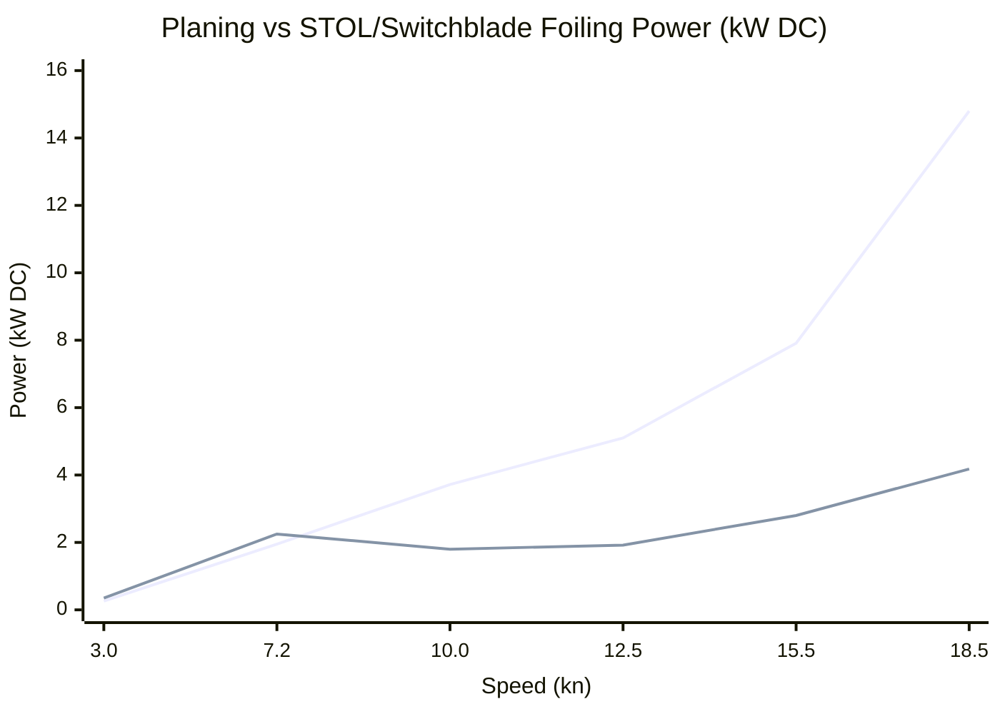
*(Upper Line = Standard Planing Catamaran `kW DC`; Lower Line = Primary Split STOL Flaperon Flying-Keel Pod `kW DC`)*

### A. Deep-Submerged Flying-Keel Pod Hydrofoiling Curve (`~235 kg` All-Up, `26 L` Buoyancy, `5.38 kWh` Pack @ `51.2 V`)
*(Values shown for **PRIMARY Split STOL Flaperons** [`7.2 kn` takeoff, `2.80 kW` / `29.8 nm` @ `15.5 kn`], with **SECONDARY Flush-Nested Switchblade** [`6.7 kn` takeoff, `2.71 kW` / `30.8 nm`] & Dry Thin Foil [`2.62 kW` / `31.8 nm`] in parentheses.)*

| Operating Regime (`1–2 Adults`, `~235 kg`) | Speed (`knots` / `mph`) | **Total Drag / Thrust (Primary STOL / Switchblade)** | **Battery Power (`DC kW` & `Amps @ 51.2 V`)** | **Energy (`Wh/nm`)** | **Range (`5.38 kWh` Pack)** | Comparison vs. Non-Foiling Catamaran |
| :--- | :---: | :--- | :--- | :---: | :---: | :--- |
| **1. Displacement Harbor (Pod Down)** | **`3.0 kn`** (`3.5 mph`) | `28–32 lbf` (`13–15 kgf`) | **`0.35 kW`** (`6.8 A`) | **`115 Wh/nm`** | **`15.4 hrs` (`46.1 nm`)** | Retract pod into tunnel for `~5.5"` beaching |
| **2. STOL Slotted Flap Takeoff (`+15°`)** | **`6.7 – 7.2 kn`** (`8.0 mph`) | **`84 lbf`** (`38 kgf`) *(vs `115 lbf` @ `10 kn` dry!)* | **`2.25 kW`** (`43.9 A`) | `313 Wh/nm` | `2–3 sec` lift-off | **100% deep submerged (`0` wave slam!) + `26 kg` buoyancy** |
| **3. Eco Foiling Cruise (`0°` Flaps / Closed)** | **`10.5 – 12.5 kn`** (`14 mph`) | **`39 – 41 lbf`** (`38 lbf` Switchblade) | **`1.86 – 1.92 kW`** (`37 A`) | **`155 Wh/nm`** | **`2.85 hrs` (`34.7 nm`)** | **Zero surface-piercing drag & active wave leveling!** |
| **4. Standard Foiling Cruise (Sweet Spot)** | **`15.5 kn`** (`17.8 mph`) | **`49.1 lbf`** (`47.5 lbf` Switchblade) | **`2.80 kW`** (`2.71 kW` Switchblade) | **`181 Wh/nm`** (`175`) | **`1.92 hrs` (`29.8 nm`)** (`30.8 nm`) | **`65%` less power** & **`2.8×` range** vs planing (`7.91 kW` / `10.5 nm`)! |
| **5. Fast Foiling Cruise** | **`18.5 kn`** (`21.3 mph`) | **`60 lbf`** (`58 lbf` Switchblade) | **`4.18 kW`** (`4.04 kW` Switchblade) | **`226 Wh/nm`** (`218`) | **`1.29 hrs` (`23.8 nm`)** (`24.6 nm`) | Uses less power at `18.5 kn` than non-foiling at `11 kn` |
| **6. Max Continuous Foiling** | **`21.5 – 22.5 kn`** (`25 mph`) | **`90 lbf`** (`85 lbf` Switchblade) | **`7.90 kW`** (`7.45 kW` Switchblade) | **`359 Wh/nm`** (`339`) | **`0.68 hrs` (`15.0 nm`)** | `+6–7 kn` faster than non-foiling |

### B. Non-Foiling Planing & Emergency Yacht-Tugboat Reference (`~220 kg`, `5.38 kWh` Pack)
*(With optional `Kort 19A` duct on `65161` / outboard, static pull increases `+20%–25%` so the `10 ft` dinghy lashed alongside a `30–40 ft` yacht can hip-tow it into a slip at `3.0–3.5 kn`.)*

| Operating Regime (`1–2 Adults`, `~220 kg`) | Speed (`knots` / `mph`) | **Pushing Force (Open Prop)** | **Pushing Force (`Kort 19A` / Shrouded)** | **Battery Power (`DC kW` @ `51.2 V`)** | **Energy (`Wh/nm`)** | **Range (`5.38 kWh` Pack)** |
| :--- | :---: | :--- | :--- | :--- | :---: | :---: |
| **1. Trolling / No-Wake Harbor** | **`3.0 kn`** (`3.5 mph`) | `24 lbf` (`11 kgf`) | `30 lbf` (`14 kgf`) | **`0.26 kW`** (`5.0 A`) | **`85 Wh/nm`** | **`21.0 hrs` (`63.0 nm`)** |
| **2. Displacement Eco Cruise** | **`4.5 kn`** (`5.2 mph`) | `45 lbf` (`20 kgf`) | `56 lbf` (`25 kgf`) | **`0.67 kW`** (`13.2 A`) | **`150 Wh/nm`** | **`8.0 hrs` (`36.0 nm`)** |
| **3. Fast Displacement / Semi-Plane** | **`6.5 kn`** (`7.5 mph`) | `78 lbf` (`35 kgf`) | `96 lbf` (`44 kgf`) | **`1.69 kW`** (`33.0 A`) | **`259 Wh/nm`** | **`3.2 hrs` (`20.7 nm`)** |
| **4. Catamaran Planing Cruise** | **`10.0 kn`** (`11.5 mph`) | `118 lbf` (`54 kgf`) | `142 lbf` (`64 kgf`) | **`3.72 kW`** (`72.7 A`) | **`372 Wh/nm`** | **`1.45 hrs` (`14.5 nm`)** |
| **5. Fast Planing (`6 HP` Gas Equiv.)** | **`13.0 kn`** (`15.0 mph`) | `145 lbf` (`66 kgf`) | `170 lbf` (`77 kgf`) | **`5.35 kW`** (`104 A`) | **`411 Wh/nm`** | **`1.0 hr` (`13.1 nm`)** |
| **6. High-Speed Continuous (`9 HP` Equiv.)** | **`15.5 kn`** (`17.8 mph`) | `185 lbf` (`84 kgf`) | `212 lbf` (`96 kgf`) | **`7.91 kW`** (`154 A`) | **`510 Wh/nm`** | **`0.68 hrs` (`10.5 nm`)** |
| **7. Peak Hole-Shot / Yacht Tow** | **`19.0 kn`** (`21.9 mph`) | `295 lbf` (`134 kgf`) | `345 lbf` (`156 kgf`) | **`15.70 kW`** (`307 A`) | **`826 Wh/nm`** | `1–2 min` burst |

### C. Long-Range (`60–75+ nm`) Expedition Hydro Package (`True Kit Navigator 300`)

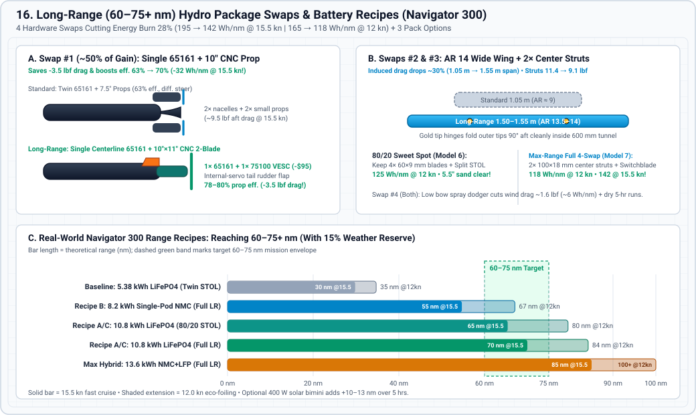

To double baseline range (`30–35 nm`) to **`60–75+ nm`** (`111–139 km`, `4.5–5.5 hrs` continuous flight) with a `15%–20%` weather reserve—while keeping the `Navigator 300` cockpit flush and well within its `500 kg` payload—combine up to **four targeted hardware swaps** (cutting energy burn `~28%`, from `195 → 142 Wh/nm` @ `15.5 kn` and `165 → 118 Wh/nm` @ `12 kn`) with dual-pack or high-density energy storage. *(Explore interactive 3D models [`06_navigator300_lr_8020_sweetspot.stl`](models/06_navigator300_lr_8020_sweetspot.stl), [`07_navigator300_lr_max_range.stl`](models/07_navigator300_lr_max_range.stl), and cutaway [`08_lr_pod_closeup.stl`](models/08_lr_pod_closeup.stl) in [`VISUAL_ATLAS.md`](VISUAL_ATLAS.md).)*

| Hardware Swap | Standard `Navigator 300` Build | **Long-Range Hydro Package** | Savings @ `15.5 kn` | Trade-Off |
| :--- | :--- | :--- | :---: | :--- |
| **1. Propulsion** *(~50% of gain!)* | `2 × Flipsky 65161` + twin `7.5"` props (`63%` eff.) | **`1 ×` Centerline `65161` (`100 Kv`) + `10"×11"` 2-blade CNC prop** (`70%` eff., `1× 75100 VESC`) | **`-3.5 lbf` + `+11%` eff.** (`~32 Wh/nm`) | Replace differential steer with compact internal-servo tailfin rudder flap. |
| **2. Main Wing** | `1.05 m` (`AR ≈ 9`) + Split STOL Flaperons | **High-Aspect `1.50–1.55 m` (`AR 13.5–14`, folding tips)** w/ Split STOL *(80/20)* or Flush Switchblade *(Max)* | **`-2.5` to `-4.0 lbf`** (`~10–15 Wh/nm`) | Wider span (folding tips keep `600 mm` tunnel beaching). |
| **3. Struts** *(Optional)* | `4×` `60 × 9 mm` side blades (`11.4 lbf`, `5.5"` clear) | **`2×` hollow `100 × 18 mm` recessed center struts** (`9.1 lbf`, rear drafts in front wake) | **`-2.3 lbf`** (`~7 Wh/nm`) | Harder hollow-carbon fab + `55 mm` pod top recess (`3.7"` sand clear). |
| **4. Aero Trim** | Open bow + upright posture (`~9.5 lbf` wind drag) | **Low-profile curved bow spray dodger** + lower seated trim | **`-1.6 lbf`** (`~6 Wh/nm`) | Adds light bow fairing; keeps crew dry on `5-hr` runs. |

| Long-Range Recipe (`Navigator 300`, `500 kg` Capacity) | Pack Energy & Chemistry | Added Weight (`All-Up`) | **80/20 Sweet Spot** *(Model 6: Keep `4×` Blades + Split STOL)* | **Full 4-Swap Max LR** *(Model 7: `2×` Struts + Switchblade)* |
| :--- | :--- | :---: | :---: | :---: |
| **Recipe A: Dual-Location `100%` `LiFePO4`** *(`5.4 kWh` Pod + `5.4 kWh` `60 mm` Battery Hard Deck)* | **`10.76 kWh`** (`9.94 kWh` usable) | `+32 kg` (`~267 kg`) | **`65 nm` @ `15.5 kn`** **`79 nm` @ `12.0 kn`** | **`70 nm` @ `15.5 kn`** **`84 nm` @ `12.0 kn`** |
| **Recipe B: Single-Pod `21700 NMC`** *(`2 × 4.1 kWh` potted cartridges inside same `26 L` pod; keeps `28 mm` deck)* | **`8.2 kWh`** (`7.38 kWh` usable) | `+7 kg` (`~242 kg`) | `51 nm` @ `15.5 kn` **`63 nm` @ `12.0 kn`** | `55 nm` @ `15.5 kn` **`67 nm` @ `12.0 kn`** |
| **Recipe C: Plug-In Expedition Extender** *(`5.4 kWh` everyday pod + removable `5.4 kWh` under-seat dry pack via umbilical)* | **`10.76 kWh`** (`9.94 kWh` usable) | `+32 kg` *(long trips only!)* | **`65 nm` @ `15.5 kn`** **`79 nm` @ `12.0 kn`** | **`70 nm` @ `15.5 kn`** **`84 nm` @ `12.0 kn`** |

*(An optional `1.4 × 1.8 m` `400 W` rigid solar bimini adds `~1.5 kWh` over a `5-hour` cruise = **`+10–13 nm`** bonus plus off-grid anchor charging.)*

#### Modular Hard Deck Seating: 1 or 2 Ergonomic Low-Sit Chairs on Flush L-Tracks (`5-Hour` Flight Ergonomics)

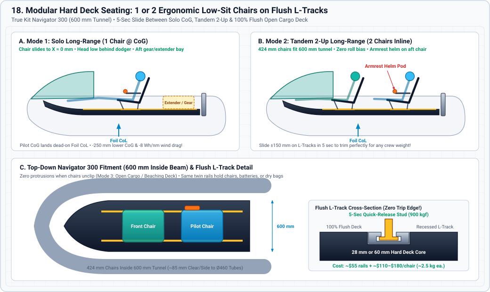

For `4.5–5.5 hour` `60–75 nm` flights, stock aluminum bench planks sit too high (high roll CoG, high wind drag) and cause lower-back fatigue. Routing **two marine-anodized L-Track rails (`1,570 mm` long, `390 mm` spacing, `~$55`, `1.1 kg`) `100%` flush into the `28 mm` or `60 mm` Hard Deck** preserves a completely snag-free flat deck when empty while enabling **`5-second` tool-free switching** across three modes *(see 3D CAD [`09_modular_hard_deck_seating.stl`](models/09_modular_hard_deck_seating.stl) & [`VISUAL_ATLAS.md`](VISUAL_ATLAS.md))*:

| Deck Mode | Chair Setup & Position (`Navigator 300`, `600 mm` Inside Beam) | CoG & Aerodynamic Benefit |
| :--- | :--- | :--- |
| **1. Solo Long-Range (`1 Chair`)** *(Model 7)* | One **`424 mm`-wide** low-sit framed mesh/carbon chair (`125 mm` pan height, `22°` lumbar recline, `~2.5 kg`) clipped at **`X ≈ 0 mm`**; feet rest naturally on the upturned bow deck | Pilot CoG lands **dead-on foil `CoL` (`X ≈ -200 mm`)**; drops vertical CoG **`~250 mm`** and tucks head behind bow dodger (**`-6 to -9 Wh/nm` wind drag**); leaves open aft L-Track bay for a `5.4 kWh` plug-in extender or dry bags! |
| **2. Tandem 2-Up (`2 Chairs Inline`)** *(Model 6 & 9)* | Two inline `424 mm`-wide chairs (**`~85 mm` clear per side** to the `Ø460 mm` tubes) at **`X = -320 mm`** (front passenger) & **`X = +420 mm`** (aft pilot) | Keeps **100% of crew weight on the centerline (`Y = 0`)** for zero roll bias; slide `±150 mm` in `5 sec` via `900 kgf` spring-loaded double-stud L-Track pins to trim for any passenger weight! |
| **3. Open Cargo / Beach Deck (`0 Chairs`)** | Unclip both chairs in `5 seconds` (`~2.5 kg` ea., fold flat) | **`100%` flush, obstruction-free cockpit** for hauling yacht groceries, dive gear, or beaching—zero protruding brackets or boxes! |

* **Integrated Right-Hand Armrest Wireless Helm Pod:** Mount the compact Bluetooth/CAN **thumb-throttle + 2-axis steering/trim mini-joystick** directly onto the pilot chair's starboard (`+Y`) armrest so the helm moves seamlessly with the chair between Solo center and Tandem aft positions—eliminating any fixed dashboard or steering pedestal (`~$280–$420` total for twin flush L-Tracks + 2 framed mesh chairs).

---

## 4. Comparing All Four Integrated Battery-Hull Architectures

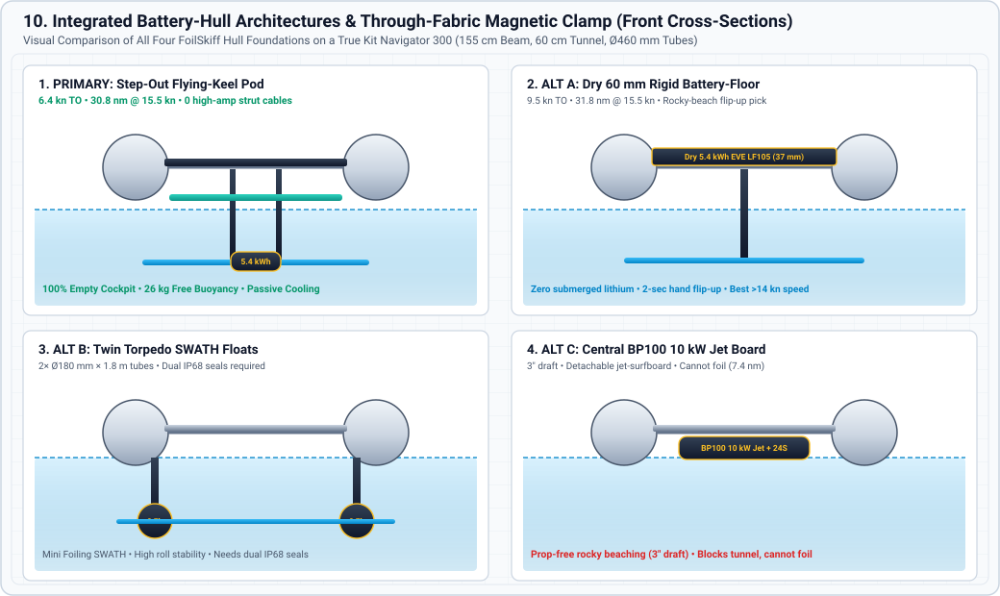

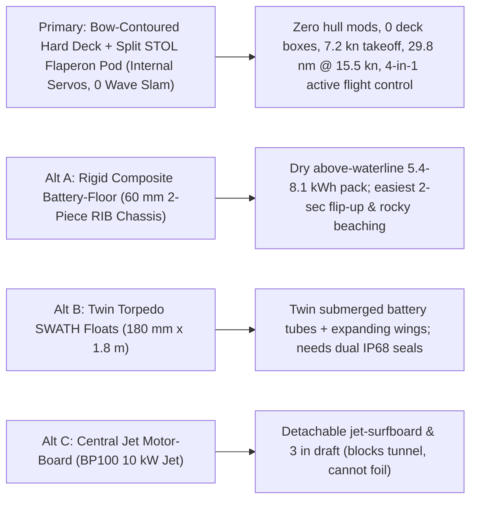

### Alternative A (Best for Rocky Beaches & `16–22 kn` Top Speed): Rigid `60 mm` Composite "Battery-Floor"
* Replaces the `True Kit`'s `100 mm` drop-stitch air floor with a **2-piece foldable `60 mm` carbon/E-glass floor** housing flat `36.7 mm` **`EVE LF105` (`3.2 V 105 Ah`) prismatic `LiFePO4` cells** dry *above* the static waterline (`16S 5.38 kWh` = `560 × 840 × 37 mm`, `31.7 kg`; `24S 8.06 kWh` = `560 × 1,260 × 37 mm`, `47.5 kg`).
* Preserves the exact catamaran tunnel clearance, leaves `100%` of the cockpit clear, keeps the lithium pack completely dry above water, and provides a rigid RIB backbone for lightweight (`12 kg`) `2-second` flip-up carbon hydrofoils (`Flipsky 65161` strut pods or `2 × W-30` `730 mm` azimuth pods).

### Alternative B: Twin Torpedo-Shaped External Battery Floats with Expanding Foils
* Two streamlined `Ø180 mm × 1.8 m` carbon torpedoes (`37.6 L` / `38.5 kg` buoyancy each) housing `2.5–3.0 kWh` cylindrical `32700`/`21700` cells each, folding mid-body wings, and `2 × Flipsky 65161` or `2 × APISQUEEN U30` tailcone pods (miniature Foiling SWATH; requires dual `IP68` sealing).

### Alternative C: Central Under-Tunnel Detachable Jet Motor-Board (`APISQUEEN BP100` `10 kW` Jet)
* Detachable `~1.9 m × 0.70 m × 85 mm` composite jetboard cassette carrying `76.8 V` (`24S`) cells + `BP100` `10 kW` pump-jet (`158 lbf`). Doubles as a standalone jet-surfboard with `3"` rocky-beach draft (`14–15.5 kn`), but blocks the air tunnel, burns `~650–700 Wh/nm` (`~7.4 nm`), and **cannot foil**.

---

## 5. Low-Cost Experimental Prototyping Mule (`M2200` + `Flipsky 75100` + `NACA 0024` Tube Fairing)

A stripped `48 V` / `2,200 W` brushless outboard (e.g., `Hangkai M2200`, `2.45 true shaft HP`, `~75–95 lbf` thrust) is an ideal zero-waste testbed for validating hydrofoil lift-off, strut fairing, and drive-by-wire controls:

1. **Swap Stock ESC for `Flipsky 75100` (`75 V / 100 A` FOC `VESC`, `~$95`):** Eliminates crude `50 A` square-wave commutation (`+5%–10%` efficiency), provides safe `75 V` headroom for `16S LiFePO4` (`58.4 V`), adds Bluetooth `W / A / RPM` logging, and allows **`3.0–3.5 kW` (`65–75 A`) `30-second` takeoff bursts** while capping continuous draw at `45 A` (`2.2 kW`).
2. **Wrap the Bare Round Shaft Tube (`Ø36 mm`) in a `NACA 0024` Fairing (`150 mm` Chord):** `3D`-printed `PETG`/`CF-Nylon` segments skinned in `1–2` layers of `6 oz` glass/carbon + epoxy cut cylinder drag ($C_D \approx 1.15 \rightarrow 0.13$) by **`~90%`** and stop propeller ventilation:

| Boat Speed | Bare `36 mm` Round Tube Drag & Wasted Power | Wrapped in `NACA 0024` Fairing (`150 mm` Chord) | **Power Saved by Fairing Alone** |
| :---: | :--- | :--- | :---: |
| **`6.0 kn`** | `22.7 lbf` (`101 N`) — wastes **`520 W`** | `2.6 lbf` (`11.4 N`) — uses `59 W` | **`461 W` saved** |
| **`10.0 kn`** | **`63.1 lbf` (`281 N`) — wastes `2,407 W`!** | `7.1 lbf` (`31.7 N`) — uses `272 W` | **`2,135 W` saved!** |
| **`13.0 kn`** | **`106.7 lbf` (`475 N`) — wastes `5,289 W`!** | `12.1 lbf` (`53.6 N`) — uses `598 W` | **`4,691 W` saved!** |

3. **Solo Lift-Off Proof (`150 kg` All-Up) & Drive-by-Wire Actuators:** With `2,900 cm²` oversized pump-foil wings (`2,200 cm²` front + `700 cm²` aft), takeoff drops to **`6.8–7.5 kn`** (`~1.9 kW` shaft) and steady flight at `11.5 kn` takes just **`1.07 kW` shaft (`1.28 kW` battery)** *(use an `8"–9" × 9"–10"` higher-pitch prop)*. Pair two **`12 V` IP66 linear actuators** (`100–150 mm`, potentiometer feedback, `~$65` ea.) with an `ESP32` + `Cytron MD13S` joystick for **`±35°` proportional electric steering** and **`±5°` aft-foil elevator trim** (expandable with `BNO085` IMU + ToF height sensor).

---

## 6. Complete Bill of Materials Comparison

| Subsystem | **Primary Build: Bow-Contoured Hard Deck + Split STOL Flaperon Pod** | **Alt A: Dry Rigid Battery-Floor + Twin Foil-Strut Pods (`2× 65161`)** | **Alt B: Turnkey CNC Azimuth Pods (`2 × W-30` `730 mm`)** | **Alt C: `2 × APISQUEEN U30` Ducted / Central `BP100` Jet** |
| :--- | :--- | :--- | :--- | :--- |
| **Propulsion & Power Steering** | `2 × Flipsky 65161` (`100 Kv`) + `2 × Flipsky 75100` `VESC` + BT/CAN joystick (**`~$1,050`**, `6 kg`, diff. steer) | `2 × Flipsky 65161` (`100 Kv`) + `2 × Flipsky 75100` `VESC` + CAN joystick (**`~$1,050`**, `6 kg`, diff. steer) | `2 × W-30` (`730 mm`) w/ built-in `±85°` steer & remote (`13.2 kg`) | `2 × U30` (`$1,300`, `5.3 kg`) or `BP100` `10 kW` jet (`$1,215`, `10.3 kg`) |
| **Hard Deck, Fuselage & Retract Hardware** | Bow-contoured `28 mm` 2-piece Hard Deck (`0` deck boxes!) + bow-bent `Tru-Alu` Hybrid C-Frame & Dyneema Sling (or `Discovery 330` O-Frame, `$550`) + `26 L` carbon fuselage bay, CNC double-O-ring rear door, Kevlar nose, leak sensor, **`4×` `60×9 mm` parallelogram blades** & tackle (`$950`) | `60 mm` 2-piece carbon/E-glass dry battery floor (`$850`) + flip-up strut mounts (`$150`) | Rigid battery floor (`$850`) or clamp-on transom/exoskeleton (`$350`) | Battery floor (`$850`) or jetboard sled hull (`$900`) |
| **Hydrofoil Wing Set & Internal Actuation** | **PRIMARY:** `1,000 cm²` main + **`2 × 250 cm²` Split STOL Flaperons** + **`2×` internal `IP67` pod servos, `Ø8 mm` double-O-ring shafts & `ESP32`/`BNO085` IMU** (`$1,030`) *OR* **SECONDARY:** **Flush-Nested Top-Deck Switchblade** (`$950`) | `1,600 cm²` front + `650 cm²` aft carbon wings (`$750`) | `1,600 cm²` front + `650 cm²` aft wings (`$750`) | *Optional (`U30`)* / *N/A (`BP100` jet)* |
| **LiFePO4 Battery Pack & BMS** | **`2 ×` swappable `IP68` potted `2.7 kWh` (`14 kg` ea.) slide-in cartridges** + BMS & blind-mate waterproof connectors (`$700`) | `16S EVE LF105` (`5.38 kWh`) flat inside floor (`$550`) | `14S` (`4.7 kWh`) or `16S` (`5.38 kWh`) `EVE LF105` (`$520–$550`) | `14S` (`$520` for `U30`) / `24S` (`$850` for `BP100`) |
| **Complete Conversion Total** | **`~$4,280`** *(`$4,200` w/ Secondary Switchblade; zero hull mods, `0` deck boxes, `0` wave slam, `29.8–30.8 nm` @ `15.5 kn`, carry-ashore `14 kg` packs!)* | **`~$3,350`** *(Dry battery, `2-sec` flip-up, `31.8 nm` @ `15.5 kn`!)* | **`2 × W-30` + `$1,620 – $2,150`** *(Zero steering fab!)* | **`~$2,820 – $2,965`** *(Bollard tow or `3"`-draft jet)* |

---

## 7. Productization & Bolt-On Retrofit Market Rationale

The core architectural choices above—**Bow-Contoured Flush Hard Deck + Zero-Hole `Tru-Alu` Hybrid C-Frame / O-Frame**, **Swappable `14 kg` `IP68` Cartridges**, and **Deep-Submerged Split STOL Flaperons with Internal Pod Servos** (or **Secondary Flush-Nested Switchblade**)—directly address a wide **`$10k → $115k` market gap** in electric tenders:

| Market Segment / Benchmark | Retail Price (USD) | Range @ `15 kn` | Tender Cargo Utility | Core Buyer Pain Point |
| :--- | :---: | :---: | :---: | :--- |
| **Bare Inflatable Catamaran** (`True Kit Navigator/Discovery`, `Takacat LX`) | `$1,850 – $3,500` | — | High (packs in bags) | Requires motor; pounds in chop at speed |
| **Mainstream `6 kW` Electric Outboard + `5 kWh` Pack** (`ePropulsion Navy 6.0` / `Torqeedo Cruise 6.0`) | **`$10,000 – $14,800`** | `~10 nm` | Battery clutters cockpit | High price yet still planes inefficiently (`10 nm`), heavy & wet in chop |
| **Single-Rider Electric Foils** (`Fliteboard`, `Manta5 SL3`) | **`$8,500 – $15,000`** | `15–25 nm` | **Zero** (1-person toy) | Cannot carry 2 adults, dogs, or yacht provisions |
| **Commercial Foiling Tenders** (`SEAir Flying Tender`, `Candela C-8`) | **`$115,000 – $390,000`** | `30–55 nm` | Superyacht only | Too heavy for normal yacht davits (`1,000+ kg`) & `10×` out of reach |
| **`FoilSkiff` Bolt-On Conversion Kit** *(Est. small-batch COGS `$2.6k–$3.4k`)* | **`$7,900 – $11,900`** *(kit)* | **`~30 nm`** | **Full 2-person tender + `100%` clear floor** | **Matches or undercuts a non-foiling `6 kW` outboard with `3×` the range and zero wave-slamming** |

### Why the Four Core Design Choices De-Risk Commercialization
1. **Swappable `IP68` Cartridges (or BYOB V1):** Solves off-boat carrying/charging (`14 kg` vs `40 kg`), isolates warranty/seal repairs, and enables launching a mechanical + propulsion **BYOB (Bring-Your-Own-Battery) kit (`$4.5k–$5.5k`)** first to defer `UN38.3` / `IEC 62619` lithium certification and hazmat air-freight overhead.
2. **Universal Spine Floor + Hybrid C-Frame / O-Frame / Magnets (`0` Hull Mods):** Fits existing owner boats (`True Kit Navigator 300` primary, `Discovery 330`, `Takacat`, `Saturn`, `Kaboat`) via swappable edge width strips without voiding hull warranties—expanding addressable volume beyond any single boat brand, while keeping **Option C (Factory RF-Welded Slot)** ready for an official OEM "Foil Edition" co-branded partnership.
3. **Approachable "Push Throttle and Fly" Stability in Real Chop:** Cruising sailors (`45–70` yrs) will not tolerate wave-slam nose-dives or unstable crashes with groceries aboard. Our **Primary Deep-Submerged Split STOL Flaperons (`~$160` internal pod servos + `20%`-chord self-centering `0°` failsafe)** deliver smooth, forgiving active flight in `1–2 ft` chop with **zero deck clutter** and without `$40k` aerospace computers.
