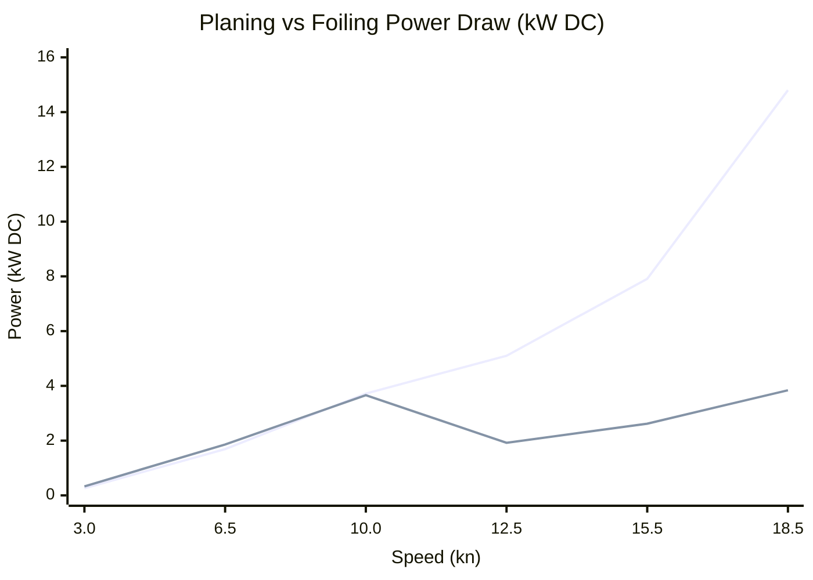
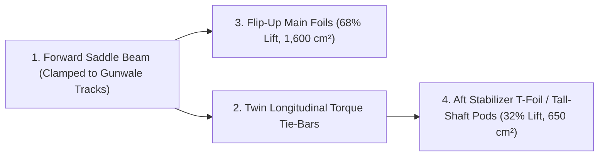
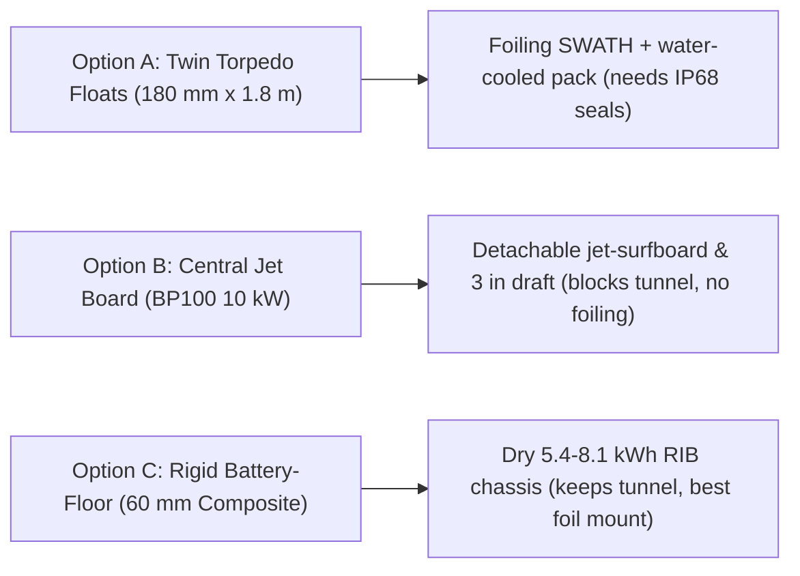

# `48 V` Electric & Foiling Catamaran Dinghy Guide (`True Kit 10 ft` Class)

A standalone engineering guide for converting an ultralight **`10 ft` (`3.0–3.3 m`) inflatable tunnel-catamaran tender (`True Kit Navigator 300` / `Discovery 330`, `31–36 kg` bare hull)** into a compact, lightweight, power-steered electric planing or hydrofoiling tender.

Instead of bolting a heavy `25–26 kg` / `$2,200+` industrial motor conversion onto a `31 kg` inflatable transom, **`FoilSkiff` prioritizes compact, high-power-density off-the-shelf drives (`4–13 kg`) with built-in or differential electric power steering**:
1. **Primary Pick — Twin `IP68` Direct-Drive Foil-Strut Pods (`2 × Flipsky 65161` or `Maytech 65162` + `2 × Flipsky 75100` `VESC`, `4–6 kg`, `~$950–$1,150`):** `6–10 kW` continuous (`200–240 lbf` thrust), zero outboard leg, **zero-hardware differential power steering**, native `16S LiFePO4` compatibility, and **`15.5–22.5 kn` foiling (`30+ nm` range on `5.38 kWh`)**.
2. **Turnkey Bolt-On Pick — Twin Steerable CNC Aluminum Azimuth Pods (`2 × W-30` `730 mm` Tall Shafts, `13.2 kg` total, `6.4 kW` peak, `110 lbf`):** Streamlined CNC struts, **built-in `±85°` (`170°`) servo power steering**, and wireless remote out of the box.
3. **Low-Speed Bollard / Tugboat Pick — `2 × APISQUEEN U30` All-Metal Ducted Thrusters (`5.3 kg`, `132 lbf` @ `4 kW` = `33 lbf/kW`, `~$1,300`):** Unmatched low-speed thrust efficiency with differential steering.
4. **Integrated Hull Foundation — Rigid `60 mm` 2-Piece Composite "Battery-Floor" Skateboard Chassis:** Replaces the `100 mm` drop-stitch air floor to house `5.38–8.06 kWh` of flat `36.7 mm` `EVE LF105` cells dry above the static waterline while serving as a rigid RIB mounting backbone for flip-up hydrofoils or any drive.

---

## 1. Off-the-Shelf Propulsion Showdown (`Weight`, `Compactness`, `Cost` & `Power Steering`)

To avoid the classic DIY trap of buying tiny high-`Kv` RC boat motors (`350–500 Kv`, which spin at `20,000+ RPM` with minimal torque), all options below use **`60–150 Kv` high-torque marine/e-foil windings** matched to `48 V` (`51.2 V` nominal) or `72 V` packs:

| Option | Weight & Footprint | `48 V` (`51.2 V`) Output & Static Thrust | **Thrust Eff. (`lbf/kW`)** | Power Steering Method | **Drive Cost (Motor + ESC + Steer)** | Foiling Ready (`15–22 kn`)? |
| :--- | :--- | :--- | :---: | :--- | :---: | :---: |
| **1. `2 × Flipsky 65161` (`100 Kv`) or `Maytech 65162` (`100 Kv`) + `2 × Flipsky 75100` `VESC`** *(Top Pick)* | **`4.0 – 6.0 kg` total** (`Ø65 × 162 mm` IP68 pods — **`4×` lighter than `ME1304`!**) | **`6–10 kW` cont. / `12–18 kW` peak** **`200–240 lbf`** (`91–109 kgf`, `7.5"` high-pitch props) | **`24–26 lbf/kW`** | **Differential power steering** *(CAN-bus joystick mixes port/stbd RPM; zero moving parts!)* | **`~$950 – $1,150`** | **Yes (`15–23 kn`)** *(bolts directly to foil struts; eliminates outboard leg!)* |
| **2. Turnkey `W-30` CNC Azimuth Pod** *(`1×` or `2×`, `570 / 730 mm` tall shafts — Zero-Fab Pick)* | **`6.6 kg`** (`1×`) / **`13.2 kg`** (`2×`) *(CNC aluminum)* | `1× W-30`: `3.2 kW` pk / `55 lbf` `2× W-30`: **`6.4 kW` pk / `110 lbf`** | `17.2 lbf/kW` *(high-RPM `5,000 RPM` speed prop)* | **Built-in `±85°` (`170°`) CNC electric steering + wireless remote** | Check live listing (`1×` or `2× W-30`) | **Yes (`2× W-30` on `730 mm` tall shafts)** *(single `55 lbf` is shy of takeoff unless `2,600+ cm²` wings)* |
| **3. `2 × APISQUEEN U30` All-Metal Ducted Thrusters** *(Bollard Pick)* | **`5.3 kg` total** (`2 × 2.14 kg` + `2 × 0.5 kg` ESCs) | **`4.0 kW` cont.** (`2 × 2 kW`) **`132 lbf`** (`60 kgf`, `2 × 30 kgf`) | **`33.0 lbf/kW`** *(Best low-speed pull!)* | **Differential power steering** *(zero moving parts)* | **`~$1,300`** *(use `14S LiFePO4` w/ stock ESCs, or `+$190` for `2× 75100` on `16S`)* | **Low-speed only (`4–11 kn`)** *(shrouded bollard props top out `~11 kn`)* |
| **4. Ultra-Light Outboard Swap (`Maytech MTI70182` `120 Kv` or `TP Power TP100` `~135 Kv`)** | **`3.0 kg` motor** (`~11–13 kg` complete on donor leg) | `MTI70182`: `5–6 kW` cont. / `12 kW` pk `TP100`: **`9–11 kW` cont. / `20 kW` pk** | `24–27 lbf/kW` | `+$100` `12 V` linear actuator on donor leg | **`~$950 – $1,250`** *(motor + `75200` VESC + leg + actuator)* | **Yes (`15–22 kn`)** *(on `20"`–`25"` tall donor leg)* |
| **5. `APISQUEEN BP100` Pump-Jet** *(Shallow Jet Pick)* | `8 kg` pump + `2.25 kg` ESC (`10.25 kg`) | **`72–86 V`**, **`10 kW`** @ `6,500 RPM` **`158 lbf`** (`72 kgf`) | **`15.8 lbf/kW`** | Jet nozzle vectoring (`±30°` cable/servo) | **`~$1,100 – $1,215`** | **No** *(flush intake sucks air when hull lifts)* |
| **6. Sealed `IP67` Dirt-Bike IPM (`QS138 70H V3` / `Sotion FW01`)** | `10.8–11.5 kg` motor (`~19 kg` complete) | `QS138`: `4–5 kW` cont. / `12 kW` pk `Sotion`: `8.5 kW` cont. / `18 kW` pk | `24–27 lbf/kW` | `+$100` `12 V` linear actuator on donor leg | **`~$1,050 – $1,450`** | **Yes** *(rugged sealed IPM, heavier than pods)* |
| *7. Heavy Industrial Baseline (`Motenergy ME1304` + `Sevcon` + Leg)* | *`15.9 kg` motor (`~25–26 kg` complete)* | *`6.8 kW` cont. / `13.5 kW` peak (`185–212 lbf` w/ `Kort 19A`)* | *`24–27 lbf/kW`* | *DIY linear actuator* | *`~$2,200+`* | *Yes (overkill weight & cost for a `10 ft` hull)* |

### Critical Electrical & Hydrodynamic Notes
* **`14S` vs. `16S LiFePO4` ESC Voltage Rule:** Many hobby/ROV ESCs (including the stock `APISQUEEN U30` `12S LiPo` ESC and some `36–48 V` white-label `W-30` azimuth pods) have a **`50.4 V` max input rating**, whereas a standard `16S LiFePO4` pack rests at `~53.2 V` and charges to **`55.2–58.4 V`** (`3.45–3.65 V/cell`).
  * **To keep stock `12S` (`50.4 V`) ESCs** (and keep the entire battery bus strictly `<50 V` under ISO `10133`): build a **`14S LiFePO4` pack (`44.8 V` nom. / `48.3–49.0 V` charge @ `3.45–3.50 V/cell`)**.
  * **To keep a standard `16S LiFePO4` pack (`51.2 V` nom.)** (matching a `48 V` mothership bus): use **`75 V`-rated `VESC` controllers (`Flipsky 75100` / `75200`)** for `16+ V` MOSFET switching headroom, and cap `Max Duty Cycle` (`~82%–85%`) / `Max Current` in `VESC Tool` to protect the motor windings.
* **Why Differential Twin Pods (`2 × Flipsky 65161` / `Maytech 65162`) Win on a Catamaran:** Mounting one `3 kg` IP68 pod directly onto the port foil strut (or stern bracket) and one onto the starboard strut eliminates the `9–10 kg` donor gas lower leg, eliminates bevel-gear losses, provides **`360°` zero-turn differential power steering** via a single `VESC` CAN-bus thumb joystick, and drops propulsion weight by **`75%`** compared to an industrial outboard conversion.
* **Commercial `5–6 kW` `48 V` Pod Benchmarks:** Verified single-unit `5–6 kW` `48 V` remote pods/outboards jump into the commercial marine tier—e.g., **Golden Motor `EZ-X10R`** (`6.5 kW`, `$2,950` remote throttle + Teleflex steering), **ePropulsion `Pod Drive 6.0 Evo`** (`6 kW`, `48 V`), and **Rim Drive Technology `5.0 kW`** (`48 V`). For budget builds, pairing **`2 × Flipsky 65161`** (`~$1,050`, `6 kg`, differential power steering) or **`2 × W-30`** (`13.2 kg`, `±85°` servo steering) delivers `6+ kW` at a fraction of commercial weight and cost.

---

## 2. Hydrodynamics: Planing vs. Hydrofoiling on a `True Kit 10 ft` Catamaran

Reference hull: **`True Kit Navigator 300`** (`3.0 m` / `9'10"`, `31 kg` / `68 lb`, `10 HP` max) or **`Discovery 330`** (`3.3 m` / `10'9"`, `36 kg` / `79 lb`, `15 HP` max), `500 kg` (`1,100 lb`) payload capacity. Because tunnel-catamaran sponsons have virtually no planing hump compared to V-hull inflatables, they plane on **`35%–45%` less power**—and **adding flip-up hydrofoils slashes `15.5-knot` power draw by another `67%`**!

*(Upper Line = Standard Planing Catamaran `kW DC`; Lower Line = Hydrofoiling Catamaran `kW DC`, dropping sharply after `10.0 kn` lift-off)*

### A. Non-Foiling Planing & Yacht Tugboat Curve (`~210–220 kg` Total, `5.38 kWh` Pack @ `51.2 V`)
*(Applicable to `2 × Flipsky 65161`, `MTI70182` / `TP100` outboard, or `ME1304`; optional `Kort 19A` duct boosts static pull `+20%–25%` so the `10 ft` tender lashed alongside a `30–40 ft` yacht can hip-tow it into a slip at `3.0–3.5 kn`.)*

| Operating Regime (`1–2 Adults`, `~220 kg`) | Speed (`knots` / `mph`) | **Pushing Force (Open Prop)** | **Pushing Force (`Kort 19A` / Shrouded)** | Shaft Power (`HP`) | **Battery Power (`DC kW` & `Amps @ 51.2 V`)** | **Energy (`Wh/nm`)** | **Range (`5.38 kWh` Pack)** |
| :--- | :---: | :--- | :--- | :---: | :--- | :---: | :---: |
| **1. Trolling / No-Wake Harbor** | **`3.0 kn`** (`3.5 mph`) | **`24 lbf`** (`11 kgf`) | **`30 lbf`** (`14 kgf`) | `0.22 kW` (`0.3 HP`) | **`0.26 kW`** (`5.0 A`) | **`85 Wh/nm`** | **`21.0 hrs` (`63.0 nm`)** |
| **2. Displacement Eco Cruise** | **`4.5 kn`** (`5.2 mph`) | **`45 lbf`** (`20 kgf`) | **`56 lbf`** (`25 kgf`) | `0.58 kW` (`0.8 HP`) | **`0.67 kW`** (`13.2 A`) | **`150 Wh/nm`** | **`8.0 hrs` (`36.0 nm`)** |
| **3. Fast Displacement / Semi-Plane** | **`6.5 kn`** (`7.5 mph`) | **`78 lbf`** (`35 kgf`) | **`96 lbf`** (`44 kgf`) | `1.45 kW` (`1.9 HP`) | **`1.69 kW`** (`33.0 A`) | **`259 Wh/nm`** | **`3.2 hrs` (`20.7 nm`)** |
| **4. Catamaran Planing Cruise** | **`10.0 kn`** (`11.5 mph`) | **`118 lbf`** (`54 kgf`) | **`142 lbf`** (`64 kgf`) | `3.20 kW` (`4.3 HP`) | **`3.72 kW`** (`72.7 A`) | **`372 Wh/nm`** | **`1.45 hrs` (`14.5 nm`)** |
| **5. Fast Planing (`6 HP` Gas Equiv.)** | **`13.0 kn`** (`15.0 mph`) | **`145 lbf`** (`66 kgf`) | **`170 lbf`** (`77 kgf`) | `4.60 kW` (`6.2 HP`) | **`5.35 kW`** (`104 A`) | **`411 Wh/nm`** | **`1.0 hr` (`13.1 nm`)** |
| **6. High-Speed Continuous (`9 HP` Equiv.)** | **`15.5 kn`** (`17.8 mph`) | **`185 lbf`** (`84 kgf`) | **`212 lbf`** (`96 kgf`) | `6.80 kW` (`9.2 HP`) | **`7.91 kW`** (`154 A`) | **`510 Wh/nm`** | **`0.68 hrs` (`10.5 nm`)** |
| **7. Peak Hole-Shot / Yacht Tow** | **`19.0 kn`** (`21.9 mph`) | **`295 lbf`** (`134 kgf`) | **`345 lbf`** (`156 kgf`) | `13.50 kW` (`18.1 HP`) | **`15.70 kW`** (`307 A`) | **`826 Wh/nm`** | `1–2 min` burst |

---

### B. Hydrofoiling Curve (`2 × Flipsky 65161` Foil-Strut Pods, `2 × W-30` `730 mm`, or Tall-Shaft Outboard + External Foils)
*(All-up flying mass `~215–235 kg` / `475–518 lb` [`1–2 crew + 36 kg 5.38 kWh pack + 6–13 kg pods + 14 kg foils`]; takeoff speed **`9.5–10.2 knots`**; **`1,600 cm²`** main front foil + **`650 cm²`** aft stabilizer)*

| Operating Regime (`~235 kg` Flying Weight) | Speed (`knots` / `mph`) | **Hydrodynamic Drag / Thrust** | Shaft Power (`HP`) | **Battery Power (`DC kW` & `Amps @ 51.2 V`)** | **Energy (`Wh/nm`)** | **Range (`5.38 kWh` Pack)** | Comparison vs. Non-Foiling Catamaran |
| :--- | :---: | :--- | :---: | :--- | :---: | :---: | :--- |
| **1. Displacement Harbor (Foils Down)** | **`3.0 kn`** (`3.5 mph`) | **`28 lbf`** (`13 kgf` / `125 N`) | `0.28 kW` (`0.4 HP`) | **`0.33 kW`** (`6.4 A`) | **`110 Wh/nm`** | **`16.3 hrs` (`48.9 nm`)** | Flip foils up in `3 kn` zones for `85 Wh/nm` |
| **2. Pre-Takeoff Catamaran Glide** | **`6.5 kn`** (`7.5 mph`) | **`85 lbf`** (`39 kgf` / `378 N`) | `1.60 kW` (`2.1 HP`) | **`1.86 kW`** (`36.3 A`) | **`286 Wh/nm`** | **`2.9 hrs` (`18.8 nm`)** | Foils generate `~40%` lift, unweighting sponsons |
| **3. Foil Take-Off Transition (`3-sec` Hump)** | **`10.0 kn`** (`11.5 mph`) | **`115 lbf`** (`52 kgf` / `512 N`) | `3.15 kW` (`4.2 HP`) | **`3.66 kW`** (`71.5 A`) | **`366 Wh/nm`** | `3–4 sec` transition | Sponsons lift completely clear of water at `10.0 kn` |
| **4. Eco Foiling Cruise (`6"` Clear!)** | **`12.5 kn`** (`14.4 mph`) | **`42 lbf`** (`19 kgf` / `187 N`) | `1.65 kW` (`2.2 HP`) | **`1.92 kW`** (`37.5 A`) | **`154 Wh/nm`** | **`2.8 hrs` (`35.0 nm`)** | **`64%` less power** & **`2.7×` range** vs planing |
| **5. Standard Foiling Cruise (Sweet Spot)** | **`15.5 kn`** (`17.8 mph`) | **`46 lbf`** (`21 kgf` / `205 N`) | `2.25 kW` (`3.0 HP`) | **`2.62 kW`** (`51.2 A`) | **`169 Wh/nm`** | **`2.05 hrs` (`31.8 nm`)** | **`67%` less power (`2.6 kW` vs `7.9 kW`) & `3.0×` range!** |
| **6. Fast Foiling Cruise** | **`18.5 kn`** (`21.3 mph`) | **`55 lbf`** (`25 kgf` / `245 N`) | `3.30 kW` (`4.4 HP`) | **`3.84 kW`** (`75.0 A`) | **`208 Wh/nm`** | **`1.4 hrs` (`25.9 nm`)** | Uses less power at `18.5 kn` than non-foiling at `10.5 kn` |
| **7. Max Continuous Foiling** | **`22.5 kn`** (`25.9 mph`) | **`82 lbf`** (`37 kgf` / `365 N`) | `6.20 kW` (`8.3 HP`) | **`7.21 kW`** (`141 A`) | **`320 Wh/nm`** | **`0.75 hrs` (`16.8 nm`)** | **`+7.0 knots` faster** top continuous speed |

---

## 3. Hydrofoil & Tall-Shaft Mounting Architecture

### A. Keeping Propellers Submerged During Flight (`6"`–`9"` Air Gap)
* A standard `15"` (`381 mm`) short-shaft outboard ventilates as soon as the hull lifts.
* **Foil-Strut Pods (`2 × Flipsky 65161` / `Maytech 65162` — Best):** Mount directly on the submerged foil struts **`250–350 mm` below the tubes**—never ventilate, zero transom overhang, and pivot `180°` out of the water together with the flip-up foils for `6"` beach landings.
* **Tall-Shaft Outboard / Azimuth Pods (`20"`–`25"` / `730 mm`):** If using a transom drive (`2 × W-30` `730 mm` or a `20"`–`25"` donor leg with `MTI70182` / `TP100` / `ME1304`), mount on a **vertical sliding/kick-up jack plate** so the propeller and aft `650 cm²` stabilizer T-foil sit `220–300 mm` below the sponsons in flight and slide up for beaching.

### B. External Clamp-On Exoskeleton (When Retaining the Stock Air Floor)

* **Option 1 — Self-Stabilizing Surface-Piercing Dihedral `V-Foils` (`32°` Dihedral, Zero Moving Parts):** As the hull rises, more wing exits the water, passively reducing submerged area until lift equals weight ($L = W$). Inherently stable in ride height, roll, and pitch with zero sensors or flaps.
* **Option 2 — High-Aspect Submerged Carbon `T-Foils` (`AR = 7.6`, `1,600 cm²`, `Eppler 817`) with Bow Surface-Skimming Wands:** Twin mechanical bow wands modulate trailing-edge flaps for higher $L/D \approx 12\text{–}15$ and smoother chop handling.
* **10-Second Flip-Up Beaching:** Port and starboard external struts lock into spring-loaded detents and pivot **`180°` straight up outside the tubes** (like `True Kit`'s flip-up beach wheels).

---

## 4. Integrated Custom-Battery & Hull Architectures

### Option C (Recommended Foundation): Rigid Composite "Battery-Floor" Replacing the Inflatable Bottom
Replacing the `True Kit`'s removable `100 mm` drop-stitch air floor with a **`55–60 mm` thick 2-piece carbon/E-glass composite floor** solves both battery packaging and rigid foil/pod mounting in one stroke:
* **Exact Flat Cell Packaging (`EVE LF105` `3.2 V 105 Ah` Prismatic `LiFePO4` — only `36.7 mm` thick!):**
  * Each `EVE LF105` cell measures `130.3 × 200.5 × 36.7 mm` (`1.98 kg`), easily fitting flat inside a `55–60 mm` floor tray (`True Kit 300/330` floor footprint is `~2,000 × 780 mm`):
    * **`48 V` (`16S`, `5.38 kWh`):** Flat `4 × 4` grid = **`560 × 840 × 37 mm`** (`31.7 kg` cells) — uses only `~30%` of the floor footprint.
    * **`76.8 V` (`24S`, `8.06 kWh` for `BP100`):** Flat `4 × 6` grid = **`560 × 1,260 × 37 mm`** (`47.5 kg` cells).
* **Why Option C Wins Overall:**
  1. **Preserves the Catamaran Air Tunnel:** At `60 mm` thick (thinner than the `100 mm` air floor), it maintains exact factory tunnel clearance with zero extra underwater drag.
  2. **Dry, Above-Waterline Battery Bay:** Sits *above* the static waterline (`IP66/IP67` gasketed aluminum top heat-sink lid), avoiding submerged `IP68` flood risk while leaving `100%` of the cockpit floor completely flat and clear.
  3. **Rigid RIB Backbone for Foils & Drives:** Locks tightly under the inflated tube flanges and bolts to the transom—eliminating the need for a separate clamp-on exoskeleton and supporting flip-up hydrofoils with **`2 × Flipsky 65161`**, **`2 × W-30`**, **`2 × U30`**, or a tall-shaft outboard.
  4. **Foldable 2-Piece Construction:** Build as two `~980 × 780 mm` (`~20 kg` each) waterproof modules joined by stainless draw-latches and an `Anderson SB175` jumper.

### Option A: Twin Torpedo-Shaped External Battery Floats with Expanding Foils
* Two streamlined `Ø180 mm × 1.8 m` carbon/fiberglass torpedoes each displace **`37.6 L` (`38.5 kg` buoyancy)** while housing **`~2.5–3.0 kWh`** of cylindrical `32700` `LiFePO4` / `21700` cells (`~18–23 kg` per pod), folding mid-body hydrofoil wings, and **`2 × Flipsky 65161`** or **`2 × APISQUEEN U30`** tailcone pods.
* Creates a **miniature Foiling SWATH** with passive seawater battery cooling and zero transom motor, at the cost of requiring **submarine-grade `IP68` seals** (double O-rings, burst discs, leak sensors, and wet-mateable connectors).

### Option B: Central Under-Tunnel Detachable Jet Motor-Board (`APISQUEEN BP100` `10 kW` Jet)
* A detachable `~1.9 m × 0.70 m × 85 mm` composite jetboard cassette housing a flat **`76.8 V` (`24S`) battery + `BP100` `10 kW` pump-jet (`158 lbf`)** clamped beneath the tunnel.
* Doubles as a **standalone `10 kW` electric jet-surfboard** and gives **`3"` rocky-beach draft** with zero exposed blades (`14–15.5 kn`), but fills the air tunnel, burns `~650–700 Wh/nm` (`~7.4 nm` on `5.12 kWh`), requires `72–86 V`, and **cannot foil**.

---

## 5. Low-Cost Experimental Prototyping: Repurposing a `2.2 kW` (`M2200`) Round-Tube Outboard for Solo Foiling

Generic `48 V` / `2,200 W` brushless outboards (e.g., `Hangkai M2200`, often inflated as "`8.0 HP`") deliver **`~1,825 W` at the shaft (`2.45 true shaft HP`, `~75–95 lbf` thrust)**—a great zero-cost experimental test mule if you already own one with a damaged plastic cowling:

1. **Swap the Stock Controller for a `Flipsky 75100` (`75 V / 100 A` FOC `VESC`, `~$95`):**
   * Replaces the crude `50 A` square-wave scooter ESC with quiet sinusoidal `FOC` (`+5%–10%` efficiency), provides safe **`75 V` headroom** for `16S LiFePO4` (`58.4 V`), adds live Bluetooth `W / A / RPM` logging, and allows a **`3.0–3.5 kW` (`65–75 A`) `30-second` takeoff boost** while limiting continuous draw to `45 A` (`2.2 kW`).
2. **Wrap the Bare Round Shaft Tube (`Ø36 mm`) in a `NACA 0024` Fairing (`150 mm` Chord):**
   * `3D`-print interlocking `PETG`/`CF-Nylon` `NACA 0024` fairing segments skinned in `1–2` layers of `6 oz` glass/carbon + epoxy (with a hollow trailing-edge wire chase). Cuts cylinder drag ($C_D \approx 1.15 \rightarrow 0.13$) by **`~90%`** and stops propeller ventilation:

| Boat Speed | Bare `36 mm` Round Tube Drag & Wasted Power | Wrapped in `NACA 0024` Fairing (`150 mm` Chord) | **Power Saved by Fairing Alone** |
| :---: | :--- | :--- | :---: |
| **`6.0 kn`** | `22.7 lbf` (`101 N`) — wastes **`520 W`** | `2.6 lbf` (`11.4 N`) — uses `59 W` | **`461 W` saved** |
| **`10.0 kn`** | **`63.1 lbf` (`281 N`) — wastes `2,407 W`!** | `7.1 lbf` (`31.7 N`) — uses `272 W` | **`2,135 W` saved!** |
| **`13.0 kn`** | **`106.7 lbf` (`475 N`) — wastes `5,289 W`!** | `12.1 lbf` (`53.6 N`) — uses `598 W` | **`4,691 W` saved!** |

3. **Solo Lift-Off Proof (`150 kg` / `330 lb` All-Up) & Drive-by-Wire Controls:**
   * With `True Kit 300` (`31 kg`) + stripped `M2200` (`12.5 kg`) + `2.0 kWh` test pack (`14 kg`) + foils (`12 kg`) + solo skipper (`80 kg`) = **`150 kg`**, oversized pump-foil wings (`2,200 cm²` front + `700 cm²` aft = `2,900 cm²`) lower takeoff speed to **`6.8–7.5 kn`** (`~1.9 kW` shaft) and cruise at **`11.5 kn` on just `1.07 kW` shaft (`1.28 kW` battery)** *(fit an `8"–9" × 9"–10"` higher-pitch prop or mild `VESC` field weakening)*.
   * Add **`12 V` IP66 linear actuators** (`100–150 mm`, `500–1,000 N`, potentiometer feedback, `~$65` ea.) driven by an `ESP32` + `Cytron MD13S` from a handheld joystick for **`±35°` proportional electric steering** and **`±5°` aft-foil elevator takeoff trim** (expandable with a `BNO085` IMU + ToF height sensor).

---

## 6. Complete Bill of Materials Comparison

| Subsystem | **Build 1: Twin Foil-Strut Pods + Battery-Floor** *(Recommended Best Value)* | **Build 2: Turnkey CNC Azimuth Pods (`2 × W-30` `730 mm`)** | **Build 3: `2 × APISQUEEN U30` Ducted + Battery-Floor** *(Harbor / Tow)* | **Build 4: Central Jet Motor-Board (`BP100` `10 kW`)** |
| :--- | :--- | :--- | :--- | :--- |
| **Propulsion & Power Steering** | `2 × Flipsky 65161` (`100 Kv`) + `2 × Flipsky 75100` `VESC` + CAN joystick (**`~$1,050`**, `6 kg`, diff. steer) | `2 × W-30` (`730 mm` tall shafts) w/ built-in `±85°` steer & remote (`13.2 kg`) | `2 × APISQUEEN U30` w/ ESCs (`$1,300`, `5.3 kg`, diff. steer; `+$190` for `75100`s on `16S`) | `APISQUEEN BP100` `10 kW` jet + `200 A` ESC (`$1,215`, `10.3 kg`) |
| **Floor Chassis / Hull Hardware** | `60 mm` 2-piece carbon/E-glass battery floor (`$850`) + strut mounts (`$150`) | Rigid battery floor (`$850`) or clamp-on transom/exoskeleton (`$350`) | `60 mm` 2-piece battery floor (`$850`) + stern/torpedo mounts (`$150`) | Composite jetboard sled hull + quick-lock clamps (`$900`) |
| **Hydrofoil Wing Set** | `1,600 cm²` carbon front wings + `650 cm²` aft wing (`$750`) | `1,600 cm²` front + `650 cm²` aft wings (`$750`) | *Optional* *(low-speed `4–11 kn` optimized)* | *N/A (cannot foil)* |
| **LiFePO4 Battery Pack & BMS** | `16S EVE LF105` (`5.38 kWh`, `48 V`) flat inside floor (`$550`) | `14S` (`4.7 kWh`) or `16S` (`5.38 kWh`) `EVE LF105` (`$520–$550`) | `14S` (`4.7 kWh`, `<50 V`) or `16S` (`5.38 kWh`) `EVE LF105` (`$520–$550`) | `24S` (`76.8 V`, `5–8 kWh`) flat pack + `24S BMS` (`$850`) |
| **Complete Conversion Total** | **`~$3,350`** *(Lightest `22.5 kn` / `31.8 nm` foiling build w/ power steering!)* | **`2 × W-30` + `$1,620 – $2,150`** *(foils + floor/pack; zero steering fab!)* | **`~$2,820 – $3,040`** *(Best `33 lbf/kW` tug/harbor pull!)* | **`~$2,965`** *(Prop-free `3"`-draft jet tender + jetboard)* |
