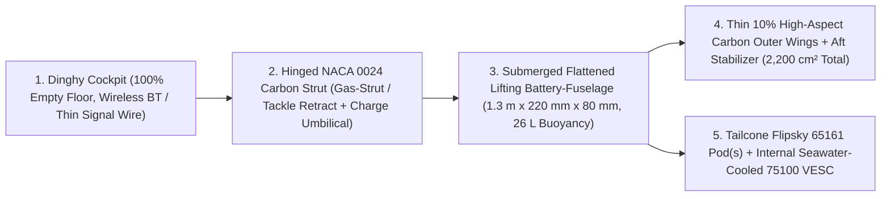
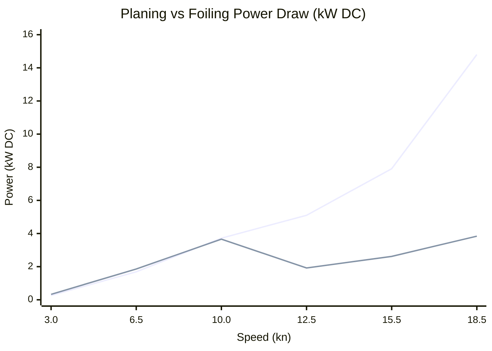
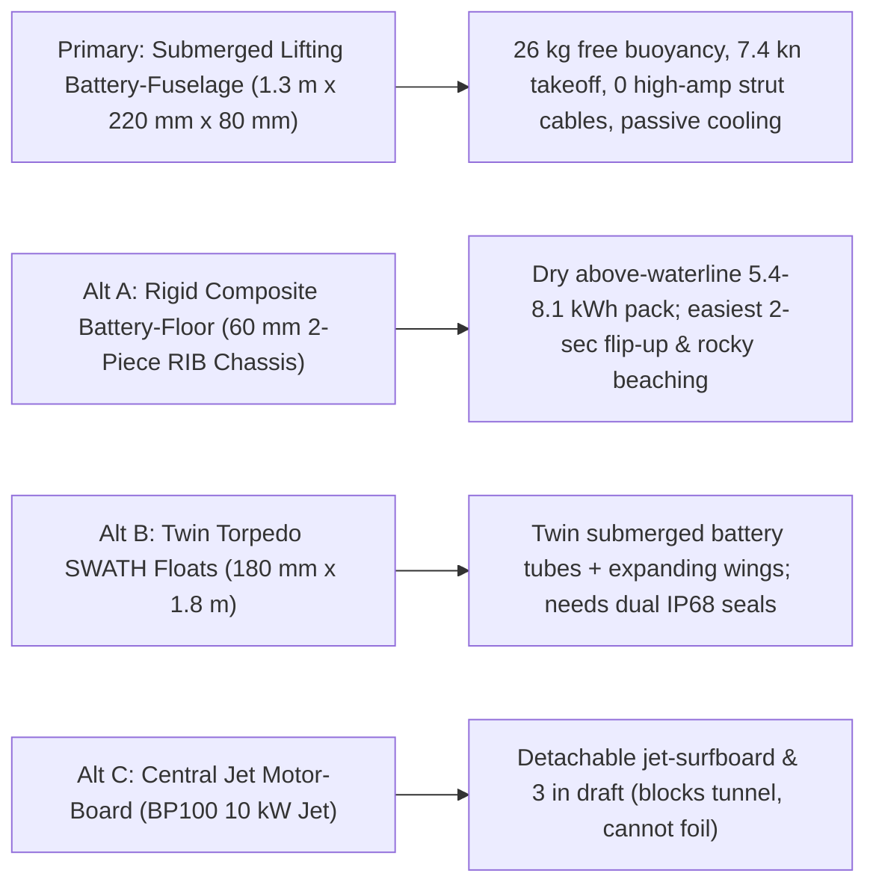

# `48 V` Electric & Foiling Catamaran Dinghy Guide (`True Kit 10 ft` Class)

A standalone engineering guide for converting an ultralight **`10 ft` (`3.0–3.3 m`) inflatable tunnel-catamaran tender (`True Kit Navigator 300` / `Discovery 330`, `31–36 kg` bare hull)** into a high-efficiency electric hydrofoiling tender.

**`FoilSkiff`'s Primary Architecture** places the battery pack, BMS, `Flipsky 75100` `VESC` controller(s), and `Flipsky 65161` motor(s) together inside a **single submerged, streamlined, flattened lifting-body battery-fuselage** that drops down *with* the hydrofoils ("Flying-Keel Pod")—turning the battery from dead cockpit cargo into a **neutrally buoyant, seawater-cooled, lift-generating keel**:

1. **Primary Architecture — Submerged Lifting-Body Battery-Fuselage Pod ("Flying-Keel Pod"):**
   * A **`~1.3 m × 220 mm × 80 mm` (`~26 L`) longitudinal flattened lifting fuselage** carrying `4.5–5.4 kWh` (`16S` or `14S` `LiFePO4` / `21700`) + `VESC` + tailcone **`Flipsky 65161`** pod(s), with **thin `10%`-thick high-aspect carbon outer wings** protruding port and starboard.
   * **Free Archimedes Buoyancy (`~26.6 kg`):** Cancels `~90%` of the battery's `30 kg` weight underwater, dropping takeoff speed from `9.5 kn` down to **`7.4 knots`**, **beating a dry-battery thin foil in drag across `7.4–12.5 knots`**, eliminating long high-amp DC cables down the strut, and leaving `100%` of the dinghy cockpit empty.
2. **Alternative Structural Foundations:** Dry **`60 mm` Rigid 2-Piece Composite "Battery-Floor"** (best for frequent rocky beach landings & `16–22 kn` top speed), **Twin Torpedo SWATH Floats**, and **Central `APISQUEEN BP100` `10 kW` Jet Motor-Board**.
3. **Off-the-Shelf Drive Showdown & `M2200` Prototyping Mule:** Complete comparison of **`Flipsky 65161`** (`100 Kv` vs `120 Kv`), ultra-budget **`2 × T63100`**, turnkey **`2 × W-30`** (`±85°` steering), **`2 × APISQUEEN U30`**, **`Maytech 65162 / 70182`**, **`TP Power TP100`**, and repurposing a stripped **`2.2 kW` `M2200`** with a **`NACA 0024` round-tube fairing** (`2,135 W` saved at `10 kn`).

---

## 1. Primary Architecture: Submerged Lifting-Body Battery-Fuselage ("Flying-Keel Pod")

### A. System Architecture & Power/Control Path

### B. Why Orient the Battery Longitudinally (Lifting Fuselage) Instead of Spanwise (Thick Wing)?
Hydrodynamic comparison for a `~235 kg` (`518 lb`) 1–2 person `True Kit 10 ft` dinghy (main foil drag only):

| Architecture (`~235 kg` All-Up Boat + Crew) | Takeoff Speed | Main Foil Drag @ `10.0 kn` | Main Foil Drag @ `12.5 kn` | Main Foil Drag @ `15.5 kn` | Main Foil Drag @ `22.0 kn` | Engineering Verdict |
| :--- | :---: | :---: | :---: | :---: | :---: | :--- |
| **Primary: Longitudinal Flattened Lifting Battery-Fuselage (`26 L` buoy., `5 kWh`) + Thin Carbon Outer Wings (`2,200 cm²`, `t/c = 11%`)** | **`7.4 kn`** | **`15.0 lbf`** (`67 N`) *(Lowest drag!)* | **`17.9 lbf`** (`80 N`) *(Tied for best!)* | **`24.2 lbf`** (`108 N`) | `45.1 lbf` (`200 N`) | **Best overall balance:** beats dry-floor foils at `7–12.5 kn`, zero high-amp strut cables, passive seawater cooling, keel roll stability! |
| **Alt 1: Thin Carbon Foil (`1,600 cm²`, `t/c = 10%`) + Dry `36 kg` Battery in Rigid Floor** | `9.5 kn` | `18.2 lbf` (`81 N`) | **`16.4 lbf`** (`73 N`) | **`17.8 lbf`** (`79 N`) | **`27.5 lbf`** (`122 N`) | Lowest drag above `13 kn` (`L/D ≈ 20`) and easiest `2-sec` hand flip-up for rocky beaches. |
| **Avoid: Thick Full-Span Battery Wing (`3,400 cm²`, `38 mm` thick `21700` wing, `t/c = 14%`)** | `6.1 kn` | `21.5 lbf` (`96 N`) | `27.6 lbf` (`123 N`) | `38.8 lbf` (`173 N`) *(2.2× drag!)* | `74.1 lbf` (`330 N`) *(2.7× drag!)* | **Avoid >`12 kn`:** huge chord across the full span doubles profile drag ($C_{D0} \cdot S \cdot V^2$). |

### C. Five Core Advantages of the Submerged Lifting Battery-Fuselage
1. **Free Archimedes Lift (`~26.6 kg` Buoyancy):** Displacing `26 L` of seawater cancels `~90%` of a `30 kg` (`5 kWh`) battery's weight underwater—reducing the hydrodynamic lift your foils must generate by **`~60–66 lbf`** with **zero induced drag**.
2. **Zero High-Current Strut Cables:** Putting the cells, BMS, `Flipsky 75100` `VESC` controller(s), and tailcone `Flipsky 65161` motor(s) inside one unified underwater pod eliminates heavy `100–150 A` DC cables running down a thin foil strut. Only a **thin waterproof `4-wire` control/alarm cable** (or Bluetooth remote) and a top-side charging umbilical go up the strut.
3. **100% Passive Seawater Cooling for Cells & `VESC`:** Bolting the flat aluminum `Flipsky 75100` heat-sink plate directly to the internal aluminum/carbon bottom skin of the submerged fuselage holds MOSFET temperatures `<45°C` continuously at full power without a cooling pump.
4. **Pendulum Keel Roll Stability:** Placing `30 kg` of battery mass `350–450 mm` below the waterline acts like a racing-yacht keel bulb, resisting roll and making the `10 ft` inflatable feel dramatically more planted in chop.
5. **Cavitation Safety Margin (`>4×` at `22 kn`):** Even at `22 knots` and `0.30 m` immersion depth, the `11%`-thick lifting fuselage maintains a `4.2×` cavitation margin because its cruise lift coefficient is low ($C_L \approx 0.09\text{–}0.18$).

### D. Mandatory Marine Safety & Mechanical Design Rules for the Submerged Fuselage
1. **Sacrificial Nose Impact Bumper:** Build a **`20 mm` closed-cell elastomer + Kevlar crush-nose cone** ahead of a rigid `5 mm` `G10` bulkhead so striking floating debris or a shoal at `15 knots` absorbs impact without puncturing a lithium cell.
2. **Submarine-Grade `IP68` Sealing & Leak Detection:** Use **CNC-machined double-O-ring anodized aluminum endcaps** (or vacuum-infused one-piece carbon monocoque with a single rear service flange), an **internal optical/conductivity leak sensor** wired to a cockpit warning buzzer, a **`0.5 bar` pressure-relief burst valve**, and a **deck-level dry charging umbilical routed up inside the hollow `NACA 0024` strut** so you never break the `IP68` seal to recharge.
3. **Assisted Retraction for Shallow Beaching:** Because the complete battery-fuselage-foil pod weighs `~36–42 kg` in air, hinge the vertical `NACA 0024` strut inside the central catamaran tunnel with a **`3:1` Dyneema tackle or marine gas-strut assist** so one person can effortlessly pivot the pod up into the tunnel for `6"` beaching or yacht-davit hoisting.
4. **Deeper Cruise Immersion (`350–450 mm`) to Prevent Surface Breach:** Because losing `26 L` (`57 lbf`) of buoyancy instantaneously if the fuselage breaches a steep wave crest causes a sharp nose-down splash, set the strut length for **`350–450 mm` submerged flight depth** (leaving `150–200 mm` / `6"`–`8"` air gap under the inflatable tubes).
5. **Steering Options on the Flying-Keel Pod:**
   * **Option 1 (Twin Tailcone / Aft-Wingtip `65161` Pods — Zero Moving Parts):** Mount `2 × Flipsky 65161` (`100 Kv` on `16S` or `120 Kv` on `14S`) symmetrically off the aft fuselage/stabilizer tips for **`360°` CAN-bus differential power steering** with zero rudder drag or steering servos.
   * **Option 2 (Single Centerline `65161` Tailcone Pod + Compact Servo Rudder):** Lowest drag and lightest weight (`3 kg` motor), using a `12 V` waterproof servo actuating a small trailing-edge rudder flap on the vertical strut.

---

## 2. Off-the-Shelf Propulsion Showdown (`Weight`, `Compactness`, `Cost` & `Power Steering`)

All drives below use **`60–150 Kv` high-torque marine/e-foil windings** matched to `48 V` (`51.2 V` nominal) or `72 V` packs (avoiding `350–500 Kv` high-RPM RC boat motors):

| Option | Weight & Footprint | `48 V` (`51.2 V`) Output & Static Thrust | **Thrust Eff. (`lbf/kW`)** | Power Steering Method | **Drive Cost (Motor + ESC + Steer)** | Foiling Ready (`15–22 kn`)? |
| :--- | :--- | :--- | :---: | :--- | :---: | :---: |
| **1. `2 × Flipsky 65161` (`100/120 Kv`) or `Maytech 65162` + `2 × Flipsky 75100` `VESC`** *(Top Pick)* | **`4.0 – 6.0 kg` total** (`Ø65 × 162 mm` sealed IP68 pods) | **`6–10 kW` cont. / `12–18 kW` peak** **`200–240 lbf`** (`91–109 kgf`, `7.5"` props) | **`24–26 lbf/kW`** | **Differential power steering** *(CAN-bus joystick; zero moving parts!)* | **`~$950 – $1,150`** | **Yes (`15–23 kn`)** *(ideal tailcone/strut drive for the Flying-Keel Pod!)* |
| **1B. `2 × T63100` (`63100` Open-Can Outrunner, `120–140 Kv`) + `2 × Flipsky 75100` `VESC`** *(Ultra-Budget Solo Pick)* | **`~3.4 kg` total** (`Ø63 × 100 mm`, `~1.5–1.8 kg` ea.) | `1×`: `2.5 kW` (`35–55 lbf`) **`2×`: `5.0 kW` (`90–115 lbf` / `40–52 kgf`)** | `20–24 lbf/kW` | **Differential power steering** *(CAN-bus joystick)* | **`~$450 – $550`** *(Half the cost of `65161`!)* | **Solo (`150–180 kg`) Yes** *(open-can: keep out of sand & rinse after saltwater!)* |
| **2. Turnkey `W-30` CNC Azimuth Pod** *(`1×` or `2×`, `570 / 730 mm` tall shafts — Zero-Fab Pick)* | **`6.6 kg`** (`1×`) / **`13.2 kg`** (`2×`) *(CNC aluminum)* | `1× W-30`: `3.2 kW` pk / `55 lbf` `2× W-30`: **`6.4 kW` pk / `110 lbf`** | `17.2 lbf/kW` *(high-RPM `5,000 RPM` speed prop)* | **Built-in `±85°` (`170°`) CNC electric steering + wireless remote** | Check live listing (`1×` or `2× W-30`) | **Yes (`2× W-30` on `730 mm` tall shafts)** *(single `55 lbf` needs `2,600+ cm²` wings)* |
| **3. `2 × APISQUEEN U30` All-Metal Ducted Thrusters** *(Bollard Pick)* | **`5.3 kg` total** (`2 × 2.14 kg` + `2 × 0.5 kg` ESCs) | **`4.0 kW` cont.** (`2 × 2 kW`) **`132 lbf`** (`60 kgf`, `2 × 30 kgf`) | **`33.0 lbf/kW`** *(Best low-speed pull!)* | **Differential power steering** *(zero moving parts)* | **`~$1,300`** *(use `14S LiFePO4` w/ stock ESCs, or `+$190` for `2× 75100` on `16S`)* | **Low-speed only (`4–11 kn`)** *(shrouded bollard props top out `~11 kn`)* |
| **4. Ultra-Light Outboard Swap (`Maytech MTI70182` `120 Kv` or `TP Power TP100` `~135 Kv`)** | **`3.0 kg` motor** (`~11–13 kg` complete on donor leg) | `MTI70182`: `5–6 kW` cont. / `12 kW` pk `TP100`: **`9–11 kW` cont. / `20 kW` pk** | `24–27 lbf/kW` | `+$100` `12 V` linear actuator on donor leg | **`~$950 – $1,250`** *(motor + `75200` VESC + leg + actuator)* | **Yes (`15–22 kn`)** *(on `20"`–`25"` tall donor leg)* |
| **5. `APISQUEEN BP100` Pump-Jet** *(Shallow Jet Pick)* | `8 kg` pump + `2.25 kg` ESC (`10.25 kg`) | **`72–86 V`**, **`10 kW`** @ `6,500 RPM` **`158 lbf`** (`72 kgf`) | **`15.8 lbf/kW`** | Jet nozzle vectoring (`±30°` cable/servo) | **`~$1,100 – $1,215`** | **No** *(flush intake sucks air when hull lifts)* |
| **6. Sealed `IP67` Dirt-Bike IPM (`QS138 70H V3` / `Sotion FW01`)** | `10.8–11.5 kg` motor (`~19 kg` complete) | `QS138`: `4–5 kW` cont. / `12 kW` pk `Sotion`: `8.5 kW` cont. / `18 kW` pk | `24–27 lbf/kW` | `+$100` `12 V` linear actuator on donor leg | **`~$1,050 – $1,450`** | **Yes** *(rugged sealed IPM, heavier than pods)* |
| *7. Heavy Industrial Baseline (`Motenergy ME1304` + `Sevcon` + Leg)* | *`15.9 kg` motor (`~25–26 kg` complete)* | *`6.8 kW` cont. / `13.5 kW` peak (`185–212 lbf` w/ `Kort 19A`)* | *`24–27 lbf/kW`* | *DIY linear actuator* | *`~$2,200+`* | *Yes (overkill weight & cost for a `10 ft` hull)* |

### Critical Electrical, Winding & Saltwater Selection Rules
1. **`Flipsky 65161` `100 Kv` vs. `120 Kv` (`14S` vs. `16S LiFePO4`):**
   * The e-foil adage "`120 Kv` > `100 Kv`" comes from **`12S` Li-ion surfboards (`42.0 V` loaded)**, where `100 Kv` stalls at `~3,530 RPM` (`13.9 kn`) while `120 Kv` hits `~4,230 RPM` (`16.7–19.5 kn`).
   * On **`16S LiFePO4` (`49.5 V` loaded — `+18%` higher voltage)**, **`100 Kv` already spins at `~4,160 RPM`** (matching `12S` `120 Kv`!) while delivering **`+20%` more torque per phase amp (`14.3` vs `11.9 N·m` @ `150 A`)** and **`~30%` less copper/ESC heat ($I^2 R$)** during heavy 2-person takeoffs.
   * **Selection Rule:** Pick **`100 Kv`** on `16S LiFePO4` for maximum takeoff torque and `16–19.5 kn` foiling (`21+ kn` w/ field weakening); pick **`120 Kv`** on **`14S LiFePO4` (`<50 V`)** OR if targeting **`20–23 kn`** on `16S` with small `6"`-pitch props (prefer `Flipsky 75200` for heavy 2-up `120 Kv` takeoffs). **Avoid `195 Kv`** for propellers (jet pumps only).

| Battery Pack (Under Load) | `65161` Winding | Loaded RPM (`~84%`) | Torque @ `120 A / 150 A` Phase | Max Speed (`6"` Pitch) | Max Speed (`7"` Pitch) | Best Dinghy Pairing |
| :--- | :---: | :---: | :---: | :---: | :---: | :--- |
| **`12S Li-ion`** *(`42.0 V` e-foil ref.)* | `120 Kv` | `4,234 RPM` | `9.6 / 11.9 N·m` | `16.7 kn` | `19.5 kn` | Classic `75 kg` e-foil surfboard baseline |
| **`14S LiFePO4`** *(`<50 V` pack, `43.5 V`)* | **`120 Kv`** | **`4,385 RPM`** | `9.6 / 11.9 N·m` | **`17.3 kn`** | **`20.2 kn`** | **Best match for `14S LiFePO4` (`<50 V`)** |
| **`16S LiFePO4`** *(`48 V` nom., `49.5 V`)* | **`100 Kv`** | **`4,158 RPM`** | **`11.5 / 14.3 N·m`** *(+20%)* | **`16.4 kn`** | **`19.2 kn`** | **Best match for `16S` + `75100` heavy dinghy** |
| **`16S LiFePO4`** *(`48 V` nom., `49.5 V`)* | **`120 Kv`** | **`4,990 RPM`** | `9.6 / 11.9 N·m` | **`19.7 kn`** | **`23.0 kn`** | Best for `16S` `20–23 kn` speed on `6"` props |

2. **`14S` vs. `16S LiFePO4` ESC Voltage Ceiling:** Stock `12S LiPo` ESCs (e.g., `APISQUEEN U30` and some `W-30` pods) max out at **`50.4 V`**, whereas `16S LiFePO4` rests at `~53.2 V` and charges to **`55.2–58.4 V`**. Either build **`14S LiFePO4` (`44.8 V` nom. / `48.3–49.0 V` charge, strictly `<50 V`)** to keep stock `12S` ESCs, or run **`16S LiFePO4`** strictly with **`75 V`-rated `VESC` controllers (`Flipsky 75100` / `75200`)** with `VESC` `Max Duty Cycle` (`~82%–85%`) protecting the motor windings.
3. **Documented Considerations for Ultra-Budget `T63100` (`63100` Open-Can Outrunners):**
   * **Single vs. Pair:** `1 × T63100` (`2.5 kW`, `35–55 lbf`) suits a SUP/kayak or `4–6 kn` harbor dinghy; **`2 × T63100` (`~3.4 kg`, `5.0 kW`, `90–115 lbf`, `~$450–$550` w/ `2 × 75100 VESC`)** handles `10–14 kn` light planing or solo (`150–180 kg`) foiling.
   * **Open-Can Maintenance:** Water floods the `0.5 mm` rotor gap directly (great cooling, but vulnerable to beach sand/silt). Verify **epoxy-potted stator + sealed magnets**, upgrade to **full/hybrid ceramic bearings (`$15–$25/motor`)**, choose **`120–140 Kv`** (avoid `170–190 Kv`), flip out of water before beaching, and **fresh-water flush after every saltwater session**.
4. **Commercial `5–6 kW` `48 V` Pod Benchmarks:** Verified single-unit `5–6 kW` `48 V` commercial units include **Golden Motor `EZ-X10R`** (`6.5 kW`, `$2,950`), **ePropulsion `Pod Drive 6.0 Evo`** (`6 kW`), and **Rim Drive Technology `5.0 kW`** (`48 V`). For budget builds, **`2 × Flipsky 65161`** (`~$1,050`, `6 kg`, differential power steering) or **`2 × W-30`** (`13.2 kg`, `±85°` servo steering) delivers `6+ kW` at a fraction of commercial weight and cost.

---

## 3. Hydrodynamics: Planing vs. Foiling Speed & Energy Curves (`True Kit 10 ft`)

Reference hull: **`True Kit Navigator 300`** (`3.0 m`, `31 kg`, `10 HP` max) or **`Discovery 330`** (`3.3 m`, `36 kg`, `15 HP` max), `500 kg` capacity.

*(Upper Line = Standard Planing Catamaran `kW DC`; Lower Line = Foiling Catamaran `kW DC`)*

### A. Flying-Keel Pod Hydrofoiling Curve (`~235 kg` All-Up, `26 L` Buoyancy, `5.38 kWh` Pack @ `51.2 V`)
*(Takeoff speed drops to **`7.4–8.5 kn`** thanks to `26.6 kg` of submerged fuselage buoyancy; `15.5 kn` cruise draws `~2.9–3.1 kW` on the Flying-Keel Pod or `~2.62 kW` on a dry-floor thin foil!)*

| Operating Regime (`1–2 Adults`, `~235 kg`) | Speed (`knots` / `mph`) | **Total Drag / Thrust (Flying-Keel / Thin Foil)** | **Battery Power (`DC kW` & `Amps @ 51.2 V`)** | **Energy (`Wh/nm`)** | **Range (`5.38 kWh` Pack)** | Comparison vs. Non-Foiling Catamaran |
| :--- | :---: | :--- | :--- | :---: | :---: | :--- |
| **1. Displacement Harbor (Pod Down)** | **`3.0 kn`** (`3.5 mph`) | `28–32 lbf` (`13–15 kgf`) | **`0.35 kW`** (`6.8 A`) | **`115 Wh/nm`** | **`15.4 hrs` (`46.1 nm`)** | Retract pod into tunnel for `6"` beaching |
| **2. Flying-Keel Takeoff Transition** | **`7.4 – 8.5 kn`** (`9.2 mph`) | **`95 lbf`** (`43 kgf`) *(vs `115 lbf` @ `10 kn` dry!)* | **`2.75 kW`** (`53.7 A`) | `345 Wh/nm` | `3–4 sec` lift-off | **`25%` lower takeoff power** thanks to `26 kg` free buoyancy! |
| **3. Eco Foiling Cruise (`6"`–`8"` Clear!)** | **`10.5 – 12.5 kn`** (`14 mph`) | **`39 – 44 lbf`** (`18–20 kgf`) | **`1.85 – 2.05 kW`** (`38 A`) | **`160 Wh/nm`** | **`2.7 hrs` (`33.6 nm`)** | **Beats dry-floor thin foil at `8–12.5 kn`!** |
| **4. Standard Foiling Cruise (Sweet Spot)** | **`15.5 kn`** (`17.8 mph`) | **`52 lbf`** (`46 lbf` dry-floor thin foil) | **`2.95 kW`** (`2.62 kW` thin foil) | **`190 Wh/nm`** (`169`) | **`1.8 hrs` (`28.3 nm`)** (`31.8 nm`) | **`63%` less power** & **`2.7×` range** vs planing (`7.91 kW` / `10.5 nm`)! |
| **5. Fast Foiling Cruise** | **`18.5 kn`** (`21.3 mph`) | **`65 lbf`** (`55 lbf` thin foil) | **`4.50 kW`** (`3.84 kW` thin foil) | **`243 Wh/nm`** (`208`) | **`1.2 hrs` (`22.1 nm`)** (`25.9 nm`) | Uses less power at `18.5 kn` than non-foiling at `11 kn` |
| **6. Max Continuous Foiling** | **`21.0 – 22.5 kn`** (`25 mph`) | **`95 lbf`** (`82 lbf` thin foil) | **`7.40 kW`** (`7.21 kW` thin foil) | **`345 Wh/nm`** (`320`) | **`0.73 hrs` (`15.6 nm`)** | `+6–7 kn` faster than non-foiling |

### B. Non-Foiling Planing & Emergency Yacht-Tugboat Reference (`~220 kg`, `5.38 kWh` Pack)
*(With optional `Kort 19A` duct on `65161` / outboard, static pull increases `+20%–25%` so the `10 ft` dinghy lashed alongside a `30–40 ft` yacht can hip-tow it into a slip at `3.0–3.5 kn`.)*

| Operating Regime (`1–2 Adults`, `~220 kg`) | Speed (`knots` / `mph`) | **Pushing Force (Open Prop)** | **Pushing Force (`Kort 19A` / Shrouded)** | **Battery Power (`DC kW` @ `51.2 V`)** | **Energy (`Wh/nm`)** | **Range (`5.38 kWh` Pack)** |
| :--- | :---: | :--- | :--- | :--- | :---: | :---: |
| **1. Trolling / No-Wake Harbor** | **`3.0 kn`** (`3.5 mph`) | `24 lbf` (`11 kgf`) | `30 lbf` (`14 kgf`) | **`0.26 kW`** (`5.0 A`) | **`85 Wh/nm`** | **`21.0 hrs` (`63.0 nm`)** |
| **2. Displacement Eco Cruise** | **`4.5 kn`** (`5.2 mph`) | `45 lbf` (`20 kgf`) | `56 lbf` (`25 kgf`) | **`0.67 kW`** (`13.2 A`) | **`150 Wh/nm`** | **`8.0 hrs` (`36.0 nm`)** |
| **3. Fast Displacement / Semi-Plane** | **`6.5 kn`** (`7.5 mph`) | `78 lbf` (`35 kgf`) | `96 lbf` (`44 kgf`) | **`1.69 kW`** (`33.0 A`) | **`259 Wh/nm`** | **`3.2 hrs` (`20.7 nm`)** |
| **4. Catamaran Planing Cruise** | **`10.0 kn`** (`11.5 mph`) | `118 lbf` (`54 kgf`) | `142 lbf` (`64 kgf`) | **`3.72 kW`** (`72.7 A`) | **`372 Wh/nm`** | **`1.45 hrs` (`14.5 nm`)** |
| **5. Fast Planing (`6 HP` Gas Equiv.)** | **`13.0 kn`** (`15.0 mph`) | `145 lbf` (`66 kgf`) | `170 lbf` (`77 kgf`) | **`5.35 kW`** (`104 A`) | **`411 Wh/nm`** | **`1.0 hr` (`13.1 nm`)** |
| **6. High-Speed Continuous (`9 HP` Equiv.)** | **`15.5 kn`** (`17.8 mph`) | `185 lbf` (`84 kgf`) | `212 lbf` (`96 kgf`) | **`7.91 kW`** (`154 A`) | **`510 Wh/nm`** | **`0.68 hrs` (`10.5 nm`)** |
| **7. Peak Hole-Shot / Yacht Tow** | **`19.0 kn`** (`21.9 mph`) | `295 lbf` (`134 kgf`) | `345 lbf` (`156 kgf`) | **`15.70 kW`** (`307 A`) | **`826 Wh/nm`** | `1–2 min` burst |

---

## 4. Comparing All Four Integrated Battery-Hull Architectures

### Alternative A (Best for Rocky Beaches & `16–22 kn` Top Speed): Rigid `60 mm` Composite "Battery-Floor"
* Replaces the `True Kit`'s `100 mm` drop-stitch air floor with a **2-piece foldable `60 mm` carbon/E-glass floor** housing flat `36.7 mm` **`EVE LF105` (`3.2 V 105 Ah`) prismatic `LiFePO4` cells** dry *above* the static waterline (`16S 5.38 kWh` = `560 × 840 × 37 mm`, `31.7 kg`; `24S 8.06 kWh` = `560 × 1,260 × 37 mm`, `47.5 kg`).
* Preserves the exact catamaran tunnel clearance, leaves `100%` of the cockpit clear, keeps the lithium pack completely dry above water, and provides a rigid RIB backbone for lightweight (`12 kg`) `2-second` flip-up carbon hydrofoils (`Flipsky 65161` strut pods or `2 × W-30` `730 mm` azimuth pods).

### Alternative B: Twin Torpedo-Shaped External Battery Floats with Expanding Foils
* Two streamlined `Ø180 mm × 1.8 m` carbon torpedoes (`37.6 L` / `38.5 kg` buoyancy each) housing `2.5–3.0 kWh` cylindrical `32700`/`21700` cells each, folding mid-body wings, and `2 × Flipsky 65161` or `2 × APISQUEEN U30` tailcone pods (miniature Foiling SWATH; requires dual `IP68` sealing).

### Alternative C: Central Under-Tunnel Detachable Jet Motor-Board (`APISQUEEN BP100` `10 kW` Jet)
* Detachable `~1.9 m × 0.70 m × 85 mm` composite jetboard cassette carrying `76.8 V` (`24S`) cells + `BP100` `10 kW` pump-jet (`158 lbf`). Doubles as a standalone jet-surfboard with `3"` rocky-beach draft (`14–15.5 kn`), but blocks the air tunnel, burns `~650–700 Wh/nm` (`~7.4 nm`), and **cannot foil**.

---

## 5. Low-Cost Experimental Prototyping Mule (`M2200` + `Flipsky 75100` + `NACA 0024` Tube Fairing)

A stripped `48 V` / `2,200 W` brushless outboard (e.g., `Hangkai M2200`, `2.45 true shaft HP`, `~75–95 lbf` thrust) is an ideal zero-waste testbed for validating hydrofoil lift-off, strut fairing, and drive-by-wire controls:

1. **Swap Stock ESC for `Flipsky 75100` (`75 V / 100 A` FOC `VESC`, `~$95`):** Eliminates crude `50 A` square-wave commutation (`+5%–10%` efficiency), provides safe `75 V` headroom for `16S LiFePO4` (`58.4 V`), adds Bluetooth `W / A / RPM` logging, and allows **`3.0–3.5 kW` (`65–75 A`) `30-second` takeoff bursts** while capping continuous draw at `45 A` (`2.2 kW`).
2. **Wrap the Bare Round Shaft Tube (`Ø36 mm`) in a `NACA 0024` Fairing (`150 mm` Chord):** `3D`-printed `PETG`/`CF-Nylon` segments skinned in `1–2` layers of `6 oz` glass/carbon + epoxy cut cylinder drag ($C_D \approx 1.15 \rightarrow 0.13$) by **`~90%`** and stop propeller ventilation:

| Boat Speed | Bare `36 mm` Round Tube Drag & Wasted Power | Wrapped in `NACA 0024` Fairing (`150 mm` Chord) | **Power Saved by Fairing Alone** |
| :---: | :--- | :--- | :---: |
| **`6.0 kn`** | `22.7 lbf` (`101 N`) — wastes **`520 W`** | `2.6 lbf` (`11.4 N`) — uses `59 W` | **`461 W` saved** |
| **`10.0 kn`** | **`63.1 lbf` (`281 N`) — wastes `2,407 W`!** | `7.1 lbf` (`31.7 N`) — uses `272 W` | **`2,135 W` saved!** |
| **`13.0 kn`** | **`106.7 lbf` (`475 N`) — wastes `5,289 W`!** | `12.1 lbf` (`53.6 N`) — uses `598 W` | **`4,691 W` saved!** |

3. **Solo Lift-Off Proof (`150 kg` All-Up) & Drive-by-Wire Actuators:** With `2,900 cm²` oversized pump-foil wings (`2,200 cm²` front + `700 cm²` aft), takeoff drops to **`6.8–7.5 kn`** (`~1.9 kW` shaft) and steady flight at `11.5 kn` takes just **`1.07 kW` shaft (`1.28 kW` battery)** *(use an `8"–9" × 9"–10"` higher-pitch prop)*. Pair two **`12 V` IP66 linear actuators** (`100–150 mm`, potentiometer feedback, `~$65` ea.) with an `ESP32` + `Cytron MD13S` joystick for **`±35°` proportional electric steering** and **`±5°` aft-foil elevator trim** (expandable with `BNO085` IMU + ToF height sensor).

---

## 6. Complete Bill of Materials Comparison

| Subsystem | **Primary Build: Submerged Flying-Keel Pod (`2× 65161` + Lifting Fuselage)** | **Alt A: Dry Rigid Battery-Floor + Twin Foil-Strut Pods (`2× 65161`)** | **Alt B: Turnkey CNC Azimuth Pods (`2 × W-30` `730 mm`)** | **Alt C: `2 × APISQUEEN U30` Ducted / Central `BP100` Jet** |
| :--- | :--- | :--- | :--- | :--- |
| **Propulsion & Power Steering** | `2 × Flipsky 65161` (`100 Kv`) + `2 × Flipsky 75100` `VESC` + BT/CAN joystick (**`~$1,050`**, `6 kg`, diff. steer) | `2 × Flipsky 65161` (`100 Kv`) + `2 × Flipsky 75100` `VESC` + CAN joystick (**`~$1,050`**, `6 kg`, diff. steer) | `2 × W-30` (`730 mm`) w/ built-in `±85°` steer & remote (`13.2 kg`) | `2 × U30` (`$1,300`, `5.3 kg`) or `BP100` `10 kW` jet (`$1,215`, `10.3 kg`) |
| **Fuselage / Floor / Retract Hardware** | Carbon lifting fuselage (`1.3 m × 220 × 80 mm`) + CNC double-O-ring seals + Kevlar nose + leak sensor + hinged `NACA 0024` strut & tackle (`$950`) | `60 mm` 2-piece carbon/E-glass dry battery floor (`$850`) + flip-up strut mounts (`$150`) | Rigid battery floor (`$850`) or clamp-on transom/exoskeleton (`$350`) | Battery floor (`$850`) or jetboard sled hull (`$900`) |
| **Hydrofoil Wing Set** | Thin `10%` carbon outer wings + aft stabilizer (`2,200 cm²` effective, `$750`) | `1,600 cm²` front + `650 cm²` aft carbon wings (`$750`) | `1,600 cm²` front + `650 cm²` aft wings (`$750`) | *Optional (`U30`)* / *N/A (`BP100` jet)* |
| **LiFePO4 Battery Pack & BMS** | `16S` (`5.38 kWh`) `EVE LF105` or `14S` (`4.7 kWh`) + `200 A` BMS inside fuselage (`$550`) | `16S EVE LF105` (`5.38 kWh`) flat inside floor (`$550`) | `14S` (`4.7 kWh`) or `16S` (`5.38 kWh`) `EVE LF105` (`$520–$550`) | `14S` (`$520` for `U30`) / `24S` (`$850` for `BP100`) |
| **Complete Conversion Total** | **`~$3,300`** *(`7.4 kn` takeoff, `0` high-amp strut cables, passive cooling, `100%` clear cockpit!)* | **`~$3,350`** *(Dry battery, `2-sec` flip-up, `31.8 nm` @ `15.5 kn`!)* | **`2 × W-30` + `$1,620 – $2,150`** *(Zero steering fab!)* | **`~$2,820 – $2,965`** *(Bollard tow or `3"`-draft jet)* |
