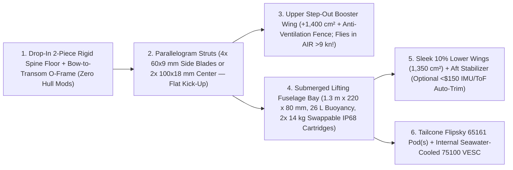
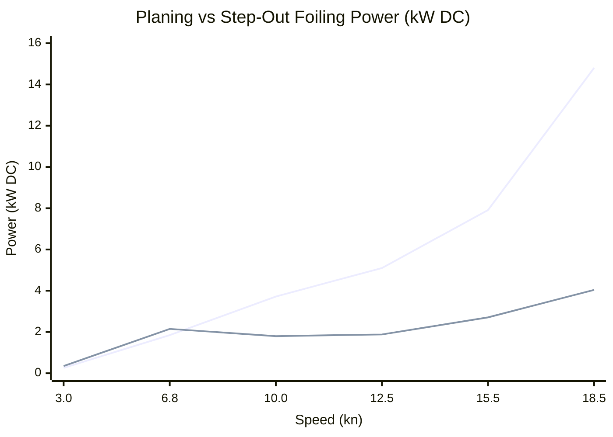
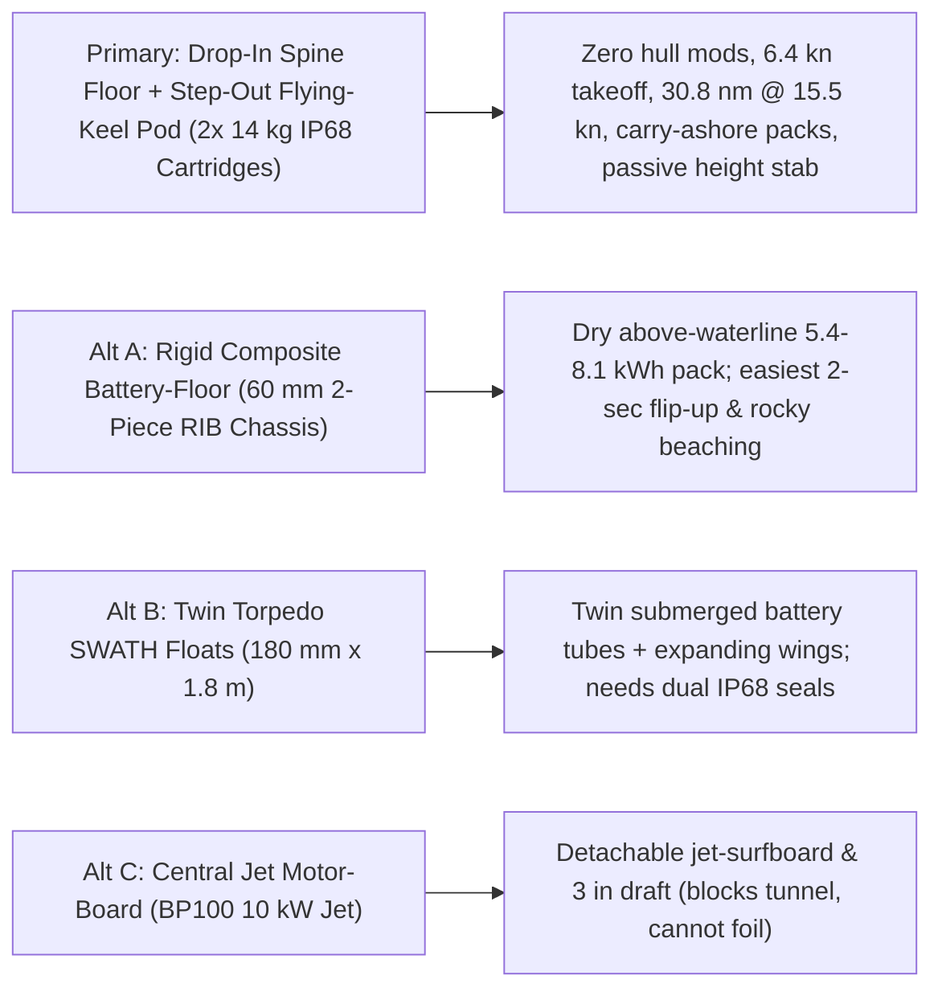

# `48 V` Electric & Foiling Catamaran Dinghy Guide (`True Kit 10 ft` Class)

A standalone engineering guide for converting an ultralight **`10 ft` (`3.0–3.3 m`) inflatable tunnel-catamaran tender (`True Kit Navigator 300` / `Discovery 330`, `31–36 kg` bare hull)** into a high-efficiency electric hydrofoiling tender.

**`FoilSkiff`'s Primary Architecture** turns any ultralight inflatable tunnel-catamaran (`True Kit`, `Takacat`, `Saturn`, `Kaboat`) into a bolt-on electric hydrofoil—with **zero glue, zero holes, and zero hull warranty voiding**—by combining three core elements:

1. **Drop-In 2-Piece Rigid "Spine Floor" Chassis (`25–35 mm` Thin Carbon/Aluminum):** Replaces the stock inflatable drop-stitch air floor using the existing tube tuck-under rails. Eliminates inflatable hull twist and porpoising under `200+ kg` dynamic foil loads, leaves `100%` of the cockpit empty, and mounts a standardized central hinged foil-cassette trunk adaptable across `True Kit`, `Takacat`, and similar catamarans via swappable outer edge trim panels.
2. **Submerged Lifting-Body Battery-Fuselage ("Flying-Keel Pod") with Swappable `IP68` Cartridges:** A **`~1.3 m × 220 mm × 80 mm` (`~26 L`) longitudinal flattened lifting fuselage** housing **two removable, factory-potted `IP68` `2.5–2.7 kWh` (`~14 kg` ea.) slide-in battery cartridges** (*Flitecell*-style) + seawater-cooled `Flipsky 75100` `VESC` + tailcone **`Flipsky 65161`** pod(s), flanked by **sleek `10%`-thick high-aspect carbon lower wings (`1,300–1,400 cm²`)**. Displacing `~26 L` of seawater provides **`~26.6 kg` free Archimedes buoyancy** (`~90%` of pack weight), eliminates high-amp strut cables, and lets one person carry a `14 kg` cartridge ashore to charge—or run a single cartridge + buoyancy plug for ultralight solo trips.
3. **Fixed Upper "Step-Out" Booster Wing (`+1,400 cm²`) + Optional `<$150` Auto-Trim Aft Stabilizer:** Mounted `200–250 mm` higher up the `NACA 0024` strut (with a `20 mm` anti-ventilation fence collar `50 mm` below it). At `0–8 kn`, **both wings are submerged (`~2,750 cm²`)** for **`6.4-knot` takeoff** (`41%` less takeoff power). Above `9 kn`, the upper wing **exits into dry air (`825×` lower density → `99.9%` drag vanishes)**, matching within `3%` of a dry-floor thin foil (`2.71 kW` / `30.8 nm` @ `15.5 kn`) while providing **inherent passive mechanical ride-height self-stabilization** ("push throttle and fly" without `$40k` active flight computers).
4. **Alternative Foundations, Off-the-Shelf Drive Showdown & `M2200` Prototyping Mule:** Complete comparison of Dry **`60 mm` Battery-Floor**, **Twin Torpedo SWATH**, **`BP100` Jet**, **`Flipsky 65161`** (`100 Kv` vs `120 Kv`), **`2 × T63100`**, **`2 × W-30`** (`±85°` steer), **`2 × APISQUEEN U30`**, **`Maytech 65162 / 70182`**, **`TP100`**, and the stripped **`M2200` + `NACA 0024` tube fairing** (`2,135 W` saved @ `10 kn`).

---

## 1. Primary Architecture: Drop-In Spine Floor + Step-Out Flying-Keel Pod

### A. System Architecture & Power/Control Path

### B. Wing & Fuselage Geometry Showdown: Why "Step-Out" Beats Submerged Swing-Wings & Thick Battery Wings
Hydrodynamic comparison for a `~235 kg` (`518 lb`) 1–2 person `True Kit 10 ft` dinghy (main foil + fuselage drag only):

| Architecture (`~235 kg` All-Up Boat + Crew) | Takeoff Speed | Main Drag @ `10.0 kn` | Main Drag @ `12.5 kn` | Main Drag @ `15.5 kn` | Main Drag @ `22.0 kn` | Engineering Verdict |
| :--- | :---: | :---: | :---: | :---: | :---: | :--- |
| **Primary (Zero Moving Parts): Flying-Keel Pod (`26 L` buoy.) + `1,350 cm²` Lower Thin Wings + Upper "Step-Out" Booster (`+1,400 cm²` high on strut)** | **`6.4 kn`** | `16.1 lbf` (`72 N`) | **`16.3 lbf`** (`73 N`) *(Tied for best!)* | **`19.3 lbf`** (`86 N`) *(`30.8 nm`)* | `33.2 lbf` (`148 N`) | **Best simplicity & passive stability:** `6.4 kn` takeoff, upper wing exits into dry air >`9 kn` (`0` moving foil parts!), passive ride-height bumper! |
| **Co-Primary (Rough-Chop / Flush Roof): Flush-Nested Top-Deck Switchblade (`2 × 680×105 mm` flush in pod roof) + `1,250 cm²` Lower Thin Wings** | **`6.7 kn`** | `16.8 lbf` (`75 N`) | `16.5 lbf` (`73 N`) | **`19.4 lbf`** (`86 N`) *(`30.8 nm`)* | **`32.3 lbf`** (`144 N`) *(Best pod!)* | **Best all-around submerged aero:** `0 cm²` extra wet area & `0` exposed tips when closed, zero ventilation in `2 ft` chop, ultra-flat `~90 mm` beach fold, hydrodynamic self-closing! |
| **Active-Chop Upgrade: Submerged Split STOL Flaperons (`1,000 cm²` Main + `2 × 250 cm²` Active Slotted Flaperons, `1,500 cm²` total wet)** | **`7.2 kn`** | **`16.1 lbf`** (`72 N`) | `16.9 lbf` (`75 N`) | **`20.9 lbf`** (`93 N`) *(`29.8 nm`)* | **`36.4 lbf`** (`162 N`) | **Best active flight control:** zero surface-piercing ventilation, narrower span, full **4-in-1 active elevation, roll leveling & banked turning** for `~$160`! |
| **Alt 1: Single-Plane Fixed Flying-Keel (`26 L` buoy. + `2,200 cm²` fixed thin wings)** | `7.4 kn` | **`15.0 lbf`** (`67 N`) | `17.9 lbf` (`80 N`) | `24.2 lbf` (`108 N`) | `45.1 lbf` (`200 N`) | Simplest single-wing pod; lowest drag at `8–11 kn`, higher cruise drag >`13 kn`. |
| **Alt 2: Flying-Keel + `1,400 cm²` Thin Wing w/ Integral Trailing-Edge Flaps** *(AC75 / Candela style)* | `7.8 kn` | `16.1 lbf` (`72 N`) | `16.5 lbf` (`73 N`) | `19.9 lbf` (`89 N`) | `34.1 lbf` (`152 N`) | Clean single submerged wing; adds 1 mechanical pushrod linkage & flap servo. |
| **Alt 3: Dry-Floor Thin Foil (`1,600 cm²`, `t/c = 10%`) + Dry `36 kg` Battery in Rigid Floor** | `9.5 kn` | `18.2 lbf` (`81 N`) | **`16.4 lbf`** (`73 N`) | **`17.8 lbf`** (`79 N`) | **`27.5 lbf`** (`122 N`) | Lowest drag >`14 kn` (`L/D ≈ 20`) & easiest `2-sec` hand flip-up for rocky beaches, but `9.5 kn` takeoff. |
| **Avoid: External Un-Nested Swing-Wing (`+1,400 cm²` thick wing swinging `90°` lengthwise *outside* fuselage)** | `5.6–6.5 kn` | `20.4–21.8 lbf` | `24.7–26.3 lbf` | `32.2–37.0 lbf` *(+33–53%!)* | `58.3–70.8 lbf` *(+30–58%!)* | **Avoid:** unlike flush-nested blades, an external wing keeps `100%` of its extra wetted area ($S_{\text{wet}}$) in seawater and points its blunt tip into `20 kn` flow! |
| **Avoid: Split Battery-Fuselage Swing-Wings** *(fuselage splits spanwise at takeoff, folds lengthwise at cruise)* | `6.7 kn` | `17.9 lbf` (`80 N`) | `18.5 lbf` (`82 N`) | `22.7 lbf` (`101 N`) | `39.3 lbf` (`175 N`) | Tiny gain over fixed pod, but adds blunt-tip drag + extreme failure risk from flexing `100 A` cables through cantilevered `IP68` rotary pivots. |
| **Avoid: Fixed Thick Full-Span Battery Wing (`3,400 cm²`, `38 mm` `21700` wing, `t/c = 14%`)** | `6.1 kn` | `21.5 lbf` (`96 N`) | `27.6 lbf` (`123 N`) | `38.8 lbf` (`173 N`) *(2.2× drag!)* | `74.1 lbf` (`330 N`) *(2.7× drag!)* | **Avoid >`12 kn`:** huge chord across the full span doubles profile drag ($C_{D0} \cdot S \cdot V^2$). |

> **Fluid-Mechanics Takeaway — Three Ways to Beat the High-Speed Wetted-Area Penalty:** Above `12 kn`, `70%–85%` of foil drag is skin friction ($D_f = \frac{1}{2} \rho V^2 C_f S_{\text{wet}}$). You can eliminate that penalty by: **(1) Pulling the takeoff wing out into dry air** (*Upper Step-Out Booster*, `0` moving parts, `30.8 nm`), **(2) Nesting two thin switchblade wings completely flush into the flat top deck of the `1,300 × 220 mm` fuselage** (*Flush-Nested Switchblade*, `0 cm²` extra wet area & `0` exposed wingtips, `30.8 nm`, best `22 kn` pod drag!), or **(3) Shrinking the main wing to `1,000 cm²` + `2 × 250 cm²` active split STOL flaperons** (`1,500 cm²` total wet, `29.8 nm` + 4-in-1 active flight control).

* **Flush-Nested Top-Deck Switchblade Wing Mechanics (`+1,300 cm²` Takeoff, `0 cm²` Extra Wet Area at Cruise):**
  * **Zero-Drag Roof Nesting & Strut Clearance:** Two `680 × 105 × 13 mm` solid UD carbon blades (`2 × 105 = 210 mm` inside the `220 mm` pod width; `1.58 m` total span / `AR ≈ 15` open!) sit flush inside a `13 mm`-deep recessed top-deck pocket (`+10 mm` pod height `80 → 90 mm` preserves the full `26 L` battery bay). Mounting the **`4×` side-straddling tandem struts** at `x = 200 mm` (ahead of the `x = 220 mm` pivots) and `x = 960 mm` (behind the `x = 900 mm` tucked tips) leaves the entire `680 mm` sweep arc `100%` clear—and with no upper wing on the struts, beach retraction folds to just **`~90 mm` (`~5.5"` clear above flat sand)**.
  * **Carbon Overhang Bridge & Strength:** Solid UD carbon (`105 × 13 mm`) sees only **`90 MPa`** at normal takeoff (`52.5 kgf/blade`, `9×` safety) and **`181 MPa`** in a `2G` gust (`4.4×` safety). Mold a **`70 mm`-deep rigid carbon Overhang Bridge** across the front of the pocket so each blade's inner `70 mm` root slides *underneath* it when deployed—reacting `~214 kgf` of upward lift in pure compression while the vertical pivot pin handles only sweep rotation.
  * **Hydrodynamic Self-Closing & Sand-Proofing:** Sweeping *aft* means water drag naturally closes the blades flush at `9–10 kn` as soon as a simple hold-open latch/cable releases (and automatically folds them safely back on kelp/branch contact). Mold **`2–3 mm` aft flush-out drain slots** + low-friction **UHMW / Delrin wear pads** under the bridge to prevent beach sand jamming, and pair with the `<$150` aft auto-trim stabilizer (since there is no passive surface-piercing height bumper).
* **Submerged Split STOL Flaperon Mechanics (`~$160` Active Flight-Control Upgrade for Rough Chop):**
  * **Stagger Position:** Mounting the split `2 × 250 cm²` (`450 × 55 mm` ea.) flaperons **slightly below & behind** the `1,000 cm²` main wing (`~20–35 mm` down, `~0.8` chords aft — *Junkers / Zenith CH701* STOL external slotted flap) channels a high-pressure converging slot jet over the rear wing's upper surface (`CL_max ≈ 1.95–2.10`). Mounting **above & behind** (*Beechcraft Staggerwing* negative-stagger biplane, `~50–100 mm` up, `~0.7` chords aft) yields gentler stall and higher rock clearance (`CL_max ≈ 1.65`) while mounting directly onto the rear tandem struts.
  * **4-in-1 Active Flight Control:** (1) **STOL Takeoff Flaps** (both `+15°` down), (2) **Direct-Lift Elevation / Ride-Height** (both `±3°` together—raises/lowers boat dead-flat over swells without rollercoaster nose pitching), (3) **Active Roll Leveling & Banked Turning** (differential left/right `±3°` when passengers move or turning), and (4) **Hydrodynamic Braking / Soft Touchdown** (both `-8°`).
  * **Dry-Deck Actuation & Mechanical Failsafe (`~$160`):** Pivoting each `250 cm²` half near its **quarter-chord aerodynamic center (`20%–25%` chord)** limits peak hinge torque across `8–22 kn` to just **`2.5–3.6 N·m` (`26–37 kg·cm` / `7.3–10.5 kgf` on a `35 mm` horn)**. Two dry-mounted **`$45–$65` brushless `IP67` `70–80 kg·cm` servos** (`0.10 s/60°`) inside the Spine Floor drive two **`4 mm` stainless pushrods** tucked inside the trailing-edge grooves of the left/right rear `60 × 9 mm` blades (controlled by an `ESP32` + `BNO085` 6-DOF IMU + ToF height sensor). Placing the hinge slightly forward at **`~20%` chord** makes both flaperons **hydrodynamically self-centering to `0°`** on power/servo loss.

### C. Core Advantages of the Spine-Floor + Step-Out Flying-Keel Pod
1. **Free Archimedes Lift (`~26.6 kg` Buoyancy) + Modular Swappable Portability:** Displacing `26 L` of seawater cancels `~90%` of the battery's weight underwater (`~66 lbf` lift with zero induced drag). Housing the cells as **two removable, factory-potted `IP68` `2.5–2.7 kWh` (`~14 kg` ea.) slide-in cartridges** inside the fuselage bay (instead of one permanent `30 kg` sealed pack) lets one person carry a battery ashore/into a car to charge, isolates seal/cell serviceability, and lets you run **1 cartridge + a closed-cell foam dummy plug** (`~15 nm`) for ultralight solo trips or **2 cartridges (`~31 nm`)** for 2-up range.
2. **Dual-Regime Efficiency with Zero Moving Parts (`6.4 kn` Takeoff + `30.8 nm` @ `15.5 kn`):** Both wings (`~2,750 cm²`) work together for low-power `6.4 kn` lift-off; above `9 kn`, the upper booster wing exits into air so cruise drag drops `20%–28%` vs. a fixed large wing—matching within `3%` of a dry-floor thin foil.
3. **"Push Throttle and Fly" Ergonomics (Passive Ride-Height Stabilization + `<$150` Auto-Trim):** If a wave trough drops the dinghy `100 mm`, the upper booster wing dips back into the water and immediately adds lift to pop the hull back up—eliminating `$40k` active `100 Hz` flight computers. Pairing this with an optional **`<$150` auto-leveling aft pitch-trim stabilizer** (`ESP32` + `BNO085` IMU + ToF height sensor + `12 V` IP66 micro-actuator) makes foiling effortless for non-athletic cruising sailors carrying passengers or groceries.
4. **Drop-In Rigid "Spine Floor" (Zero Hull Flex, Zero Permanent Boat Mods):** Replacing the stock inflatable drop-stitch floor with a thin **`25–35 mm` 2-piece folding carbon/aluminum Spine Floor** tucked into the existing tube channels eliminates torsional twisting and porpoising under `200+ kg` dynamic foil loads without a single drop of glue or drilled hole—and adapts across `True Kit`, `Takacat`, `Saturn`, and `Kaboat` simply by swapping outer floor-edge trim panels.
5. **Zero High-Current Strut Cables & Passive Seawater Cooling:** Keeping the battery cartridges, `Flipsky 75100` `VESC` controller(s) (heat-sunk directly to the bottom skin `<45°C`), and tailcone `Flipsky 65161` motor(s) inside one underwater fuselage eliminates thick `100–150 A` DC cables running down a thin foil strut—only a thin `4-wire` control/alarm cable (or Bluetooth remote) and optional deck-level charge umbilical go up the strut.
6. **Pendulum Keel Roll Stability & Cavitation Margin (`>4×` at `22 kn`):** Placing `28–30 kg` of battery mass `350–450 mm` below the waterline resists roll like a racing keel bulb, while the low-lift longitudinal fuselage maintains a `4.2×` cavitation margin at `22 kn`.

### D. Mandatory Marine Safety & Mechanical Design Rules
1. **Drop-In Rigid Spine-Floor Structural Backbone (Mandatory on Soft Inflatables):** Never mount a hydrofoil directly to an unsupported drop-stitch air floor or glued PVC transom patches. Always bolt the hinged foil cassette trunk to a **rigid 2-piece folding carbon/aluminum Spine Floor** wedged firmly into the inflatable catamaran's tube tuck-under channels so `200+ kg` of dynamic pitch/roll torque transmits cleanly across both hulls.
2. **Anti-Ventilation Strut Fence Collar (Mandatory for Step-Out Wing):** Install a compact horizontal **`~20 mm` carbon anti-ventilation plate/collar** around the vertical `NACA 0024` strut **`50 mm` below the upper booster wing** (identical to an outboard motor's cavitation plate). This blocks surface air from sucking down the strut onto the lower `1,350 cm²` wing during the `8–9 kn` step-out transition.
3. **Swappable `IP68` Battery Cartridges + Sacrificial Nose Impact Bumper:** Build a **`20 mm` closed-cell elastomer + Kevlar crush-nose cone** ahead of a rigid `5 mm` `G10` bulkhead for rock/debris impacts. Use **two removable, factory-potted `IP68` (`14 kg` ea.) slide-in cartridges** with blind-mate waterproof high-current connectors (e.g., `Amphenol SurLok` / `QS8` inside a CNC double-O-ring rear bay door), an **internal optical/conductivity leak sensor** wired to a cockpit alarm, a **`0.5 bar` pressure-relief burst valve**, and a **deck-level dry charging umbilical** up the hollow `NACA 0024` strut for routine yacht charging without removing the cartridges. *(For BYOB/certification-light early builds, size the bay or dry floor option for off-the-shelf certified `48 V` marine packs.)*
4. **Parallelogram Assisted Retraction for Shallow Beaching & Grounding Kick-Up:** Because the complete `1.3 m` pod weighs `~37–43 kg` loaded (`~11–15 kg` once the two `14 kg` cartridges are pulled out!), mount it on **`2×` inline tandem parallel struts (4-bar parallelogram)** hinged to the O-Frame rails with a **`3:1` Dyneema tackle or marine gas-strut assist** + breakaway Delrin shear pin. This lifts the `1.3 m` pod **100% flat and horizontal** straight up *between* the O-Frame rails for `6"` beaching or reef-strike kick-up (avoiding the inverted-T single-mast collision bug below).
5. **Deeper Lower-Pod Cruise Immersion (`350–450 mm`):** Set strut geometry so the **lower battery fuselage flies `350–450 mm` deep** (preventing sudden `26 L` buoyancy-loss breach in chop) while the **upper step-out booster wing sits `200–250 mm` higher** (`100–150 mm` clear in dry air at cruise, and `150–200 mm` submerged at rest/takeoff).
6. **Steering & Auto-Trim Options on the Flying-Keel Pod:**
   * **Option 1 (Twin Tailcone / Aft-Wingtip `65161` Pods — Zero Moving Parts):** Mount `2 × Flipsky 65161` (`100 Kv` on `16S` or `120 Kv` on `14S`) symmetrically off the aft fuselage/stabilizer tips for **`360°` CAN-bus differential power steering** with zero rudder drag or steering servos.
   * **Option 2 (Single Centerline `65161` Tailcone Pod + Compact Servo Rudder):** Lowest drag and lightest weight (`3 kg` motor), using a `12 V` waterproof servo actuating a small trailing-edge rudder flap on the vertical strut.
   * **Optional `<$150` Auto-Trim Pitch Assist:** Add an `ESP32` + `BNO085` IMU (in 6-DOF gyro+accel mode) + ToF water-surface sensor driving a `12 V` IP66 micro-actuator (`±5°` on the aft stabilizer) to automatically trim nose-pitch across varying passenger/cargo weights.

### E. Drop-In 2-Piece Rigid "Spine Floor" & Zero-Hole Top-to-Bottom Coupling
Both `True Kit` (`Navigator` / `Discovery`) and `Takacat LX` feature a **continuous, permanently heat-welded `~1.0–1.2 mm` PVC fabric "tunnel ceiling" web** stretched between the two side pontoons, with the stock drop-stitch air floor resting *on top* of it. Because you cannot pass a strut through the center of the floor without cutting that PVC membrane, the Spine Floor uses **zero-hole clamping** across or around the web:

* **2-Piece Rigid Spine Floor Mechanics (`0` Glue, `0` Holes, `60-Second` Install):**
  * Two interlocking `25–35 mm` sandwich panels (`~900–1,050 mm × 800–900 mm` ea., `~7–9 kg` total in carbon/Divinycell foam or `~11–13 kg` in marine aluminum honeycomb) latch together midship with a full-width tapered tongue-and-groove + 2 flush over-center latches.
  * A standardized `650 mm`-wide central **Spine Core** fits multiple hulls via cheap bolt-on **beveled HDPE/EVA outer width strips (`50–150 mm`)** matching `True Kit 280/300/330`, `Takacat 300/340/380`, `Saturn`, or `Kaboat`.
  * Partially inflate pontoons (`~1.5 PSI`) → drop the Spine Floor directly onto the `1.2 mm` PVC web and latch midship → inflate tubes to full `3.5 PSI` to friction-lock the beveled edges firmly inside the tube pockets.

| Connection Method (Top Spine Floor $\leftrightarrow$ Bottom Foil Carriage) | Added Weight | Added Cost | Grounding / Reef-Strike Behavior | Hull Compatibility | Engineering Verdict |
| :--- | :---: | :---: | :--- | :---: | :--- |
| **Option B1 (Top Zero-Hole Pick): Full Bow-to-Transom Twin-Rail "O-Frame" Clamshell** *(wraps both open bow & open transom around PVC web)* | **`~2.5–3.5 kg`** *(2× `50×20 mm` rails)* | **`+$150 – $250`** *(`~$70` Alu tubing)* | Mechanical strut kick-up + Delrin shear pin | Open-bow + open-transom cats (`True Kit Discovery`, `Takacat LX`) | **Best zero-hole mount overall:** `3×–4×` lower bending moment, ultra-slim `20 mm` rail height, `220 mm` pod retracts *between* rails, folds to `1.0 m`, zero slip/magnets! |
| **Option B2: Open-Transom "C-Frame" Wrap-Around Spine** *(single-ended `180×30 mm` beam exiting open transom `1.1 m` forward under tunnel)* | **`~3.3–5.2 kg`** *(carbon / Alu)* | **`+$200 – $350`** | Mechanical strut kick-up + Delrin shear pin | Closed-bow + open-transom cats (`True Kit Navigator 300`) | **Best zero-hole mechanical mount for closed-bow cats:** upward lift compresses straight into Spine Floor (`0` cantilever in lift); zero corrosion or magnets. |
| **Option A: Through-Fabric Switchable Magnets (`4 × Magswitch` Rotary `N52` / EPM) + Aft Safety/Shear Bridle** | `~6–9 kg` | `+$450 – $750` | **Built-in resettable breakaway fuse** (front pair releases cleanly @ `~400 kgf` shock; safety tether retains pod!) | **Universal** *(open or closed transom inflatables!)* | **Best universal bolt-on UX (`5-sec` drop-on):** works ONLY with Spine Floor directly on `1.2 mm` PVC (`~2.5 mm` gap), NOT through `100 mm` air deck! |
| **Option C: Factory OEM Welded Centerboard Slot** *(one RF-welded `60×320 mm` slot + PVC boot + split-neoprene gasket in non-airtight web)* | **`~1.0–1.5 kg`** | `+$150` *(factory)* | Top-accessible strut kick-up clutch | Factory OEM "Foil Edition" (`True Kit` / `Takacat`) | **Lightest & cleanest OEM finish** (zero underwater rails; pluggable w/ flush blanking plate); modifies stock PVC web so not a no-mod DIY bolt-on. |

#### Key Structural Details for Options B1 ("O-Frame"), B2 ("C-Frame") & Option A (Switchable Magnets)
* **Option B1 (Full Bow-to-Transom Twin-Rail "O-Frame" — `True Kit Discovery` & `Takacat LX`):**
  * Wrapping around *both* open ends turns a `1.1 m` cantilever (`~917 N·m` in `2G` hang) into a closed `2.0 m` loop (`~210–300 N·m`), shrinking the lower chassis to **two slim `50 × 20 × 2.5 mm` `6061-T6` aluminum rails (`~3.5 kg` total, `~$70` off-the-shelf tubing)** or **`~2.5 kg` carbon** spaced **`250–300 mm` apart**.
  * Spacing the rails `250–300 mm` apart yields huge roll stiffness in hard turns AND creates a **built-in center retraction bay** so the `220 mm`-wide Flying-Keel Pod pivots up *between* the two rails for extra beaching clearance. Midship slide-in stainless splice sleeves split the `2.0 m` rails into `1.0 m` packable halves; the front bow bridge doubles as a beaching bumper and the rear transom bridge anchors the `3:1` retraction tackle & launch wheels.
* **Option B2 (Open-Transom "C-Frame" — `True Kit Navigator 300`):**
  * A `180 × 30 × 3.5 mm` hollow box beam (`~2.4 kg` carbon / `~4.2 kg` `6061-T6` Alu + vertical rear transom C-bridge) runs `1.1 m` forward underneath the `1.2 mm` PVC web to boat CoG. Upward foiling lift (`+210 kgf`) compresses directly up into the Spine Floor through a `3 mm` EPDM chafe pad (`0` cantilever moment in lift); a calibrated `$1` Delrin breakaway shear pin lets the strut kick up aft on grounding.
* **Option A (Four Mandatory Rules for Through-Fabric Switchable Magnetic Clamping):**
  1. **`~2.2–2.5 mm` Gap Physics (`4 ×` `10 × 10 cm` Pucks on `400 × 800 mm` Base):** Sitting the Spine Floor directly on the `1.2 mm` PVC web yields `B ≈ 0.70 T` (`~2.0 kgf/cm²`) → **`~800 kgf` (`1,760 lbf`) total clamping force** (`~2.2×` roll safety margin in `1.5 G` turns; upward foiling lift compresses the clamp tighter).
  2. **Rubber Grip Pads + Aft Transom Shear/Safety Bridle (Mandatory):** Wet PVC is slippery (`μ ≈ 0.22` → `~175 kgf` slip threshold). Bond **micro-ribbed vulcanized rubber/silicone grip pads** (`μ ≈ 0.65–0.80` → `520+ kgf` shear) to both faces **and** clip a short Dyneema/stainless bridle over the transom to carry fore-aft shock shear and prevent losing the `$2,500` pod if a reef strike trips the magnetic breakaway fuse.
  3. **Mechanical Rotary (`Magswitch`) or Electro-Permanent Magnets (EPMs) ONLY — Never Plain Electromagnets:** Plain electromagnets fail-unsafe on battery loss. Mechanical rotary `N52` pucks require **zero power**, stay failsafe `ON`, and only need a sealed **`8–10 mm` mild-steel / `430` ferritic stainless keeper plate** on the bottom carriage (saving `~4 kg` and `~$400` vs. dual-sided magnets).
  4. **Hermetic Saltwater Sealing & 6-DOF IMU Mode:** Encapsulate all `NdFeB` rotors (`316L`/epoxy) and vacuum-bag bottom steel keeper plates in carbon/epoxy against saltwater corrosion; keep magnetic compasses `>500 mm` away and run any `BNO085` auto-trim IMU in **6-DOF (gyro + accel only)** mode.

#### Mandatory Parallelogram Strut Geometry (`4×` Slim Side-Straddling Blades vs. `2×` Center Tandem Struts)
Keeping a pivoting `1.3 m` Flying-Keel Pod **parallel during grounding kick-up and shallow-water retraction** geometrically requires a **4-bar parallelogram linkage** (front + rear inline struts).

> **Two Critical Geometric Rules:**
> 1. **Never Pivot a Single Central Mast ("Inverted-T") on a `1.3 m` Pod:** On a `0.60 m` single central mast rigidly bolted to the middle of a `1.3 m` pod (`±0.65 m` nose/tail overhang), pivoting aft just **`40°`** drives the **rear tailcone straight up into the PVC tunnel ceiling (`-1 cm` clearance — collision!)** while pitching the **front nose `27 cm` *deeper* into the seabed (`-64 cm` → `-91 cm`) like a plow**!
> 2. **Watch Folded Strut-Chord Stack-Up & Upper-Wing Alignment:** When a strut swings `80°–85°` aft, its **chord stands vertically**! Stacking an `80 mm` pod strictly *underneath* a `120 mm`-chord strut yields **`~210 mm` (`8.3"`)** total depth below the PVC web (leaving only `~20 mm` clearance inside a `~230 mm` `True Kit` tunnel). You solve this by either **straddling the pod sides with `4×` ultra-slim `60 × 9 mm` blades (`~90 mm` folded depth!)** OR **recessing `2×` `100 mm`-chord center struts `55 mm` into a pod top channel with offset pivot pins (`~135 mm` folded depth)**. In both cases, hinge the **Upper Step-Out Booster Wing to BOTH front and rear struts (double-deck parallelogram)** so it also stays `100%` horizontal when folded!

| Strut Layout (`0.40 m` Submerged @ `15.5 kn`) | Strut Drag @ `15.5 kn` | Folded Depth Below PVC Web | Beach Clearance (`230 mm` Tunnel) | Roll Flex (`1.5 G` Turn) & Buckling | Engineering Verdict |
| :--- | :---: | :---: | :---: | :--- | :--- |
| **Primary A (Best Mechanical / O-Frame Fit): `4×` Ultra-Slim Side-Straddling Tandem Blades** (`60 × 9 mm` solid UD carbon or `75 × 10 mm` `6061-T6` Alu; 2 left + 2 right) | **`11.4 lbf`** *(carbon; `0.5 lbf` spray!)* `13.1 lbf` *(Alu)* | **`~90–95 mm`** *(blades flank pod sides; `0` pod cut-out!)* | **`~135–140 mm` (`5.5"`)!** | `<3 mm` roll flex w/ Upper Wing tie; `9.8×–10.5×` buckling margin | **Cleanest build for Twin-Rail O-Frame:** bolts straight from both rails to pod sides (`0` crossbars, `100%` intact `IP68` battery bay, works in solid carbon or cheap `6061-T6` Alu!). Route thin charge/signal wires in a `3 mm` trailing-edge channel; only `+2.3 lbf` (`~1.3 nm` range) vs `2×` center struts. |
| **Primary B (Lowest Pivoting Drag): `2×` Center Tandem Parallel Struts** (`100 × 18 mm` hollow carbon, offset pins + `55 mm` pod top recess) | **`9.1 lbf`** *(aft in front wake)* | **`~135 mm`** *(`~210 mm` if non-recessed!)* | **`~95 mm` (`3.7"`)** | `<1.2°` flex w/ `300 mm` wide T-heads | **Lowest drag (`+1.3 nm` range) & internal hollow cable routing**, plus cleanest weed shedding—requires hollow carbon tooling + recessed top slot in pod fairing. |
| **Fixed / Vertical-Lift Only: `1×` Single Central Carbon Mast** (`180 × 22 mm`, `3.5 mm` UD walls) | **`7.1 lbf`** *(Lowest!)* | *N/A (vertical slide only)* | *N/A* | `<1°` flex (`99 MPa`, `8×` safety) | **FAILS pivoting kick-up** (tail hits ceiling @ `40°`, nose plows `27 cm` deeper to `-91 cm`!). Use **ONLY** for vertical daggerboard lift (OEM Option C slot) or short dry-floor foils. |
| **Avoid: `4×` Thick Quad Struts** (`110 × 15 mm` ea.) | **`18.7 lbf`** *(2.6× drag!)* | `~150 mm` | `~80 mm` | Over-built | **Avoid:** unnecessary chord/thickness destroys high-speed efficiency. |

* **Upper Step-Out Booster Wing Synergy on Primary A (`4×` Side-Straddling Blades):** Supporting the `~1.0 m` upper takeoff wing at **two points `250 mm` apart** cuts its root bending moment by **`~40%`** (enabling lighter, cheaper fiberglass or thin aluminum construction), locks the left and right blades into a rigid **3D box-portal frame** (`<3 mm` roll flex even in `6061-T6` Alu, especially with a slim aft tie-rod across the rear pair), lets you set an **independent `+2°–3°` nose-up takeoff incidence angle** (zero cruise pitch penalty once it clears into dry air >`9 kn`), and folds cleanly as a **double-deck horizontal stack (`~95–105 mm` total depth → `~125–135 mm` / `~5"` clear above flat sand)**.

---

## 2. Off-the-Shelf Propulsion Showdown (`Weight`, `Compactness`, `Cost` & `Power Steering`)

All drives below use **`60–150 Kv` high-torque marine/e-foil windings** matched to `48 V` (`51.2 V` nominal) or `72 V` packs (avoiding `350–500 Kv` high-RPM RC boat motors):

| Option | Weight & Footprint | `48 V` (`51.2 V`) Output & Static Thrust | **Thrust Eff. (`lbf/kW`)** | Power Steering Method | **Drive Cost (Motor + ESC + Steer)** | Foiling Ready (`15–22 kn`)? |
| :--- | :--- | :--- | :---: | :--- | :---: | :---: |
| **1. `2 × Flipsky 65161` (`100/120 Kv`) or `Maytech 65162` + `2 × Flipsky 75100` `VESC`** *(Top Pick)* | **`4.0 – 6.0 kg` total** (`Ø65 × 162 mm` sealed IP68 pods) | **`6–10 kW` cont. / `12–18 kW` peak** **`200–240 lbf`** (`91–109 kgf`, `7.5"` props) | **`24–26 lbf/kW`** | **Differential power steering** *(CAN-bus joystick; zero moving parts!)* | **`~$950 – $1,150`** | **Yes (`15–23 kn`)** *(ideal tailcone/strut drive for the Flying-Keel Pod!)* |
| **1B. `2 × T63100` (`63100` Open-Can Outrunner, `120–140 Kv`) + `2 × Flipsky 75100` `VESC`** *(Ultra-Budget Solo Pick)* | **`~3.4 kg` total** (`Ø63 × 100 mm`, `~1.5–1.8 kg` ea.) | `1×`: `2.5 kW` (`35–55 lbf`) **`2×`: `5.0 kW` (`90–115 lbf` / `40–52 kgf`)** | `20–24 lbf/kW` | **Differential power steering** *(CAN-bus joystick)* | **`~$450 – $550`** *(Half the cost of `65161`!)* | **Solo (`150–180 kg`) Yes** *(open-can: keep out of sand & rinse after saltwater!)* |
| **2. Turnkey `W-30` CNC Azimuth Pod** *(`1×` or `2×`, `570 / 730 mm` tall shafts — Zero-Fab Pick)* | **`6.6 kg`** (`1×`) / **`13.2 kg`** (`2×`) *(CNC aluminum)* | `1× W-30`: `3.2 kW` pk / `55 lbf` `2× W-30`: **`6.4 kW` pk / `110 lbf`** | `17.2 lbf/kW` *(high-RPM `5,000 RPM` speed prop)* | **Built-in `±85°` (`170°`) CNC electric steering + wireless remote** | Check live listing (`1×` or `2× W-30`) | **Yes (`2× W-30` on `730 mm` tall shafts)** *(single `55 lbf` needs `2,600+ cm²` wings)* |
| **3. `2 × APISQUEEN U30` All-Metal Ducted Thrusters** *(Bollard Pick)* | **`5.3 kg` total** (`2 × 2.14 kg` + `2 × 0.5 kg` ESCs) | **`4.0 kW` cont.** (`2 × 2 kW`) **`132 lbf`** (`60 kgf`, `2 × 30 kgf`) | **`33.0 lbf/kW`** *(Best low-speed pull!)* | **Differential power steering** *(zero moving parts)* | **`~$1,300`** *(use `14S LiFePO4` w/ stock ESCs, or `+$190` for `2× 75100` on `16S`)* | **Low-speed only (`4–11 kn`)** *(shrouded bollard props top out `~11 kn`)* |
| **4. Ultra-Light Outboard Swap (`Maytech MTI70182` `120 Kv` or `TP Power TP100` `~135 Kv`)** | **`3.0 kg` motor** (`~11–13 kg` complete on donor leg) | `MTI70182`: `5–6 kW` cont. / `12 kW` pk `TP100`: **`9–11 kW` cont. / `20 kW` pk** | `24–27 lbf/kW` | `+$100` `12 V` linear actuator on donor leg | **`~$950 – $1,250`** *(motor + `75200` VESC + leg + actuator)* | **Yes (`15–22 kn`)** *(on `20"`–`25"` tall donor leg)* |
| **5. `APISQUEEN BP100` Pump-Jet** *(Shallow Jet Pick)* | `8 kg` pump + `2.25 kg` ESC (`10.25 kg`) | **`72–86 V`**, **`10 kW`** @ `6,500 RPM` **`158 lbf`** (`72 kgf`) | **`15.8 lbf/kW`** | Jet nozzle vectoring (`±30°` cable/servo) | **`~$1,100 – $1,215`** | **No** *(flush intake sucks air when hull lifts)* |
| **6. Sealed `IP67` Dirt-Bike IPM (`QS138 70H V3` / `Sotion FW01`)** | `10.8–11.5 kg` motor (`~19 kg` complete) | `QS138`: `4–5 kW` cont. / `12 kW` pk `Sotion`: `8.5 kW` cont. / `18 kW` pk | `24–27 lbf/kW` | `+$100` `12 V` linear actuator on donor leg | **`~$1,050 – $1,450`** | **Yes** *(rugged sealed IPM, heavier than pods)* |
| *7. Heavy Industrial Baseline (`Motenergy ME1304` + `Sevcon` + Leg)* | *`15.9 kg` motor (`~25–26 kg` complete)* | *`6.8 kW` cont. / `13.5 kW` peak (`185–212 lbf` w/ `Kort 19A`)* | *`24–27 lbf/kW`* | *DIY linear actuator* | *`~$2,200+`* | *Yes (overkill weight & cost for a `10 ft` hull)* |

### Critical Electrical, Winding & Saltwater Selection Rules
1. **`Flipsky 65161` `100 Kv` vs. `120 Kv` (`14S` vs. `16S LiFePO4`):**
   * The e-foil adage "`120 Kv` > `100 Kv`" comes from **`12S` Li-ion surfboards (`42.0 V` loaded)**, where `100 Kv` stalls at `~3,530 RPM` (`13.9 kn`) while `120 Kv` hits `~4,230 RPM` (`16.7–19.5 kn`).
   * On **`16S LiFePO4` (`49.5 V` loaded — `+18%` higher voltage)**, **`100 Kv` already spins at `~4,160 RPM`** (matching `12S` `120 Kv`!) while delivering **`+20%` more torque per phase amp (`14.3` vs `11.9 N·m` @ `150 A`)** and **`~30%` less copper/ESC heat ($I^2 R$)** during heavy 2-person takeoffs.
   * **Selection Rule:** Pick **`100 Kv`** on `16S LiFePO4` for maximum takeoff torque and `16–19.5 kn` foiling (`21+ kn` w/ field weakening); pick **`120 Kv`** on **`14S LiFePO4` (`<50 V`)** OR if targeting **`20–23 kn`** on `16S` with small `6"`-pitch props (prefer `Flipsky 75200` for heavy 2-up `120 Kv` takeoffs). **Avoid `195 Kv`** for propellers (jet pumps only).

| Battery Pack (Under Load) | `65161` Winding | Loaded RPM (`~84%`) | Torque @ `120 A / 150 A` Phase | Max Speed (`6"` Pitch) | Max Speed (`7"` Pitch) | Best Dinghy Pairing |
| :--- | :---: | :---: | :---: | :---: | :---: | :--- |
| **`12S Li-ion`** *(`42.0 V` e-foil ref.)* | `120 Kv` | `4,234 RPM` | `9.6 / 11.9 N·m` | `16.7 kn` | `19.5 kn` | Classic `75 kg` e-foil surfboard baseline |
| **`14S LiFePO4`** *(`<50 V` pack, `43.5 V`)* | **`120 Kv`** | **`4,385 RPM`** | `9.6 / 11.9 N·m` | **`17.3 kn`** | **`20.2 kn`** | **Best match for `14S LiFePO4` (`<50 V`)** |
| **`16S LiFePO4`** *(`48 V` nom., `49.5 V`)* | **`100 Kv`** | **`4,158 RPM`** | **`11.5 / 14.3 N·m`** *(+20%)* | **`16.4 kn`** | **`19.2 kn`** | **Best match for `16S` + `75100` heavy dinghy** |
| **`16S LiFePO4`** *(`48 V` nom., `49.5 V`)* | **`120 Kv`** | **`4,990 RPM`** | `9.6 / 11.9 N·m` | **`19.7 kn`** | **`23.0 kn`** | Best for `16S` `20–23 kn` speed on `6"` props |

2. **`14S` vs. `16S LiFePO4` ESC Voltage Ceiling:** Stock `12S LiPo` ESCs (e.g., `APISQUEEN U30` and some `W-30` pods) max out at **`50.4 V`**, whereas `16S LiFePO4` rests at `~53.2 V` and charges to **`55.2–58.4 V`**. Either build **`14S LiFePO4` (`44.8 V` nom. / `48.3–49.0 V` charge, strictly `<50 V`)** to keep stock `12S` ESCs, or run **`16S LiFePO4`** strictly with **`75 V`-rated `VESC` controllers (`Flipsky 75100` / `75200`)** with `VESC` `Max Duty Cycle` (`~82%–85%`) protecting the motor windings.
3. **Documented Considerations for Ultra-Budget `T63100` (`63100` Open-Can Outrunners):**
   * **Single vs. Pair:** `1 × T63100` (`2.5 kW`, `35–55 lbf`) suits a SUP/kayak or `4–6 kn` harbor dinghy; **`2 × T63100` (`~3.4 kg`, `5.0 kW`, `90–115 lbf`, `~$450–$550` w/ `2 × 75100 VESC`)** handles `10–14 kn` light planing or solo (`150–180 kg`) foiling.
   * **Open-Can Maintenance:** Water floods the `0.5 mm` rotor gap directly (great cooling, but vulnerable to beach sand/silt). Verify **epoxy-potted stator + sealed magnets**, upgrade to **full/hybrid ceramic bearings (`$15–$25/motor`)**, choose **`120–140 Kv`** (avoid `170–190 Kv`), flip out of water before beaching, and **fresh-water flush after every saltwater session**.
4. **Commercial `5–6 kW` `48 V` Pod Benchmarks:** Verified single-unit `5–6 kW` `48 V` commercial units include **Golden Motor `EZ-X10R`** (`6.5 kW`, `$2,950`), **ePropulsion `Pod Drive 6.0 Evo`** (`6 kW`), and **Rim Drive Technology `5.0 kW`** (`48 V`). For budget builds, **`2 × Flipsky 65161`** (`~$1,050`, `6 kg`, differential power steering) or **`2 × W-30`** (`13.2 kg`, `±85°` servo steering) delivers `6+ kW` at a fraction of commercial weight and cost.

---

## 3. Hydrodynamics: Planing vs. Foiling Speed & Energy Curves (`True Kit 10 ft`)

Reference hull: **`True Kit Navigator 300`** (`3.0 m`, `31 kg`, `10 HP` max) or **`Discovery 330`** (`3.3 m`, `36 kg`, `15 HP` max), `500 kg` capacity.

*(Upper Line = Standard Planing Catamaran `kW DC`; Lower Line = Primary Step-Out Flying-Keel Pod `kW DC`)*

### A. Step-Out Flying-Keel Pod Hydrofoiling Curve (`~235 kg` All-Up, `26 L` Buoyancy, `5.38 kWh` Pack @ `51.2 V`)
*(Takeoff speed drops to **`6.4–7.0 kn`** with both wings submerged [`2,750 cm²`]; above `9 kn`, the upper booster wing lifts out into dry air so `15.5 kn` cruise draws just **`2.71 kW`** — within `3%` of a dry-floor thin foil!)*

| Operating Regime (`1–2 Adults`, `~235 kg`) | Speed (`knots` / `mph`) | **Total Drag / Thrust (Step-Out Pod / Dry Thin Foil)** | **Battery Power (`DC kW` & `Amps @ 51.2 V`)** | **Energy (`Wh/nm`)** | **Range (`5.38 kWh` Pack)** | Comparison vs. Non-Foiling Catamaran |
| :--- | :---: | :--- | :--- | :---: | :---: | :--- |
| **1. Displacement Harbor (Pod Down)** | **`3.0 kn`** (`3.5 mph`) | `28–32 lbf` (`13–15 kgf`) | **`0.35 kW`** (`6.8 A`) | **`115 Wh/nm`** | **`15.4 hrs` (`46.1 nm`)** | Retract pod into tunnel for `6"` beaching |
| **2. Biplane Step-Out Takeoff (`2,750 cm²`)** | **`6.4 – 7.0 kn`** (`7.8 mph`) | **`82 lbf`** (`37 kgf`) *(vs `115 lbf` @ `10 kn` dry!)* | **`2.15 kW`** (`42.0 A`) | `316 Wh/nm` | `2–3 sec` lift-off | **`41%` lower takeoff power** (both wings wet + `26 kg` buoyancy!) |
| **3. Eco Foiling Cruise (Upper Wing in Air!)** | **`10.5 – 12.5 kn`** (`14 mph`) | **`38 – 40 lbf`** (`17–18 kgf`) | **`1.82 – 1.88 kW`** (`36 A`) | **`152 Wh/nm`** | **`2.95 hrs` (`35.5 nm`)** | **Matches/beats dry-floor thin foil & `+20%` better than fixed pod!** |
| **4. Standard Foiling Cruise (Sweet Spot)** | **`15.5 kn`** (`17.8 mph`) | **`47.5 lbf`** (`46 lbf` dry-floor thin foil) | **`2.71 kW`** (`2.62 kW` thin foil) | **`175 Wh/nm`** (`169`) | **`2.0 hrs` (`30.8 nm`)** (`31.8 nm`) | **`66%` less power** & **`2.9×` range** vs planing (`7.91 kW` / `10.5 nm`)! |
| **5. Fast Foiling Cruise** | **`18.5 kn`** (`21.3 mph`) | **`58 lbf`** (`55 lbf` thin foil) | **`4.04 kW`** (`3.84 kW` thin foil) | **`218 Wh/nm`** (`208`) | **`1.33 hrs` (`24.6 nm`)** (`25.9 nm`) | Uses less power at `18.5 kn` than non-foiling at `11 kn` |
| **6. Max Continuous Foiling** | **`21.5 – 22.5 kn`** (`25 mph`) | **`87 lbf`** (`82 lbf` thin foil) | **`7.65 kW`** (`7.21 kW` thin foil) | **`348 Wh/nm`** (`320`) | **`0.70 hrs` (`15.5 nm`)** | `+6–7 kn` faster than non-foiling |

### B. Non-Foiling Planing & Emergency Yacht-Tugboat Reference (`~220 kg`, `5.38 kWh` Pack)
*(With optional `Kort 19A` duct on `65161` / outboard, static pull increases `+20%–25%` so the `10 ft` dinghy lashed alongside a `30–40 ft` yacht can hip-tow it into a slip at `3.0–3.5 kn`.)*

| Operating Regime (`1–2 Adults`, `~220 kg`) | Speed (`knots` / `mph`) | **Pushing Force (Open Prop)** | **Pushing Force (`Kort 19A` / Shrouded)** | **Battery Power (`DC kW` @ `51.2 V`)** | **Energy (`Wh/nm`)** | **Range (`5.38 kWh` Pack)** |
| :--- | :---: | :--- | :--- | :--- | :---: | :---: |
| **1. Trolling / No-Wake Harbor** | **`3.0 kn`** (`3.5 mph`) | `24 lbf` (`11 kgf`) | `30 lbf` (`14 kgf`) | **`0.26 kW`** (`5.0 A`) | **`85 Wh/nm`** | **`21.0 hrs` (`63.0 nm`)** |
| **2. Displacement Eco Cruise** | **`4.5 kn`** (`5.2 mph`) | `45 lbf` (`20 kgf`) | `56 lbf` (`25 kgf`) | **`0.67 kW`** (`13.2 A`) | **`150 Wh/nm`** | **`8.0 hrs` (`36.0 nm`)** |
| **3. Fast Displacement / Semi-Plane** | **`6.5 kn`** (`7.5 mph`) | `78 lbf` (`35 kgf`) | `96 lbf` (`44 kgf`) | **`1.69 kW`** (`33.0 A`) | **`259 Wh/nm`** | **`3.2 hrs` (`20.7 nm`)** |
| **4. Catamaran Planing Cruise** | **`10.0 kn`** (`11.5 mph`) | `118 lbf` (`54 kgf`) | `142 lbf` (`64 kgf`) | **`3.72 kW`** (`72.7 A`) | **`372 Wh/nm`** | **`1.45 hrs` (`14.5 nm`)** |
| **5. Fast Planing (`6 HP` Gas Equiv.)** | **`13.0 kn`** (`15.0 mph`) | `145 lbf` (`66 kgf`) | `170 lbf` (`77 kgf`) | **`5.35 kW`** (`104 A`) | **`411 Wh/nm`** | **`1.0 hr` (`13.1 nm`)** |
| **6. High-Speed Continuous (`9 HP` Equiv.)** | **`15.5 kn`** (`17.8 mph`) | `185 lbf` (`84 kgf`) | `212 lbf` (`96 kgf`) | **`7.91 kW`** (`154 A`) | **`510 Wh/nm`** | **`0.68 hrs` (`10.5 nm`)** |
| **7. Peak Hole-Shot / Yacht Tow** | **`19.0 kn`** (`21.9 mph`) | `295 lbf` (`134 kgf`) | `345 lbf` (`156 kgf`) | **`15.70 kW`** (`307 A`) | **`826 Wh/nm`** | `1–2 min` burst |

---

## 4. Comparing All Four Integrated Battery-Hull Architectures

### Alternative A (Best for Rocky Beaches & `16–22 kn` Top Speed): Rigid `60 mm` Composite "Battery-Floor"
* Replaces the `True Kit`'s `100 mm` drop-stitch air floor with a **2-piece foldable `60 mm` carbon/E-glass floor** housing flat `36.7 mm` **`EVE LF105` (`3.2 V 105 Ah`) prismatic `LiFePO4` cells** dry *above* the static waterline (`16S 5.38 kWh` = `560 × 840 × 37 mm`, `31.7 kg`; `24S 8.06 kWh` = `560 × 1,260 × 37 mm`, `47.5 kg`).
* Preserves the exact catamaran tunnel clearance, leaves `100%` of the cockpit clear, keeps the lithium pack completely dry above water, and provides a rigid RIB backbone for lightweight (`12 kg`) `2-second` flip-up carbon hydrofoils (`Flipsky 65161` strut pods or `2 × W-30` `730 mm` azimuth pods).

### Alternative B: Twin Torpedo-Shaped External Battery Floats with Expanding Foils
* Two streamlined `Ø180 mm × 1.8 m` carbon torpedoes (`37.6 L` / `38.5 kg` buoyancy each) housing `2.5–3.0 kWh` cylindrical `32700`/`21700` cells each, folding mid-body wings, and `2 × Flipsky 65161` or `2 × APISQUEEN U30` tailcone pods (miniature Foiling SWATH; requires dual `IP68` sealing).

### Alternative C: Central Under-Tunnel Detachable Jet Motor-Board (`APISQUEEN BP100` `10 kW` Jet)
* Detachable `~1.9 m × 0.70 m × 85 mm` composite jetboard cassette carrying `76.8 V` (`24S`) cells + `BP100` `10 kW` pump-jet (`158 lbf`). Doubles as a standalone jet-surfboard with `3"` rocky-beach draft (`14–15.5 kn`), but blocks the air tunnel, burns `~650–700 Wh/nm` (`~7.4 nm`), and **cannot foil**.

---

## 5. Low-Cost Experimental Prototyping Mule (`M2200` + `Flipsky 75100` + `NACA 0024` Tube Fairing)

A stripped `48 V` / `2,200 W` brushless outboard (e.g., `Hangkai M2200`, `2.45 true shaft HP`, `~75–95 lbf` thrust) is an ideal zero-waste testbed for validating hydrofoil lift-off, strut fairing, and drive-by-wire controls:

1. **Swap Stock ESC for `Flipsky 75100` (`75 V / 100 A` FOC `VESC`, `~$95`):** Eliminates crude `50 A` square-wave commutation (`+5%–10%` efficiency), provides safe `75 V` headroom for `16S LiFePO4` (`58.4 V`), adds Bluetooth `W / A / RPM` logging, and allows **`3.0–3.5 kW` (`65–75 A`) `30-second` takeoff bursts** while capping continuous draw at `45 A` (`2.2 kW`).
2. **Wrap the Bare Round Shaft Tube (`Ø36 mm`) in a `NACA 0024` Fairing (`150 mm` Chord):** `3D`-printed `PETG`/`CF-Nylon` segments skinned in `1–2` layers of `6 oz` glass/carbon + epoxy cut cylinder drag ($C_D \approx 1.15 \rightarrow 0.13$) by **`~90%`** and stop propeller ventilation:

| Boat Speed | Bare `36 mm` Round Tube Drag & Wasted Power | Wrapped in `NACA 0024` Fairing (`150 mm` Chord) | **Power Saved by Fairing Alone** |
| :---: | :--- | :--- | :---: |
| **`6.0 kn`** | `22.7 lbf` (`101 N`) — wastes **`520 W`** | `2.6 lbf` (`11.4 N`) — uses `59 W` | **`461 W` saved** |
| **`10.0 kn`** | **`63.1 lbf` (`281 N`) — wastes `2,407 W`!** | `7.1 lbf` (`31.7 N`) — uses `272 W` | **`2,135 W` saved!** |
| **`13.0 kn`** | **`106.7 lbf` (`475 N`) — wastes `5,289 W`!** | `12.1 lbf` (`53.6 N`) — uses `598 W` | **`4,691 W` saved!** |

3. **Solo Lift-Off Proof (`150 kg` All-Up) & Drive-by-Wire Actuators:** With `2,900 cm²` oversized pump-foil wings (`2,200 cm²` front + `700 cm²` aft), takeoff drops to **`6.8–7.5 kn`** (`~1.9 kW` shaft) and steady flight at `11.5 kn` takes just **`1.07 kW` shaft (`1.28 kW` battery)** *(use an `8"–9" × 9"–10"` higher-pitch prop)*. Pair two **`12 V` IP66 linear actuators** (`100–150 mm`, potentiometer feedback, `~$65` ea.) with an `ESP32` + `Cytron MD13S` joystick for **`±35°` proportional electric steering** and **`±5°` aft-foil elevator trim** (expandable with `BNO085` IMU + ToF height sensor).

---

## 6. Complete Bill of Materials Comparison

| Subsystem | **Primary Build: Drop-In Spine Floor + Step-Out Flying-Keel Pod** | **Alt A: Dry Rigid Battery-Floor + Twin Foil-Strut Pods (`2× 65161`)** | **Alt B: Turnkey CNC Azimuth Pods (`2 × W-30` `730 mm`)** | **Alt C: `2 × APISQUEEN U30` Ducted / Central `BP100` Jet** |
| :--- | :--- | :--- | :--- | :--- |
| **Propulsion & Power Steering** | `2 × Flipsky 65161` (`100 Kv`) + `2 × Flipsky 75100` `VESC` + BT/CAN joystick (**`~$1,050`**, `6 kg`, diff. steer) | `2 × Flipsky 65161` (`100 Kv`) + `2 × Flipsky 75100` `VESC` + CAN joystick (**`~$1,050`**, `6 kg`, diff. steer) | `2 × W-30` (`730 mm`) w/ built-in `±85°` steer & remote (`13.2 kg`) | `2 × U30` (`$1,300`, `5.3 kg`) or `BP100` `10 kW` jet (`$1,215`, `10.3 kg`) |
| **Spine Floor, Fuselage & Retract Hardware** | Drop-in `25–35 mm` 2-piece rigid carbon/Alu Spine Floor (`$450`) + `26 L` carbon fuselage bay + CNC double-O-ring rear bay door, Kevlar nose, leak sensor, hinged `NACA 0024` strut, anti-ventilation fence & tackle (`$950`) | `60 mm` 2-piece carbon/E-glass dry battery floor (`$850`) + flip-up strut mounts (`$150`) | Rigid battery floor (`$850`) or clamp-on transom/exoskeleton (`$350`) | Battery floor (`$850`) or jetboard sled hull (`$900`) |
| **Hydrofoil Wing Set & Auto-Trim** | Sleek `1,350 cm²` thin lower wings + fixed **`+1,400 cm²` upper step-out booster wing** + aft stabilizer (`$870`; optional `+$150` `ESP32`/`IMU`/`ToF` auto-trim) | `1,600 cm²` front + `650 cm²` aft carbon wings (`$750`) | `1,600 cm²` front + `650 cm²` aft wings (`$750`) | *Optional (`U30`)* / *N/A (`BP100` jet)* |
| **LiFePO4 Battery Pack & BMS** | **`2 ×` swappable `IP68` potted `2.7 kWh` (`14 kg` ea.) slide-in cartridges** + BMS & blind-mate waterproof connectors (`$700`) | `16S EVE LF105` (`5.38 kWh`) flat inside floor (`$550`) | `14S` (`4.7 kWh`) or `16S` (`5.38 kWh`) `EVE LF105` (`$520–$550`) | `14S` (`$520` for `U30`) / `24S` (`$850` for `BP100`) |
| **Complete Conversion Total** | **`~$4,020`** *(`$4,170` w/ auto-trim; zero hull mods, `6.4 kn` takeoff, `30.8 nm` @ `15.5 kn`, carry-ashore `14 kg` packs!)* | **`~$3,350`** *(Dry battery, `2-sec` flip-up, `31.8 nm` @ `15.5 kn`!)* | **`2 × W-30` + `$1,620 – $2,150`** *(Zero steering fab!)* | **`~$2,820 – $2,965`** *(Bollard tow or `3"`-draft jet)* |
